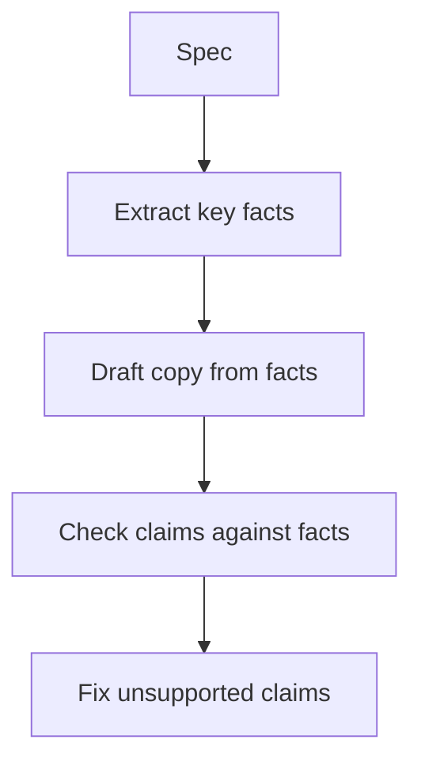

# what-is-an-agent | Workflows vs agents | 1 | 12
Pick the least autonomy that solves the problem. Agents are for tasks whose steps you cannot write down in advance.

## What it is
A workflow runs a fixed path in your code and calls the model at set points, such as classify, then draft, then check. An agent lets the model decide which step comes next. The first is predictable, cheap and easy to test. The second handles open-ended work and costs more in tokens, latency and debugging.

```mermaid A workflow follows a path your code fixed, while an agent loops and lets the model choose each next step
flowchart TD
  subgraph W[Workflow, code picks the step]
    W1[Classify] --> W2[Draft] --> W3[Check]
  end
  subgraph G[Agent, model picks the step]
    A1{Model decides} -->|Tool call| A2[Tool]
    A2 --> A1
    A1 -->|Done| A3[Final answer]
  end
  class A1 focus
```

## How to choose
Can you list the steps ahead of time? Use a workflow. Does the task branch in ways you cannot predict, like fixing an unknown bug in a codebase? Use an agent, and give it a way to check its work. Start with a single model call with good context. Add retrieval, then tools, then a loop, only when the simpler form falls short on your evals.

## A worked example: choosing
Task: tag each incoming support email as billing, bug or other. Steps are fixed: one model call per email. Use a workflow. Task: investigate why a customer's invoice is wrong. The steps depend on what is found. Use an agent with tools for invoices and account history, with limits and a person to approve changes.

## What the extra autonomy costs
Take the email tagger and give it an agent loop. Invented numbers for illustration. The email is 500 tokens. Each tool result adds 300 tokens, and every call resends everything so far.

The workflow makes one call and sends 500 tokens. The agent makes four calls and sends 500, 800, 1,100 and 1,400 tokens, which is 3,800 in total. That is 7.6 times the input for a task that needed one call.

The table counts the input tokens each call sends. The agent resends the growing history every time, so its total is 7.6 times the workflow's.

| Setup | Call | Tokens sent | Running total |
|---|---|---|---|
| Workflow | 1 | 500 | 500 |
| Agent | 1 | 500 | 500 |
| Agent | 2 | 800 | 1,300 |
| Agent | 3 | 1,100 | 2,400 |
| Agent | 4 | 1,400 | 3,800 |

Cost is only part of it. The agent might also take a different route on each run, so the same email can get two different tags.

## What goes wrong: an agent where a workflow would do
The symptom is a system that works in the demo and disagrees with itself in testing. Run the same 20 emails twice and count how many get a different tag. A fixed workflow, with randomness turned down where the model allows it, should disagree far less. If the agent disagrees often, the freedom it has is not buying anything.

## A middle path: one loop inside a workflow
You do not have to pick one side. Keep the fixed steps in code and allow a loop in only the step that needs it. For the invoice question, fetching the invoice and the account can be two fixed calls. Only the step "work out why the totals differ" needs a loop. The loop then has a small job, a short step limit and a narrow set of tools, so it is cheap to test and hard to derail.

```mermaid Only the middle step of the invoice question gets a loop, and the rest stays fixed code
flowchart TD
  F1[Fetch the invoice] --> F2[Fetch the account]
  F2 --> L[Loop: work out why totals differ]
  L --> L2[Short step limit, narrow tools]
  L2 --> A[Answer]
  class L focus
```

## Common mistake
Building an agent because the word is exciting.

```resources
article | Building effective agents | https://www.anthropic.com/engineering/building-effective-agents | Anthropic | The reference for workflow versus agent and when to use each.
article | A practical guide to building agents | https://cdn.openai.com/business-guides-and-resources/a-practical-guide-to-building-agents.pdf | OpenAI | Use-case selection and orchestration patterns.
course | AI Agents for Beginners | https://github.com/microsoft/ai-agents-for-beginners | Microsoft | Twelve lessons from fundamentals to production.
```

```quiz
You can list the three steps of a task in advance. What fits best? | A fixed three-step workflow ; One autonomous agent with tools ; A swarm of cooperating agents | 0 | Known steps mean a workflow is simpler, cheaper and easier to test.
What should you do before adding an agent loop? | Add more tools to the call to cover gaps ; Check whether one good call is enough ; Pick a framework before testing anything | 1 | Each added layer costs tokens and debuggability, so add one only when your tests show a need.
A task branches in ways you cannot predict, such as fixing an unknown bug. What fits? | A single call with a much longer prompt ; A fixed chain of exactly three steps ; An agent with tools, limits and checks | 2 | Unpredictable steps are where an agent earns its extra cost.
```

```story
You want to know the cheapest flight to Lisbon next month. A fixed workflow can search one website and show the result: three steps you wrote. An agent can decide to check three sites, notice that weekday flights are cheaper, look at nearby airports and come back with options. The workflow follows your plan. The agent makes its own.
```

# agent-use-cases | Where agents work today | 1 | 12
Agents are strongest where steps vary, results can be checked and mistakes are cheap to undo.

## Working well
Coding: reading a repository, editing files and running tests gives a built-in checker. Research: gathering and cross-checking sources. Customer support: answering from a knowledge base and taking bounded actions like a refund within limits. Data work: writing and running queries, then charting results. Operations: triaging alerts and drafting runbook steps for a person to approve.

## Working poorly
Open-ended goals with no way to tell if the result is right. Long chains where each step is unreliable. Irreversible actions with no human check. Tasks a fixed script could do reliably and cheaply.

## A checklist before building
Can success be tested automatically? What is the worst thing a wrong action can do? Can it be undone? How many steps will it take, and what is the per-step failure rate? What does one run cost? If you cannot answer, start with a workflow and a human in the loop, then loosen it as evals show the agent is reliable.

## A worked example: the checklist applied
Idea: "An agent that books meetings by email." Can success be tested automatically? Partly. Worst failure? Booking the wrong person, or sharing private info. Reversible? Mostly. Steps? 4 to 8. Verdict: a draft-and-confirm workflow first, with a person approving each invite, loosened later if the pass rate is high.

## Questions that save months
What does one run cost? What is the pass rate on twenty realistic cases? Who reviews the output? What is the rollback?

## Why coding works and market research does not
Picture a coding agent fixing a bug. It edits a function and runs the tests. Three tests fail. It reads the output, edits again, and one test fails. It edits once more and all pass. At every step something outside the model said whether it was right.

Now ask an agent to write a market analysis. No test exists. The agent stops when the text sounds finished, and that is a feeling, not a check. The agent is the same in both cases. What differs is whether the task has a verdict that does not come from the model.

## What goes wrong: a confident wrong finish
The symptom is a run that ends with "done" and a tidy report, where a figure in it does not exist in any source. Confirm it by taking ten finished runs and checking every claim against its source by hand. Count the runs with at least one unsupported claim. Do this before anyone trusts the agent, and again after every change to the prompt or model.

## How much to trust twenty runs
Suppose 17 of 20 test tasks pass. That is 85 percent, but with only twenty runs the true rate could plausibly sit anywhere from about 65 to 95 percent. A second batch might give 14 of 20. Treat a small test as a rough warning light, not a measurement. To tell two versions apart, you need many more runs or a very large gap between them.

## Common mistake
Starting with the most ambitious use case instead of the most checkable one.

## Why long chains fail
Suppose each step of an agent is 95 percent reliable. After 10 steps, the chance that every step is right is 0.95^10, which is 60 percent. After 30 steps it is 21 percent. That is why useful agents have short chains, checks after each step and a person at the risky points. It is also why a tool that lets the agent verify its own work, such as a test, is worth so much.

```mermaid The chance that every step is right falls fast as a chain gets longer, even at 95 percent per step
xychart-beta
  x-axis "steps in the chain" [1, 5, 10, 20, 30]
  y-axis "chance all steps are right, percent" 0 --> 100
  line "0.95 to the power of steps" [95, 77.4, 59.9, 35.8, 21.5]
```

## Hype to discount
"Autonomous employees", agent swarms for tasks a script could do, and demos that worked once. The real limits are reliability over many steps and cost, because every step re-reads the context. The agents that work today have a narrow scope, good tools and a way to check themselves.

## How to read an agent claim
Ask four questions. What are the steps? What checks the result? What does one run cost? What is the pass rate on twenty realistic tasks?

```resources
article | A practical guide to building agents | https://cdn.openai.com/business-guides-and-resources/a-practical-guide-to-building-agents.pdf | OpenAI | Use-case selection with examples.
article | Building effective agents | https://www.anthropic.com/engineering/building-effective-agents | Anthropic | Customer support and coding as the two clearest cases.
repo | AI Agents for Beginners | https://github.com/microsoft/ai-agents-for-beginners | Microsoft | Lessons with example use cases.
article | LLM Powered Autonomous Agents | https://lilianweng.github.io/posts/2023-06-23-agent/ | Lilian Weng | Planning, memory and tool use as the three components.
article | Agents | https://huyenchip.com/2025/01/07/agents.html | Chip Huyen | Tools, planning and failure modes, in depth.
```

```quiz
Which task suits an agent best today? | Fixing a failing test in a repo ; Making money with no human oversight ; Sending legal letters without review | 0 | Tests give a built-in way to check the result.
What should you do if you cannot define success for a task? | Build a full agent now and see what happens ; Start with a workflow and a reviewer ; Add several more agents to split the work | 1 | Reliability has to be shown before autonomy is granted.
An agent is 95 percent reliable per step and a task needs 30 steps. About how often does it finish without error? | About 95 percent of the time ; About 50 percent of the time ; About 21 percent of the time | 2 | 0.95 multiplied by itself 30 times is about 0.21. Small error rates compound.
```

```story
A software team gets a flaky test failure at night. An agent reads the logs, finds the test, checks recent commits, proposes a fix in a branch and posts a summary for review in the morning. A person approves in five minutes instead of investigating for an hour. Narrow job, clear check, reviewed output: that is where agents shine today.
```

# agent-loop | The agent loop | 2 | 15
A while loop with a model call inside. Understanding the loop is understanding agents.

## The steps
1. Send the model the goal, the history and the tool definitions.
2. If the reply is a tool call, run it.
3. Append the call and its result to the history.
4. Call the model again.
5. If the reply is a final answer, stop.

Around the loop, add limits: a maximum number of steps, a cost cap and a timeout. Also log every call, so you can see what the agent did, and give a person a way to interrupt.

```mermaid The model never runs a tool itself, since your program sends each call on and returns the result
sequenceDiagram
  participant P as Your program
  participant M as Model
  participant T as Tool
  P->>M: Goal, history, tool definitions
  M-->>P: Tool call, get_order
  P->>T: Run get_order
  T-->>P: Result
  P->>M: Whole history plus result
  M-->>P: Final answer
  Note over P,M: Each turn resends the whole history
```

## What goes wrong
The model picks the wrong tool, repeats the same call, or loses the goal as the history grows. Unclear tool errors make the model retry the same call over and over. Context fills with old results. Fixes are in the harness: clear tool errors, a step limit, trimming or summarizing old output and checks the agent can run itself.

## Try it
Step through the loop in the demo. Watch the context grow with each tool call, and see where the loop stops.

## A trace of three turns
Goal: "What is the total for order 8123 including shipping?" Invented token counts. The goal plus the tool definitions take 450 tokens.

Turn 1 sends 450 tokens. The model replies with a call to get_order (30 tokens). Your program runs it, and the tool result adds 100 tokens.

Turn 2 sends 450 + 30 + 100 = 580 tokens. The model calls get_shipping (30 tokens) and the result adds 120.

Turn 3 sends 580 + 30 + 120 = 730 tokens. The model writes the final answer and the loop stops.

The new information was about 280 tokens, but the loop sent 450 + 580 + 730 = 1,760. Each turn resends the whole history, so a long run costs far more than the sum of its parts.

## What goes wrong: the repeat spiral
The symptom is a log showing the same tool with the same arguments five times in a row, each returning the same result. The model does not see progress and tries again. Confirm it by logging every call and checking for identical pairs of tool name and arguments. A simple fix is for the harness to notice a repeat and either stop the run or return the message "You already tried this and got this result. Try something different."

This is what the repeat spiral looks like in a log. The log is invented, and the five identical lines are the sign.

```text
step 1  get_order {"id": "8123"}  returned: No order found
step 2  get_order {"id": "8123"}  returned: No order found
step 3  get_order {"id": "8123"}  returned: No order found
step 4  get_order {"id": "8123"}  returned: No order found
step 5  get_order {"id": "8123"}  returned: No order found
harness  Repeat detected: "You already tried this and got this result. Try something different."
```

## When the loop is the wrong tool
Read the logs of twenty runs. If every run makes the same three calls in the same order, the model is not deciding anything. Write those three calls as plain code and skip the loop. It will be faster, cheaper and easy to test.

## Where this connects
Agents need tests of their own, and the loop needs limits for cost and steps. See [Trajectory evals for agents](/ai/docs/evals-and-safety/agent-evals) and [Human approval](/ai/docs/production/human-in-the-loop).

## The code
The loop from the steps above, in Python. It stops when the model answers, and also after 10 steps. Tool results go back in a message with the role "user", because from the model's side your program is the one answering its request. `tools` is the list of tool definitions and `run_tool` is your function that runs one, as in the tool-use lesson.

```python
from anthropic import Anthropic

client = Anthropic()  # reads ANTHROPIC_API_KEY from the environment

def run_agent(goal, tools, run_tool, max_steps=10):
    messages = [{"role": "user", "content": goal}]
    for _ in range(max_steps):
        reply = client.messages.create(model="claude-sonnet-5-5", max_tokens=1000, tools=tools, messages=messages)
        messages.append({"role": "assistant", "content": reply.content})
        if reply.stop_reason != "tool_use":
            return reply.content[0].text  # no tool call: this is the final answer
        results = []
        for block in reply.content:
            if block.type == "tool_use":
                try:
                    output = run_tool(block.name, block.input)
                except Exception as e:  # return the error as a result so the model can recover
                    output = f"Error: {e}"
                results.append({"type": "tool_result", "tool_use_id": block.id, "content": str(output)})
        messages.append({"role": "user", "content": results})
    return "Stopped: step limit reached."
```

```resources
article | How to build an agent | https://ampcode.com/how-to-build-an-agent | Thorsten Ball | A complete agent in a few hundred lines. Read the code.
article | LLM Powered Autonomous Agents | https://lilianweng.github.io/posts/2023-06-23-agent/ | Lilian Weng | The planning, memory and tool components around the loop.
repo | smolagents | https://github.com/huggingface/smolagents | Hugging Face | A small library where the loop is easy to read.
course | Hugging Face Agents Course | https://huggingface.co/learn/agents-course | Hugging Face | Free course that builds agents step by step.
```

```quiz
What ends an agent loop? | The model answers, or a limit stops it ; It stops after exactly ten steps always ; It stops once the first tool call returns | 0 | The loop runs until the model answers or a step, cost or time limit stops it.
The agent calls the same failing tool again and again. What is the best fix? | A higher temperature to try other ideas ; A clear error message plus a retry limit ; A longer system prompt with more warnings | 1 | The model needs to learn what went wrong, and the harness must cap retries.
Your loop has no step limit and the model keeps calling tools. What could happen? | The model stops by itself after three calls ; The API rejects the very first tool call ; A runaway loop that racks up a large bill | 2 | Without limits, a confused agent can keep going. Cap steps, cost and time.
```

```story
A new employee is told "find out why the checkout page is slow". They look at one thing, then decide what to look at next based on what they found, repeating until they have the answer. An agent loop is exactly that: look, decide, act, look at the result, decide again.
```

# tool-design | Designing tools for agents | 2 | 12
Your code does the same thing every time for the same input. The model does not. A tool is the agreement between them, so design it for the model, not for a human developer.

## Principles
Fewer, higher-level tools beat many thin ones. A single "search customers by name" tool is easier to use well than five separate API calls the model must string together. Write descriptions as if for a new colleague, with when to use it and examples. Return what the model needs, in readable form, not raw database rows ("Order 8123, shipped Tuesday, $42" rather than every column). Offer filters, or return only a few results at a time, so a call cannot return 40,000 tokens. Make errors instructive: say what failed and what to try.

## Test them with the model
Run realistic tasks, read the transcripts, and look for confusion. Common signs are wrong tool picks, wrong arguments and over-calling (using a tool when it is not needed). Revise descriptions and responses, then rerun the same tasks and compare.

## A worked example: a tool description
Weak: "search - searches stuff". Better: "search_orders - find orders for a customer. Use when the user asks about past purchases. Input: customer_email (required), status (optional: open, shipped, cancelled). Returns up to 5 orders as id, date, total, status." The better one tells the model when to use it, what to pass and what comes back.

## How the model sees your tools
The model never sees your code. It sees each tool's name, description and argument schema as text, and your program sends all of them on every call. Invented numbers: 30 tools at 150 tokens each is 4,500 tokens of definitions per call. A task with 10 calls resends 45,000 tokens of tool text before any real work.

```mermaid Tool definitions are resent on every call, so a 10-call task carries thousands of tokens of tool text, at an invented 150 tokens per tool
xychart-beta
  x-axis "tools offered" [5, 10, 20, 30]
  y-axis "tool text sent over 10 calls, tokens" 0 --> 50000
  bar [7500, 15000, 30000, 45000]
```

Size is only one side. With 30 similar options, the model has more chances to pick the wrong one. This is part of why fewer, clearer tools work better.

```mermaid The model sees only the tool text your program sends, and your code runs on its side of the line
flowchart TD
  D[Name, description, schema] -->|Sent as text every call| M[Model]
  M -->|Tool call with arguments| P[Your program]
  P --> C[Tool code]
  C -->|Result| P
  P -->|Result as text| M
  class D focus
```

## What goes wrong: overlapping tools
You have search_customers and find_user, and both can look up a person by email. The symptom is that the model picks one on Monday and the other on Tuesday, or picks whichever name sounds nicer. Confirm it by asking the same ten questions and tallying which tool is called. If one question splits close to evenly, the tools overlap. Merge them, or write in each description when it should not be used.

## When fewer tools goes too far
Taken to the extreme, you could offer one tool, do_anything(action, params). Its schema says nothing about what is valid, so you cannot validate arguments. You also cannot allow reading while blocking deleting, because every action looks the same. Merge tools that do the same job. Keep separate the ones with different risks, such as read_order and cancel_order.

## Common mistake
Returning raw database dumps. Shape the result for a reader with limited attention.

```resources
article | Writing effective tools for AI agents | https://www.anthropic.com/engineering/writing-tools-for-agents | Anthropic | Prototype, evaluate with agents, then iterate.
docs | Tool use best practices | https://docs.anthropic.com/en/docs/build-with-claude/tool-use/overview | Anthropic | Official guidance on schemas and descriptions.
```

```quiz
What is wrong with a tool that returns 40,000 tokens of raw rows? | It floods the context and buries key facts ; It arrives too fast for the model to read ; It breaks the tool's declared JSON schema | 0 | Return concise, relevant results and offer filters or pagination.
How do you know a tool is well designed? | Its description is very long and thorough ; Agents use it correctly on real tasks ; It exposes many options and parameters | 1 | Evaluate by running tasks and reading transcripts.
Two tools, search_orders and find_orders, confuse the model. What is the best fix? | Rename them so the names look neater ; Add a third similar tool to cover the gap ; Merge them or sharpen both descriptions | 2 | Overlapping tools make the model guess. Clear, distinct descriptions help.
```

```story
A shop gives its assistant two tools: get_order and cancel_order. A third tool, run_sql, is tempting because it can do everything, but it makes the assistant likely to write risky queries. Fewer, safer tools that match real tasks work better than one super tool.
```

# tool-errors-and-validation | When tools fail, and tool inputs are still inputs | 2 | 12
Tool calls fail and tool arguments are written by a model. Handle both as you would handle any untrusted input.

## Validate arguments
The model produces the arguments. They can be missing, the wrong type or dangerous. Validate against the schema before running anything. A "search" tool that builds a SQL string from the argument is an injection hole. Use parameterized queries, allowlists and limits. Treat the model like a user who may be tricked.

## Return failures as results
If a tool fails, do not crash the loop. Return an error message as the tool result, written for the model: what failed and what to try. "No results for 'gift cards 2019'. Try a broader query or remove the year." The model can then retry with changes. Cap retries so a persistent failure ends the run with a clear message.

## Keep the results honest
Return real data, not guesses, and say when a result is empty or truncated. Pass back any reasoning or tool-call items the provider requires in the next call, since dropping them can degrade behavior or cause an error. Log each call, its arguments and the result for later review.

## Check the data path
Before wiring a tool into an agent, call it by hand with typical and bad inputs and read what it returns. A tool that works alone but returns a 40,000-token blob will wreck the agent's context.

## A worked example: validating
Tool delete_file(path). The model passes "../../etc/passwd". Validation checks that the path stays inside the project folder and refuses with "Path must be inside the project." The model learns the rule and retries with a valid path. The check lives in code, not in the prompt.

## Limits on retries
Three attempts is a typical cap. After that, stop and report what was tried. An agent that retries forever burns money.

## Three kinds of failure, three messages
Not every problem should be handled the same way.

A bad argument is the model's fault. Return "order_id must be digits only, got '#8123'". The model fixes it and retries.

A broken tool is the world's fault, such as a timeout. Return "The order service timed out. Retrying once may work." The harness can retry once itself.

An empty result is not a failure at all. Return "No order with id 8123 exists." Retrying will not help. The model should tell the user, not try again.

If all three return the same vague "Error", the model guesses, and often retries the one case that cannot work.

```mermaid Each kind of failure gets its own message, so the model knows whether to fix, wait or stop
flowchart TD
  T[Tool call] --> R{What happened?}
  R -->|Bad argument| A[Message: fix the argument]
  R -->|Service broken| B[Message: retry may work]
  R -->|Nothing found| C[Message: no such order]
  A --> M[Model retries]
  B --> H[Harness retries once]
  C --> U[Model tells the user]
```

## What goes wrong: the silent empty result
A tool catches every exception and returns an empty string. The model reads "nothing came back" as "no order exists" and tells the user their order is missing. The symptom is a confident wrong answer, while the logs show the tool returning empty at the same moment the database was down. Confirm it by switching off the service the tool depends on and reading what the tool returns. It should say it failed.

## Check the value, not just the type
A schema can say quantity is an integer, and 1,000,000 is an integer. Types are only the first filter. Add checks on meaning: a refund must not exceed the order total, a date must not be in the past, a path must stay in the project folder. Put these checks in code beside the tool, where the model cannot talk its way around them.

```mermaid Arguments pass a schema check and then a meaning check in code before the tool runs
flowchart TD
  M[Model writes arguments] --> S{Fits the schema?}
  S -->|No| E[Error result to the model]
  S -->|Yes| V{Value makes sense?}
  V -->|No| E
  V -->|Yes| R[Run the tool]
  class E warn
  class R good
```

The table sends four sets of arguments through both checks. The limit of 100 per order and the amounts are invented.

| Arguments the model sent | Schema check | Meaning check | Outcome |
|---|---|---|---|
| quantity = "three" | Fails, not an integer | Not reached | Error: quantity must be a whole number |
| quantity = 1,000,000 | Passes | Fails, above the limit of 100 | Error: quantity must be 100 or less |
| refund = 90 on an order of 42 | Passes | Fails, above the order total | Error: refund cannot exceed 42 |
| path = "docs/guide.md" | Passes | Passes, inside the project folder | The tool runs |

## Common mistake
Trusting that arguments will be shaped as described. Models make typos and can be manipulated.

```resources
article | Writing effective tools for AI agents | https://www.anthropic.com/engineering/writing-tools-for-agents | Anthropic | Error messages and responses designed for models.
docs | Handle tool calls | https://docs.anthropic.com/en/docs/build-with-claude/tool-use/implement-tool-use | Anthropic | Returning results and errors to the model.
article | OWASP Top 10 for LLM Applications | https://genai.owasp.org/llm-top-10/ | OWASP | Insecure output and excessive agency risks.
```

```quiz
A tool call fails. What should the loop do? | Return an instructive error, cap retries ; Crash the loop and show an error page ; Ignore the failure silently and carry on | 0 | The model can recover when the error says what to try.
Why validate tool arguments? | Arguments are always right but slow to read ; The model can send wrong or unsafe values ; Schemas are optional for nearly every tool | 1 | Arguments come from a model that may be mistaken or manipulated.
A search tool builds a SQL string from the model's argument. What is the safe change? | Trust the argument because a model wrote it ; Ask the model to avoid special characters ; Use parameterized queries and an allowlist | 2 | Treat model output like user input: never build raw queries from it.
```

```story
A tool is asked to look up order "ABC" and crashes because order ids are numbers. If the loop crashes too, the user sees nothing. If the tool returns "No order with id ABC. Order ids are numbers like 8123. Ask the customer for the number.", the agent recovers and asks the right question. Good errors turn failures into next steps.
```

# workflow-patterns | Workflow patterns | 2 | 15
Five patterns cover most useful systems that are not full agents.

## The patterns
Prompt chaining: break a task into steps where each output feeds the next, with checks between. Routing: classify the input and send it to a specialized prompt or model. Parallelization: run independent subtasks at once, or run the same task several times and vote. Orchestrator-workers: a lead model splits an unpredictable task and delegates pieces to workers. Evaluator-optimizer: one model drafts, another critiques, and the loop repeats until the criteria are met.

## Choosing
Chain when the task splits cleanly. Route when inputs differ in kind. Parallelize for speed or confidence. Use orchestrator-workers when subtasks are not known beforehand. Use evaluator-optimizer when you have clear criteria and revision helps. Each pattern adds calls, so add one only when it improves a measured result.

The table puts the five patterns side by side.

| Pattern | Use it when | Calls it adds |
|---|---|---|
| Prompt chaining | The task splits cleanly into steps | One per step |
| Routing | Inputs differ in kind | A classifier call, then one handler |
| Parallelization | You want speed or confidence | One per subtask or vote |
| Orchestrator-workers | Subtasks are not known beforehand | A lead call plus one per worker |
| Evaluator-optimizer | You have clear criteria and revision helps | A draft, then a check and a revision per round |

## A worked example: prompt chaining
Task: write a product page. Step 1: extract key facts from the spec as bullets. Step 2: draft copy from the bullets. Step 3: check the copy against the bullets and list any claim not supported. Step 4: fix those. Each step is small and checkable, so errors are caught early.



## A worked example: routing
An incoming message is classified as billing, technical or sales. Each category goes to a prompt (or model) tuned for it. A cheap model does the classification, a stronger one handles the technical cases.

```mermaid Routing sends each message to the prompt or model tuned for its kind
flowchart TD
  M[Incoming message] --> C[Cheap model classifies]
  C -->|Billing| B[Billing prompt]
  C -->|Technical| T[Stronger model]
  C -->|Sales| S[Sales prompt]
```

## Parallelization with a vote
Ask the model three times to label a message. The labels come back bug, bug, billing. The majority is bug. That costs three calls instead of one.

Invented math: if one call is right 80 percent of the time and the three runs make independent mistakes, the majority is right when at least two are right. That is 3 × 0.8 × 0.8 × 0.2 + 0.8³ = 0.384 + 0.512 = 0.896, about 90 percent. The catch is the word independent. If the model misreads a kind of message the same way every time, three votes give the same wrong answer.

The table repeats that math for more votes, with the same 80 percent per call and independent mistakes. Each extra pair of votes buys less than the one before.

| Calls voting | Majority is right |
|---|---|
| 1 | 80.0 percent |
| 3 | 89.6 percent |
| 5 | 94.2 percent |
| 7 | 96.7 percent |

## How evaluator-optimizer stops
The loop needs an exit. A common version is: draft, then a critic checks the draft against written criteria, then the writer revises. It stops when every criterion passes or after three rounds, whichever comes first.

Two failures to watch for. A critic with vague criteria always finds something to improve, so the loop runs to the cap. Or the revisions flip back and forth between two versions. Confirm either one by saving every round and comparing round 2 with round 4. If they are near identical, cut the loop and fix the criteria.

```mermaid The evaluator-optimizer loop has an exit, either every criterion passes or three rounds are used up
flowchart TD
  D[Writer drafts] --> C[Critic checks criteria]
  C --> Q{Pass or round 3?}
  Q -->|No| R[Writer revises]
  R --> C
  Q -->|Yes| O[Stop]
  class Q focus
```

## When one prompt beats all of them
Before adding a pattern, run the single plain call on your test set. If it gets 90 of 100 right, a three-step chain has to beat 90 to justify three times the calls. Often the better fix is a clearer prompt, not more structure.

## Common mistake
Adding patterns without measuring. Each extra call adds cost, time and failure points.

```resources
article | Building effective agents | https://www.anthropic.com/engineering/building-effective-agents | Anthropic | Defines and illustrates all five patterns.
repo | Claude Cookbooks: agent patterns | https://github.com/anthropics/claude-cookbooks/tree/main/patterns/agents | Anthropic | Runnable notebooks for each pattern.
course | Agentic AI | https://www.deeplearning.ai/courses/agentic-ai/ | Andrew Ng, DeepLearning.AI | Reflection, tool use, planning and multi-agent, with evals.
```

```quiz
Which pattern fits "different inputs need different handling"? | Routing to specialized handlers ; Prompt chaining in a fixed order ; Evaluator-optimizer feedback loops | 0 | Routing classifies the input and sends it to a specialized handler.
Which pattern needs clear criteria to work well? | Routing between handlers ; Evaluator-optimizer loops ; Parallelization of subtasks | 1 | The evaluator needs something concrete to judge against.
A product page needs facts extracted, copy drafted, then checked against the facts. Which pattern is this? | A router between handlers ; An orchestrator and workers ; A prompt chain of steps | 2 | A fixed sequence where each step feeds the next is a chain.
```

```story
A newsroom has an assembly line: a reporter drafts, an editor checks facts, a copy editor polishes. Nobody decides the order each time. Workflow patterns are assembly lines made of model calls, for tasks where the steps are known.
```

# agent-memory | Memory and state | 2 | 12
The model remembers nothing between calls. Memory is whatever your system stores and puts back in the window.

## Kinds of memory
Working memory is the current context. Session memory is a log or summary of what happened so far. Long-term memory is facts and preferences stored outside the window, usually as files, a database or a vector index, and retrieved when relevant. Procedural memory is instructions and skills that tell the agent how to do things.

## Practical design
Start with plain files: a progress notes file, a decisions log and the project memory file. They are readable, diffable and easy to edit. Add retrieval only when the notes outgrow the window. The hard problems are choosing what to write down, avoiding stale or wrong facts, and forgetting on purpose. Anything the agent writes to memory can be wrong, so treat it as a hypothesis to verify.

## A worked example: a notes file
After each session the agent appends to notes.md: "User prefers metric units. Project uses PostgreSQL 15. Decision 3 May: use queue for emails." At the next session it reads the file first. Plain text, readable by you, editable by you. Later, if the file grows, add search over it.

## How a note gets back into the window
The model does not read your notes file by itself. At the start of each session your harness reads the file and pastes it into the prompt, so the text is in the window again.

That has a price. Invented numbers: the file is 2,000 tokens and grows by 200 tokens a session. Every call carries it. After 40 sessions it is 10,000 tokens on every call, even when most lines are irrelevant. That is the point where search over the notes starts to pay for itself.

```mermaid A notes file that grows by 200 tokens a session adds 10,000 tokens to every call after 40 sessions, with invented numbers
xychart-beta
  x-axis "sessions so far" [0, 10, 20, 30, 40]
  y-axis "notes tokens on every call" 0 --> 10000
  bar [2000, 4000, 6000, 8000, 10000]
```

```mermaid Memory is just a file the harness pastes back into the prompt at the start of each session
flowchart TD
  S1[Session ends] -->|Agent appends| N[(notes.md)]
  N -->|Harness reads at start| H[Harness]
  H -->|Pasted into prompt| W[Context window]
  W --> M[Model call]
  class N focus
```

## What goes wrong: stale memory
A note says "The project uses PostgreSQL 15." The team has since moved to 16. The agent reads the note, trusts it, and writes code for the old version. The symptom is an agent acting confidently on a fact that was once true. Confirm it by asking the agent where it got the fact, then checking the date on that note. Fix it by dating every entry and having the agent check anything it can look up, such as a version, before acting on it.

## When memory is the wrong tool
Do not copy into notes what the agent can read from the source. A list of files in the repo goes out of date on the next commit, while the repo itself is always right. Use memory for what cannot be recovered: what the user prefers, which approach was chosen and why, and which attempts already failed.

## Common mistake
Building a complicated memory system before trying a notes file.

```resources
repo | mem0 | https://github.com/mem0ai/mem0 | Mem0 | A memory layer for agents with extraction and retrieval.
repo | Letta | https://github.com/letta-ai/letta | Letta | Stateful agents with self-managed memory, from the MemGPT line of work.
article | Effective context engineering for AI agents | https://www.anthropic.com/engineering/effective-context-engineering-for-ai-agents | Anthropic | Structured note-taking and just-in-time retrieval.
```

```quiz
Where should an agent's notes start out? | In plain files it can read and you edit ; In a vector database the agent maintains ; In the model's weights through fine-tuning | 0 | Files are simple and inspectable. Add retrieval only when you need it.
Why treat remembered facts as hypotheses? | They always cost too much to store ; They can be wrong or out of date ; Models tend to ignore saved notes | 1 | Memory written by a model can contain errors that then compound.
A user moves to a new database and the notes still say PostgreSQL. What is this problem? | A tokenization error in the saved notes ; A normal feature of long-term memory ; A stale memory that needs updating | 2 | Deciding when something is out of date, and forgetting it, is one of the hard parts.
```

```story
A good barista remembers that you order a flat white with oat milk. They do not remember it from a book. They remember because they noticed it once and kept it. Agent memory is the same two steps: decide what is worth keeping, and bring it back when it is useful.
```

# persisting-conversations | Saving and resuming agent conversations | 2 | 10
An agent's state is its message list. Save it and you can resume, audit and replay.

## What to store
The full ordered list of messages, including tool calls and tool results, plus metadata: user id, model and prompt version, timestamps and token counts. Store one row per message or one document per conversation. Include a version of your message format so old conversations still load after you change it.

## Practical rules
Keep each conversation private to its owner. Redact secrets and personal data you do not need. Add a retention limit. Treat stored history as untrusted: it may contain injected text from earlier tool results.

## A worked example: what a saved record looks like
conversation_id, user_id, created_at, model "sonnet-5-5", prompt_version "v14", messages: [ {role: user, text: ...}, {role: assistant, tool_call: search(...)}, {role: tool, result: ...}, ... ]. When the user returns, load the list, add the new message and send. If it is too long, summarize the oldest part and keep the last few turns.

Here is the same record laid out as JSON, with invented values. Each tool call and its result share an id, which is what lets a trim or a crash check keep them paired.

```json
{
  "conversation_id": "c_1042",
  "user_id": "u_77",
  "created_at": "2026-03-02T09:14:00Z",
  "model": "sonnet-5-5",
  "prompt_version": "v14",
  "format_version": 2,
  "messages": [
    {"role": "user", "text": "Where is my last order?"},
    {"role": "assistant", "tool_call": {"id": "t1", "name": "search_orders", "args": {"customer_email": "ana@example.com"}}},
    {"role": "tool", "tool_call_id": "t1", "result": "Order 8123, shipped Tuesday, $42"},
    {"role": "assistant", "text": "Order 8123 shipped on Tuesday."}
  ]
}
```

## Resuming, step by step
1. Load the saved messages by conversation id.
2. Check the owner is the current user.
3. Check the format version and convert old records if needed.
4. Append the new user message and save it right away.
5. Count tokens. If over budget, trim or summarize.
6. Send, then save each reply and tool result as it arrives, not once at the end.

Saving as you go matters. If the process dies midway, you lose one step, not the whole conversation.

## What goes wrong: a crash between call and result
The assistant's tool call was saved, then the server crashed before the tool result was written. On resume, the history has a call with no result. The major provider APIs reject a tool call that has no matching result, so the symptom is an error that only affects conversations that were interrupted. Confirm it by scanning saved conversations for tool calls without a matching result. On load, either drop the dangling call or add a result saying "interrupted before finishing".

```mermaid A crash between saving the call and saving the result leaves a call with no result
sequenceDiagram
  participant S as Server
  participant H as Saved history
  participant T as Tool
  S->>H: Save the assistant tool call
  S->>T: Run the tool
  Note over S,T: Server crashes here
  Note over H: Call is saved, result is not
  S->>H: Later, resume and load history
  Note over S,H: Provider rejects a call with no result
```

## Trimming without losing the goal
Suppose a conversation has 40 messages and is too long. Keep the first message, since it holds the original goal. Replace messages 2 to 33 with one summary message. Keep the last 7 turns as they are. That is 1 + 1 + 7 = 9 messages instead of 40. Check that a tool call and its result are kept or dropped together, never split.

```mermaid Trimming keeps the first message, one summary and the last turns, which is 9 messages instead of 40
flowchart TD
  A[40 messages] --> B[Message 1, the goal]
  A --> C[Messages 2 to 33, one summary]
  A --> D[Last 7 turns, unchanged]
  B & C & D --> E[9 messages sent]
  class E good
```

## Common mistake
Trimming messages by cutting in the middle of a tool call, leaving a result with no matching call.

```resources
article | Effective context engineering for AI agents | https://www.anthropic.com/engineering/effective-context-engineering-for-ai-agents | Anthropic | Trimming and summarizing long histories.
repo | LangGraph persistence | https://langchain-ai.github.io/langgraph/concepts/persistence/ | LangChain | Checkpointing agent state as a built-in feature.
repo | 12-Factor Agents | https://github.com/humanlayer/12-factor-agents | HumanLayer | Own your state and make agents resumable.
```

```quiz
What is the state of a simple agent? | Its list of messages so far ; Its model weights, saved to disk ; Its API key and account login | 0 | Save the list and the agent can resume.
Why keep a tool call with its matching result when trimming history? | It makes the stored history much shorter ; APIs reject a result with no matching call ; It looks neater when the logs are printed | 1 | The pair must stay together.
A user asks you to delete their data. What does this imply for saved conversations? | Nothing, since conversations are temporary ; Only the most recent message must be deleted ; You need a way to find and erase their chats | 2 | Stored history is personal data, so keep it private, deletable and short-lived.
```

```story
A user starts a research task on Monday, closes the tab, and returns Wednesday. If the app saved the conversation, the agent picks up exactly where it left off. If not, the user starts over. Saving the message list is the simplest way to give an agent continuity.
```

# multi-agent | Multi-agent systems | 3 | 15
Several agents help when work is parallel and independent. They hurt when work is tightly coupled.

## When it helps
Research across many sources, audits of many files and independent verification all split cleanly. Each subagent gets its own context window, so the lead agent's context stays small. In Anthropic's multi-agent research system, a lead agent plans and spawns subagents that search in parallel, and the setup outperformed a single agent on broad research questions, using far more tokens.

## When it hurts
Coding tasks where pieces depend on each other, because agents make conflicting assumptions. Anything where coordination cost exceeds the work. Remember that token use multiplies with each agent. Rules of thumb: give each subagent a clear objective, output format and boundaries, scale the number of agents to the difficulty, and have the lead synthesize rather than relay.

## A worked example: when it pays off
Question: "Compare five competitors' pricing." Five subagents each research one competitor and return a short structured summary. The lead agent merges them into a table. Time drops from one long run to five short ones in parallel. Token use goes up because each agent reads its own sources.

```mermaid The lead agent sends one slice to each subagent and merges five short summaries into a table
flowchart TD
  Q[Compare five competitors] --> L[Lead agent plans]
  L --> A1[Subagent 1] & A2[Subagent 2] & A3[Subagent 3] & A4[Subagent 4] & A5[Subagent 5]
  A1 & A2 & A3 & A4 & A5 -->|Short summaries| M[Lead merges]
  M --> T[Pricing table]
  class L focus
```

## A case where it hurts
Two agents editing different parts of the same program must agree on the interface between them. If they decide separately, the pieces do not fit. Keep tightly coupled work in one context.

## The token arithmetic
Invented numbers. One agent researches five competitors alone and uses 100,000 tokens in one long run.

With five subagents, each reads about 60,000 tokens of its own sources, so 300,000 in total. The lead adds 20,000 for planning and merging, which makes 320,000. That is 3.2 times the tokens. In return the five readings happen at once, so waiting time drops to roughly one subagent's run.

The table sets the two setups side by side, using the same invented numbers.

| Setup | Total tokens | Waiting time | What the lead reads |
|---|---|---|---|
| One agent, five competitors in turn | 100,000 | One long run | Everything, 100,000 |
| Lead plus five subagents | 320,000 (5 x 60,000 plus 20,000) | About one subagent's run | Five summaries, 1,500 |

The lead does not see the 300,000. It sees five summaries of about 300 tokens each, 1,500 tokens in total.

## What goes wrong: summaries lose detail
The lead can only use what a subagent chose to report. If the lead later needs a number that the subagent read but left out, it is gone. A second symptom is vague task wording. If you tell two subagents "research pricing", both may cover the same competitor while a third is skipped. Confirm it by reading the task text each subagent received, then checking the merged table for duplicates and gaps. Give each one a distinct slice, a fixed output format, and a list of the fields you need.

## Common mistake
Choosing multi-agent because it looks impressive. Use it when the work splits cleanly.

```resources
article | How we built our multi-agent research system | https://www.anthropic.com/engineering/multi-agent-research-system | Anthropic | Architecture, prompt lessons, evaluation and token cost.
article | Don't build multi-agents | https://cognition.ai/blog/dont-build-multi-agents | Cognition | The counterargument: shared context and conflicting decisions.
course | AI Agents in LangGraph | https://www.deeplearning.ai/short-courses/ai-agents-in-langgraph/ | DeepLearning.AI and LangChain | Stateful, controllable orchestration.
```

```quiz
Which task suits several agents best? | Searching twenty independent sources ; Editing one function in a single file ; A tightly coupled multi-module refactor | 0 | Independent subtasks parallelize with little conflict.
What is the main cost of multi-agent systems? | More lines of text in every prompt ; Token use that grows per agent ; Slower typing speed for the user | 1 | Each agent carries its own context, so total tokens rise quickly.
Two agents edit different parts of a program that must agree on an interface. What goes wrong? | They always agree as they share a model ; Nothing, as parallel work never conflicts ; They assume different things and clash | 2 | Tightly coupled work belongs in one context.
```

```story
A newspaper researching a big story splits it: one reporter checks the financials, one interviews former employees, one reads court filings. They work at once and an editor combines the findings. Multiple agents help in the same situation: independent pieces of research done in parallel. They do not help when the pieces depend on one another.
```

# long-running-agents | Long-running agents | 3 | 15
Work that outlasts one context window needs structure: a plan, a progress file and clean handoffs.

## The problem
Over hours, context fills, coherence drops and agents may wrap up early. Compaction summarizes in place. A reset clears the window and starts a fresh agent with a written handoff. Resets give a clean slate at the cost of writing a good handoff.

## A workable design
An initializer agent expands the spec into a feature list and a setup script. A worker agent takes one feature at a time, commits and updates a progress file. An evaluator agent runs the app and the tests and reports failures with evidence. Tests and the git log are the shared state. Each agent starts by reading the progress file and the latest commits.

```mermaid Three agents share the progress file, the git log and the tests, so each one can start cold
flowchart TD
  I[Initializer agent] -->|Expands the spec| F[Feature list and setup script]
  F --> W[Worker agent, one feature]
  W -->|Commit and update| P[(Progress file and git log)]
  P --> E[Evaluator agent]
  E -->|Runs app and tests| R[Failures with evidence]
  R --> W
  class E focus
```

## A worked example: a progress file
progress.md: "Goal: build the invoicing app. Features done: login, customer list. In progress: invoice PDF export. Next: email sending. Tests: 24 passing, 2 failing (export). Notes: use the existing PDF library." A new agent session reads this file and the latest commit messages and continues in minutes.

The same progress file as a feature list. Only a passing test moves a feature to done, so the agent's own opinion never counts as finished.

| Feature | Status | Test result |
|---|---|---|
| Login | Done | Passing |
| Customer list | Done | Passing |
| Invoice PDF export | In progress | 2 failing |
| Email sending | Next | Not written yet |

## Evaluator agents
A separate agent runs the app and tests it, then writes what it found. The worker agent fixes those issues. Splitting the roles stops the worker from marking its own homework generously.

## Compaction versus reset in numbers
Invented numbers. The window holds 100,000 tokens and after hours of work 90,000 are used.

Compaction replaces the history with a 5,000-token summary and the same agent carries on. It is quick, but each summary is made from the last one, so small errors and lost details stack up.

A reset starts a new agent with a 1,000-token handoff plus the files it reads itself. It costs more effort to write the handoff, but the new agent sees the real files, not a retelling.

```mermaid Compaction keeps the same agent working from a summary, while a reset starts a fresh agent that reads the real files
flowchart TD
  subgraph C[Compaction]
    C1[90,000 tokens of history] --> C2[5,000 token summary]
    C2 --> C3[Same agent carries on]
  end
  subgraph R[Reset]
    R1[90,000 tokens of history] --> R2[1,000 token handoff]
    R2 --> R3[New agent reads the real files]
  end
```

## What goes wrong: declaring victory early
The symptom is an agent that announces "done" with five of twenty features working. The cause is that it judges completion by feel. Confirm it by comparing its claim with the feature list and the test results. The fix is to make the list the definition of done. Each feature has a status, and only a passing test may change it to done. The run ends when the list is complete, not when the agent says so.

## What a handoff must contain
The example progress file lists goals and state. Good handoffs also hold three more items:

1. The exact next step.
2. What was tried and failed, so the next agent does not repeat it.
3. How to run the tests.

Without the second item, a fresh agent often rebuilds the same dead end.

## Common mistake
Letting a single context run for hours. Quality drops. Reset with a handoff.

```resources
article | Effective harnesses for long-running agents | https://www.anthropic.com/engineering/effective-harnesses-for-long-running-agents | Anthropic | Initializer and coding agents with progress artifacts.
article | Harness design for long-running application development | https://www.anthropic.com/engineering/harness-design-long-running-apps | Anthropic | Planner, generator and evaluator over multi-hour runs.
```

```quiz
What is the difference between a reset and compaction? | A reset starts fresh, compaction trims in place ; Reset and compaction are two names for one thing ; Compaction deletes files from the project folder | 0 | A reset avoids lingering context anxiety but needs a good handoff.
What is the shared state between sessions of a long task? | The chat window that the user keeps open ; Files such as notes, tests and git history ; The model's own memory from earlier runs | 1 | Durable artifacts let a fresh agent pick up the work.
An agent marks its own work as done, but half the feature is missing. What helps? | A separate evaluator that tests the app ; A longer prompt that says to be thorough ; A larger context window for the same agent | 0 | Separating the doer from a skeptical checker stops generous self-grading.
```

```story
A marathon runner does not carry every memory of every mile in their head. They carry a plan, check the watch, and refuel at stations. A long agent run is similar: it cannot carry everything in its context, so it uses a plan, a progress file and checkpoints.
```

