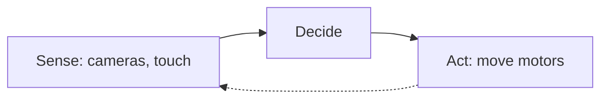
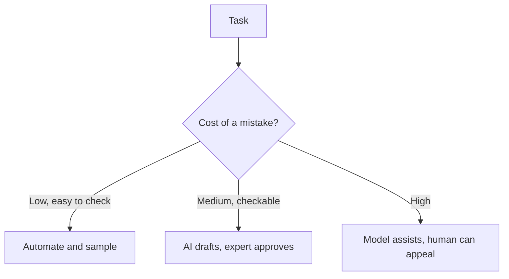

# what-is-applied-ai | What applied AI is and how to pick a problem | 1 | 12
Applied AI means using models that already exist to solve a real problem for real people. The hard part is rarely the model. It is choosing a problem where a model helps and measuring whether it did.

## What it is
Research AI builds new models and methods. Applied AI takes a model, connects it to data and tools, tests it and fits it into a job someone already does. Most of the AI work in the world is applied.

Most applied problems fall into a few kinds of task. Predict a number (next month's sales). Sort things into groups (fraud or not fraud). Rank things (which video to show next). Read or write language. Understand images or sound. Choose actions in the physical world (a robot arm). Each kind has its own tools, covered in the lessons that follow.

## Picking a problem
Ask four questions. How often does the task happen? A task done once a year is not worth automating. What does a mistake cost? A wrong movie suggestion costs nothing, a wrong drug dose costs a lot. Do you have data, or can you get it? Can you tell if the answer was right? If you cannot measure success, you cannot improve it.

## A worked example: start with a baseline
A shop wants to predict which customers will cancel. Before any model, write the simplest rule: "customers who have not logged in for 30 days will cancel". Say it catches 40 of the 100 who cancel. That rule is your baseline. A model is only worth its cost if it beats the baseline by enough to matter. Many projects find that the rule gets most of the value.

## Scoring a task before you build
Count the hours first. Frequency times minutes per case gives the yearly or monthly load. Tagging 300 support tickets a month at 2 minutes each is 10 hours. Reviewing 40 contracts a month at 90 minutes each is 60 hours. The second is the bigger prize, but a mistake there costs more and needs a lawyer to check. Neither wins on size alone.
1. Write the task as input and output.
2. Multiply frequency by time per case.
3. Name the cost of a wrong output.
4. Find 50 past cases with known right answers.

If step 4 is impossible, you cannot tell whether a model works, so stop there.

The table scores the two example tasks side by side.

| | Tagging support tickets | Reviewing contracts |
|---|---|---|
| Cases per month | 300 | 40 |
| Minutes per case | 2 | 90 |
| Hours per month | 10 | 60 |
| Cost of a wrong output | Low | High, and a lawyer must check |

```mermaid Two gates can stop a project early: no past cases to measure with, or a model that does not beat the baseline rule
flowchart TD
  T[Task as input and output] --> H[Hours: frequency times time]
  H --> C[Cost of a wrong output]
  C --> D{50 past cases with answers?}
  D -->|No| S[Stop: cannot measure]
  D -->|Yes| B[Write a baseline rule]
  B --> M{Model beats baseline?}
  M -->|No| K[Keep the rule]
  M -->|Yes| G[Use the model]
  class S bad
  class G good
```

## A second example: when a rule is enough
A store wants to flag refunds over $500 for a manager. That is a threshold, not a prediction. One line of code does it, never tires and can be explained to an auditor. A model adds cost and uncertainty with nothing to gain. Use learned models when the pattern is too fuzzy to write down, such as spotting a likely cancellation from dozens of weak signals.

## What goes wrong: a good score nobody can use
A shop's cancellation model is better than the 30 day rule. It catches 55 of the 100 who cancel, against 40. But the retention team can phone only 50 customers a month. What matters is how many real cancellations sit in the 50 names the model ranks highest, not the overall score. To confirm, rank by the model's score, take the top 50, and count the real cancellations among them. Test against the capacity you actually have.

## Common mistake
Starting with "we should use AI" instead of "this task costs us 200 hours a month". A tool searching for a problem usually finds a demo, not a result.

```resources
article | Rules of Machine Learning | https://developers.google.com/machine-learning/guides/rules-of-ml | Google | Practical advice, starting with "do not be afraid to launch without machine learning".
article | People + AI Guidebook | https://pair.withgoogle.com/guidebook/ | Google PAIR | How to decide whether and how AI fits a product.
article | Stanford AI Index | https://hai.stanford.edu/ai-index | Stanford HAI | Yearly data on how AI is used across industries.
course | Kaggle Learn | https://www.kaggle.com/learn | Kaggle | Short free lessons with code on applied machine learning.
```

```quiz
Which task is the best first candidate for AI? | A rare task where every mistake is very costly ; A one-off task with no way to measure the result ; A frequent task with data and a success test | 2 | Frequent, measurable tasks with data are where a model can be tested and improved.
Why write a simple rule before building a model? | It sets a baseline the model must beat ; It makes the model train faster overall ; It removes the need to collect any data | 0 | Without a baseline you cannot tell whether the model adds value.
A team says "let us add AI" with no problem named. What is the risk? | The model will be too expensive to ever run ; They build a demo that solves nothing ; They will run out of training data too soon | 1 | A solution without a problem has no way to measure success.
```

```story
A regional bakery chain hears that AI can forecast demand and hires a consultant. Before buying anything, the manager writes down last week's sales for each shop and guesses "same as the same day last week". That guess is wrong by about 8 percent. Any model now has a clear number to beat, and the manager can tell whether it was worth the cost.
```

# recommenders-and-ranking | Recommendation and ranking systems | 2 | 14
A recommender decides what to show you next. It works by turning people and items into lists of numbers and finding the pairs that fit.

## What it is
A recommender (or recommendation system) suggests items: videos, songs, products, posts. The classic idea is collaborative filtering: people who liked the same things in the past will probably like the same things in the future. You do not need to know anything about the items, only who interacted with what.

Modern systems learn an embedding (a list of numbers) for each user and each item, so a good match is a high dot product, the same operation you meet in the Building Blocks chapter. Large services work in two steps. First a fast stage picks a few hundred candidates from millions. Then a slower, more careful model ranks those few hundred.

## A worked example
A user is the vector [0.9, 0.1]: loves action, barely cares about romance. Movie A is [0.8, 0.2], mostly action. Movie B is [0.1, 0.9], mostly romance. Dot product with A: 0.9 × 0.8 + 0.1 × 0.2 = 0.74. With B: 0.9 × 0.1 + 0.1 × 0.9 = 0.18. A ranks first. In real systems the vectors have hundreds of numbers and the model learns them from clicks and watch time.

```mermaid Each movie is scored by a dot product with the user vector, and the highest score is shown first
flowchart TD
  U[User vector 0.9 and 0.1] --> DA[Dot product with A]
  U --> DB[Dot product with B]
  MA[Movie A 0.8 and 0.2] --> DA
  MB[Movie B 0.1 and 0.9] --> DB
  DA --> SA[Score 0.74]
  DB --> SB[Score 0.18]
  SA & SB --> R[A ranks first]
  class R good
```

## What goes wrong
The cold start problem: a new user or a new item has no history, so there is nothing to match. Systems fall back to popular items or ask a few questions. A feedback loop: if you only show what people already click, you never learn what else they would like. The target matters too: optimizing clicks can promote sensational items, while optimizing "watched to the end" rewards something different.

## How collaborative filtering finds a match
Three users and four movies. Ana liked movies 1 and 2. Ben liked 1, 2 and 3. Cy liked only 4. Ben shares both of Ana's likes, Cy shares none. So Ben is Ana's nearest neighbor, and the system suggests movie 3 to Ana, which Ben liked and she has not seen. Embeddings do the same job with numbers and scale to millions of users.

The table shows who liked what. Ben matches both of Ana's likes, so his movie 3 goes to Ana.

| User | Movie 1 | Movie 2 | Movie 3 | Movie 4 |
|---|---|---|---|---|
| Ana | liked | liked | no record | no record |
| Ben | liked | liked | liked | no record |
| Cy | no record | no record | no record | liked |

## Why two stages
Invented numbers: a careful model takes 2 milliseconds per item. Scoring 5,000,000 items takes 10,000 seconds, nearly three hours, for one page view. The cheap first stage cuts that to 500 candidates, and the careful model then scores them in 1 second. The cost is that anything the first stage drops can never be recommended, so a weak first stage caps quality.

```mermaid A fast stage trims millions of items so a slower, careful model only scores a few hundred
flowchart TD
  A[5,000,000 items] --> F[Fast stage]
  F --> C[500 candidates]
  C --> R[Careful model ranks]
  R --> P[Page of results]
  F -.->|Dropped items are gone| X[Never recommended]
  class X bad
```

## What goes wrong: counts are not rates
Two videos are equally liked: half of the viewers click either one. The system shows video X to 900 users and video Y to 100. X gets 450 clicks, Y gets 50. Ranked by click count, X looks nine times better, and gets shown even more tomorrow. Compare clicks per view instead, and both are 50 percent. To confirm, check whether the top items are simply the ones shown most. Showing a small share of random items keeps feeding the system fresh evidence.

The table ranks the two videos by count and by rate.

| Video | Shown to | Clicks | Rank by clicks | Clicks per view |
|---|---|---|---|---|
| X | 900 | 450 | First | 50 percent |
| Y | 100 | 50 | Second | 50 percent |

## How to tell a new ranking is better
Split 20,000 users in two equal groups. Version A gets a click rate of 4.0 percent and version B 4.3 percent. The random wobble in the difference between two groups of 10,000 is about 0.28 percentage points. The measured gap is 0.3, barely more than one wobble, so it could be luck. You would need more users or a longer test before shipping B.

## Common mistake
Measuring only accuracy on past data. What counts is what happens when real users see the new ranking, so teams run A/B tests that compare two versions on live traffic.

```resources
course | Recommendation Systems | https://developers.google.com/machine-learning/recommendation | Google | A short course on candidate generation, scoring and ranking.
article | Netflix Prize | https://en.wikipedia.org/wiki/Netflix_Prize | Wikipedia | The contest that made collaborative filtering famous, and why the winning model was not shipped.
article | System Design for Recommendations and Search | https://eugeneyan.com/writing/system-design-for-discovery/ | Eugene Yan | How real recommenders split into candidate retrieval and ranking.
```

```quiz
What does collaborative filtering rely on? | Overlap in what people have liked ; The text description of every item ; A hand-written list of rules for taste | 0 | It only needs the record of who interacted with which items.
A brand new user opens the app. Which problem appears? | Overfitting, since there is too much data ; Cold start, as there is no history yet ; Latency, since the model is too large | 1 | With no past behavior, the system has nothing to compare.
Why do big systems use a candidate stage first? | It lets them skip the ranking step altogether ; It is cheaper than using a vector database ; It avoids slow ranking of every single item | 2 | A fast filter narrows millions to hundreds so a careful model can rank them.
```

```story
In 2006 Netflix offered one million dollars to anyone who could improve its movie predictions by 10 percent. A team won in 2009 with a blend of many models. Netflix later said it never ran the full winner, because the engineering cost was too high for the gain. Simple and good enough often beats best on paper.
```

# forecasting-and-fraud | Forecasting, fraud and anomaly detection | 2 | 15
Many valuable AI systems predict a number or flag the odd one out. They use classical machine learning on tables, not chatbots.

## What it is
Forecasting predicts a future value from past values: sales, energy use, traffic. A good forecast starts with a naive guess such as "same as last week" and then adds patterns like trend and season. Classification sorts cases into labels, such as fraud or not. Anomaly detection finds cases that look unlike normal ones when you have few or no labeled examples of the bad kind.

For tables of numbers, simple models (linear models, decision trees, boosted trees) often match or beat large neural networks, train in seconds and are easier to explain.

## A worked example: forecast error
Actual sales over three days: 100, 120, 110. Forecast: 105, 115, 120. Errors: 5, 5, 10. The mean absolute error is (5 + 5 + 10) / 3 = 6.7 units a day. The naive "same as yesterday" forecast can only be scored on days 2 and 3: it predicts 100 and 120, so it is off by 20 and 10, a mean of 15. On those same two days the model is off by 5 and 10, a mean of 7.5, so it beats the baseline.

## A worked example: rare events
Out of 100,000 card payments, 100 are fraud. A model that always says "not fraud" is 99.9 percent accurate and catches nothing. This is class imbalance. Use precision (of the cases flagged, how many were right) and recall (of the real cases, how many were found). Say a model flags 200 payments and 80 are truly fraud. Precision is 80 / 200 = 40 percent. Recall is 80 / 100 = 80 percent. Which matters more depends on what a miss costs against what a false alarm costs. Try it in the demo above: slide the threshold and watch the false alarms rise as you catch every fraud.

The table lays out the four outcomes for the 100,000 payments.

| | Actually fraud | Actually fine |
|---|---|---|
| Flagged | 80 caught | 120 false alarms |
| Not flagged | 20 missed | 99,780 correct passes |

## A second example: a better naive forecast
Shop sales last week, Monday to Sunday, were 80, 90, 85, 95, 140, 200, 120. This week they were 84, 92, 88, 100, 150, 210, 126. Forecast Tuesday to Sunday two ways. "Same as yesterday" is off by 8, 4, 12, 50, 60 and 84, an average of 36.3. "Same day last week" is off by 2, 3, 5, 10, 10 and 6, an average of 6.0. The weekly pattern is the signal, so repeat the season, not the last value. Any model must beat 6.0.

```mermaid Two weeks of shop sales: the weekly shape repeats, so the same day last week is a strong guess
xychart-beta
  x-axis [Mon, Tue, Wed, Thu, Fri, Sat, Sun]
  y-axis "sales" 0 --> 250
  line "last week" [80, 90, 85, 95, 140, 200, 120]
  line "this week" [84, 92, 88, 100, 150, 210, 126]
```

| Day | Actual | Same as yesterday | Error | Same day last week | Error |
|---|---|---|---|---|---|
| Tue | 92 | 84 | 8 | 90 | 2 |
| Wed | 88 | 92 | 4 | 85 | 3 |
| Thu | 100 | 88 | 12 | 95 | 5 |
| Fri | 150 | 100 | 50 | 140 | 10 |
| Sat | 210 | 150 | 60 | 200 | 10 |
| Sun | 126 | 210 | 84 | 120 | 6 |
| Average error | | | 36.3 | | 6.0 |

## How an anomaly score works
A customer's daily spending over five days was 30, 45, 38, 52 and 35 dollars. The mean is 40 and the standard deviation, a measure of typical spread, is about 7.7. A payment of 130 sits (130 - 40) / 7.7 = 11.7 spreads above the mean, a clear outlier. A payment of 55 sits 1.9 spreads away and is normal. The threshold is a choice. Flag everything beyond 3 spreads and, if spending were bell-shaped, about 0.3 percent of ordinary payments still trip it. On 100,000 payments that is roughly 270 false alarms.

## What goes wrong: information from the future
A model reports 99 percent recall on test data, then collapses live. One cause is leakage: a feature that is only known after the answer. For fraud, a field like "chargeback filed" is filled in after fraud is found, so the model just reads it. Symptom: one feature dominates and the score is too good. To confirm, drop that feature and watch the score fall. Ask of each column, "would I know this at the moment I must decide?"

```mermaid Leakage is a column that is filled in only after the answer is known, so the model reads the answer
flowchart TD
  P[Payment arrives] --> D[Decision moment]
  D --> F[Fraud is found later]
  F --> C[Chargeback filed field set]
  C -.->|In training data only| D
  class C bad
```

## Common mistake
Using accuracy on rare events, or testing on data from before the model's training period. Test on later data than you trained on, since the model will always be used on the future.

```resources
book | Forecasting: Principles and Practice | https://otexts.com/fpp3/ | Hyndman and Athanasopoulos | Free, practical book on forecasting methods.
docs | scikit-learn: outlier detection | https://scikit-learn.org/stable/modules/outlier_detection.html | scikit-learn | Methods for flagging unusual cases, with code.
course | Kaggle Learn: Intro to Machine Learning | https://www.kaggle.com/learn/intro-to-machine-learning | Kaggle | Build a first model on a table in an hour.
```

```quiz
A model says "not fraud" every time and is 99.9 percent accurate. What does this show? | Accuracy misleads on rare events ; The model is nearly perfect already ; The dataset is too big to be useful | 0 | With rare positives, always guessing the common label looks accurate while finding nothing.
Why compare a forecast against "same as last week"? | It is the cheapest method to compute ; It proves the data is free of errors ; It sets a bar any model must beat | 2 | A forecast is only worth its cost if it beats the simple guess.
When is anomaly detection a good fit? | You have thousands of labeled examples of each case ; You have few labeled examples of bad cases ; You need to sort items into known categories | 1 | It finds cases that differ from normal without needing labels for the rare kind.
```

```story
In 2021 the real estate company Zillow shut down its house-buying business after its pricing models paid more for homes than it could resell them for, losing hundreds of millions of dollars. Home prices moved faster than its forecasts, which is the risk of every prediction about the future.
```

# computer-vision-in-practice | Computer vision in practice | 2 | 14
Computer vision means models that work with images and video. In practice, the hard parts are the data, the cost of mistakes and the camera.

## What it is
The main jobs are classification (what is in this image), detection (where are the objects, drawn as boxes), segmentation (which pixels belong to which object) and reading text (OCR). Modern systems start from a model pretrained on millions of images and fine-tune it on a few hundred of your own, which makes small projects possible. Vision-language models can also answer questions about an image in plain words, which is often enough for simple cases.

## Where it is used
Factories check parts for defects on a conveyor belt. Farms spot diseased plants from drone photos. Hospitals use models that flag suspicious areas on scans for a doctor to review. Banks read cheques and invoices. Phones unlock with a face. In each case a human usually reviews the uncertain cases.

## A worked example: a screening test
A hospital screens 1,000 scans. Ten show disease. The model finds 9 of the 10 (recall 90 percent) and raises 50 false alarms. It flagged 59 scans, of which 9 are real, so precision is 9 / 59, about 15 percent. That can still be a good screening tool, because a doctor reviews 59 scans instead of 1,000 and only 1 case was missed. The numbers decide whether it helps, not the headline accuracy.

The table sorts the 1,000 scans into the four outcomes.

| | Has disease | No disease |
|---|---|---|
| Flagged | 9 found | 50 false alarms |
| Not flagged | 1 missed | 940 correct passes |

## What goes wrong
Models learn shortcuts. A classifier trained on photos from one hospital may be reading the scanner's label, not the disease. A model trained in good light fails at night. Always test on images from a different place and time than the training set, and keep checking after launch because cameras and conditions change.

## How a detection gets scored
A detector draws a box. To grade it, compare with the true box using intersection over union, or IoU: the overlap area divided by the combined area. Say the true box covers x from 0 to 10 and y from 0 to 10, and the prediction covers x from 5 to 15 and y from 0 to 10. The overlap is 5 × 10 = 50. The union is 100 + 100 - 50 = 150. IoU is 50 / 150 = 0.33. Teams choose a cutoff, often 0.5, and count a box as correct only above it. This is why a box that "looks about right" can still count as a miss.

The table works out the overlap and union for the two boxes.

| Box | x range | y range | Area |
|---|---|---|---|
| True box | 0 to 10 | 0 to 10 | 100 |
| Predicted box | 5 to 15 | 0 to 10 | 100 |
| Overlap | 5 to 10 | 0 to 10 | 50 |
| Union | | | 150 |
| IoU | | | 50 / 150 = 0.33 |

## Routing by confidence
A model gives each image a score between 0 and 1. Invented example with 1,000 images: 800 score above 0.9 and pass automatically, of which 4 are wrong (0.5 percent). The other 200 go to a person, and 30 of them are wrong, which the person fixes. People handle 20 percent of the load, and, if the reviewer catches every error, the final error rate is 0.4 percent. The catch is calibration: whether a score of 0.9 really means 90 percent right. To check, group past predictions by score and compare each group's true accuracy with its score. Models are often too sure of themselves.

```mermaid A confidence cutoff sends most images through and the unsure ones to a person
flowchart TD
  I[1,000 images] --> S{Score above 0.9?}
  S -->|Yes, 800| A[Pass automatically]
  S -->|No, 200| P[Person reviews]
  A --> E1[4 wrong, kept]
  P --> E2[30 wrong, fixed]
  class E1 warn
  class E2 good
```

## When a simple sensor wins
A packing line needs to know whether a box has a bottle in it. A weight sensor or a light beam answers in a fraction of a millisecond, costs little and does not care about lighting. Use vision when the question depends on appearance, such as a scratch or a label. If a cheaper signal answers the question, use that.

## Common mistake
Training and testing on images from the same camera session. The score looks great and falls apart in the real world.

```resources
course | Hugging Face Computer Vision Course | https://huggingface.co/learn/computer-vision-course | Hugging Face | Free course from basics to modern models.
paper | Dermatologist-level classification of skin cancer | https://www.nature.com/articles/nature21056 | Esteva et al. | A well-known study of a vision model on medical images.
repo | Tesseract OCR | https://github.com/tesseract-ocr/tesseract | Tesseract | A widely used open-source tool for reading text in images.
course | Practical Deep Learning for Coders | https://course.fast.ai/ | fast.ai | Hands-on course that builds image classifiers early on.
```

```quiz
What does object detection return? | One label for the whole image ; Boxes around each object found ; The text written inside the image | 1 | Detection says what is in the image and where it is.
Why can a model with low precision still help in screening? | Staff review far fewer cases than before ; It guarantees it never misses a real case ; It removes every false alarm before review | 0 | A human checks the flagged few, which saves time if recall stays high.
A model works in the lab but fails on the factory floor. A likely cause? | The factory has fewer total images to check ; The model was written in the wrong language ; Lighting and cameras differ from the lab | 2 | A change in conditions between training and use breaks learned shortcuts.
```

```story
A car parts maker photographs every brake disc on a conveyor belt. The first model rejects good discs when a shadow falls across them, because most defect photos in the training set were taken on a darker shift. Adding photos from every shift and a lamp over the belt fixes more than a bigger model would have.
```

# speech-and-voice | Speech recognition and voice assistants | 2 | 13
Voice systems turn sound into text, think about it, and turn text back into sound. Each step adds delay, and delay decides whether it feels like a conversation.

## What it is
Speech recognition (ASR, or speech-to-text) converts audio to words. Text-to-speech (TTS) does the reverse. A voice assistant chains the two around a language model: listen, transcribe, think, write a reply, speak it. Some newer models take audio in and give audio out directly, which cuts steps and keeps tone.

Open models such as Whisper made good transcription cheap for many languages. Accuracy is measured with word error rate (WER): the number of substitutions, deletions and insertions divided by the number of words in the true transcript.

```mermaid A voice assistant chains recognition, a language model and speech, and each step adds delay
flowchart TD
  U[User speaks] --> A[Speech recognition]
  A --> L[Language model]
  L --> T[Text-to-speech]
  T --> H[User hears reply]
```

## A worked example: word error rate
The speaker says "turn the lights off in the kitchen" (7 words). The system writes "turn the light off in kitchen". One word is changed (lights to light), one is missing (the). That is 1 substitution + 1 deletion = 2 errors over 7 words, a WER of 2 / 7, about 29 percent.

Lined up word by word, the two errors are easy to see.

| Position | Spoken | System wrote | Result |
|---|---|---|---|
| 1 | turn | turn | correct |
| 2 | the | the | correct |
| 3 | lights | light | substitution |
| 4 | off | off | correct |
| 5 | in | in | correct |
| 6 | the | nothing | deletion |
| 7 | kitchen | kitchen | correct |

## A worked example: the delay budget
Transcribing takes 0.3 seconds, the model 0.6 and speech 0.3. Total 1.2 seconds before the user hears anything. People notice gaps in talk quickly, so teams stream everything: start speaking the first sentence while the model writes the second, and stop the voice at once if the user interrupts.

## Where it is used
Meeting notes and captions, call-centre assistants, voice control in cars, language practice, and tools that read text aloud for people with low vision. Accents, background noise, and names are the usual failures, so test with the speakers you will actually serve.

## What WER hides
WER counts every word equally. "Take fifteen milligrams twice a day" heard as "take fifty milligrams twice a day" has one error in six words, a WER of 17 percent. The same score applies if the system just drops "a". The first is dangerous and the second is harmless. Report WER on the words that matter, such as names, numbers and drug names, as well as overall.

## Averages hide groups
Invented numbers: 80 speakers have a WER of 6 percent and 20 speakers with a regional accent have 18 percent. Overall: 0.8 × 6 + 0.2 × 18 = 8.4 percent. That looks fine, yet one in five users has a poor experience. To confirm, split your test audio by accent, microphone and noise, and compute WER for each group.

## The wait before the delay budget
The 1.2 second budget starts after the user stops talking, but the system must first decide they have stopped. It waits for a pause, typically a fraction of a second (say 0.7 seconds). Add that and the total becomes 1.9 seconds. A shorter wait makes the assistant talk over people who pause to think. A longer wait feels slow. Streaming helps the other end: if speech starts when the model has written its first sentence, say 0.2 seconds into its 0.6, the first sound arrives 0.3 + 0.2 + 0.1 = 0.6 seconds after the pause ends, or 1.3 seconds after the user stopped talking. The 0.1 second speaking start-up is invented.

```mermaid The wait for a pause comes before the delay budget starts, which raises the total from 1.2 to 1.9 seconds
flowchart TD
  S[User stops talking] --> W[Wait for pause, 0.7 s]
  W --> A[Transcribe, 0.3 s]
  A --> M[Model, 0.6 s]
  M --> T[Speak, 0.3 s]
  T --> H[Total 1.9 s]
  class W warn
```

```mermaid Seconds from the user stopping to the first sound, when waiting for every step and when streaming (the 0.1 second start-up is invented)
xychart-beta
  x-axis [No streaming, Streaming]
  y-axis "seconds" 0 --> 2
  bar [1.9, 1.3]
```

## Common mistake
Testing with clean studio audio. Real users talk in cars and kitchens, and the error rate there can be several times higher.

```resources
repo | Whisper | https://github.com/openai/whisper | OpenAI | Open speech recognition model for many languages.
course | Hugging Face Audio Course | https://huggingface.co/learn/audio-course | Hugging Face | Free course on speech and audio models.
paper | Robust Speech Recognition via Large-Scale Weak Supervision | https://arxiv.org/abs/2212.04356 | OpenAI | The Whisper paper: how a speech model is trained and how its error rate is measured.
```

```quiz
What does word error rate measure? | How fast the system answers a question ; How many words in the audio are wrong ; How natural the voice sounds to people | 1 | WER counts substitutions, deletions and insertions against the true words.
Why do voice assistants stream their output? | It makes the transcript more accurate in noise ; It lets them store the audio for later use ; It speaks before the whole answer exists | 2 | Streaming overlaps the steps, which cuts the wait the user feels.
A demo works in a quiet room. What should you do next? | Test with noise, accents and real names ; Launch it, since the demo proves it works ; Switch to a bigger language model first | 0 | Real conditions raise error rates, so test in them before launch.
```

```story
A clinic records doctor visits so notes write themselves. In the quiet demo the transcripts are nearly perfect. In real rooms, with a printer humming and a patient mumbling a drug name, it confuses two medicines that sound alike. The clinic adds a drug-name list and makes the doctor confirm each medication before the note is saved.
```

# robotics-and-automation | Robotics and process automation | 2 | 13
AI in the physical world is harder than AI on a screen, because the world pushes back. Process automation, which only moves data, is far easier and far more common.

## What it is
A robot works in a loop: sense (cameras, touch), decide, act (move motors), and repeat many times a second. Older robots followed fixed programs and needed a controlled setting, like a car factory line. Newer approaches learn from demonstrations or from trial and error in simulation, and some models take camera images and an instruction in words and output motor actions.

Process automation is software doing office work: reading an invoice, filling a form, routing a ticket. Language models made it flexible, since they can read messy inputs that rules could not handle.



## Why physical AI is hard
Every step can fail, and errors add up. Training in simulation is cheap and safe, but a model trained there can fail on a real robot because friction, lighting and wear differ. This is the sim-to-real gap. Real-world data is slow and costly to collect, since a robot can only do so many attempts per hour.

## A worked example: errors multiply
A robot completes each of 10 steps in a task with 95 percent success. All ten succeed with probability 0.95 to the power 10, about 0.60. A task that looks 95 percent reliable per step fails four times in ten. Reaching 99 percent per step lifts the whole task to about 0.90.

## Where it is used
Warehouse picking, vacuum robots, surgical assistance under a surgeon's control, crop harvesting, and automated invoice handling in finance teams. Start with the cases where the environment is controlled and a person can step in.

## Retries change the multiplication
The worked example assumes one failed step ruins the task. If the robot can notice a failed grasp and try once more, a 95 percent step succeeds with probability 1 - 0.05 × 0.05 = 0.9975. Over ten steps that gives 0.9975 to the power 10, about 0.975, instead of 0.60. This holds only if failures are independent and detectable. A robot that does not know it dropped the part cannot retry, so sensors that check each step are worth as much as better arms.

```mermaid A robot that can notice a failed step and retry once fails far less often
flowchart TD
  A[Attempt the step] --> C{Step worked?}
  C -->|Yes| N[Next step]
  C -->|No| R[Retry once]
  R --> C2{Step worked?}
  C2 -->|Yes| N
  C2 -->|No| F[Task fails]
  class F bad
```

```mermaid Chance that every step of a task succeeds: 95 percent per step decays fast, 99 percent holds up, and one retry rescues 95 percent
xychart-beta
  x-axis "steps in the task" [0, 2, 4, 6, 8, 10]
  y-axis "chance all steps succeed" 0 --> 1
  line "95 percent per step" [1, 0.9025, 0.8145, 0.7351, 0.6634, 0.5987]
  line "99 percent per step" [1, 0.9801, 0.9606, 0.9415, 0.9227, 0.9044]
  line "95 percent with one retry" [1, 0.995, 0.99, 0.9851, 0.9802, 0.9753]
```

## The loop has a delay
Invented numbers: a belt carries parts at 0.5 meters per second, and the camera-decide-move loop takes 0.3 seconds. The part moves 0.5 × 0.3 = 0.15 meters, 15 centimeters, before the arm acts. The arm must aim where the part will be, not where it was seen. Slower loops or noisy timing show up as grasps that miss by a steady distance in the direction of travel.

## A second example: automation that fails quietly
A model reads invoices and fills the total. One supplier writes "1.250,00", with a dot for thousands and a comma for decimals. The model reads it as 1.25. The symptom is totals wrong by a factor of 1,000 for one supplier, with no error message. A cheap check catches this: add up the line items and compare with the total, and send any mismatch to a person. Where invoices come in one fixed template, a plain parsing rule is cheaper and exact.

## Common mistake
Treating a smooth demo video as proof. Ask how many attempts it took and how often the robot failed.

```resources
repo | LeRobot | https://github.com/huggingface/lerobot | Hugging Face | Open models, data and tools for real-world robotics.
article | RT-2: vision-language-action models | https://robotics-transformer2.github.io/ | Google DeepMind | A model that turns images and instructions into robot actions.
paper | Domain Randomization for Transferring Deep Neural Networks from Simulation to the Real World | https://arxiv.org/abs/1703.06907 | Tobin et al. | A classic attack on the sim-to-real gap.
```

```quiz
What is the sim-to-real gap? | A simulation differs from the real world ; Real robots cost much more than simulated ones ; Robots move more slowly than their software | 0 | Friction, light and wear in the real world are not captured in simulation.
A task has 10 steps, each 95 percent reliable. About how often does it fully succeed? | About 95 percent of the time ; About 60 percent of the time ; Roughly 10 percent of the time | 1 | 0.95 multiplied ten times is about 0.60, because errors compound.
Why is invoice automation easier than a warehouse robot? | The invoices have fewer words to process ; Robots cannot read printed text or labels ; Mistakes are cheap and easy to undo | 2 | Software tasks are reversible and cheap to retry, unlike physical movement.
```

```story
A warehouse robot picks items from bins with 98 percent success on the test shelf. On the live floor, shiny packaging confuses the cameras and the success rate drops to 90 percent. Each failed pick needs a worker to step in. The company counts the cost of those interventions before deciding how many robots to buy.
```

# ai-across-industries | AI in healthcare, finance, law, education and retail | 2 | 15
The same tools show up in every industry. What differs is the cost of a mistake, the rules, and who must stay responsible.

## What it is
Each field picks the tasks that are frequent, data-rich and checkable, and keeps people in charge of decisions that carry risk.

Healthcare: reading scans, writing visit notes, finding patients at risk. Regulators treat many of these as medical devices and expect evidence. Finance: fraud detection, credit scoring, document reading, customer chat. Decisions about credit must be explainable to the customer, and rules limit unfair bias. Law: searching cases and drafting. Lawyers remain responsible for every filing. Education: tutoring, feedback on drafts, lesson planning. The aim is learning, not finished homework. Retail: demand forecasts, recommendations, price tests, support chat.

## A worked example: choosing the control
Rate each task on two lines: cost of a mistake, and how easily a person can check it. Summarizing a meeting: low cost, easy to check, so automate and sample. Drafting a contract clause: medium cost, checkable by a lawyer, so AI drafts and a lawyer approves. Approving a loan: high cost, affects a person's life, so a model may assist but rules, explanations and a human appeal must exist. The more a mistake costs, the more control stays with a person.



## What goes wrong
Bias in data becomes bias in decisions. In 2018 Reuters reported that Amazon dropped a hiring tool trained on past resumes, because it had learned to mark down resumes that mentioned women's groups. In 2023 two New York lawyers and their firm were fined $5,000 after submitting a brief with court cases a chatbot had invented. Neither failure was about intelligence. Amazon's team tested the tool, found it was biased and shut the project down. The lawyers did not check their citations.

## How a bias check works
Take 1,000 loan applicants in each of two groups. The model approves 600 in group A (60 percent) and 420 in group B (42 percent). The ratio is 42 / 60 = 0.70. A gap this size does not prove unfairness, since the groups may differ in income or debts. It is a prompt to look closer. Compare applicants with similar finances: if group B is still approved less often at the same income and debt, the model is treating them differently and the data needs inspection. Ask which inputs act as stand-ins for the group, such as a postcode.

The table compares the two groups from the 1,000 applicants each.

| Group | Applicants | Approved | Approval rate |
|---|---|---|---|
| A | 1,000 | 600 | 60 percent |
| B | 1,000 | 420 | 42 percent |
| Ratio of B to A | | | 0.70 |

## Explaining one decision
In many countries, including the US, a person denied credit is owed reasons. With a simple scoring model each input adds or subtracts points, so the biggest negatives become the explanation. Invented example: debt ratio -40, two late payments -25, short history -5. The reply says the main factors were debt and late payments. Models that cannot produce reasons like this are hard to use in lending.

## Why human review fails
Putting a person after the AI does not guarantee checking. People skim when the tool is usually right. Say an assistant drafts 1,000 summaries and 50 are wrong. A reviewer who catches 60 percent lets 50 × 0.4 = 20 errors through. To test, secretly seed the queue with 20 known errors and count how many get caught. If the catch rate is low, change the process: show sources next to the draft, ask the reviewer to confirm specific facts, and rotate the work.

```mermaid Of 50 wrong summaries, a reviewer who catches 60 percent still lets 20 through
flowchart TD
  D[1,000 summaries] --> W[50 are wrong]
  W --> R[Reviewer catches 60 percent]
  R --> C[30 caught]
  R --> L[20 reach users]
  class L bad
  class C good
```

## Common mistake
Copying a success from another industry without its safeguards. A tool that is fine for retail support is not automatically fine for medicine.

```resources
article | AI-enabled medical devices | https://www.fda.gov/medical-devices/artificial-intelligence-enabled-medical-devices/list-artificial-intelligence-enabled-medical-devices | US FDA | The official list of AI devices cleared in the United States.
article | Stanford AI Index | https://hai.stanford.edu/ai-index | Stanford HAI | Data on adoption by industry.
article | AI Risk Management Framework | https://www.nist.gov/itl/ai-risk-management-framework | NIST | A US government framework for judging and managing AI risk.
```

```quiz
Which factor should set how much human control a task needs? | How impressive the model looks in demos ; The cost of mistakes and how checkable ; How expensive each model call is to run | 1 | High-cost, hard-to-check decisions need a person in charge.
Why did Amazon drop its resume screening tool? | It reproduced bias from past hiring data ; It was too slow for large applicant pools ; It could not read the resume formats | 0 | Learning from biased history teaches the model the same bias.
What went wrong in the court brief case? | The model's answer was in the wrong format ; Nobody checked the cited cases were real ; The court did not allow any typed filings | 1 | The tool made up cases and no person verified them before filing.
```

```story
A small law firm uses an assistant to draft a research memo. The draft cites six cases. A junior associate looks up each one and finds that two do not exist. The partner adds a rule: every citation gets opened and read by a person before anything leaves the firm. The tool still saves hours, and the rule keeps the firm out of the news.
```

# roi-and-rollout | Estimating value and rolling AI out | 2 | 14
A project succeeds when it saves more than it costs and people actually use it. Both can be estimated before you build.

## What it is
ROI (return on investment) compares what a project gains with what it costs. For AI the costs include model calls, building time, review time by people, monitoring and upkeep. The gains are time saved, errors avoided or revenue added. Teams that skip the cost side often find the gain disappears.

A rollout goes in stages: test on past cases, run beside the people doing the job (shadow mode), release to a small group, then widen. At each stage you compare against the baseline.

```mermaid A rollout widens in stages, and each stage is compared with the baseline
flowchart TD
  A[Test on past cases] --> B[Shadow mode]
  B --> C[Small group]
  C --> D[Widen]
  A & B & C & D -.-> E[Compare with baseline]
  class E focus
```

## A worked example (invented numbers)
A support team gets 10,000 tickets a month. Each takes 4 minutes at a cost of $30 an hour, so $2 a ticket, or $20,000 a month. An assistant drafts replies. It handles 30 percent of tickets with no edits, which saves $6,000. Model calls cost $0.05 a ticket, so $500 for all 10,000. A person spot-checks 5 percent of all drafts, which is 500 tickets, and a check takes as long as handling the ticket did, so that is 500 × $2 = $1,000. Net saving: 6,000 − 500 − 1,000 = $4,500 a month. If building cost $30,000, payback is about seven months. If it handled only 10 percent, the saving would be $2,000 − 500 − 1,000 = $500 and payback would take five years.

```mermaid The monthly saving is what handling saves minus model calls and spot-checks
flowchart TD
  S[Saved handling, $6,000] --> N[Net saving, $4,500]
  C[Model calls, $500] --> N
  K[Spot-checks, $1,000] --> N
  class N good
```

## After launch
Watch quality, cost and usage. Data drift means real inputs slowly change from what the system was tested on, so scores slide without any code change. Keep a test set, rerun it monthly, and keep an easy way for users to report a bad answer. A company answers for what its tools say: in 2024 a Canadian tribunal ordered Air Canada to pay a customer who relied on wrong refund advice from its website chatbot.

## Find the break-even before you build
Using the invented numbers above, fixed costs are $500 for calls plus $1,000 for checking, $1,500 a month. Each percent of tickets handled saves $200 (1 percent of $20,000). Break-even is 1,500 / 200 = 7.5 percent. Below that, the assistant loses money every month. The estimate is only as good as the 30 percent figure, so measure it before launch.

The table sweeps the share of tickets handled, with $1,500 a month of fixed costs.

| Share of tickets handled | Saving | Fixed costs | Net per month |
|---|---|---|---|
| 5 percent | $1,000 | $1,500 | -$500 |
| 7.5 percent | $1,500 | $1,500 | $0 |
| 10 percent | $2,000 | $1,500 | $500 |
| 20 percent | $4,000 | $1,500 | $2,500 |
| 30 percent | $6,000 | $1,500 | $4,500 |

## Putting error bars on the shadow-mode result
Run the assistant in shadow mode on 200 past tickets and see 60 drafts need no edits, which is 30 percent. With only 200 tickets the result has a margin of about 6 points either way (roughly 2 × sqrt(0.3 × 0.7 / 200), the sampling-error formula from the benchmarks lesson). The true rate could be 24 or 36 percent. At 24 percent the net saving is $3,300 a month and payback takes 9.1 months. At 36 percent it is $5,700 and payback takes 5.3 months. The monthly result is above break-even across the whole range. Whether a 5 to 9 month payback is acceptable is a separate decision. A range that crosses 7.5 percent would mean testing more tickets.

The table turns the shadow-mode range into payback, for the $30,000 build cost.

| Share handled | Net per month | Payback |
|---|---|---|
| 24 percent | $3,300 | 9.1 months |
| 30 percent | $4,500 | 6.7 months |
| 36 percent | $5,700 | 5.3 months |

## What goes wrong: costs the estimate misses
The example counts the 30 percent of tickets drafted well. The other drafts cost time too. Suppose 20 percent of all drafts are wrong, and each takes an extra minute to read and discard. That is 10,000 × 0.2 × 1 minute = 2,000 minutes, about $1,000 a month, which cuts the net saving to $3,500. The symptom is that drafts get accepted but tickets handled per hour barely moves. Confirm by measuring total handling time per ticket before and after, not how many drafts were accepted.

## Common mistake
Declaring victory after a demo. Adoption, review time and drift decide the real return.

```resources
article | Rules of Machine Learning | https://developers.google.com/machine-learning/guides/rules-of-ml | Google | Launch, monitor and iterate advice from experience.
paper | Hidden Technical Debt in Machine Learning Systems | https://papers.nips.cc/paper_files/paper/2015/hash/86df7dcfd896fcaf2674f757a2463eba-Abstract.html | Sculley et al. | Why running a model costs more than building it.
article | Patterns for Building LLM-based Systems | https://eugeneyan.com/writing/llm-patterns/ | Eugene Yan | Evals, guardrails and feedback loops in production.
```

```quiz
Which cost is most often forgotten in an AI project estimate? | Staff time spent reviewing outputs ; The per-token price of each model call ; The monthly fee for the cloud servers | 0 | Review and monitoring time can outweigh model call costs.
What is shadow mode? | Hiding the system from all of the users ; Training the model without using real data ; Running beside staff, taking no action | 2 | It lets you compare AI output to real decisions with no risk.
Scores drop six months after launch with no code change. What is a likely cause? | The model weights decayed over the months ; The users typed faster than before ; Data drift, since real inputs changed | 2 | Real inputs move away from the data the system was tested on.
Fixed costs are $1,500 a month and each percent of tickets handled saves $200. When does the project break even? | At 7.5 percent of tickets handled ; At 15 percent of tickets handled ; At 30 percent of tickets handled | 0 | 1,500 / 200 = 7.5 percent. Below that it loses money each month.
```

```story
A mid-sized insurer pilots a claims assistant and the demo is a hit. In shadow mode, though, its suggestions match the human decision on only 70 percent of claims, and the claims staff spend more time correcting drafts than writing them. The insurer narrows the tool to one claim type where it matches 95 percent, and that is where it pays off.
```
