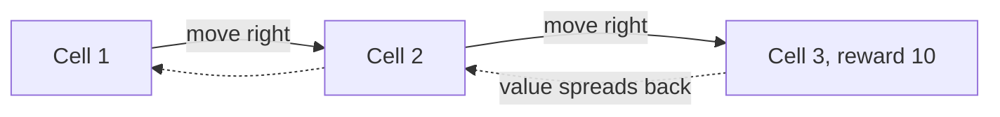

# vision-and-image-generation | Vision and image generation | 1 | 15
Computers learned to see around 2012. A decade later they learned to draw.

## Seeing
Before 2012, image recognition used hand-designed features. AlexNet, a convolutional neural network (a network that slides small filters across an image to detect edges, then shapes, then objects), cut the ImageNet error rate sharply. Later models like ResNet passed human-level accuracy on that benchmark. Vision models now power photo search, medical imaging support, self-driving perception and document reading.

## Drawing
Generative adversarial networks (GANs, 2014) pitted a generator against a critic to produce realistic images. Diffusion models took over from 2020. A diffusion model is trained by adding noise to images step by step and learning to reverse it. To generate, it starts from pure noise and removes it step by step, guided by a text prompt. DALL-E, Midjourney and Stable Diffusion (open weights, 2022) made this mainstream. Video models such as Sora extended the idea to moving images.

## Why it matters
The same pattern of a scalable architecture, lots of data and lots of compute drove both. It also raised real questions about training data rights, deepfakes and provenance, which the field is still working out.

## A worked example: how a filter finds a face
A small filter, say 3 by 3 pixels, slides across the image. Where the pixels look like a vertical edge the filter produces a high number. Many filters produce many maps: edges, then corners, then eyes and noses. Stack layers and the last one says "face". The network learns the filters from examples. This sliding filter is called a convolution.

```mermaid Stacked filters build from edges to corners to parts to the final label
flowchart TD
  A[Image] --> B[Edge filters]
  B --> C[Corner and curve filters]
  C --> D[Eyes and noses]
  D --> E[Last layer says face]
  class B focus
```

The table slides a 3 by 3 vertical edge filter along an invented image six columns wide, where every row reads 0 0 0 9 9 9 (dark to bright). Each row of the filter holds -1, 0 and 1, so a window scores high only where the left side is darker than the right.

| Window | Columns covered | Pixels in each row | Output |
|---|---|---|---|
| 1 | 1 to 3 | 0 0 0 | 0 |
| 2 | 2 to 4 | 0 0 9 | 27 |
| 3 | 3 to 5 | 0 9 9 | 27 |
| 4 | 4 to 6 | 9 9 9 | 0 |

The high numbers mark the windows that straddle the edge, and the flat dark and flat bright windows score zero.

## A worked example: diffusion in four steps
Start with a clean photo of a dog. Add a little random noise, then more, until it is pure static. Train a network to guess the noise that was added at each step. To generate, start from static and repeatedly subtract the guessed noise, steered by your text prompt "a dog wearing a hat". After about 20 to 50 steps an image appears.

```mermaid Diffusion learns to undo noise, then generates by removing noise from static
flowchart TD
  subgraph Training
    C[Clean photo] --> N[Add noise step by step]
    N --> S[Pure static]
    N -.-> G[Network learns to guess the noise]
  end
  subgraph Generation
    S2[Start from static] --> D[Subtract guessed noise, 20 to 50 steps]
    D --> I[Image appears]
    P[Text prompt] -.-> D
  end
  G -.->|the trained guesser is reused| D
  class D focus
```

## How the filters get their values
A filter is a small grid of numbers. At the start those numbers are random. The network sees a labelled photo, makes a guess and measures how wrong it was (the loss). Gradient descent then nudges every filter number a little in the direction that shrinks the loss. After millions of photos, the early filters turn into edge detectors, because edges help with almost every recognition task. Nobody types them in. A 3 by 3 filter holds 9 numbers, so a layer of 32 such filters on a black-and-white image holds 9 × 32 = 288 numbers.

## Why drawing takes many small steps
Removing all the noise in one jump gives a blurry average of everything the model has seen. Small steps let it commit to details gradually. Early steps tend to settle the rough layout and colors, and later steps add texture and sharp edges. A guidance setting controls how strongly your text pulls on each step. Too low and the image ignores your words. Too high and images often look harsh and overdone.

## When the result is wrong
The symptom is a hand with six fingers, a sign with scrambled letters, or three apples when you asked for four. The cause is that the model learned what these things usually look like, not the rules behind them. A recognition model that only saw bright daytime photos can also fail at night, because the pixels look unlike its training data. To check whether a flaw is a model limit or bad luck, repeat the prompt with ten different random seeds (the seed fixes the starting noise). If most of the ten share the flaw, it is the model.

## Try it yourself: count the apples
Open any free image generator. Ask for "a hand holding four red apples" five times. Count the fingers and the apples in each image. Then add detail ("on a white table, daylight, photo") and repeat. Counting errors are common, especially above three or four objects, and often persist while the style changes. Treat that as a sign the model copies appearance more than it counts.

## Common mistake
Believing the image model understands what it draws. It captures how things usually look. That is why hands, text and counting objects were hard for early versions.

```resources
paper | Denoising Diffusion Probabilistic Models | https://arxiv.org/abs/2006.11239 | Ho, Jain, Abbeel | The paper that made diffusion practical.
article | The Illustrated Stable Diffusion | https://jalammar.github.io/illustrated-stable-diffusion/ | Jay Alammar | A visual walkthrough of how text becomes an image.
article | Convolutional Neural Networks for Visual Recognition | https://cs231n.github.io/convolutional-networks/ | Stanford CS231n | Notes that explain convolutions clearly.
video | But how do AI images and videos actually work? | https://www.youtube.com/watch?v=iv-5mZ_9CPY | 3Blue1Brown | Diffusion and CLIP explained visually.
```

```quiz
How does a diffusion model make an image? | It copies the closest image it saw in training ; It paints the image one pixel at a time ; It cleans up random noise step by step | 2 | It is trained to reverse a noising process, and applies that reversal at generation time.
What did AlexNet show? | Learned features beat hand-designed ones ; Hand-designed features still win on images ; GPUs are too slow to train big networks | 0 | It started the deep learning era in vision.
A diffusion model draws six fingers on a hand. What is the most likely reason? | It ran out of memory midway through drawing it ; It learned how hands look, not how they work ; The prompt was longer than the image allows | 1 | The model captures typical appearance without understanding structure, which is why hands and text were hard.
```

```story
A radiologist reviews hundreds of scans a day. A vision model flags the ten that look suspicious, so the radiologist looks at those first. It does not replace the doctor. It decides where their attention goes. That pattern, AI as a very fast first look, shows up across medicine, farming and manufacturing.
```

# games-and-reinforcement | Games and reinforcement learning | 1 | 15
Games are clean test beds: clear rules, a score, endless practice. They showed that learning from trial and error can beat human experts.

## What happened
Deep Blue (1997) beat the chess champion with brute-force search. AlphaGo (2016) beat Lee Sedol at Go using neural networks to guess good moves and positions, trained first on human games and then by playing itself. In game two, its move 37 surprised experts as something no human would play. AlphaZero (2017) learned chess, shogi and Go from scratch with only the rules, by playing itself, and beat the best programs.

## The idea: reinforcement learning
An agent takes actions in an environment and receives rewards. It learns a policy, a rule for choosing actions, that maximizes total reward. There are no labels, only a score that arrives late. The same idea later trained language models: with a reward for correct math or passing code tests, models learned to reason in longer chains of thought.

```mermaid An agent acts, the environment answers with a reward, and the agent learns a policy from that score
flowchart LR
  A[Agent] -->|action| E[Environment]
  E -->|reward and new situation| A
  class E focus
```

## Why it matters
Self-play and reward signals let a system exceed its teachers. The limit is that you need a reward you can compute. That is why reinforcement learning works best on games, math and code, where answers can be checked.

## A worked example: learning a tiny game by reward
A robot in a 3-cell corridor starts in cell 1. Cell 3 holds a reward of +10. Moving costs -1. At first it moves randomly. After a few hundred tries, it notices that moving right from cell 2 usually leads to +10 and records a high value for that action. Soon the value spreads backward: moving right from cell 1 is good too, because it leads to cell 2. This is the core idea of Q-learning.

## How the value spreads: a trace
Q-learning keeps a score for each action in each cell. After every move it updates that score with a simple rule: new score = old score + learning rate × (reward + best score of the next cell − old score). These are invented numbers for illustration. Use a learning rate of 0.5, all scores starting at 0, and a net reward of +9 for the move that reaches cell 3 (+10 minus the move cost of 1).


1. From cell 2 the robot moves right and reaches the goal. The score for "right in cell 2" becomes 0 + 0.5 × (9 + 0 − 0) = 4.5.
2. From cell 1 it moves right to cell 2, paying -1. The score for "right in cell 1" becomes 0 + 0.5 × (-1 + 4.5 − 0) = 1.75.
3. Next time it reaches the goal from cell 2, that score becomes 4.5 + 0.5 × (9 − 4.5) = 6.75.
Each pass moves the scores toward 9 for cell 2 and 8 for cell 1. Good news travels backward one cell per visit.

The table extends the three steps above to six visits, alternating between the two cells.

| Visit | Move | Cell 2 score | Cell 1 score |
|---|---|---|---|
| 0 | Start | 0 | 0 |
| 1 | Cell 2, right, reaches the goal | 4.5 | 0 |
| 2 | Cell 1, right, to cell 2 | 4.5 | 1.75 |
| 3 | Cell 2, right, reaches the goal | 6.75 | 1.75 |
| 4 | Cell 1, right, to cell 2 | 6.75 | 3.75 |
| 5 | Cell 2, right, reaches the goal | 7.875 | 3.75 |
| 6 | Cell 1, right, to cell 2 | 7.875 | 5.3125 |

The cell 1 score only rises after the cell 2 score does, which is the backward spread, and cell 2 climbs toward 9 and cell 1 toward 8.

## Explore or exploit
The agent must choose between the best action it knows and a new one. If it always picks the best known action, it can lock onto a mediocre habit and never find a better route. A common fix is to try a random action a small share of the time. Too much random play wastes effort. Too little leaves better routes undiscovered. In the corridor this is trivial. In Go the number of possible positions is so large that the balance matters a great deal.

## What goes wrong
A reward that arrives only at the end of a long game gives the agent almost nothing to learn from early on. The symptom is a score curve that stays flat for a long time. Adding small rewards along the way helps, but each one is a new chance to be gamed. Another symptom is a rising score with strange behavior. Confirm it by watching replays of the agent, not only the score chart.

## Try it yourself: three more updates
On paper, repeat the trace above for the cell 2 score. Apply the rule again and again. You should get 4.5, then 6.75, then 7.875. Then update the cell 1 score once using the new cell 2 value. The numbers climb toward 9 and 8 but never jump there at once. Ten minutes is enough, and it shows why learning takes many tries.

## Common mistake
Expecting the same method to work where there is no clear score. Defining the reward is the hard part. A badly chosen reward gets exploited: a cleaning robot rewarded for "no visible mess" may learn to hide the mess.

```resources
article | AlphaGo | https://deepmind.google/research/breakthroughs/alphago/ | Google DeepMind | The story and results of the match.
video | AlphaGo - The Movie | https://www.youtube.com/watch?v=WXuK6gekU1Y | Google DeepMind | A full documentary of the Lee Sedol match.
course | Spinning Up in Deep RL | https://spinningup.openai.com/ | OpenAI | A clear introduction to reinforcement learning concepts and code.
paper | Mastering Chess and Shogi by Self-Play with a General Reinforcement Learning Algorithm | https://arxiv.org/abs/1712.01815 | Silver et al. | The AlphaZero paper.
```

```quiz
What does a reinforcement learning agent try to maximize? | The number of labelled examples it sees ; The number of moves in each game it plays ; The total reward it collects over time | 2 | It learns actions that earn reward, not copies of labelled answers.
Why does reinforcement learning work well on math and code? | Answers can be auto-checked for reward ; Those subjects are short and simple to write ; They have the largest amount of data online | 0 | A computable reward is what the method needs.
A cleaning robot is rewarded for "no visible mess" and learns to hide mess under a rug. What went wrong? | The robot had too little time to train properly ; The reward missed the real goal and was gamed ; The robot's sensors could not see the rug | 1 | A badly chosen reward gets gamed. Defining the reward is the hard part.
```

```story
In March 2016 an AI called AlphaGo played a move in game two against champion Lee Sedol that commentators first thought was a mistake: a stone placed on the fifth line, far from the action. Professionals later called it beautiful and creative. The program had played millions of games against itself and found something people had missed for centuries.
```

# science-breakthroughs | AI in science: proteins, weather and more | 1 | 12
Pattern-finding models turned out to be useful for hard science problems with lots of data.

## Proteins
A protein is a chain of amino acids that folds into a 3D shape, and the shape determines what it does. Predicting the shape from the chain was a 50-year problem. AlphaFold 2 (DeepMind, 2020 to 2021) reached near-experimental accuracy at the CASP14 competition. DeepMind released predicted structures for hundreds of millions of proteins in a free database. In 2024 Demis Hassabis and John Jumper shared the Nobel Prize in Chemistry with David Baker for protein structure prediction and design.

## Other areas
Weather forecasting models trained on decades of data now match or beat traditional physics simulations on many measures at a fraction of the compute. Models help search for new materials and drug candidates, and they help read medical images. In math, systems solved olympiad-level problems, with some reaching gold-medal level at the International Mathematical Olympiad in 2025.

## Caveat
These systems are tools in a pipeline. Predictions need lab or expert verification, and models can be confidently wrong outside the data they were trained on.

## A worked example: why folding is hard
A short protein of 100 building blocks has an astronomical number of possible shapes. Trying them all is impossible. AlphaFold learned from about 170,000 known structures which blocks tend to sit near each other, and predicts the shape directly. The result is not magic. It is pattern knowledge from known proteins, applied to a new one.

## How the prediction works
Related proteins from different species are lined up next to each other. If two positions tend to change together across species, they are probably close in 3D, because a change at one spot needs a matching change at the other to keep the protein stable. The network learns to read these paired signals and turns them into a predicted shape. This is a simplified picture, but it shows why the method needs many known proteins to learn from.

```mermaid Positions that change together across related proteins hint that they sit close in 3D
flowchart TD
  A[Line up related proteins from many species] --> B[Find positions that change together]
  B --> C[Likely close in 3D]
  C --> D[Network turns paired signals into a shape]
  D --> E[Predicted structure]
  E --> F[Lab check before relying on it]
  class F good
```

## A second example: weather as repeated guessing
A learned weather model takes the state of the atmosphere now and predicts the state a short time ahead. To forecast further, it feeds its own output back in and repeats. If each step covers 6 hours, a 10-day forecast takes 10 × 24 ÷ 6 = 40 steps (invented step size). A small error in one step is carried into the next, so errors can grow. A physics simulation solves equations instead. A learned model copies patterns, which is why it is fast once trained but can struggle with situations that rarely appeared in its data.

```mermaid A learned weather model feeds its own output back in, so small errors can carry forward
flowchart TD
  A[Atmosphere now] --> M[Model predicts 6 hours ahead]
  M --> B[Next state]
  B -.->|fed back in, 40 times for 10 days| M
  B --> F[Forecast]
  class B warn
```

## Where it breaks
The symptom is a smooth, confident answer that is wrong for an unusual case, such as a rare extreme storm or a protein unlike any known one. Flexible protein regions that have no single fixed shape are another weak spot. To check, test the model on past events it did not train on, and report the error on the extreme cases separately from the average. A good average can hide poor results on the cases that matter most.

## Try it yourself: read a confidence map
Open the AlphaFold Protein Structure Database and search for a protein you have heard of, such as insulin. The viewer colors each region by how confident the model is. Find a region with low confidence and note where it sits. Many readers see that flexible ends and loose loops are less certain than the core. This shows that the tool reports its own doubt, and that you should read it.

## Common mistake
Treating a predicted structure as a measured one. It is a strong hypothesis. Check with experiments before relying on it for a drug.

```resources
article | AlphaFold | https://deepmind.google/science/alphafold/ | Google DeepMind | Overview and access to the structure database.
tool | AlphaFold Protein Structure Database | https://alphafold.ebi.ac.uk/ | EMBL-EBI | Look up predicted structures for proteins.
paper | Highly accurate protein structure prediction with AlphaFold | https://www.nature.com/articles/s41586-021-03819-2 | Jumper et al. | The Nature paper.
article | The Nobel Prize in Chemistry 2024 | https://www.nobelprize.org/prizes/chemistry/2024/press-release/ | Nobel Prize | The official announcement.
```

```quiz
What problem did AlphaFold address? | Reading handwritten text from old documents ; Beating human champions at the game of Go ; Predicting protein 3D shape from sequence | 2 | Protein structure prediction was a long-standing open problem.
Why should you verify AI predictions in science? | Models can fail outside their training data ; Models are usually wrong on any real protein ; Journals require a second model to agree first | 0 | Treat outputs as strong hypotheses until experiments confirm them.
A predicted protein shape suggests a drug could bind. What should happen next? | Publish the shape as if it were measured ; Test it in a lab before relying on it ; Skip testing because the model scored well | 1 | The prediction narrows the search. People and labs still confirm.
```

```story
Proteins are tiny machines that run every cell, and each one folds from a string of building blocks into a specific 3D shape. For fifty years, finding one shape could take a lab a year of expensive work. After AlphaFold, a researcher studying a disease protein can look up its predicted shape in a free database in a few seconds and decide where to spend lab time.
```

# speech-and-multimodal | Speech and multimodal models | 1 | 12
Modern models take in and produce text, images, audio and video in one system.

## Speech
Speech recognition used to need separate acoustic and language models. Whisper (OpenAI, 2022) trained a transformer on about 680,000 hours of audio from the web and became a robust open speech-to-text model across many languages. Text-to-speech now sounds natural, and real-time voice conversation is a product feature.

## Multimodal
A multimodal model maps different kinds of input into a shared representation. Images are cut into patches and turned into vectors the same way tokens are, then processed by the same transformer. This lets a model read a chart, a screenshot or a handwritten note, and describe or reason about it. CLIP (2021) trained image and text encoders so matching pairs land close together, which powers image search and guides image generation.

## Why it matters for builders
Screenshots and documents can go straight in without a separate OCR step, and voice becomes an interface. Cost and latency go up with image and audio input, so check token usage for each type.

## A worked example: image as tokens
A 224 by 224 pixel image cut into 16 by 16 pixel patches gives 14 × 14 = 196 patches. Each patch becomes a vector, like a word. A transformer then reads those 196 vectors with attention, just like words in a sentence. Add the text "What color is the car?" and the model can look at the relevant patches while it answers.

```mermaid An image becomes patch vectors that the transformer reads like words, next to the text question
flowchart TD
  A[Image 224 by 224] --> B[196 patches of 16 by 16]
  B --> C[One vector per patch]
  Q[Question text as tokens] --> T[Transformer with attention]
  C --> T
  T --> R[Answer]
  class C focus
```

## Costs to plan for
Images and audio use many more tokens than the text that describes them. A single high-resolution photo can cost as much as a few thousand words. Downscale before sending, and send audio in short segments.

```mermaid Doubling an image's width and height quadruples the patches the transformer must read, at 16 by 16 pixel patches
xychart-beta
  x-axis "image side in pixels" [112, 224, 448, 896]
  y-axis "patches" 0 --> 3300
  bar [49, 196, 784, 3136]
```

## How speech becomes text
Sound is a stream of numbers, for example 16,000 a second (a common rate). The model first turns a short clip into a spectrogram, a picture showing which pitches are loud at each moment. It then reads that picture with a transformer, much as it would read an image, and writes out text tokens one at a time. Many modern speech models, including Whisper, work in roughly this way. One second of audio at that rate is 16,000 numbers, which is why audio is heavy to process.

```mermaid Audio is turned into a spectrogram, read by a transformer, and written out as text tokens
flowchart TD
  A[Audio, 16000 numbers a second] --> B[Spectrogram of pitch over time]
  B --> C[Transformer reads it]
  C --> D[Text tokens, one at a time]
  class B focus
```

## A second example: invoice, image or text?
You need to pull the total from a scanned invoice. Option one: run OCR (software that turns a picture of text into text) and send only the text. It is cheap, but it loses layout, so a total in a table can be confused with a subtotal. Option two: send the image directly. The model sees the layout and stamps, but you pay for more tokens. Option two is not needed for a clean typed contract where plain text is enough. Try both on ten real documents and compare.

## When it goes wrong
With speech, the symptom is confident but wrong words, mostly names, jargon and accents, and sometimes text invented for silent or noisy stretches. With images, the symptom is a description of details that are not there, or small print that became unreadable after downscaling. To confirm, ask the model to quote the exact text it relied on and compare it with the source. For speech, measure the word error rate: wrong words divided by total words, checked against a transcript you wrote by hand.

## Try it yourself: measure your own error rate
Record a 30 second clip that includes two names and some background noise. Run it through any speech-to-text tool. Write down what you actually said and count the wrong, missing or extra words. With invented numbers, 6 wrong out of 100 words is 6 ÷ 100 = 6 percent. Names and jargon are often the biggest source of errors, so those are the words to double-check.

## Common mistake
Trusting speech recognition on names, jargon and noisy audio. Always check those parts.

```resources
paper | Robust Speech Recognition via Large-Scale Weak Supervision | https://arxiv.org/abs/2212.04356 | OpenAI | The Whisper paper.
repo | Whisper | https://github.com/openai/whisper | OpenAI | Open-source speech recognition you can run locally.
paper | Learning Transferable Visual Models From Natural Language Supervision | https://arxiv.org/abs/2103.00020 | OpenAI | The CLIP paper.
```

```quiz
How does a transformer read an image? | It converts the image to text with another tool ; It cannot read images without a special chip ; It cuts it into patches, treated like tokens | 2 | Vision transformers treat image patches the way language models treat tokens.
What does CLIP do? | Maps matching images and text close together ; Compresses video so that it takes less storage ; Writes captions for any video, word by word | 0 | That shared space powers image search and guides image generation.
A 224 by 224 image is cut into 16 by 16 patches. How many patches is that? | 256, a 16 by 16 grid ; 196, a 14 by 14 grid ; 1,024, a 32 by 32 grid | 1 | 224 divided by 16 is 14 in each direction, and 14 × 14 = 196.
```

```story
A video platform used to rely on volunteers to add subtitles. Now a speech model transcribes a one-hour lecture in minutes in dozens of languages, and a person only fixes the mistakes. Deaf viewers, people watching with the sound off and anyone searching for a quote all benefit from the same step.
```

# code-and-math | Code and math | 1 | 12
Code and math are where models improved fastest, because answers can be checked.

## Code
GitHub Copilot (2021) brought autocomplete from large models into editors. Chat assistants followed, then agents that read a repository, edit files and run tests. SWE-bench measures this on real GitHub issues: the model gets the repository and the issue and must make the tests pass. Scores climbed from low single digits in 2023 to a majority of tasks solved on its verified subset in 2025.

## Math
Reasoning models trained with reinforcement learning on problems with checkable answers improved quickly on competition math. In 2024 DeepMind's AlphaProof and AlphaGeometry reached silver-medal level on International Mathematical Olympiad problems. In 2025 several systems reached gold-medal level.

## Why it matters
When you can verify a result automatically, you can train on it and you can trust it more. That is why coding agents lead the agent field, and why building verification into your own tasks pays off.

## A worked example: why checkable work improves fastest
Suppose a model attempts 1,000 coding problems with hidden tests. Each attempt either passes or fails, with no argument. That pass/fail signal can be used to train the model: reinforce the attempts that passed. For an essay there is no such signal, only opinions. Domains with automatic checks, like code, math and games, therefore improve first.

## What benchmarks tell you
SWE-bench uses real issues from open-source projects. A model is scored on how many it resolves with all tests passing. The number rose quickly from 2023 to 2025, which tells you the trend, but your own codebase is different. Always try a candidate tool on your own code.

## How a test becomes a training signal
The loop is simple enough to follow step by step, using invented numbers.
```mermaid Hidden tests turn each attempt into a pass or fail score that can train the model
flowchart TD
  A[Problem with hidden tests] --> B[8 attempts]
  B --> C[Run every attempt against the tests]
  C --> D[Score 1 for pass, 0 for fail]
  D --> E[Make the passing styles more likely]
  E -.-> A
  class C focus
```

1. Give the model a problem and keep the tests hidden.
2. Ask for 8 different attempts.
3. Run every attempt against the tests.
4. Score each one 1 for pass and 0 for fail. Suppose 3 pass, so the pass rate is 3 ÷ 8 = 37.5 percent.
5. Adjust the model so the 3 passing styles become more likely.
Repeat over thousands of problems. No human has to read the attempts, which is why this scales.

## A second example: where checking is weak
Ask a model to write a friendly welcome email. There is no test that says the email is good. Even in code, tests can be weak. If the tests only check one input, a function that hardcodes the expected answer passes. The symptom is green tests and wrong behavior on real data. Confirm it by adding a test the model never saw, with a different input, and reading the diff for special-case code.

The table runs an invented discount function, price minus a percent, against four checks. A cheating version that always returns 90 passes the first check, the only one the suite had, and fails every other.

| Check | Expected | Correct function | Always returns 90 |
|---|---|---|---|
| 100 with 10 percent off | 90 | 90, pass | 90, pass |
| 50 with 10 percent off | 45 | 45, pass | 90, fail |
| 0 with 10 percent off | 0 | 0, pass | 90, fail |
| 200 with 25 percent off | 150 | 150, pass | 90, fail |

## Reading a benchmark honestly
A high score on a public test shows the trend, but three things can inflate it. The problems may have leaked into the training data, so the model remembers answers. The test may cover only some kinds of work, such as small bug fixes. The agent may have been given many attempts. Ask what a score measures and how many tries were allowed before you compare tools.

## Try it yourself: tests first
Pick a small function, such as one that applies a discount to a price. Before asking a chat model to write it, write five tests: three normal cases and two edge cases, such as a price of zero and a negative discount. Paste the description, run the tests on the answer and count passes. Models often pass the normal cases and miss an edge case. The lesson is that your tests, not the model's confidence, decide whether the code is right.

## Common mistake
Accepting generated code because it compiles. Read it, run the tests and look for unrequested changes.

```resources
tool | SWE-bench | https://www.swebench.com/ | Princeton NLP | Leaderboard of agents fixing real GitHub issues.
article | AI achieves silver-medal standard solving International Mathematical Olympiad problems | https://deepmind.google/discover/blog/ai-solves-imo-problems-at-silver-medal-level/ | Google DeepMind | AlphaProof and AlphaGeometry 2.
paper | Evaluating Large Language Models Trained on Code | https://arxiv.org/abs/2107.03374 | Chen et al. | The Codex paper that introduced HumanEval.
```

```quiz
Why did code and math improve fastest? | Their wording is the least ambiguous of any field ; More money was spent on them than on anything else ; Answers can be auto-checked during training | 2 | A pass or fail result can be used to train and to trust the output.
What does SWE-bench test? | Whether an agent fixes real repository issues ; How quickly a model can write a new function ; How well a model explains legacy code to users | 0 | It scores agents on real repository tasks.
A generated change compiles. Why is that not enough to accept it? | Compiling guarantees that the logic is correct ; It may be wrong, so test and read the diff ; The model has already tested it internally | 1 | Compiling checks syntax, not behavior. Tests and review check behavior.
```

```story
A developer opens a repository they have never seen and asks an agent to find where passwords are validated and add a length check. The agent searches, reads three files, makes the change and runs the tests. Doing it by hand would take an hour of orientation. Code is where AI gave the earliest daily value, because the result can be checked by running it.
```

# open-models | Open-weight models | 1 | 12
Some labs publish the trained weights, so anyone can download and run the model.

## What it means
Open-weight means the numbers that define the trained model are available. It is not always open source: licenses vary, and the training data and code are often not released. You can run an open-weight model on your own machine or server, fine-tune it and inspect it. Llama (Meta), Mistral, Qwen (Alibaba) and DeepSeek are well-known families. Hugging Face hosts close to a million models and the tools to use them.

## Trade-offs
Open weights give privacy, control, predictable cost at scale and the ability to customize. You take on serving, updates and safety. Frontier closed models are usually somewhat ahead on the hardest tasks, and the gap has varied over time. Smaller open models run on a laptop and are good enough for many tasks like classification and extraction.

## Open weights versus open source
"Open weights" means you can download the trained numbers. "Open source" in the strict sense would also include the training data and code. Most releases are the first kind. Always read the license: some forbid commercial use or have size limits.

## A worked example: choosing
You need to classify 5 million support tickets a month. A closed API at $0.50 per million tokens with 300 tokens per ticket costs about 1.5 billion tokens × $0.50/million = $750 a month. A small open model on one rented GPU may cost around $400 a month and keep data in-house, but you must run it and keep it updated. If volume is small, the API is easier. Here the saving is only $350 a month, which an hour or two of engineer time a week could use up, so hosting pays off only when volume is much larger or privacy matters.

```mermaid The API bill rises with volume while a rented GPU costs the same each month, so they cross near 2.7 million tickets (invented prices, 300 tokens a ticket)
xychart-beta
  x-axis "tickets per month, in millions" [1, 2, 3, 4, 5]
  y-axis "dollars per month" 0 --> 800
  line "API" [150, 300, 450, 600, 750]
  line "One rented GPU" [400, 400, 400, 400, 400]
```

## What you actually download
An open-weight release is a large file of numbers plus a program that runs them. The file size is roughly the number of parameters times the bytes stored for each one. Invented numbers: a model with 7 billion parameters stored at 2 bytes each is 14 GB. Quantization (storing each number with less precision) at half a byte each cuts that to 3.5 GB, at some cost in quality. The model also needs extra memory while it works, so a file that fits on your disk may not fit in memory.

```mermaid The file size comes from parameters times bytes each, and the model must fit in fast memory to run quickly
flowchart TD
  W[7 billion parameters, 2 bytes each] --> F[14 GB file]
  F -->|quantize| Q[3.5 GB, some quality loss]
  F --> M{Fits in fast memory?}
  Q --> M
  M -->|yes| R[Runs quickly]
  M -->|no| S[Spills to slow storage and crawls]
  class R good
  class S bad
```

## A second example: when the API wins
A team builds a feature that gets 200 requests a day with no privacy rule. Suppose each request uses 1,000 tokens. That is 200 × 1,000 × 30 = 6 million tokens a month. At the invented price of $0.50 per million tokens, the API costs about $3. A rented GPU is billed by the hour whether it is busy or idle, so it would cost far more. At low volume the API is the clear choice, and you can use a stronger model than your own hardware could run.

## What goes wrong
The symptom is a model that runs but crawls, because it did not fit in fast memory and spilled to slower storage. Another is answers that look worse than the online demo. Common causes are heavy quantization or the wrong chat format for that model. To confirm, run the same 20 prompts on the local model and on a hosted one and compare the results side by side. A license surprise is a third failure, so read the terms before you build.

## Try it yourself: run one locally
Install Ollama and download a small model. Ask it five questions you have already asked a hosted assistant, including one hard one. Note how fast it answers and whether your computer slows down. Expect simple questions to work well and the hard one to be weaker or slower. That is the real shape of the trade: control and privacy on one side, raw capability on the other.

## Common mistake
Assuming open means free. You pay in hardware, time and maintenance.

```resources
tool | Hugging Face Hub | https://huggingface.co/models | Hugging Face | The main place to find, compare and download open models.
repo | Ollama | https://github.com/ollama/ollama | Ollama | Run open models locally with one command.
repo | llama.cpp | https://github.com/ggml-org/llama.cpp | ggml | Efficient local inference in C and C++.
article | Open-source AI is the path forward | https://about.fb.com/news/2024/07/open-source-ai-is-the-path-forward/ | Mark Zuckerberg | Meta's argument for open weights.
tool | Gemma | https://deepmind.google/models/gemma | Google DeepMind | Google's lightweight open models.
course | Building with Llama 4 | https://www.deeplearning.ai/short-courses/building-with-llama-4 | DeepLearning.AI and Meta | Short course on using Llama models.
```

```quiz
What do open-weight models usually let you do? | Read all of their training data ; Skip reading the license terms ; Download and run them yourself | 2 | The weights are published. Licenses and data availability vary.
When is an open model a good choice? | When data control matters and you can run it ; When you want it running with no setup work ; When you need top quality on every single task | 0 | Running it yourself keeps data in-house, at the cost of operating it.
You classify 5 million tickets a month and have no privacy concern. What should you compare first? | Which model has the largest parameter count ; API cost against hosting cost plus upkeep ; Which license text is the shortest to read ; Whichever model tops a public leaderboard | 1 | At volume, total cost including your own time decides, not size or fame.
```

```story
A hospital cannot send patient notes to an outside service. It downloads an open-weight model and runs it on its own servers. The notes never leave the building. The model is a bit weaker than the best closed one, but for summarizing notes it is good enough, and the privacy problem disappears.
```

