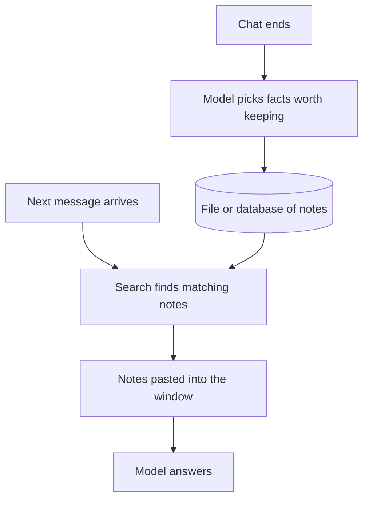

# evolution-overview | From prompts to agents to harnesses | 1 | 15
The vocabulary changed every year, but each new name points at a real shift in where the leverage is. Some of it is also rebranding. Here is which is which.

## The sequence
Prompt engineering (2020 to 2023): GPT-3 showed that wording and examples change results, so people tuned prompts. Retrieval and tools (2023): models gained access to documents and functions. Agents (2024 to 2025): models run in a loop, choose tools and act over many steps. Context engineering (2025): the realization that what is in the window matters more than phrasing. Harness engineering (2025 to 2026): the recognition that the system around the model, not only the model, decides how well an agent does.

My read: retrieval, tools and agents each added something new you could build. Context engineering is mostly a better name for prompt plus retrieval plus memory, though the habit of counting what is in the window is useful. Harness engineering is real where it brought measured gains (separate checkers, context resets) and ordinary software engineering where it did not.

The table lines up the five names. The last column shows how each era would handle one job: answering a customer's question about an order.

| Name | Years | What gets engineered | Customer question task |
|---|---|---|---|
| Prompt engineering | 2020 to 2023 | The sentence you type | A clever instruction |
| Retrieval and tools | 2023 | What the model can reach | Help articles added to the prompt |
| Agents | 2024 to 2025 | A loop that chooses and acts | Look up orders, issue refunds with tools |
| Context engineering | 2025 | Everything in the window at each step | Choose what is in the window for each step |
| Harness engineering | 2025 to 2026 | The whole environment | Tests, approvals, tracing and a separate checker |

## A habit worth keeping
When you meet a new term, find the mechanism, find the measurement, and find the old name. If you cannot find all three, wait.

## Running the three questions on a new term
Take an invented term, "intent engineering", from a vendor post. Apply the checks in order.

1. Mechanism: read for what the system does differently. Suppose the post says the app rewrites a vague request into a clear goal before the model sees it. That is a concrete step.
2. Measurement: ask for a before and after. Suppose the vendor reports 62 of 100 test requests solved before, and 71 of 100 after. That is 9 points better, but 100 requests is a small test. Random luck alone can move a score by about 5 points at this size (a score near 65 of 100 wobbles by roughly 5 either way), and the gap between two such scores wobbles by about 7. A 9 point gain is barely more than that, so ask for more runs.
3. Old name: rewriting a request before processing it is called query rewriting, and search engines have done it for years.
Verdict: a real technique with a small, uncertain gain, applied in a new place. It is not a new discipline.

## When the mechanism is real but the claim is not
A pitch says: "Harness engineering lets any model act like a top engineer." The mechanism behind it is real. Tests catch wrong answers, and permissions stop bad actions. The claim goes too far, because a harness checks, limits and feeds a model. It can give the model documents and tools, but it cannot make the model reason better than it can. A harness can lift results a lot (one team moved a coding agent from outside the top 30 into the top 5 on a benchmark by changing only the harness), but a weaker model still fails tasks a stronger one passes.

You can test the claim. Keep the harness fixed and swap in a weaker model, then run the same hundred tasks, since twenty is too few to trust a small gap, and count passes. If the count drops a lot, the model still matters. Expect that result. A good harness helps every model, but it does not remove the gap between models.

## Common mistake
Thinking you must learn the newest name to be current. The mechanisms underneath last longer than the labels.

```resources
article | Effective context engineering for AI agents | https://www.anthropic.com/engineering/effective-context-engineering-for-ai-agents | Anthropic | Frames context engineering as the successor to prompt engineering.
article | Harness design for long-running application development | https://www.anthropic.com/engineering/harness-design-long-running-apps | Anthropic | Planner, generator and evaluator agents, with the failures that motivated them.
article | The New Software Lifecycle | https://addyosmani.com/blog/new-sdlc-vibe-coding/ | Addy Osmani | Vibe coding to agentic engineering, with Agent = Model + Harness.
article | Industrial Agentic Engineering | https://research.google/pubs/industrial-agentic-engineering/ | Google Research | Specification, harness, trajectory, verification and meta-debugging.
```

```quiz
What is the clearest sign a term is rebranding rather than new? | It was coined by a well known engineer ; It names no new mechanism or method ; It trended on social media this week | 1 | Useful terms name a mechanism you can implement and measure.
What stayed constant across the eras? | A model that does the reasoning ; The wording of every prompt ; The design of each provider API | 0 | The scope of what engineers design grew, while the model stayed at the center.
A post says "workflow orchestration" cut errors but gives no before and after numbers. What do you do? | Adopt it, since errors fell ; Reject it, since vendors exaggerate ; Ask for the test set, the scores before and after, and how many runs | 2 | A real mechanism may exist, but without a measurement you cannot tell luck from a gain.
```

```story
A shop owner hears "prompt engineering" in 2023, "agents" in 2024, "context engineering" in 2025 and "harness engineering" in late 2025 or 2026. Each time the headlines say everything changed. A better question each time: what can I now do that I could not do before, and what would I have called this last year?
```

# prompt-engineering-era | The prompt engineering era | 1 | 12
What survived from prompt engineering is a handful of techniques with a mechanism behind them. The magic-words era mostly did not.

## What was real
Few-shot examples work because the model infers the task from patterns in context, which is in-context learning. Chain-of-thought works because written reasoning gives later tokens something to build on, since each new token is chosen using all the text before it. Clear structure and delimiters (markers like ### or triple quotes that fence off the data) help because the model has to tell instructions from data. ReAct interleaved reasoning with tool calls and is the direct ancestor of agent loops.

## What was hype
Secret phrases that supposedly unlock hidden performance, "act as a world-class expert", and prompt marketplaces. Much of this faded as models got better at following plain instructions.

## What it became
Prompts are now treated as code: versioned, tested against examples and reviewed. Writing one is still a skill, but no longer the whole job. "Prompt engineer" as a standalone job title mostly dissolved into general software and product work, because a prompt is a small part of a system that also needs data, tools and tests.

## A worked example: separating habit from superstition
"You are a world-class expert": reported gains are mixed, so test it on your task before trusting it. "Think step by step": real effect on multi-step problems for older models. "Here are three examples": real, reliable effect on format. "Take a deep breath and work on this problem step-by-step": in a 2023 Google DeepMind paper (Yang et al., "Large Language Models as Optimizers"), a program searched for the best instruction for a model called PaLM 2-L on a grade-school math set. This phrase scored 80.2 percent, against 71.8 for "Let's think step by step" and 34.0 with no instruction. It was the winner of a long search, so it may partly fit that one test. I know of no evidence it helps reliably on current models. The test is simple: run both versions on twenty inputs and count. Twenty inputs can only show big gaps. If the two versions differ by one or two, you have learned nothing yet, so add more inputs.

## How few-shot works, with a tiny trace
Invented prompt: "Review: great = positive. Review: awful = negative. Review: fine =". The model has seen no training on this exact list. It reads the pattern and continues it, so the next word is a one-word label such as "positive", not a full sentence.

```mermaid The examples in the prompt show the model the task and the output format, so it continues the pattern
flowchart TD
  A[Prompt with two labeled examples] --> B[New input, fine]
  B --> C[Model reads the pattern in context]
  C --> D[Continues it in the same one-word format]
  class C focus
```

Without the two examples, the same model might answer with a full sentence. The examples teach the format as well as the task. To measure it, run twenty inputs both ways and count outputs in the right format. Invented result: 11 of 20 without examples, 19 of 20 with.

## What goes wrong: tuning to your test cases
You rewrite a prompt until three test inputs all pass. On twenty new inputs it fails half of them. The prompt learned your three cases, much like a student who memorizes the practice exam.

To confirm, split your inputs into two groups. Tune the prompt on the first group only, then score the second group once, without changing anything. If the second score is far lower, you overfit the prompt. This second group is called held-out: set aside and never used for tuning. Keep it hidden until the end.

```mermaid Tune on one group of inputs and score a hidden group once, or the prompt only learns your test cases
flowchart TD
  A[Your inputs] --> T[Tuning group]
  A --> H[Held-out group]
  T --> P[Rewrite the prompt until it passes]
  P --> S[Score the held-out group once]
  H --> S
  S --> R{Far lower?}
  R -->|yes| O[Prompt overfit your cases]
  R -->|no| G[Prompt holds up on new inputs]
  class H focus
  class O bad
  class G good
```

## When a technique is not needed
Chain of thought helps on multi-step problems, such as a bill with a discount and tax. It adds cost to a one-step lookup like "What is the capital of France?", because the model writes extra tokens it does not need. Reasoning models are trained to think before they answer. Adding "think step by step" to one may change nothing. Run both versions on your task before you keep the phrase.

## Common mistake
Copying prompts from a social media thread without testing them on your own task.

```resources
paper | Language Models are Few-Shot Learners | https://arxiv.org/abs/2005.14165 | Brown et al. | The origin of few-shot prompting.
paper | Large Language Models as Optimizers | https://arxiv.org/abs/2309.03409 | Yang et al. | Source of the "deep breath" instruction result.
paper | Chain-of-Thought Prompting Elicits Reasoning in LLMs | https://arxiv.org/abs/2201.11903 | Wei et al. | Step-by-step reasoning improves accuracy.
paper | ReAct: Synergizing Reasoning and Acting | https://arxiv.org/abs/2210.03629 | Yao et al. | Reasoning and tool use in one loop.
article | Prompt Engineering | https://lilianweng.github.io/posts/2023-03-15-prompt-engineering/ | Lilian Weng | A clear survey of techniques from the peak of the era.
```

```quiz
Why does few-shot prompting work? | It memorizes the examples for good ; It infers the task from the examples ; It retrains its weights on every prompt | 1 | In-context learning lets the model pick up the task from examples in the prompt.
A teammate's prompt passes the 3 inputs they tuned on. What is the best next step? | Score it once on inputs it was not tuned on ; Ship it because the three inputs pass ; Add more magic phrases to the prompt | 0 | Passing your tuning cases says nothing about new inputs.
You find a viral "magic prompt" online. How do you decide whether to use it? | Adopt it because it went viral ; Test it on your own inputs ; Adopt it if its author is famous | 1 | Count results on twenty inputs before adopting any prompt.
```

```story
In 2023 people shared "magic prompts" like secret codes. Some were just good habits (be specific, give examples). Others only looked clever. As models got better at plain instructions, the secret-code ones faded and the habits stayed. What survived was the part that had a reason behind it.
```

# harness-engineering | Harness engineering: real or hype? | 2 | 15
Agent = Model + Harness. The harness is everything around the model that turns text prediction into finished work. The name is new. The parts are concrete.

## What a harness contains
Instructions and rule files such as AGENTS.md. Tools, including MCP servers and the descriptions that tell the model when to use them. Sandboxes where code runs, with limits on what it can reach. Orchestration, meaning how several agents or models are coordinated: subagents, model routing and handoffs. Hooks, which are deterministic code at fixed points such as before a tool call or a commit. Observability: logs, traces and cost metering. Memory and context management, including compaction and resets.

## Why it is more than a buzzword
Anthropic's long-running work found two failure modes in the models they tested. As context fills, some models lose coherence and start wrapping up early, so the harness clears the context and starts a fresh agent with a written handoff of what was done and what is next. A later model largely stopped doing this, and that harness part was dropped. Second, a model grading its own work tends to praise it, so the harness separates the generator from an evaluator. The evaluator is still a model and still too generous at first, but it is much easier to tune a separate evaluator to be skeptical than to make a generator critical of itself. Parts of a harness that cover a model's weakness can be removed when the model improves, so test whether each part still earns its place. Both are engineering decisions you can test, and they produced measurable gains. In Anthropic's test the full harness cost about 20 times more ($200 against $9) and the solo run's main feature did not work, so the gain has to be worth the bill.

A reset is different from compaction. Compaction summarizes the old conversation and the same agent carries on. A reset throws the conversation away and starts a new agent that reads a handoff note, for example a progress file and the git history.

```mermaid A separate evaluator tries the generator's work and sends back problems, so the generator never grades itself
sequenceDiagram
  participant G as Generator
  participant E as Skeptical evaluator
  G->>E: Finished work
  Note over E: Tries the work, looks for problems
  alt Problems found
    E-->>G: List of problems
    G->>E: Revised work
  else Nothing found
    E-->>G: Approved
  end
```

## The honest caveat
Most of this is ordinary systems engineering: retries, permissions, tests, logging and separation of duties. The new part is that the central component is probabilistic: the same input can give different outputs, so you cannot assume it will behave the same way twice. Verification and observability matter more, and changes need evals to prove they help. Google Research's "Industrial Agentic Engineering" adds meta-debugging: when an agent fails, debug the workflow, not the model. If someone uses the word without naming which of these parts they changed, treat it as marketing.

## Try it
Click through the parts in the diagram. Then take your own agent and list which parts exist, which are missing and which failure each missing part allows.

## A worked example: one failure, one harness change
Failure: the agent says "done" but half the feature is missing. Cause: no way to check. Harness change: give it the test suite and require passing tests before it can finish. Failure: it edited a config file it should not touch. Harness change: a permission rule blocking that folder. Each change is small and measurable.

The table pairs each failure with the harness part involved.

| What the agent did | Harness part involved | Change |
|---|---|---|
| Said done with half the feature missing | A way to check | Give it the test suite and require passing tests |
| Edited a config file it should not touch | A permission rule | Block that folder |
| Tried to commit a key | A hook | Scan the files staged for the commit (the ones about to be saved) before it runs |
| Dropped rules late in a long session | A rules file grown to 300 lines | Trim to the ten rules that matter |
| Praised its own mediocre work | A separate evaluator | Add a skeptical checker |

## How a hook stops a bad action
A hook is code that runs at a fixed point, so the model cannot talk its way past it. Trace for a secrets check:
1. The agent finishes a change and asks to run the commit command.
2. The harness pauses the call and runs the hook first.
3. The hook scans the staged files for text shaped like a password or key.
4. It finds one and returns a refusal that names the file.
5. The agent reads the refusal, removes the key, and tries again.

```mermaid A hook runs before the commit and refuses it, whatever the model remembers
sequenceDiagram
  participant A as Agent
  participant H as Harness
  participant K as Hook
  A->>H: Run the commit command
  H->>K: Pause the call, run the hook
  Note over K: Scans staged files for keys
  K-->>H: Refuse, naming the file
  H-->>A: Refusal message
  A->>H: Remove the key, try again
```

A rule in the prompt, "never commit secrets", works most of the time. The hook runs every time, because the check does not depend on the model remembering. It still only catches what its scan can recognise.

## What goes wrong: a harness that grows too heavy
A rules file grows to 300 lines. Some rules contradict each other, and the agent starts ignoring parts of it. The symptom is an agent that obeys rules early in a session and drops them later, as the rules compete with the task for attention and sometimes contradict each other.

To confirm, trim the file to the ten rules that matter. Run the same task ten times with each version and compare the passes. If the short file passes as often or more, the extra rules were noise.

## How to tell a checker works
An evaluator that approves everything adds cost and no safety. Plant a known bug in a copy of the code and ask the evaluator to review it. If it misses an obvious bug, tighten its instructions or give it the tests to run. Repeat with three different bugs before you trust it.

## When a harness is the wrong tool
Renaming twenty files once does not need sandboxes, tracing and a second agent. Write a short script and check the result by eye. A harness pays off when the task repeats, runs unattended, or can do real damage.

## Common mistake
Adding harness parts without a way to measure whether they help.

```resources
article | Harness design for long-running application development | https://www.anthropic.com/engineering/harness-design-long-running-apps | Anthropic | Context resets, evaluator agents and what they bought.
article | Effective harnesses for long-running agents | https://www.anthropic.com/engineering/effective-harnesses-for-long-running-agents | Anthropic | Initializer and coding agents, progress files and handoffs.
article | Harness engineering | https://openai.com/index/harness-engineering/ | OpenAI | OpenAI's account of building software with agents inside a harness.
article | The New Software Lifecycle | https://addyosmani.com/blog/new-sdlc-vibe-coding/ | Addy Osmani | The harness anatomy diagram and its role in each phase.
article | Industrial Agentic Engineering | https://research.google/pubs/industrial-agentic-engineering/ | Google Research | Specification, harness, trajectory, verification and meta-debugging.
repo | 12-Factor Agents | https://github.com/humanlayer/12-factor-agents | HumanLayer | Principles for building reliable LLM software, with code.
```

```quiz
A model grades its own output as excellent but it is mediocre. Which harness change helps? | Give the generator a higher temperature ; Add a separate, skeptical evaluator ; Ask the generator for a longer self-review | 1 | Tuning a standalone evaluator to be skeptical is easier than making a generator self-critical.
Which statement about harness engineering is most accurate? | It applies old ideas to an uncertain part ; It has no overlap with ordinary software engineering ; It is mostly about picking the best model | 0 | The parts are old ideas. The new context is that the central component is probabilistic.
An agent keeps editing a folder it should not touch. Which harness part addresses this? | A firmer line in the prompt ; A switch to a larger model ; A permission rule or hook | 2 | A rule enforced in code runs every time, so the model cannot talk its way past it. A prompt line depends on the model remembering it.
```

```story
Two teams use the same model for a coding agent. Team A types prompts into a chat window. Team B built a setup: a rules file, a sandbox, tests the agent can run, a hook that blocks commits with secrets, and a separate reviewer agent. Team B gets far more done with fewer surprises, and the difference is not the model. It is the harness.
```

# ai-buzzwords | A field guide to AI buzzwords | 1 | 12
For each popular term: what it actually names, and how much of it is marketing.

The table gives each term below its honest label before the details.

| Term | What it names | Verdict | Question to ask |
|---|---|---|---|
| Vibe coding | Prompting and accepting output with little review | Real for prototypes | What verifies it? |
| Agentic | The model chooses its steps | Real, but hype on a fixed flow | What does the model decide at runtime? |
| AGI | No agreed definition | Undefined | What test would show it? |
| Context engineering | Deciding what enters the window | Real | Can I measure tokens and results? |
| Multi-agent swarm | Parallel agents | Real in narrow cases | Are the subtasks independent? |
| Skills | Folders of instructions loaded when relevant | Packaging | What does it add beyond a file? |
| Memory | Facts stored outside the window and retrieved | Real | What is kept, and when is it stale? |
| Reasoning | Models trained to think before answering | Real | Does it beat the plain model on my task? |

## Vibe coding
Real: building by prompting and accepting output with little review, fine for prototypes. Limit: without verification you cannot trust it for anything that matters. Reviewed AI-assisted coding is the same tools used with a written spec, tests and a human reading the code. Simon Willison's article draws this line.

## Agentic
Real if it means the model chooses its steps. Hype if it is stuck on a fixed chatbot flow. Ask what decisions the model makes at runtime.

## AGI
A loose label with no agreed definition or test. Useful as a direction, useless as a product requirement. Treat claims about its date as opinions.

## Context engineering
Real: deciding what enters the window and when. It is the most concrete of the newer terms because you can measure tokens and results.

## Multi-agent swarm
Real in narrow cases: parallel research, large audits and independent verification. Often overkill. One agent with good tools is simpler and cheaper, and every extra agent adds coordination cost.

## Skills
Real: folders of instructions and scripts loaded when relevant. A packaging convention, not a new capability.

## Memory
Real: storing facts outside the window and retrieving them. Mostly files plus search. The hard part is deciding what to keep and when it is stale.

## Reasoning
Real: models trained to spend tokens on thinking before answering. It improves multi-step problems. It does not mean the model understands in a human sense.

## "10x" and "replaces developers"
Studies are mixed. One 2025 randomized study by METR followed 16 experienced open-source developers on 246 real issues and found tasks took 19 percent longer with the AI tools of early 2025, partly from the time spent verifying. METR itself says these results no longer reflect current tools and has published a newer round, so treat the 19 percent as a snapshot from early 2025. Gains are real on well-specified, verifiable work and smaller elsewhere.

## A worked example: translating a pitch
Pitch: "Our multi-agent swarm autonomously builds your product." Translation: several model calls coordinated by code. Questions: what does each agent do, what checks the output, what is the pass rate, what does a run cost, what happens when it is wrong? If the answers are vague, it is a demo.

## A quick glossary of caution
Real mechanism with a hype halo: agentic behavior, reasoning models, context engineering, memory. Real but narrow: multi-agent systems. Mostly packaging: skills, and pitch phrases like "autonomous employee". Undefined: AGI.

## A second example: "our assistant has memory"
Mechanism, with an invented example:
1. After a chat, a step asks the model which facts are worth keeping, such as "user prefers metric units".
2. Those facts are saved to a file or database.
3. In the next chat, a search finds the notes that match the new message and pastes them into the window.



That is memory: a notebook the system reads before it answers. The failure is a stale note. You tell the assistant you moved from London to Paris, but the old note stays, so it keeps suggesting umbrellas for London. To confirm, change a fact and ask a question that depends on it in a new chat.

## When the buzzword is the wrong tool
A task has three steps: fetch a page, pull out a date, write one sentence. A swarm of four agents is overkill. Invented cost count: each agent reads the same 8,000-token brief and does about 2,000 tokens of work. Four agents cost 4 times 10,000, or 40,000 tokens, before they message each other. One agent reads the brief once and does all three steps: 8,000 plus 3 times 2,000, or about 14,000. Use several agents only when subtasks are independent and large enough to pay for the overhead.

## Checking that reasoning helps
Reasoning models spend extra tokens thinking before they answer. Collect ten multi-step questions and ten one-step lookups. Run each set with reasoning on and off. Expect a clear gain on the multi-step set, little on the lookups, and a higher token bill both times. If you see no gain on your own task, switch it off.

## Common mistake
Rejecting a whole idea because the marketing is silly. Look for the mechanism underneath.

```resources
article | Measuring the Impact of Early-2025 AI on Experienced Open-Source Developer Productivity | https://metr.org/blog/2025-07-10-early-2025-ai-experienced-os-dev-study/ | METR | A randomized trial that found slower completion, with caveats.
article | Not all AI-assisted programming is vibe coding | https://simonwillison.net/2025/Mar/19/vibe-coding/ | Simon Willison | Draws the line between vibe coding and reviewed AI-assisted code.
article | AI Snake Oil and AI as Normal Technology | https://www.normaltech.ai/ | Narayanan and Kapoor | A newsletter that separates real capability from claims.
```

```quiz
A vendor says its product is "agentic". Which fact would show the word is real? | It has a chat window and a friendly name ; The model picks which tool to call next at runtime ; It runs on one of the largest models | 1 | Agentic means the model chooses its own steps, so look for decisions made at runtime.
When is a multi-agent system justified? | For parallel tasks such as research ; Always, because more agents are smarter ; Never, because one agent always costs less | 0 | Coordination cost makes it overkill for most tasks, but it fits parallel independent subtasks.
A study finds developers were 19 percent slower with AI tools. How should you treat this? | As proof AI never helps developers ; As irrelevant, since it is one study ; As one small, early data point | 2 | The study had 16 developers and early-2025 tools, so weigh it as evidence, not a verdict.
```

```story
A founder reads that "agentic AGI will replace developers". They could panic or ignore it. A better move: translate it. "Agentic" means a model that chooses its own steps. "AGI" has no agreed definition. "Replace developers" is a prediction, not a measurement. Translated, the sentence says almost nothing testable.
```

