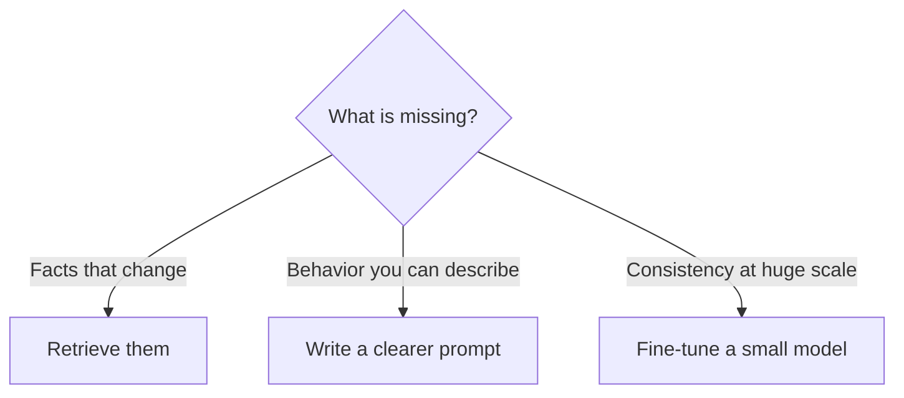

# tokens-and-context | Tokens and the context window | 1 | 10
A model reads and writes tokens, not words, and everything it can use for one answer has to fit in its context window.

## What it is
A token is a piece of text, usually a word or part of a word. "unbelievable" might be three tokens. Code, numbers and non-English text usually cost more tokens per character than plain English prose. A rule of thumb for English is about 4 characters or 0.75 words per token.

The context window is the maximum number of tokens the model can see at once. It holds your system prompt, the whole conversation so far, any files or tool results, and the answer being written. When it is full, something has to be dropped or summarized.

## Why it matters
Cost, speed and quality all follow token count. Developers who use a model through an API pay per input and output token. Long inputs are slower. Past a point, quality drops too: the longer the input, the less reliably a model uses it, even on simple tasks. This is often called context rot. Facts buried in the middle of a long input are especially easy to miss.

## Try it
Paste a paragraph of prose, a JSON blob and some code into a tokenizer viewer and compare tokens per character. Then count the tokens in the longest message you have ever sent a chatbot.

## Worked example: counting tokens and cost
The sentence "I love learning about AI!" is about 7 tokens. A 1,000-word email is around 1,300 tokens. If a model charges $3 per million input tokens, that email costs about $0.004 to read. Cheap once, but an agent that re-reads a 50,000-token conversation 30 times pays for 1.5 million tokens: about $4.50. Tokens are the unit of cost, speed and memory.

## How text becomes tokens
A tokenizer holds a fixed list of pieces, built by repeatedly merging character pairs that appear often in training text (this method is called BPE). To encode text it starts from single characters and joins pairs using those learned merges, in the order it learned them. For example, "t" and "h" join into "th", then "th" and "e" into "the". Then it replaces each resulting piece with an ID number. The model only ever sees those numbers.

```mermaid Text is split into pieces, each piece becomes an ID number, and the model only sees the IDs
flowchart LR
  T[Text] --> S[Split into pieces]
  S --> I[Piece IDs]
  I --> M[Model]
  class I focus
```

Common words are usually one piece. Rare words split into several. An invented split: "unbelievable" becomes "un", "believ", "able". This also helps explain why models miscount letters. The model receives piece IDs, not individual letters, so it has to have learned what is inside each piece.

## Why long chats get expensive
Every turn resends the whole conversation as input. Invented numbers: each turn adds 500 tokens. Turn 1 sends about 500. Turn 2 sends turns 1 and 2 together, about 1,000. Turn 3 sends all three, about 1,500, and so on. Over 10 turns the total sent is 500 × (1 + 2 + ... + 10) = 500 × 55 = 27,500 tokens, although the conversation holds only 5,000 tokens of text. Cost grows faster than the number of turns. Providers can discount text that repeats at the start of every call, but the window still fills.

```mermaid Each call carries the whole conversation so far, so the input grows every turn
sequenceDiagram
  participant A as App
  participant M as Model
  A->>M: Turn 1, about 500 tokens
  M-->>A: Reply 1
  A->>M: Turns 1 and 2, about 1,000 tokens
  M-->>A: Reply 2
  A->>M: Turns 1 to 3, about 1,500 tokens
  M-->>A: Reply 3
```

Plotted for the invented 500-token turns, the total sent pulls away from the size of the conversation itself.

```mermaid Tokens sent in total against tokens in the conversation, at 500 new tokens per turn (invented numbers)
xychart-beta
  x-axis "turns so far" [2, 4, 6, 8, 10]
  y-axis "tokens" 0 --> 30000
  line "total sent so far" [1500, 5000, 10500, 18000, 27500]
  line "conversation size" [1000, 2000, 3000, 4000, 5000]
```

## What goes wrong when the window fills
Symptoms are easy to spot:

1. The assistant forgets an instruction from the start, because the app trimmed old messages.
2. A reply ends mid-sentence, because the limit was reached.
3. Costs per message keep rising during one session.

To confirm, count tokens before sending. Most APIs also report why generation stopped, for example hitting the length limit.

## Common mistakes
Assuming a bigger window means a better answer. More text can bury what matters. Another mistake is forgetting that the answer also uses window space, so a nearly full window leaves little room to reply.

```resources
tool | Tiktokenizer | https://tiktokenizer.vercel.app/ | dqbd | Paste text, see the exact tokens for different models.
video | Let's build the GPT Tokenizer | https://www.youtube.com/watch?v=zduSFxRajkE | Andrej Karpathy | Two hours on why tokenization causes so many odd model behaviors.
article | Context Rot | https://research.trychroma.com/context-rot | Chroma | Measures how model accuracy degrades as the input gets longer.
article | Effective context engineering for AI agents | https://www.anthropic.com/engineering/effective-context-engineering-for-ai-agents | Anthropic | Treats context as a finite budget to spend carefully.
```

```quiz
You paste a 40-page report that fits well inside the window, and the answers to specific questions get vague. What is the most likely cause? | The model cannot read PDF files at all ; Key facts get buried in a huge context ; The model only ever reads the first page | 1 | Long contexts dilute attention. Retrieving or summarizing the relevant part usually works better than pasting everything.
Which text costs more tokens for the same number of characters? | Everyday English with common words ; Text made of many short sentences ; Source code and non-English text | 2 | Tokenizers are tuned on common English, so code and rare words split into more pieces.
A chat has used 95 percent of the context window. What is a problem with asking for a long answer? | The reply shares the window and may cut off ; The model refuses any request near the limit ; The extra tokens are free, so nothing changes | 0 | The reply also uses window space, so a nearly full window leaves little room to answer.
```

```story
A user pastes a whole contract into a chatbot and asks one question about clause 14. The answer is vague. Nothing is broken: the contract filled most of the model's context window, and clause 14 was one needle in a very large haystack. A short, well-chosen excerpt would have worked better and cost less.
```

# next-token-prediction | Next-token prediction and sampling | 1 | 12
An LLM is a function that scores every possible next token. Sampling settings decide which one gets picked.

## What it is
Given the tokens so far, the model gives every token in its vocabulary (its full list of known pieces) a score, and softmax (a formula covered below) turns the scores into probabilities. A sampler picks one, appends it, and the model runs again. An answer is just this loop repeated until the model outputs a special end-of-answer marker called a stop token.

```mermaid One step is score, pick, append, and the loop repeats until a stop token
flowchart TD
  A[Tokens so far] --> B[Model scores every token]
  B --> C[Softmax makes probabilities]
  C --> D[Sampler picks one token]
  D --> E[Append it to the text]
  E --> F{Stop token?}
  F -->|No| A
  F -->|Yes| G[Answer is done]
  class D focus
```

Temperature reshapes the probabilities before sampling (it divides the scores first, shown below). Near 0 the top token wins almost every time, so output is stable. Higher values flatten the odds, so unlikely tokens get picked more often. Top-p keeps only the smallest set of tokens whose probabilities add up to p, then samples inside it. For example, with probabilities 0.66, 0.24 and 0.10 and p = 0.8, the first two add up to 0.90, so the third token is dropped and the other two are rescaled to 0.73 and 0.27.

## Try it
Use the sampler above the lesson, which shows three tokens and their odds. Raise the temperature and watch how the picks spread out. Then set it near zero and sample ten times.

## Worked example: one step
Prompt: "The capital of France is". The model scores possible next tokens: "Paris" 92 percent, "a" 2 percent, "Lyon" 1 percent, and so on. The sampler picks one, usually "Paris". Now the prompt is "The capital of France is Paris" and the model predicts the next token again, maybe a period. Repeat until it predicts an end marker.

## Why this explains the weirdness
The model commits to one token at a time and cannot take a token back. It has no written plan to follow, so it can start a sentence confidently and then box itself into an ending that does not fit.

## Inside one step, with small numbers
The model first produces a raw score for each token, called a logit. Softmax turns scores into probabilities that sum to 1. Invented scores for three tokens: 2, 1 and 0. Softmax raises e (about 2.718) to each score, which gives 7.389, 2.718 and 1, then divides each by their total of 11.107. The probabilities are about 0.665, 0.245 and 0.090.

Temperature divides the scores first. At temperature 0.5 the scores become 4, 2 and 0, and the probabilities sharpen to about 0.867, 0.117 and 0.016. At temperature 2 they become 1, 0.5 and 0, and flatten to about 0.506, 0.307 and 0.186. Same model, same prompt, different odds.

Temperature 0 itself cannot be divided by, so tools treat it as "always pick the top token". Even then, the same prompt can occasionally give different output, so check important outputs instead of trusting them blindly.

The three temperatures side by side, for the scores 2, 1 and 0 used above.

```mermaid The same three scores at three temperatures: low temperature sharpens the odds, high temperature flattens them
xychart-beta
  x-axis [Token 1, Token 2, Token 3]
  y-axis "probability" 0 --> 1
  bar "temperature 0.5" [0.867, 0.117, 0.016]
  bar "temperature 1" [0.665, 0.245, 0.09]
  bar "temperature 2" [0.506, 0.307, 0.186]
```

## What goes wrong: loops
At low temperature a model can repeat itself. After a phrase has appeared twice, the most likely next token is often the start of the same phrase again, and the loop feeds itself. The symptom is the same sentence repeated until the length limit.

To confirm, rerun with a higher temperature or a repetition penalty, a setting that lowers the score of tokens already used. If the loop disappears, sampling was at least part of the cause.

## Answer order matters
Because tokens are committed one at a time, the first words steer the rest. If a reply must begin "Yes", the model often ends up justifying yes even when the evidence says no. Asking for the reasoning first and the verdict last lets the verdict rest on that reasoning.

Test it on a yes or no question with a tricky answer. Run it once asking for the verdict first and once asking for reasoning first. Compare the results over about 10 runs each.

## How to measure variability
For a task you care about, run the same prompt 10 times at your chosen settings and compare the final answer only (the yes or no, the number, the label), not the wording. If one or two final answers show up, the task is stable. If many do, the probabilities are spread out, so make the prompt clearer or lower the temperature first.

## Common mistake
Believing the model "looks up" facts. It predicts likely text. When a fact was common in training, the likely text is right. When it was rare, the likely text can be a convincing guess.

## The math, when you are ready
The step that turns scores into probabilities is called softmax. It has a worked example with small numbers in [Probability and softmax](/ai/docs/building-blocks/probability-and-softmax). You do not need it to use models.

```resources
video | Intro to Large Language Models | https://www.youtube.com/watch?v=zjkBMFhNj_g | Andrej Karpathy | One hour that gives the right mental model of what an LLM is.
video | Large Language Models explained briefly | https://www.youtube.com/watch?v=LPZh9BOjkQs | 3Blue1Brown | Eight minutes, the fastest accurate overview.
course | Neural Networks: Zero to Hero | https://karpathy.ai/zero-to-hero.html | Andrej Karpathy | Builds a language model from a bigram counter up to GPT.
```

```quiz
An extraction job must return the same JSON every run. What should you change? | Raise the temperature to 1.5 ; Lower the temperature toward 0 ; Add a longer greeting to the prompt | 1 | Low temperature makes the most likely token win almost every time, so output is repeatable.
A prompt asks for a yes or no verdict first, then the reasons. Why can the verdict end up wrong even when the reasons are sound? | The model swaps to a weaker version mid-answer ; The reasons are checked and then thrown away ; The verdict tokens are committed before any reasoning exists | 2 | The model predicts one token at a time, so intermediate steps give it something to build the answer on.
A model's top token is "Paris" at 92 percent. At temperature 0, what does it output? | Paris, nearly every time it runs ; A random token from the likely few ; Paris, but only 92 percent of the time | 0 | Temperature near 0 makes the highest-probability token win nearly always.
```

```story
Your phone's keyboard suggests the next word as you type. A language model is that feature scaled up enormously: instead of three suggestions based on your messages, it weighs every token (a word or a piece of one) in its vocabulary using patterns learned from a large part of the internet, and it does it one token after another until the answer is done.
```

# sampling-parameters | Sampling parameters | 1 | 12
A handful of settings control how the next token is chosen and when the answer stops. Knowing them lets you tune behavior without changing the prompt.

## The settings
Temperature rescales probabilities: near 0 is repeatable, higher is more varied. Top-k keeps only the k most likely tokens, for example 40, and samples among them. Top-p (nucleus sampling) keeps the smallest set of tokens whose probabilities add up to p, for example 0.9, so the set grows when the model is unsure and shrinks when it is confident. Repetition or frequency penalties lower the score of tokens that already appeared, reducing loops. Max tokens caps the answer length. Stop sequences end generation when a given string appears. A seed makes sampling repeatable on providers that support it. The order in the diagram below is the Hugging Face default; llama.cpp applies temperature last, so check your runtime.

```mermaid One common order: penalties, temperature, then top-k and top-p, with a stop check after each sampled token
flowchart TD
  A[Model scores every token] --> B[Penalties lower repeated tokens]
  B --> C[Temperature rescales]
  C --> D[Top-k and top-p keep a set]
  D --> E[Sample and append one token]
  E --> F{Stop?}
  F -->|No| A
  F -->|Yes| G[Answer ends]
  class D focus
```

## Example
Probabilities for the next token: A 0.50, B 0.25, C 0.15, D 0.07, E 0.03. Top-k 2 keeps A and B and rescales them to 0.67 and 0.33. Top-p 0.85 keeps A, B and C and drops D and E: A and B add up to 0.75, which is below 0.85, and adding C gives 0.90, which reaches it.

## Rules of thumb
Extraction, classification and code: temperature 0 to 0.3. Brainstorming and creative writing: 0.8 to 1.0. Change either temperature or top-p, not both. Some models fix these values. Some reasoning models ignore your settings, and some newer models, including recent Claude models, reject any temperature, top-p or top-k other than the default with an error. Check the provider's docs for the model you use. Even at temperature 0, output can differ between calls on some providers, so do not rely on bit-exact repeatability.

## A worked example: same prompt, three settings
Prompt: "Name a fruit." Temperature 0: "Apple" almost every time. Temperature 0.7: apple, banana, mango across runs. Temperature 1.5: occasionally "dragonfruit" or something odd. For a form that must name exactly one valid fruit from a list, use 0. For brainstorming ten product names, use 0.9.

## How the settings stack
Settings act in sequence, and earlier ones change what later ones see. Reuse the probabilities A 0.50, B 0.25, C 0.15, D 0.07, E 0.03. Dividing the scores by a temperature of 0.5 is the same as squaring each probability and rescaling so they sum to 1. In general, raise each probability to the power 1/T and rescale: T = 0.5 squares them, T = 2 takes square roots, which flattens the gap between tokens. The squares are 0.25, 0.0625, 0.0225, 0.0049 and 0.0009, which total 0.3408. The new probabilities are about 0.734, 0.183, 0.066, 0.014 and 0.003.

Now apply top-p 0.85. A and B together reach 0.917, so only A and B survive. Earlier, top-p 0.85 alone kept three tokens. Lowering temperature shrank the candidate set as well. The order can differ between libraries and services, so test rather than assume.

The table follows one set of probabilities through each setting. A zero means the token was dropped.

| Setting applied | A | B | C | D | E |
|---|---|---|---|---|---|
| None | 0.50 | 0.25 | 0.15 | 0.07 | 0.03 |
| Top-k 2 | 0.67 | 0.33 | 0 | 0 | 0 |
| Top-p 0.85 | 0.56 | 0.28 | 0.17 | 0 | 0 |
| Temperature 0.5 | 0.73 | 0.18 | 0.07 | 0.01 | 0.003 |
| Temperature 0.5, then top-p 0.85 | 0.80 | 0.20 | 0 | 0 | 0 |

## Trade-offs and when not to use them
Low temperature gives repeatable output but can loop and sound flat. High temperature gives variety but more errors. Top-k uses the same cutoff whether the model is sure or unsure, which top-p handles better. A seed helps you debug, but it is not a guarantee of identical output across providers or versions.

Do not tune sampling to fix a bad prompt. If answers are wrong because the instructions are unclear, no setting repairs that.

## What goes wrong
Match the symptom to the dial.

1. JSON cut off halfway: max tokens is too low. Check why generation stopped.
2. An answer ends too early: a stop sequence appears inside the content.
3. Odd or unrelated words: temperature is too high.
4. The same line repeated: temperature is too low, or no repetition penalty is set.

Log the settings with every request. Then rerun the failing prompt about 10 times, changing one dial at a time.

## Try it yourself
In any playground that exposes temperature, send "Name a fruit." ten times at 0 and ten times at 1. Count distinct answers. Expect very few at 0, usually one or two, and noticeably more at 1.

## Common mistake
Turning both temperature and top-p up at once, which compounds the randomness and produces nonsense. Change one dial, test, then decide.

## The math, when you are ready
Temperature is one number inside the softmax formula. See it with real numbers in [Probability and softmax](/ai/docs/building-blocks/probability-and-softmax).

```resources
docs | Messages API parameters | https://docs.anthropic.com/en/api/messages | Anthropic | Max tokens and stop sequences, plus temperature, top-p and top-k (now deprecated on newer Claude models).
article | How to generate text: decoding methods | https://huggingface.co/blog/how-to-generate | Hugging Face | Greedy, beam, top-k and top-p, with code.
video | Let's build GPT: from scratch, in code, spelled out | https://www.youtube.com/watch?v=kCc8FmEb1nY | Andrej Karpathy | Sampling is built into the generation loop near the end.
```

```quiz
Token probabilities are A 0.50, B 0.25, C 0.15, D 0.07, E 0.03. Which does top-p 0.85 keep? | Only A and B ; A, B and C ; A, B, C and D | 1 | 0.50 + 0.25 = 0.75 is below 0.85, and adding C reaches 0.90, so D and E are dropped.
What does a stop sequence do? | Raises the temperature for one token ; Blocks the model from mentioning a topic ; Stops output when the string appears | 2 | It cuts the output at a chosen marker, such as the end of a field.
You want ten different product name ideas. Which setting fits best? | A higher temperature such as 0.9 ; Temperature 0 with top-k set to 1 ; A very small maximum output length | 0 | Brainstorming benefits from variety, which higher temperature provides.
```

```story
A chef follows a recipe the same way every time for a customer who wants consistency, and improvises when a customer asks for something surprising. Sampling settings are the model's "how much to improvise" dials. For a tax form you want the first kind of chef. For a poem you might want the second.
```

# transformers-and-attention | Transformers and attention | 2 | 20
The transformer lets every token look at every earlier token and decide which ones matter for the next prediction.

## What it is
The transformer is the design behind modern language models. Its key idea is that every token can look at every earlier token and decide which ones matter.

Here is the path a piece of text takes. First it is split into tokens. Each token becomes a vector, which is a list of numbers called an embedding. Then the vectors pass through a stack of identical blocks. Each block does two jobs. Attention lets a token pull in information from other tokens. A feed-forward step then runs each token's vector through a small neural network, one token at a time with no mixing between tokens. Attention moves information between tokens, and this step reworks the information each token now holds. At the very end, the last vector is turned into a score for every possible next token.

```mermaid Text becomes vectors, passes through a stack of identical blocks, and ends as a score for every next token
flowchart TD
  A[Text] --> B[Tokens]
  B --> C[Embedding vectors]
  subgraph Block[One block, repeated many times]
    D[Attention] --> E[Feed-forward]
  end
  C --> D
  E --> F[Score for every next token]
  class D focus
```

In attention, each token makes three vectors. The query says what it is looking for. The key says what it contains. The value says what it offers. A token compares its query with every earlier key, and the best matches contribute their values. This is how the word "it" can pull in the meaning of the noun it refers to.

```mermaid Queries are compared with keys to get weights, and the weights mix the values
flowchart TD
  Q[Query of this token] --> S[Scores]
  K[Keys of earlier tokens] --> S
  S --> W[Softmax weights]
  W --> O[Weighted sum]
  V[Values of earlier tokens] --> O
  class W focus
```

## Why it matters
You do not need the math to use models, but this picture explains real limits. Attention compares every token with every earlier token, so the work grows quickly with length. That is why long inputs cost more. Attention itself does not know word order, so models add a position signal to each token's vector. Even so, where a fact sits in a prompt can change how well the model uses it (see the long-prompt example below). Attention also lets a model notice that a new line looks like the examples above it and continue the same pattern. Earlier keys and values are saved in a KV cache, so repeated prefixes are cheap. That idea is behind prompt caching.

```mermaid While generating, each new token adds one key and value to the cache and reuses all the saved ones
sequenceDiagram
  participant M as Model
  participant C as KV cache
  M->>C: Save keys and values for the prompt
  loop For each new token
    C-->>M: Saved keys and values of earlier tokens
    M->>C: Save key and value of the new token
  end
```

## A worked example
Take "The bank of the river was muddy." When the model handles "bank", attention pulls in "river", so the vector for "bank" moves toward "edge of water". In "The bank approved my loan", it pulls in "loan" and "approved" and moves toward "financial institution". The word is the same, but its meaning is set by its neighbors.

## Go deeper
Watch the 3Blue1Brown chapters first. Then play with an interactive visualization. Then read the original paper or the illustrated walkthrough.

## A trace with small numbers
Invented numbers for illustration. A token has three earlier tokens to look at. Its query compared with their keys gives scores 3, 1 and 0. Softmax turns these into weights: e^3 is about 20.1, e^1 about 2.7, e^0 equals 1, total about 23.8. The weights are about 0.84, 0.11 and 0.04.

Say the three values are single numbers, 10, 20 and 30. The output is the weighted average: 0.844 × 10 + 0.114 × 20 + 0.042 × 30, about 12.0 (the weights are rounded, so they add to 1.000 here). Most of the answer comes from the first token, because its key matched the query best. Real models scale the scores before softmax and use long vectors, but the steps are the same.

The same trace as a table, with one row per earlier token.

| Earlier token | Score | e to the score | Weight | Value | Weight times value |
|---|---|---|---|---|---|
| 1 | 3 | 20.09 | 0.844 | 10 | 8.44 |
| 2 | 1 | 2.72 | 0.114 | 20 | 2.28 |
| 3 | 0 | 1.00 | 0.042 | 30 | 1.26 |
| Total | | 23.80 | 1.000 | | 11.98 |

## Trade-offs and limits
Each comparison costs work, and the number of comparisons grows with the square of the input length. As the history chapter showed, doubling the input quadruples this part of the cost.

A model also runs several attention heads in parallel. A head is one independent copy of attention that can focus on a different kind of relationship. Attention weights show where information flowed, but they are only part of the computation, so they are an incomplete explanation of why the model answered as it did.

## A second example: where attention does not help
Attention can only mix information the vectors already hold. Ask a model how many r letters are in "strawberry". The tokenizer may have hidden the letters inside larger pieces, so the model has little direct access to the letters. Giving the model a code tool avoids the problem.

A different failure is a fact buried in a very long prompt. In a very long prompt, models often use a fact in the middle less reliably than one at the start or end, and may miss a line that is present. Researchers have measured this, but the exact cause is not settled. To check, move the fact to the start or end of the prompt and ask again. If the answer changes, position was the cause.

## Common mistake
Assuming a model with more layers will answer your question better. Layers are only one of several things that set quality, along with the amount and quality of training data and how the model was tuned afterward. When two models disagree, test both on your own examples instead of picking the bigger one.

## The math, when you are ready
Attention is a few dot products, a softmax and a weighted average. The step-by-step numbers are in [Attention in numbers](/ai/docs/building-blocks/attention-math), in the Building Blocks chapter later in the path. Read it after you have used and built with models, and it will feel much easier.

```resources
video | Transformers, the tech behind LLMs | https://www.youtube.com/watch?v=wjZofJX0v4M | 3Blue1Brown | The clearest animated explanation of embeddings and attention.
tool | Transformer Explainer | https://poloclub.github.io/transformer-explainer/ | Georgia Tech Polo Club | Runs GPT-2 in your browser and lets you change temperature live.
tool | LLM Visualization | https://bbycroft.net/llm | Brendan Bycroft | A 3D walkthrough of every operation in a small GPT.
article | The Illustrated Transformer | https://jalammar.github.io/illustrated-transformer/ | Jay Alammar | The classic diagram-by-diagram walkthrough.
paper | Attention Is All You Need | https://arxiv.org/abs/1706.03762 | Vaswani et al. | The original transformer paper.
```

```quiz
What does attention let a token do? | Look only at the single token just before it ; Weigh earlier tokens by their relevance ; Pick the single most frequent earlier token | 1 | Queries are matched against keys of earlier tokens, and the best matches contribute their values.
Why are very long inputs expensive? | Longer words use a different tokenizer entirely ; The vocabulary grows with the length of the input ; Every token is compared with earlier ones | 2 | Cost rises roughly with the square of the length because of those comparisons.
A token's scores against three earlier tokens are 3, 1 and 0. Which earlier token contributes most to its output? | The one with score 3, because its key matched the query best ; The one with score 0, because it is the most different ; All three equally, since weights always add to 1 | 0 | Softmax turns the scores into weights and the highest score gets the largest weight (about 0.84 here).
```

```story
A student reads a textbook paragraph and, before answering a question, flips back through the pages looking for the lines that matter. A transformer does this for every word it writes: it looks back over everything so far, scores what is relevant, and uses that. Imagine the student has a helper for each page who instantly shouts how relevant their page is to the question, and the student blends the answers weighted by how loudly each one shouted. That all happens at once, which is why models can keep a long story consistent.
```

# training-pipeline | Pretraining, fine-tuning and RL | 2 | 15
Models are built in stages. Each stage changes what the model is good at and why it behaves the way it does.

## What it is
A chatbot is built in stages. Each stage teaches it something different.

Stage one is pretraining. The model reads a huge amount of text and learns to predict the next token. This is where its knowledge and its ability with language come from. The result is a base model. It can continue any text, but it does not know it is supposed to help you.

Stage two is supervised fine-tuning, or SFT. People write thousands of example conversations: a question, then a good answer. The model trains on them and starts to answer like an assistant.

Stage three is preference tuning. People compare two answers and pick the better one, and the model is nudged toward the kind people prefer. You will see two names for this. RLHF is the original method: it trains a separate scorer from the human picks, then nudges the model toward higher scores. DPO reaches the same goal more simply, with no separate scorer.

Stage four, used for reasoning models, is reinforcement learning on tasks with checkable answers, such as math and code. The model gets a reward when the final answer is right, so it learns to think longer and more carefully.

```mermaid Each stage starts from the previous model, and the last one only applies to reasoning models
flowchart TD
  A[Pretraining on huge text] -->|Base model| B[SFT on example conversations]
  B -->|Assistant| C[Preference tuning]
  C -.->|Reasoning models| D[RL on checkable tasks]
  class A focus
```

The table compares what each stage learns from and what it produces.

| Stage | Training data | What teaches the model | Result |
|---|---|---|---|
| Pretraining | A huge amount of text | Whether it predicted the next token | A base model that continues any text |
| Supervised fine-tuning | Thousands of written example conversations | Matching the example answer | A model that answers like an assistant |
| Preference tuning | Pairs of answers where people picked the better one | Moving toward the preferred answer | Clearer, safer, better organized answers |
| Reinforcement learning | Tasks with checkable answers | A reward when the final answer is right | A reasoning model that thinks longer |

## Why it matters
Pretraining has a cutoff date, so the model knows nothing newer. Politeness, refusals and tool use come from the later stages. That is why a prompt can change how a model behaves, but it cannot add lasting knowledge. Facts you put in a prompt help with that one request and are gone afterwards, because the model's weights do not change.

When you need new facts, retrieve them and put them in the prompt. When you need the same style or format every time at large scale, consider fine-tuning.

## A worked example: what each stage adds
Ask a base model "How do I bake bread?" It might continue with "How do I bake a cake? How do I bake cookies?", like a list of search suggestions. After instruction tuning it gives steps. After preference tuning the steps get clearer, safer and better organized. After reasoning training it can work through a long problem, such as scaling a recipe for 37 people.

## What one training example looks like
In pretraining, one sentence produces many practice questions. Take the six tokens "The cat sat on the mat" (invented split). The model is shown "The" and must predict "cat". Then "The cat" and must predict "sat". That gives 5 predictions from one sentence, each scored by how much probability the right token got. Billions of such sentences make up the run.

Fine-tuning uses the same scoring, but on conversations, and usually only the assistant's reply counts. Same mechanism, different data.

Each row below is one practice question made from the single sentence.

| Prediction | The model sees | It must predict |
|---|---|---|
| 1 | The | cat |
| 2 | The cat | sat |
| 3 | The cat sat | on |
| 4 | The cat sat on | the |
| 5 | The cat sat on the | mat |

## Trade-offs: prompt, retrieve or fine-tune
Match the tool to what is missing.

Missing facts that change often: retrieve them. A company with 200 policy pages updated weekly cannot re-tune each week, and retrieval can show its sources.

Missing behavior you can describe: write a clearer prompt first, since it is free and instant.

Missing consistency at huge scale: fine-tune a small model. A brand voice in a fixed three line format, millions of times a day, is a good fit. The costs are collecting good examples and the risk of side effects.



## What goes wrong after tuning
Symptoms to watch for:

1. A tuned model gets worse at unrelated tasks, because the update shifted weights it needed.
2. Answers have the right format but wrong facts. Format can be taught by fine-tuning. Facts mostly cannot be added reliably that way, because they come from pretraining.
3. Reinforcement learning on checkable tasks can be gamed. A coding model might special-case the exact tests instead of solving the problem.

To confirm, test on examples that were not used in tuning. Also rerun a small set of general tasks before and after the change.

## Common mistake
Fine-tuning a model to "teach" it your company facts. Facts are better supplied when the question is asked, through retrieval. That keeps them up to date and shows the sources.

## The math, when you are ready
Training is repeated guessing, measuring the error and nudging the weights. The numbers behind that loop are in [Loss and gradient descent](/ai/docs/building-blocks/loss-and-gradient-descent). It is optional for now.

```resources
video | Deep Dive into LLMs like ChatGPT | https://www.youtube.com/watch?v=7xTGNNLPyMI | Andrej Karpathy | About three and a half hours covering pretraining, SFT and RL end to end.
video | How I use LLMs | https://www.youtube.com/watch?v=EWvNQjAaOHw | Andrej Karpathy | Practical companion to the deep dive, with real workflows.
paper | Training language models to follow instructions with human feedback | https://arxiv.org/abs/2203.02155 | OpenAI | The InstructGPT paper that made the RLHF recipe the standard way to build assistants.
course | Hugging Face LLM Course | https://huggingface.co/learn/llm-course | Hugging Face | Free, hands-on path through transformers, datasets and fine-tuning.
```

```quiz
A model does not know about a product released last month. What is the right fix? | Fine-tune it on one sentence about the product ; Raise the temperature so it guesses better ; Wait until the next pretraining run happens ; Put the facts in the prompt or retrieve them | 3 | Knowledge comes from pretraining and has a cutoff. Supplying facts in context is cheap and reliable.
Which stage mainly produces instruction-following behavior? | Pretraining on a very large web text corpus ; Supervised and preference fine-tuning ; Tokenizing text before any training starts | 1 | A base model only continues text. Post-training teaches the assistant behavior.
A strict three-line house format is needed millions of times a day, and a clear prompt already works but costs many tokens each time. What should you consider? | Retraining the base model every single month ; Keep adding more format rules to the prompt until it never slips ; Fine-tuning a small model on that format | 2 | Past a very large volume, a small tuned model can hold the format without long instructions and cost less per call. A clearer prompt is still the first thing to try.
```

```story
Think of training a new employee in four stages. First they read every book in the library (pretraining), so they know a lot but have no idea how to behave at work. Then a mentor shows them example conversations with customers (fine-tuning), and a manager says which of two replies was better (preference tuning). Finally they practice problems with an answer key and get marked right or wrong with nobody watching (reinforcement learning on checkable tasks).
```

# limits-and-hallucinations | Limits and hallucinations | 1 | 10
Models produce plausible text, not verified facts. Knowing the failure modes tells you where to add checks.

## What it is
A hallucination is a confident answer that is not supported by the model's knowledge or the provided sources. It happens because the training objective rewards fluent continuations and guessing over saying "I do not know", and the text you read carries no sign of how unsure the model was. Common failure areas are precise facts and citations, arithmetic done in its head, events after the knowledge cutoff, and long tasks where an early mistake carries forward. Where possible give the model a tool for these: a calculator, a search, a code runner.

Capabilities are also uneven. A model can solve a hard proof and then miscount letters in a word.

## Why a model makes things up
Think about what happens with a rare fact. Ask for the author of an obscure book. The model has seen little about it, so its probabilities spread across many plausible names. Invented numbers: 12 percent for one name, 10 percent for another, 9 percent for a third. The sampler must still pick something. With odds this flat it might pick any of the three, and each run can give a different name. Whichever it picks is printed in the same confident tone as a name with 95 percent behind it. If the same question gives different answers each time, treat the answer as a guess.

Nothing in the printed answer separates "I know" from "this looks right". Bigger models tend to make fewer such errors, but none are immune.

```mermaid Invented odds for the first token of an answer: a well-known fact has a clear winner, a rare fact spreads thin
xychart-beta
  x-axis [First choice, Second choice, Third choice]
  y-axis "probability percent" 0 --> 100
  bar "Well-known fact" [95, 3, 1]
  bar "Rare fact" [12, 10, 9]
```

In both cases the answer comes out in the same tone, so a pick from the 12 percent spread looks as sure as the 95 percent one.

## Why it matters
Design around the failure instead of hoping it disappears. Give the model sources and ask for quotes. Let it call a calculator or run code instead of computing in its head. Add verification steps that check the output against something independent, such as tests, a schema or a second look from a separate prompt. Then measure how often it still fails (see the evals chapter).

## Worked example: three guard rails
Task: summarize a customer's contract. Rail one: give the model the contract text and tell it to answer only from it. Rail two: require a short quote for every claim, which you can check with a text search. Rail three: have a second prompt (or a person) verify a sample. None of these make the model perfect. Together they make errors visible.

```mermaid Three rails make errors visible: ground the answer, check the quotes, verify a sample
flowchart TD
  A[Contract text and question] --> B[Model answers only from the text]
  B --> C[Every claim has a short quote]
  C --> D[Text search checks each quote]
  D --> E[Second prompt or person checks a sample]
  class D good
  class E good
```

## A second example: matching checks to stakes
Guard rails cost time and money, so scale them to what a mistake costs. Rewriting an email to sound politer has few facts to get wrong, and a quick read by you is enough. Summarizing a legal contract needs the full set of rails.

Even a good rail can mislead. A required quote might exist in the contract but not support the claim it is attached to. Checking that the quote exists is not the same as checking that it says what the model claims.

## How to tell it is working
Build a small test set of about 30 questions with known answers. Include some whose answers are not in the provided document. Count three things: right answers, wrong answers, and times the model said the answer is not available. If the model says "not stated" for questions that are in the document, the rails are too strict.

A well-grounded setup should say "not stated" when asked, for example, the notice period of a contract that never mentions one. If it invents a number, your rails are not yet working. Rerun the set after every change to the prompt or model so you see whether the wrong-answer rate moved.

Scoring the test set means looking at two kinds of question separately.

| Kind of question | Good outcome | Bad outcome |
|---|---|---|
| Answer is in the document | Right answer, with a quote that supports it | Wrong answer, or says it is not stated when it is |
| Answer is not in the document | Says it is not stated | Invents an answer |

## Common mistake
Reading confidence as accuracy. The tone is equally fluent when the answer is wrong.

```resources
article | Why language models hallucinate | https://openai.com/index/why-language-models-hallucinate/ | OpenAI | Explains how training and benchmarks reward guessing over abstaining.
article | What We've Learned From A Year of Building with LLMs | https://applied-llms.org/ | Yan, Husain, Liu and others | Practitioner lessons on prompts, retrieval, evals and operations.
article | Building LLM applications for production | https://huyenchip.com/2023/04/11/llm-engineering.html | Chip Huyen | Production problems with LLM apps: ambiguous prompts, evaluation, cost and latency, and composing tools.
```

```quiz
A model summarizes a contract and says the notice period is 30 days, but the contract never mentions one. Which check catches this? | Requiring a quote for every claim and searching the contract for it ; Re-reading the summary to see if the wording is fluent ; Asking the model for a shorter summary instead | 0 | A quote that does not exist in the contract cannot be found by text search, so the invented number shows up.
How can you reduce made-up citations? | Ask the model to be honest in the prompt ; Give sources and demand exact quotes ; Request shorter answers on every question | 1 | Grounding in given text and requiring checkable quotes gives you something to verify mechanically.
The model states a date in a confident tone. What does the tone tell you? | That the date is probably correct ; That the date came from a trusted database ; Nothing about whether the date is right | 2 | Fluent confidence is the same whether the answer is right or wrong, so check what matters.
```

```story
In 2023 a New York lawyer, Steven Schwartz, filed a brief in Mata v. Avianca that cited six court cases a chatbot had invented, with convincing names and citations. None existed. He even asked the chatbot whether the cases were real, and it said yes. The model was not lying. It produced text that looked like legal citations, because that is what it is built to do.
```

