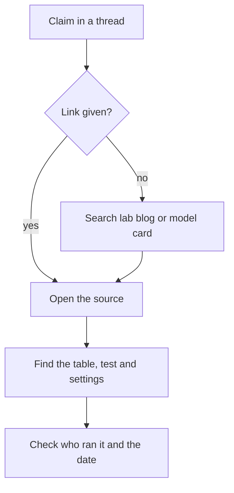

# sources-to-follow | Sources worth following | 1 | 10
New releases arrive weekly. A short list of reliable sources beats a feed of everything.

## How to keep up without drowning
Pick three to five sources and ignore the rest. Prefer people who build and show evidence over accounts that repost excitement. Treat viral threads as pointers: find the primary source (the paper, the docs, the repo) and read that. Check the date, since advice from a year ago may be outdated. When something claims a big win, ask what was measured and on what.

## A starter set
Start with these: Anthropic Engineering for how things are built (a lab blog), Simon Willison's Weblog for daily notes from a practitioner, one newsletter such as Import AI or Ahead of AI for research, and Hugging Face Papers to see which papers people are reading. The rest of the list is there to swap in later. If you run models on your own machine, add a local-models community such as r/LocalLLaMA.

## A worked example: a weekly routine
Monday, 20 minutes: skim one newsletter for the week's research. Wednesday, 10 minutes: read one engineering blog post fully. Friday, 15 minutes: open the Model atlas and the News radar on this site to see what shipped this week. Total under an hour. Anything bigger gets a deeper read, from the primary source.

## Tracing a claim to its source
A thread says: "New model beats the old one by 20 percent." Follow these steps.


1. Look for a link. If there is none, search the lab's blog or model card for the release.
2. Find the table behind the claim and note which test it uses and the settings.
3. Check who ran it: the lab itself, or an independent group.
4. Check the date, in case the claim describes an older version.

Suppose the table shows a score of 10 out of 100 before and 12 out of 100 after. The absolute gain is 2 points (12 minus 10). The relative gain is that 2 divided by the starting 10, which is 0.2, or 20 percent. Both numbers are true, and only the relative one makes a good headline.

## What goes wrong: five sources that are really one
Your five newsletters all report the same new result in nearly the same words, with the same number. It feels like strong confirmation. It is often five summaries of one post.

To check, follow each link backward. If all of them end at the same page, you have one source, repeated. Count independent sources, not mentions. That page is now the thing to read and test: look for the table and who ran it (steps 2 and 3 above). A newsletter that gives no link counts for nothing until you find its source.

```mermaid Five newsletters can all point to one post, which is one source repeated
flowchart LR
  N1[Newsletter 1] --> P[One original post]
  N2[Newsletter 2] --> P
  N3[Newsletter 3] --> P
  N4[Newsletter 4] --> P
  N5[Newsletter 5] --> P
  class P warn
```

## How to tell your set is working
At the end of each month, write down three things you learned and where each came from. Mark each one as primary (paper, docs, repo) or secondary (someone's summary). Replace a source if:
1. You cannot recall learning anything from it.
2. It never links to primary sources.
3. You skim it without reading.

A set that passes keeps you able to say, in one sentence, what changed and what evidence shows it.

## Common mistake
Following everything. Sources you do not read are noise.

```resources
article | Anthropic Engineering | https://www.anthropic.com/engineering | Anthropic | How Claude features and agents are built.
article | Simon Willison's Weblog | https://simonwillison.net/ | Simon Willison | Daily, careful notes on tools and models.
article | Latent Space | https://www.latent.space/ | swyx and Alessio | Podcast and newsletter for AI engineers.
article | Ahead of AI | https://magazine.sebastianraschka.com/ | Sebastian Raschka | Clear research explainers and architecture comparisons.
article | Interconnects | https://www.interconnects.ai/ | Nathan Lambert | Post-training, open models and policy.
article | Import AI | https://importai.substack.com/ | Jack Clark | Weekly research summary.
tool | Hugging Face Papers | https://huggingface.co/papers | Hugging Face | Daily trending papers.
```

```quiz
A viral thread claims a huge result. Best next step? | Share it, since many others already have ; Trace it to the original source ; Wait for a famous account to confirm it | 1 | Threads are pointers. The paper or docs hold the evidence.
A score goes from 40 to 50 on a test. Which headline is accurate? | Up 10 points, or 25 percent relative ; Up 50 percent relative to the start ; Up 10 percent on the same test, overall | 0 | 10 divided by the starting 40 is 0.25; the gain is 10 points on the test.
Five newsletters report the same result with the same number. How many independent sources do you have? | Five, since five different outlets agree ; None, because newsletters are never sources ; Probably one, if all link to one post | 2 | Count where the links end, not how many outlets mention it.
```

```story
A viral post says a new model is "insane". A careful practitioner posts a test the same day: it improved on one benchmark by two points and got worse on another. The person who follows five trusted sources knows the real picture by lunchtime. The person who follows five hundred accounts knows only that something happened.
```

# awesome-lists | Curated lists and roadmaps | 1 | 10
Other people have already organized this field. Use their lists as a map and check what is current.

## How to use a list
A good list saves you weeks. A bad one is a pile of bookmarks. Judge a list in a minute with four checks:

1. When was the last update? A list untouched for a year is probably stale.
2. Does each entry say why it is worth reading, or is it just a link?
3. Is it maintained by one person or many? One person's list dies when they lose interest.
4. Are paid items marked? A list that hides which courses cost money is selling to you.

## A worked example: judging a list
Open the repository and look at the commit history. If the last change was eleven months ago, treat the links as hints and check each one. Look at ten entries. If seven of them have a sentence about what you will learn, the list is curated. If none do, it is a dump. Pick the best two or three entries in the section you need and ignore the rest. The first list below marks paid items with a money-bag icon, so you can skip them if you want free material only.

```mermaid Judge a list in a minute: check the last update, then whether entries say why, then pick a few
flowchart TD
  L[Open the list] --> A{Recently updated?}
  A -->|No| H[Treat links as hints, check each]
  A -->|Yes| B{Do most entries say why?}
  H --> B
  B -->|No| D[A dump: skim, do not trust]
  B -->|Yes| C[Curated: pick the best two or three]
  class C good
  class D bad
```

## Which list for which goal
You are new and want an order to follow: the path on this site, then the beginner guides below. You want to build agents: the agentic engineering lists. You want to study the research: the model internals chapter and the papers it cites. You want to keep up weekly: the sources in the previous lesson.

## Use this site's library
The Resource library page lists every link cited in these lessons, with a sentence on what each one is good for, filterable by type. It is smaller than a giant list and every entry is annotated.

## What goes wrong: link rot and repeats
Open ten random entries on a list. If three lead to an error page, a changed address, or a site that no longer covers the topic, the list is not being maintained. This is link rot, and it grows with age.

A second problem is repetition. Open three lists on the same topic and you often see the same ten resources in each. The real count is not 500 links across three lists. It may be closer to 40 unique ones. To confirm, copy the titles into one document and remove duplicates. The number left is the size of the topic.

## Turning a list into a plan
A list becomes useful when you add a goal and a limit.
1. Write one goal, such as "build a small agent that calls two tools".
2. Find the section of the list that matches and copy five entries into a notes file.
3. Next to each, write one line on why you picked it.
4. Spend 15 minutes on each. Cross out any that repeat what you already learned.
5. Keep the best two and do them this week.

Five entries become two in about an hour and a quarter. Expect to end with fewer items than you started with. That is the point.

## Common mistake
Saving lists you never open. Pick one, take three items, and read them this week.

```resources
repo | Awesome Agentic Engineering Resources | https://github.com/EthicalML/awesome-agentic-engineering-resources | EthicalML | Articles, courses, papers and benchmarks, with monthly updates.
repo | Agentic Engineering Handbook | https://github.com/keyuchen21/agentic-engineering-handbook | keyuchen21 | A phased roadmap of 200+ resources.
repo | Awesome Agentic Engineering | https://github.com/fatihkc/awesome-agentic-engineering | fatihkc | Focused on directing coding agents.
repo | Learn how to build, deploy, evaluate agents | https://github.com/Machine-Learning-Tokyo/agent-resources | Machine Learning Tokyo | Ten free resources ranked by quality.
repo | Start AI Engineering in 2026 | https://github.com/louisfb01/start-ai-engineering | Louis-François Bouchard | A guide for beginners organized by learning style.
repo | mlabonne/llm-course | https://github.com/mlabonne/llm-course | Maxime Labonne | Roadmaps for LLM scientists and engineers with notebooks.
repo | Generative AI for Beginners | https://github.com/microsoft/generative-ai-for-beginners | Microsoft | Structured lessons with code.
tool | roadmap.sh AI Engineer | https://roadmap.sh/ai-engineer | roadmap.sh | Community map of skills.
```

```quiz
What makes a list entry more useful? | A catchy title and a bare link only ; A line on why it is worth reading ; A long list of tags on every entry | 1 | A sentence on why tells you whether to spend time on it. A bare link makes you open it to find out.
You found a list with 500 links and no notes on any entry. What is the best first move? | Read all 500 entries from top to bottom ; Skip lists and search at random instead ; Pick a goal, take about five entries | 2 | Without notes or order, a long list only helps once you bring a goal to narrow it.
A list was last updated 14 months ago. What should you do? | Treat links as hints and check them ; Throw it away and never trust lists again ; Trust it fully since it is so popular | 0 | Lists age quickly in this field, so check recency.
```

```story
A beginner opens a list titled "500 AI resources" and closes it ten minutes later more confused. Long lists are libraries, not courses. Pairing a list with a path that says "read these five first" is what turns links into learning.
```

# reading-benchmarks | How to read benchmarks and leaderboards | 2 | 12
A benchmark is a fixed test with a score. It is useful and easy to misread.

## What to check
Is the test saturated, with top models all near 100 percent so differences are noise? Could the model have seen the answers in training (contamination)? Does the task look like yours? Was the score measured by the vendor or independently? How many runs, and what was the spread? Human preference arenas measure style and helpfulness in chat, which is not the same as correctness on your task. Benchmarks for agents depend heavily on the harness used, so a score is for a model plus a harness.

## How to use them
Use leaderboards to shortlist, then run your own examples. Track a small number of benchmarks that resemble your work. Be suspicious of any single headline number.

## A worked example: is the gap real?
Model A scores 87.3 and model B 86.9 on a test with 500 questions. With that many questions the typical sampling error is about 1.5 points (about 3 points at 95 percent confidence), so a gap of 0.4 is within noise. Treat them as equal until a larger or different test separates them.

```mermaid Both scores carry sampling error, and the gap between them carries more
flowchart TD
  A[Model A 87.3, error about 1.5] --> G[Gap 0.4, error about 2.1]
  B[Model B 86.9, error about 1.5] --> G
  G --> R[Within noise, treat as a tie]
  class R warn
```

### How the noise estimate works
A score on n questions is a sample. Here p is the share of questions the model got right written as a fraction (87 percent is 0.87) and n is the number of questions. The typical sampling error (how far the score tends to land from the true score by luck of which questions were picked) is sqrt(p(1 - p) / n). For p = 0.87 and n = 500 that is sqrt(0.87 × 0.13 / 500), about 0.015, or 1.5 points.

A gap between two scores is noisier than either score alone, because both carry error. Treating them as independent, the gap error is about 1.5 times the square root of 2, or about 2.1 points. About 95 percent of the time (if you repeated the test many times with fresh questions, the true gap would fall inside the band about 19 times in 20) the true gap sits within roughly twice that. A 0.4 gap is far inside it. Models tested on the same questions have a tighter gap in practice, but 0.4 still tells you very little.

```mermaid At a score near 87 percent, the typical error of the gap is still larger than 0.4 points at 5,000 questions
xychart-beta
  x-axis "questions in the test" [100, 250, 500, 1000, 2000, 5000]
  y-axis "points of typical error" 0 --> 5
  line "one score" [3.36, 2.13, 1.5, 1.06, 0.75, 0.48]
  line "gap between two scores" [4.76, 3.01, 2.13, 1.5, 1.06, 0.67]
```

## What goes wrong: a model that has seen the test
Contamination means test questions appeared in the training data. The symptom is a high public score that does not carry over. A model scores 90 on a famous test, then does much worse on questions you wrote in the same style.

To check, write 20 fresh questions of the same type and compare. A large drop suggests memorization. It does not prove it, since your questions may also be harder. With only 20 questions your own score is uncertain by 5 to 7 points, so a drop of 3 points means nothing, while a drop of 20 points is worth taking seriously.

## When a public benchmark is the wrong tool
You summarize legal contracts. A coding leaderboard tells you almost nothing about that. Build your own test:
```mermaid A small test built from your own work, run several times per model
flowchart TD
  A[30 real inputs] --> B[Write the answer or a rubric for each]
  B --> C[Run each model 3 times on all 30]
  C --> D[Record the average and the spread]
  D --> E{Gap bigger than the noise?}
  E -->|no| F[Add more examples]
  E -->|yes| G[Pick the better model]
  class E focus
```

1. Collect 30 real inputs from your work.
2. Write the answer you want for each, or a short rubric (a checklist for grading).
3. Run each candidate model three times on all 30.
4. Record the average and the spread between runs (the gap between the best and worst of the three).

Your 30 questions are a small sample too. At 30 questions, one score carries about 7 points of sampling error and a gap between two models about 10 points, so only a gap larger than that means much. Running each model three times shows how much its own answers wobble, but that spread is the smallest noise, not the whole of it. If the gap is smaller than about 10 points, add more examples or try both models on live traffic.

## Common mistake
Quoting a single number without its context.

```resources
tool | LMArena | https://lmarena.ai/ | LMArena | Human preference rankings.
tool | Artificial Analysis | https://artificialanalysis.ai/ | Artificial Analysis | Independent quality, speed and price.
tool | SWE-bench | https://www.swebench.com/ | Princeton NLP | Coding agent benchmark.
tool | Epoch AI Benchmarking Hub | https://epoch.ai/benchmarks | Epoch AI | Independent runs across many benchmarks.
article | AI as Normal Technology | https://www.normaltech.ai/ | Narayanan and Kapoor | Newsletter by the authors of the book AI Snake Oil, on separating real AI progress from hype.
```

```quiz
All top models score 97 to 99 percent. What does that tell you? | Pick the one with the highest score ; The test no longer tells them apart ; They were all trained on the same data | 1 | Small differences near the ceiling are mostly noise.
A team gets 70 percent on a coding-agent benchmark. Another team runs the same model with different tools and prompts and gets 58. Likeliest reason? | The second team's model weights differ ; The harness differs, so the score is model plus harness ; The benchmark is contaminated | 1 | Harness choices change results significantly.
Model A scores 87.3 and B scores 86.9 on 500 questions. Which conclusion is fair? | The gap is small noise, so call it a tie ; B is worse, since it lost on 500 questions ; A is better, since 87.3 is higher than 86.9 | 0 | With 500 questions, a 0.4 gap is smaller than typical sampling error.
```

```story
A new model tops a leaderboard by half a point. A team switches to it and finds it does worse on their documents. The leaderboard measured something real, but not their task. Benchmarks are a starting list, not a verdict.
```

