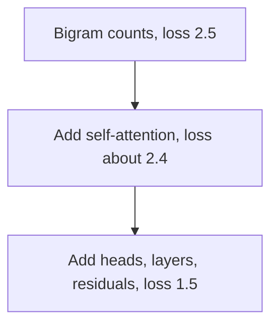
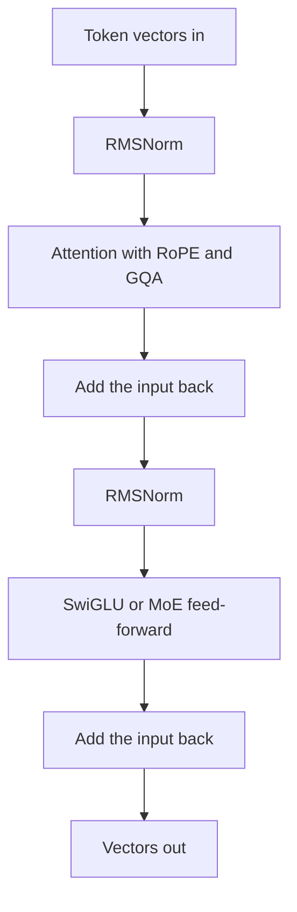
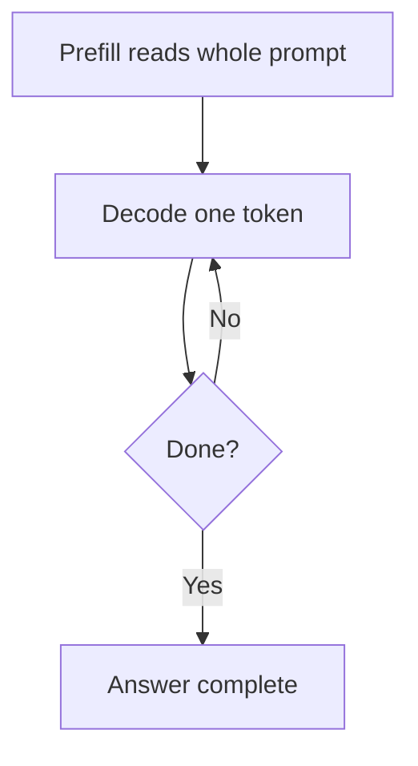

# train-from-scratch | Build a small GPT from scratch | 3 | 30
The best way to demystify a language model is to write a tiny one. The model file is about 300 lines of Python, and the training script is about 300 more.

## What you build
A character-level GPT. You load a text file, map each character to an integer, and train a transformer to predict the next character. You add pieces in this order: a bigram model (just counts), then self-attention, then multi-head attention, then feed-forward layers. Next come residual connections, which add a layer's input to its output so signals and gradients flow, and layer normalization, which rescales each layer's values to a steady size so training stays stable. Last is dropout, which randomly zeroes values during training to reduce overfitting. Each of the first six steps cuts loss, so you see why each piece exists. Dropout is the exception: it helps validation loss only once the model starts to overfit.

## Terms you will meet
Parameters: the learned numbers, which training adjusts. Batch: a group of examples processed together. Epoch: one pass through the data. Overfitting: memorizing training data and failing on new data, spotted when validation loss rises while training loss falls. Validation set: data held out to measure generalization.

## Do it
Follow the Karpathy video with the code open. Then change one thing at a time, such as the number of layers or the context length, and see what happens to loss. A GPU helps, but a laptop is enough for a smaller version.

## A worked example: the learning path in code
Step 1: count which character follows which (a bigram model). Loss about 2.5. Step 2: add one self-attention layer so a character can see earlier ones. Loss drops a little, to about 2.4. Step 3: add several heads, a feed-forward layer, more layers, residual connections and layer norm. Loss about 1.5 and output looks like verse. That last result uses the larger settings from the end of the video and a GPU. On a laptop, use a smaller model and expect a higher loss and rougher text. Each step is a few lines and each step visibly helps.



## What to try after
Change the context length and see what happens. Train on your own text. Make the model bigger until it overfits (validation loss rises) and then add dropout. You are doing, at small scale, the same core loop the labs use to pretrain a model.

## How one training step works
Training repeats one loop thousands of times.
1. Cut a batch of short snippets from your text file.
2. At every position the model outputs a probability for each possible next character.
3. The loss at that position is minus the natural log of the probability it gave the true character.
4. Backpropagation works out how much each parameter contributed to the loss.
5. The optimizer moves every parameter a small step that lowers the loss.

```mermaid One training step is a loop: batch, predict, loss, blame, nudge, then the next batch
flowchart TD
  A[Cut a batch of snippets] --> B[Predict the next character]
  B --> C[Loss from the true character]
  C --> D[Backpropagation]
  D --> E[Optimizer moves parameters]
  E -.->|Repeat thousands of times| A
  class C focus
```

Trace one position. The text so far is "th" and the true next character is "e". If the model gave "e" a probability of 0.02, the loss is 3.91. After some steps it gives 0.10 and the loss is 2.30. The loss curve you watch is this number averaged over the batch.

## How to tell it is working
Before training, the model guesses almost evenly. If your text has 65 distinct characters, each gets a probability near 1/65, so the starting loss is about ln 65, which is 4.17. A first loss far from that points to a bug in the data or code, not to a weak model. After that, log training loss and validation loss together every few hundred steps. Both should fall. If both stay flat, suspect the learning rate or a bug before you suspect the model size.

## What goes wrong: it memorizes
The symptom is training loss that keeps falling while validation loss turns upward, and samples that repeat long stretches of the training file word for word. A small text file holds far fewer facts than a model of millions of parameters can store, so it copies. To confirm, print the loss on both sets and look for the gap opening. Fixes, in order of effort: more text, dropout, a smaller model, or stopping at the step with the lowest validation loss.

```mermaid Invented loss curves: training loss keeps falling while validation loss turns upward, the sign of memorizing
xychart-beta
  x-axis "training step" [0, 500, 1000, 1500, 2000, 2500]
  y-axis "loss" 0 --> 5
  line "training loss" [4.2, 2.4, 1.6, 1.0, 0.6, 0.3]
  line "validation loss" [4.2, 2.5, 1.9, 1.9, 2.2, 2.6]
```

## When this is the wrong tool
A model trained from scratch on one file only continues text in that file's style. It cannot answer questions or follow instructions. For real tasks you start from a pretrained model and adapt it, as the fine-tuning lesson shows.

## Common mistake
Copying the code without running it and changing things. Experiments teach the lesson.

## Before you start
This is easier if you have done the Building Blocks chapter just before it: vectors, softmax, gradients and attention. The code is short, and each piece maps to a lesson there.

```resources
video | Let's build GPT: from scratch, in code, spelled out | https://www.youtube.com/watch?v=kCc8FmEb1nY | Andrej Karpathy | The standard walkthrough, about two hours.
repo | nanoGPT | https://github.com/karpathy/nanoGPT | Andrej Karpathy | A minimal, readable GPT training codebase. Deprecated by its author in favour of nanochat, but still fine to read.
repo | LLMs-from-scratch | https://github.com/rasbt/LLMs-from-scratch | Sebastian Raschka | The code for the book Build a Large Language Model (From Scratch).
course | Neural Networks: Zero to Hero | https://karpathy.ai/zero-to-hero.html | Andrej Karpathy | The full series from micrograd to GPT and tokenizers.
```

```quiz
Validation loss rises while training loss falls. What is happening? | Underfitting, the model is too small to learn ; Overfitting, it memorizes the training set ; A bug that leaks validation data into training | 1 | Training loss falls because the model memorizes; validation loss rises because memorized text does not carry over. Underfitting would show both losses high, and a leak would make validation loss fall too.
What does a residual connection do? | Halves the batch size for each training step ; Deletes any layers that the network does not need ; Adds a layer's input back onto its output | 2 | The shortcut gives the gradient a direct path back through every layer, so early layers still get a useful signal in a deep network.
After one minute your tiny GPT prints random letters and the loss is still near 4. What should you do? | Wait and keep watching the loss fall ; Add dropout right away to stop memorizing ; Cut the training text to a few lines | 0 | Loss near ln of the vocabulary size means the model has barely learned yet. Add dropout only when validation loss rises.
```

```story
A hobbyist trains a tiny GPT on a folder of Shakespeare plays on a laptop, with a small model. At first it outputs random letters. After a few minutes it produces words, then lines that look like verse, nonsense but plausibly Shakespearean. Watching the loss number fall while gibberish becomes language does more for your understanding than any article.
```

# modern-llm-architecture | Inside a modern LLM | 3 | 20
Most current models are still transformers. The changes below make them cheaper to train and run, or a little better for the same size. A few newer models also replace parts of attention, which this lesson does not cover.

## Changes from the 2017 design
The transformer from 2017 is still the core of today's models. Newer models add a few tricks that make them cheaper, faster or able to read more. Here they are in plain words.

RMSNorm keeps the numbers inside the network at a steady size so training stays stable. It is a simpler and faster version of an older step called layer normalization.

RoPE, short for rotary position embeddings, tells the model where each token sits in the text. It does this by rotating the query and key vectors by an angle that depends on position. It copes better with long texts than older methods.

Grouped-query attention, or GQA, lets several attention heads share one set of keys and values. The model stores less in its KV cache, so it needs less memory for long inputs.

SwiGLU is a small change to the feed-forward step, the part that processes each token's vector on its own after attention. It uses two projections side by side, and one of them acts as a gate that scales the other, followed by a third that projects back. It gives slightly better results than the older ReLU.

Mixture of experts, or MoE, replaces one big feed-forward block with many smaller "expert" blocks. A router picks only a few of them for each token. The model can hold a lot of knowledge but only uses a fraction of it per token.



## Why this matters to you
These choices decide price and speed. Fewer active parameters mean less compute per token, so tokens can be cheaper and faster, but memory still has to hold every parameter. A dense model, one that uses all its parameters for every token, has no such gap. A smaller KV cache means longer inputs fit in the same memory. When a model card says "671B total, 37B active", it means the model stores 671 billion parameters but only uses about 37 billion for each token.

## A worked example: reading a model card
Imagine the card says: "128K context, GQA with 8 KV heads, 64 experts with 2 active, RoPE." In plain words: it can read about 100,000 words at once. It shares key and value memory across groups of heads. It has 64 specialist blocks and uses 2 for each token. It encodes position by rotation. From this you can guess that it is large to store but fairly cheap to run.

## How grouped-query attention saves memory
The KV cache stores one key and one value vector per token, per layer, per key-value head. Use invented numbers for illustration: 32 layers, 128 numbers per head, 2 bytes per number. With 32 key-value heads each token costs 2 (a key and a value) × 32 layers × 32 key-value heads × 128 numbers × 2 bytes = 524,288 bytes, half a megabyte. An 8,000 token conversation then needs about 4.2 GB of cache. Let groups of heads share keys and values so only 8 are stored, and the same conversation needs about 1.0 GB. The quality drop is usually small, and the memory saving is exactly 32 divided by 8, a factor of four.

```mermaid Grouped-query attention lets several query heads read one shared set of keys and values
flowchart LR
  A[Query head 1] --> K1[Shared keys and values A]
  B[Query head 2] --> K1
  C[Query head 3] --> K2[Shared keys and values B]
  D[Query head 4] --> K2
  class K1 focus
  class K2 focus
```

```mermaid KV cache for an 8,000 token conversation shrinks in proportion to the key-value heads kept, using the lesson's invented model sizes
xychart-beta
  x-axis "key-value heads stored" [32, 16, 8, 4, 1]
  y-axis "gigabytes" 0 --> 5
  bar [4.19, 2.1, 1.05, 0.52, 0.13]
```

## How a router picks experts
Take four experts. For one token the router, a small layer that scores each expert, outputs 2.0, 1.0, 0.5 and -1.0. The model keeps the top two scores, 2.0 and 1.0, and turns them into weights with softmax: 0.73 and 0.27. The token's output is 0.73 times expert one's answer plus 0.27 times expert two's. The other two experts do no work for this token. A different token may score a different pair.

```mermaid The router scores all experts, but only the top two run and their outputs are blended
flowchart TD
  T[Token] --> R[Router scores 4 experts]
  R -->|0.73| E1[Expert 1]
  R -->|0.27| E2[Expert 2]
  R -.-> E3[Expert 3, skipped]
  R -.-> E4[Expert 4, skipped]
  E1 --> O[Weighted sum]
  E2 --> O
  class E3 warn
  class E4 warn
```

## What active parameters do not save
Every expert must still sit in memory, because the next token might need any of them. A model with 671 billion parameters stored in 16-bit form needs about 1,342 GB just to hold them, even though only 37 billion work per token. Active parameters cut the compute per token. They do not cut the storage, so a big mixture model still needs a large cluster or heavy quantization to run at all.

## Common mistake
Comparing models by total parameters alone. Compare active parameters, context length and measured quality on your own task.

```resources
article | Understanding and Coding the KV Cache in LLMs from Scratch | https://magazine.sebastianraschka.com/p/coding-the-kv-cache-in-llms | Sebastian Raschka | Why generation reuses past keys and values.
article | The Big LLM Architecture Comparison | https://magazine.sebastianraschka.com/p/the-big-llm-architecture-comparison | Sebastian Raschka | Compares DeepSeek, Llama, Qwen and others side by side.
paper | RoFormer: Enhanced Transformer with Rotary Position Embedding | https://arxiv.org/abs/2104.09864 | Su et al. | The RoPE paper.
paper | GLU Variants Improve Transformer | https://arxiv.org/abs/2002.05202 | Noam Shazeer | Introduces SwiGLU and its siblings.
```

```quiz
A card says "671B total, 37B active". What does that mean? | The model was trained on only 37B tokens ; About 37B parameters are used per token ; The model has exactly 37 layers in total | 1 | MoE routes each token to a few experts, so compute follows the active parameters.
What does grouped-query attention save? | Compute spent on the feed-forward step ; Space taken by the token vocabulary ; KV cache memory at long inputs | 2 | Sharing key and value heads shrinks the cache that grows with context length.
Two models have the same total size, but one is a mixture of experts with fewer active parameters. Which does less computation per token? | The dense one, because it stores fewer parameters ; Both, since total size is what sets the work ; Neither, since the tokenizer sets the work ; The expert one, as fewer parameters run | 3 | Compute per token follows active parameters, not total size. Both models store the same number of parameters.
```

```story
You read that a new model has "671 billion parameters" and assume it is slow and expensive to run. The model card says "37 billion active". Only a small group of expert sub-networks wake up for each token, so the work per token is about what a 37B model does. You still need enough memory to hold all 671 billion parameters. The headline number and the real cost differ because of one design choice.
```

# fine-tuning | Fine-tuning with LoRA and QLoRA | 3 | 20
Fine-tuning adjusts a pretrained model on your examples. Use it to change behavior and style, not to add facts.

## When to fine-tune
First try better prompts, examples in context and retrieval. Fine-tune when you need a consistent format or tone at scale, want a small cheap model to match a big one on a narrow task, or have prompt text that is too long to send every call. Do not fine-tune to teach new facts. It is unreliable for that and retrieval is easier to update.

## LoRA and QLoRA
Full fine-tuning updates every weight, which needs a lot of memory. LoRA (low-rank adaptation) freezes the original weights and, for each weight matrix you choose to adapt (often the attention matrices), learns two small matrices whose product is the update. The 8 in the shapes below is the rank, the size of the narrow middle. The worked example below puts numbers on how small that update is. QLoRA also stores the frozen base in 4-bit form so a large model fits on one GPU.

$$W' = W + B A, \qquad B \in \mathbb{R}^{4096 \times 8}, \; A \in \mathbb{R}^{8 \times 4096}$$

## Data is the work
Quality beats quantity. A few hundred to a few thousand clean examples often suffice. Hold out an evaluation set, compare against the base model with prompting, and check that you did not make other abilities worse.

## A worked example: LoRA in numbers
A weight matrix of 4,096 by 4,096 holds 16.8 million numbers. Full fine-tuning would update all of them, for every layer. LoRA freezes them and learns two thin matrices, 4,096 by 8 and 8 by 4,096, about 32,800 numbers each, 65,500 in total, about 0.4 percent of the original matrix. The update is their product, added to the original. Far less memory, and the add-on file is small enough to share.

## How LoRA changes a layer
For an input vector x of 4,096 numbers, the layer computes the frozen output plus a small correction. The correction multiplies x by A, which squeezes it down to 8 numbers, then by B, which expands those 8 back to 4,096. Because 8 numbers carry the whole change, the update can only move the layer along 8 directions. That limit is called the rank. B starts as all zeros, so before training the correction is zero and the model behaves exactly like the original. After training, you can add B A into W once, so serving costs no extra time.

```mermaid The frozen weights and the small trained pair run side by side, and their outputs are added
flowchart TD
  X[Input x, 4096 numbers] --> W[Frozen weights]
  X --> A[A squeezes to 8 numbers]
  A --> B[B expands to 4096]
  W --> S[Add]
  B --> S
  S --> Y[Layer output]
  class A focus
  class B focus
```

The rank is the main size dial. The table counts the numbers in A and B for one 4,096 by 4,096 matrix of 16.8 million numbers.

| Rank | Numbers in A and B | Share of the original matrix |
|---|---|---|
| 1 | 8,192 | 0.05 percent |
| 4 | 32,768 | 0.2 percent |
| 8 | 65,536 | 0.4 percent |
| 16 | 131,072 | 0.8 percent |
| 64 | 524,288 | 3.1 percent |

## A second example: when not to fine-tune
A shop wants a bot that knows its return policy, which changes every month. Fine-tuning would mean building new training examples and retraining each time, and the model might still quote last month's rule. Putting the policy in a document that a retrieval step fetches means editing one file. Fine-tune for how the bot answers. Retrieve for what it knows.

## What goes wrong: gains that hide losses
After fine-tuning on a narrow set, the format may be perfect while the model gets worse at everything else. It may refuse normal requests, or answer unrelated questions in the style of your examples. To confirm, keep a fixed set of about 20 general prompts. Run them on the base model and on the tuned one, and read both sets of answers side by side. Also watch validation loss on held-out examples: if it rises while training loss falls, you are overfitting. Fewer epochs (passes over the training data) or a smaller rank usually helps.

## Common mistake
Fine-tuning before trying prompting, examples and retrieval.

```resources
paper | LoRA: Low-Rank Adaptation of Large Language Models | https://arxiv.org/abs/2106.09685 | Hu et al. | The LoRA paper.
paper | QLoRA: Efficient Finetuning of Quantized LLMs | https://arxiv.org/abs/2305.14314 | Dettmers et al. | Fine-tuning large models on a single GPU.
repo | Unsloth | https://github.com/unslothai/unsloth | Unsloth | Fast, memory-efficient fine-tuning with notebooks.
repo | LLaMA-Factory | https://github.com/hiyouga/LlamaFactory | hiyouga | A unified tool for fine-tuning many models.
course | smol course | https://github.com/huggingface/smol-course | Hugging Face | A practical course on aligning small models.
docs | PEFT | https://huggingface.co/docs/peft | Hugging Face | The standard library for LoRA and related methods.
```

```quiz
You have 800 clean examples and a prompt that works 90 percent of the time. What should you try first? | Tighten the prompt, then compare with tuning ; Train a smaller model from scratch instead ; Gather 100,000 messy examples and fine-tune | 0 | Prompting is cheaper to try. Fine-tune when it falls short on your tests.
A rank-8 LoRA on a 4096 by 4096 matrix stores about what share of its numbers? | About 5 percent ; About 25 percent ; Under 1 percent | 2 | Two 4096 by 8 matrices are 65,536 numbers in total, versus 16.8 million: about 0.4 percent.
Your return policy changes monthly and the bot must quote it. What do you change each month? | Retrain the model on new examples ; Edit the document the bot retrieves from ; Raise the LoRA rank of the adapter | 1 | Retrieval reads the current file, so editing one document updates the answers without retraining.
```

```story
A law firm wants every contract summary in exactly their house format: three headings, no more than 150 words, fixed phrases. A long prompt works 90 percent of the time. After fine-tuning a small model on 800 of their best summaries, it follows the format 99 percent of the time, faster and cheaper. Fine-tuning shines when you need the same behavior reliably, at scale.
```

# rl-for-llms | Reinforcement learning for reasoning | 3 | 20
Models learn to reason by trying answers, getting a reward when the answer checks out, and reinforcing what worked.

## The idea
Start with a policy: the model itself, which picks tokens. For a math problem, sample several answers. A reward function gives 1 if the final answer is correct and 0 if not. Raise the probability of the sampled reasoning that earned reward and lower it for the rest. Over many problems the model discovers longer, more careful chains of thought.

## Algorithms in plain terms
Policy gradient (REINFORCE) nudges up the probability of actions in proportion to the reward. The problem is high variance, so training is noisy. An advantage compares an answer to a reference score such as the average reward: how much better than average was this one? PPO computes advantages with a second model, the value model, whose job is to guess how good a situation is. That doubles the memory and work. PPO also limits how far each update can move the policy. It looks at the importance ratio, which is the new probability divided by the old one, and clips it to a range like 0.8 to 1.2. GRPO, used by DeepSeek, drops the value model: sample a group of answers per prompt and use the group's own average as the reference. Each answer's advantage is its reward minus the group's mean, divided by the group's standard deviation (a measure of how spread out the rewards are). Some later variants drop the division.

$$A_i = \frac{r_i - \mathrm{mean}(r)}{\mathrm{std}(r)}$$

Here the standard deviation divides by the number of answers (4), the simplest version. Code libraries may divide by one less, which shifts the numbers slightly but not the idea.

## Limits
It needs a reward you can compute, so it works best on math, code and tasks with tests. Rewards can be gamed: a model may find shortcuts that satisfy the check without doing the task.

## A worked example: one training step
Prompt: "What is 17 × 24?" The model samples four attempts with answers 408, 398, 408, 418. Rewards: 1, 0, 1, 0. Mean 0.5, standard deviation 0.5. Advantages: +1, -1, +1, -1. The two reasoning chains that reached 408 are made more likely, the others less likely. Repeat over many thousands of problems.

```mermaid One reinforcement learning step: sample attempts, check them, compare with the average, then update
flowchart TD
  P[Prompt] --> S[Model samples 4 attempts]
  S --> R[Reward 1 or 0 per answer]
  R --> A[Advantage against the average]
  A --> U[Raise good attempts, lower the rest]
  U -.->|Next problem| P
  class R focus
```

## What can go wrong
Reward hacking: if the reward only checks the final number, the model may learn tricks that get the number without good reasoning. Hacking is reduced by rewards that are hard to fool: tests the model has never seen, a separate check on output format, and caps on length. Rewards that come from a learned model of step quality can be hacked too, which is why DeepSeek-R1 used only rule-based checks.

## A second example: a rare success
Rewards for four attempts are 1, 0, 0, 0. The mean is 0.25 and the standard deviation is 0.43. The one correct attempt gets advantage (1 - 0.25) / 0.43 = +1.73. Each wrong one gets -0.58. The total push up equals the total push down (1.73 against 3 x 0.58), but it is concentrated on the single answer that worked, so the model clearly learns what that one did differently. This is how it learns from problems it usually gets wrong.

## When there is nothing to learn
If all four attempts are correct, every reward is 1, the mean is 1, the standard deviation is 0 and every advantage is 0. The same happens when all four fail. The update is empty. This is why training sets are chosen so problems are neither too easy nor too hard. If reward stays flat, check how many prompts in a batch have mixed results.

The table puts the group examples side by side, using the spread of the four rewards.

| Rewards for 4 attempts | Mean | Standard deviation | Advantages |
|---|---|---|---|
| 1, 0, 1, 0 | 0.5 | 0.5 | +1, -1, +1, -1 |
| 1, 0, 0, 0 | 0.25 | 0.43 | +1.73, -0.58, -0.58, -0.58 |
| 1, 1, 1, 0 | 0.75 | 0.43 | +0.58, +0.58, +0.58, -1.73 |
| 1, 1, 1, 1 | 1 | 0 | 0, 0, 0, 0 |
| 0, 0, 0, 0 | 0 | 0 | 0, 0, 0, 0 |

## How clipping limits a step
Say the old model gave a reasoning step probability 0.20 and the updated one gives 0.30. The ratio is 1.5. With clipping at 1.2, a positive-advantage sample stops counting beyond 0.24, so one lucky sample cannot drag the model far from where it was.

```mermaid For a positive-advantage sample the clipped objective stops rising once the new probability is 1.2 times the old
xychart-beta
  x-axis "new probability divided by old" [0.6, 0.8, 1.0, 1.2, 1.4, 1.6, 1.8]
  y-axis "objective per unit of advantage" 0 --> 2
  line "without clipping" [0.6, 0.8, 1.0, 1.2, 1.4, 1.6, 1.8]
  line "with clipping at 1.2" [0.6, 0.8, 1.0, 1.2, 1.2, 1.2, 1.2]
```

## What goes wrong: hacking you can measure
Suppose the reward is the share of unit tests that pass. A model may learn to write code that detects the test inputs and returns the expected outputs. The symptom is training reward near 100 percent while code fails on new inputs. To confirm, score the model on held-out tests it never trained against, and read some outputs.

## Common mistake
Trying it on a task like writing a good cover letter. There is no function that returns 1 or 0, so people reach for a model that gives a score, and the policy soon learns to please that scorer instead of writing well.

```resources
paper | DeepSeekMath | https://arxiv.org/abs/2402.03300 | Shao et al. | Introduces GRPO.
paper | DeepSeek-R1 | https://arxiv.org/abs/2501.12948 | DeepSeek | Reasoning emerging from reinforcement learning with verifiable rewards.
paper | Proximal Policy Optimization Algorithms | https://arxiv.org/abs/1707.06347 | Schulman et al. | The PPO paper.
course | Hugging Face Deep RL Course | https://huggingface.co/learn/deep-rl-course | Hugging Face | Free course from basics to policy gradient methods.
```

```quiz
What is the GRPO advantage of a correct answer when rewards are 1, 0, 0, 1? | +0.5, since reward minus the group mean is 0.5 ; +1, since 0.5 divided by the std of 0.5 ; 0, since the correct answers cancel each other | 1 | Reward minus the group mean is 0.5, and dividing by the standard deviation (0.5) gives +1.
Why does reinforcement learning for reasoning work best on math and code? | They have the largest training sets online ; These subjects use shorter reasoning chains ; Their answers can be checked automatically | 2 | A computable reward is the requirement.
A coding model's training reward is 98 percent, but on tests it never saw it passes 40 percent. The most likely cause? | Reward hacking: it satisfied the training checks without solving the task ; The group size is too large for the problem set ; The clipping range is too tight for each step | 0 | A big gap between the reward it trains on and held-out results means the check is being gamed.
```

```story
A student solves math problems and is told only "right" or "wrong" at the end. At first they guess. They notice that writing out the steps leads to more rights, so they write more steps. Reinforcement learning on math does this to a model: reward correct final answers and the model discovers that careful, longer reasoning pays off.
```

# quantization-serving | Quantization and serving | 3 | 15
Running a model is a memory and speed problem. Quantization and smart batching make it cheap enough to use.

## Memory math
A model with N parameters stored in 16-bit format needs about 2N bytes. A 70 billion parameter model needs about 140 GB for weights, more than one GPU holds. In 8-bit it needs 70 GB, in 4-bit about 35 GB (a little more once the scales are stored, see below). Add memory for the KV cache, which grows with context length and the number of simultaneous users. Memory bandwidth, used below, is how many gigabytes per second the card can read from its memory.

$$\text{memory} \approx N \times \text{bytes per parameter}$$

```mermaid Weight memory for a 70 billion parameter model halves with each step down in precision
xychart-beta
  x-axis [16-bit, 8-bit, 4-bit]
  y-axis "gigabytes" 0 --> 150
  bar [140, 70, 35]
```

## Quantization
It stores weights with fewer bits, mapping ranges of values to a small set of levels. Quality loss at 8-bit is usually negligible and at 4-bit is small for large models, larger for small ones. GGUF is a file format for running quantized models locally with llama.cpp. AWQ and GPTQ are two quantization methods aimed at GPU serving.

## Serving
Generation has two phases: prefill reads the whole prompt in parallel, then decode produces one token at a time. Decode is limited by memory bandwidth, because it must read all the weights from memory for every token, so memory speed, not raw compute, sets the pace. Servers batch many users together to share that reading cost.

Servers such as vLLM add three tricks to raise throughput:
1. Continuous batching lets a new request join a batch that is already running instead of waiting for the whole batch to finish.
2. Paged attention stores the KV cache in small fixed blocks, so memory is not wasted on gaps.
3. Speculative decoding has a small, fast model guess the next few tokens, and the large model checks all of them in one pass, keeping the ones it agrees with.



## How the squeezing works, step by step
Take weights between -1 and 1 and 4 bits, which give 16 levels. The levels are spaced 2 / 15 = 0.133 apart: -1, -0.867, and so on. To store 0.37:
1. Shift and scale it: (0.37 + 1) / 0.133 = 10.3.
2. Round to the nearest whole level, 10.
3. Store the integer 10 plus the shared scale.
4. When running, convert back: -1 + 10 × 0.133 = 0.333.

```mermaid A weight becomes a small integer plus a shared scale, then is converted back when used
flowchart TD
  W[Weight 0.37] --> S[Shift and scale to 10.3]
  S --> R[Round to level 10]
  R --> T[Store 10 and the shared scale]
  T --> B[Convert back to 0.333]
  class R focus
```

No weight is ever off by more than half a step, 0.067. Each weight is off by a small random-looking amount, and a layer's output is a sum of many weights, so the small errors partly cancel. Large models tolerate this well and small ones lose more. A few big weights break the cancelling, as the next section shows.

## What goes wrong: one outlier
Suppose one weight in a row is 8 and the rest are near 0.3. The range is now -8 to 8, so the step grows to 1.07. The nearest levels to 0.3 are -0.53 and 0.53, so every small weight snaps to 0.53 and the layer breaks. The symptom is a model that works at 8-bit and produces garbage at 4-bit. Practical methods give each small group of weights its own scale, so one outlier damages only its group. To confirm, compare perplexity or your own test answers before and after. Perplexity is a score for how surprised the model is by real text. Lower is better, so a jump up after quantizing means damage.

The table shows the same row of weights stored with and without the outlier.

| Row of weights | Range | Step between levels | 0.3 is stored as |
|---|---|---|---|
| All between -1 and 1 | -1 to 1 | 0.133 | 0.333 |
| One weight at 8 | -8 to 8 | 1.067 | 0.533 |

## What a serving budget looks like
Memory holds weights plus the KV cache. Invented numbers for a 70B model with grouped-query attention: 80 layers, 8 key-value heads, 128 numbers per head, 2 bytes each, and both a key and a value per token. That is 80 x 8 x 128 x 2 x 2 = 327,680 bytes per token, so one 8,000 token conversation takes 2.6 GB. Ten users at once need 26 GB on top of 35 GB of 4-bit weights.

## Why batching pays
Say reading the 35 GB of weights takes 35 ms on a card that moves 1,000 GB per second. One user then gets about 29 tokens a second. Eight users in one batch share that same read, so the step still takes about 35 ms but produces 8 tokens: about 229 tokens a second in total. This ignores the cache reads, which grow with the batch.

```mermaid Total tokens per second grow with the batch because one read of the weights serves every user, using the lesson's invented 35 ms step
xychart-beta
  x-axis "users in the batch" [1, 2, 4, 8]
  y-axis "tokens per second in total" 0 --> 250
  bar [28.6, 57.1, 114.3, 228.6]
```

## Common mistake
Quantizing a small model to 2 bits and being surprised it got worse.

```resources
repo | vLLM | https://github.com/vllm-project/vllm | vLLM project | Throughput-focused serving with paged attention.
repo | llama.cpp | https://github.com/ggml-org/llama.cpp | ggml | Local inference and the GGUF format.
article | Transformer Inference Arithmetic | https://kipp.ly/transformer-inference-arithmetic/ | Kipply | The memory and compute math of serving.
paper | Efficient Memory Management for LLM Serving with PagedAttention | https://arxiv.org/abs/2309.06180 | Kwon et al. | The vLLM paper.
```

```quiz
How much memory do the weights of a 70B model need at 4-bit? | About 140 GB ; About 35 GB ; About 70 GB | 1 | 70 billion parameters at half a byte each is about 35 GB.
Which generation phase is limited by memory bandwidth? | Sampling the next token with temperature ; Prefill, which reads the whole prompt at once ; Decode, which writes one token at a time | 2 | Producing one token at a time rereads all the weights, and the growing KV cache, on every step.
A layer has 15 weights near 0.3 and one weight at 8. Stored in 4 bits with one scale for the whole row, what happens to the small weights? | They are stored almost exactly ; They all snap to about 0.53 ; They all become exactly 0 | 1 | The outlier stretches the range to -8..8, so the step is 1.07 and the nearest levels to 0.3 are -0.53 and 0.53.
```

```story
A model that needs 140 GB of memory will not fit on any single consumer card. Squeeze every number from 16 bits to 4 and it needs 35 GB. Squeeze further or shrink the model and it fits on a laptop. Quantization is the trade of a little accuracy for a lot of room, like saving a photo as a smaller JPEG.
```

# local-models | Running models on your own machine | 2 | 12
A laptop can run a capable small model. It is the fastest way to learn what models need and to keep data private.

## Getting started
Install Ollama or LM Studio, then pull a model with one command. Choose a size your memory can hold. As a rule, a 4-bit model needs about half a gigabyte per billion parameters plus some overhead. So 8 GB of memory fits a 3 to 4 billion parameter model comfortably, and an 8B one only if you close other apps. 16 GB is the comfortable start for 7 to 8B. Unified memory on Apple Silicon lets the GPU use system memory, which is why laptops handle larger models than a typical PC graphics card.

## What to use them for
Classification, extraction, summaries and drafting where the data should not leave your machine. Local models are also a cheap test bed for prompts and tool use. Expect weaker results than the frontier on hard reasoning and coding. Most local runners expose an API shaped like the common cloud APIs, so switching is usually a new base URL and model name. Check that the features you use, such as tool calling, work with the local model.

## A worked example: what fits
A 7 to 8 billion parameter model at 4-bit is about 4 GB of weights, comfortable on a laptop with 16 GB of memory. A 14B model is about 7 GB, tighter. A 70B model at 4-bit is about 35 GB, needing a workstation. Add 1 to 2 GB for the context cache to each. Start with the small one and see if it is good enough for your task.

## A memory budget in practice
The rule of half a gigabyte per billion parameters ignores everything else on the machine. On a 16 GB laptop, the system and open apps often take 4 to 5 GB. Check yours in the memory monitor (Activity Monitor on a Mac, Task Manager on Windows) with your usual apps open. That leaves about 11 GB. A 14B model at 4-bit needs about 7 GB, and the context cache adds one or two more, so it fits. The context cache is extra memory the model uses to remember the text so far, so it grows as your prompt and conversation get longer. A 32B model needs 32 × 0.5 = 16 GB and does not.

On the 16 GB laptop with about 11 GB free, the half-gigabyte rule sorts the model sizes like this.

| Model size | Weights at 4-bit | Fits in about 11 GB free? |
|---|---|---|
| 8B | 4 GB | Yes, with room for the cache |
| 14B | 7 GB | Yes, with 1 to 2 GB for the cache |
| 32B | 16 GB | No |
| 70B | 35 GB | No, it needs a workstation |

## What goes wrong: it slows to a crawl
If the model plus its cache is larger than free memory, the system pushes part of it to disk (this is called swap, disk space used as overflow memory, and it is far slower than RAM). The symptom is words arriving every few seconds and a laptop that gets hot and stuck. To confirm, open the memory monitor while it generates and look for heavy swap use or memory pressure in the red. Choose a smaller model or a more compressed version.

```mermaid A model that does not fit in free memory spills to disk and slows to a crawl
flowchart TD
  M[Model plus cache] --> D{Fits in free memory?}
  D -->|Yes| F[Runs at normal speed]
  D -->|No| S[Spills to disk and crawls]
  S --> C[Choose a smaller model]
  class F good
  class S bad
```
Another symptom is a model that ignores the start of a long document. Many runners start with a short context window by default, so early text is silently dropped. Paste a document with a fact in the first line, ask about it, and raise the context setting if the answer misses.

## Try it yourself: is it good enough
Write 20 real prompts from your task and run them on the local model and a cloud model. Mark each answer acceptable or not. If the local model passes 18 of 20 and the cloud one 19, that is probably good enough for a draft-and-review task. For work where a wrong answer is costly, set a higher bar first. Also note speed. Around 5 to 8 tokens a second is close to reading speed, so slower than that feels sluggish.

## When the cloud wins
One laptop serves one request at a time well. If a hundred people need answers together, or the task needs hard multi-step reasoning, a hosted model fits better.

## Common mistake
Expecting a laptop model to match the largest cloud models.

```resources
repo | Ollama | https://github.com/ollama/ollama | Ollama | The simplest way to run models locally.
tool | LM Studio | https://lmstudio.ai/ | LM Studio | A desktop app for downloading and chatting with local models.
repo | llama.cpp | https://github.com/ggml-org/llama.cpp | ggml | The engine behind many local tools.
tool | r/LocalLLaMA | https://www.reddit.com/r/LocalLLaMA/ | Community | The main community for local model news and tips.
```

```quiz
Roughly how much memory does a 4-bit 8B model need? | About 16 GB ; About 4 to 5 GB ; About 1 to 2 GB | 1 | Half a byte per parameter is 4 GB for 8 billion parameters, and the runtime adds a little more, so 4 to 5 GB.
You must summarize 300 confidential contracts and a cloud service is not allowed. Which reason best supports a local model? | It beats a frontier model on legal reasoning ; The documents never leave your own machine ; It serves many users faster than a host | 1 | Local models give privacy, but they are weaker than frontier models on hard reasoning and serve one request at a time well.
Your laptop has 8 GB of memory. Which model size is realistic at 4-bit? | About 3 to 4 billion parameters ; About 14 billion parameters ; About 70 billion parameters | 0 | Weights take about half a gigabyte per billion parameters, and the system and apps already use 4 to 5 GB of the 8, so only about 3 to 4 GB is free.
```

```story
A journalist working on a sensitive story cannot paste documents into an online service. They run a model on their laptop with no internet. It is not the smartest model, but it can summarize documents, pull out names and dates, and nothing leaves the machine. For some jobs, "private and good enough" beats "smarter but online".
```

