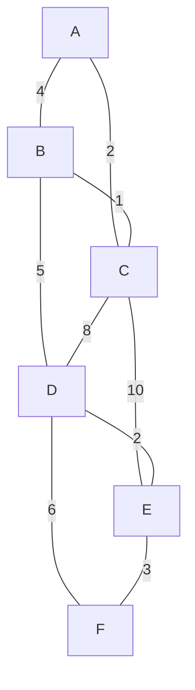
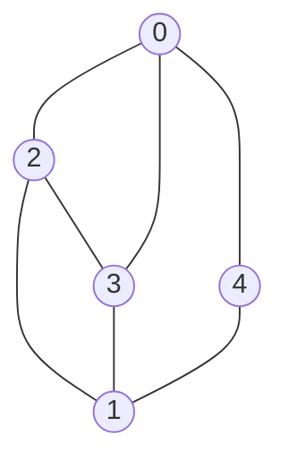

# algorithms/graph/bellman-ford | before References
Bellman-Ford on a small digraph with source S and the edges relaxed in this fixed order: A to C (2), B to A (-3), S to A (4), S to B (5), C to D (1). The table shows the best known distance to each vertex after every round, and which edges improved something.

```mermaid The example graph: the negative edge B to A makes the route through B cheaper than the direct edge S to A
flowchart TD
  S -->|4| A
  S -->|5| B
  B -->|-3| A
  A -->|2| C
  C -->|1| D
  class B focus
```

| Round | S | A | B | C | D | Edges that improved |
|---|---|---|---|---|---|---|
| start | 0 | inf | inf | inf | inf | - |
| round 1 | 0 | 4 | 5 | inf | inf | SA SB |
| round 2 | 0 | 2 | 5 | 6 | 7 | AC BA CD |
| round 3 | 0 | 2 | 5 | 4 | 5 | AC CD |
| round 4 | 0 | 2 | 5 | 4 | 5 | none, stop |

A reaches 2 via S, B, A instead of 4 directly. Round 4 changes nothing, so a version with an early exit can stop there, which is the best case in the complexity section. The lesson code has no such check and always runs |V| - 1 = 4 rounds. The order edges are relaxed in changes the intermediate rows but never the final answer. The table uses the order above so each round is easy to follow, while the code walks the vertices in the order they were added.

# algorithms/graph/floyd-warshall | before Example
One cell of the update, using numbers from the tables below: in the pass for k = 2, the entry for 4 to 3 improves from infinity to 1 because going through vertex 2 costs -1 + 2. The 2 on the edge from 2 to 3 is the entry from the k = 1 table (it was 3 before that pass).

```mermaid Pass k = 2 for the pair 4 to 3: the direct entry is infinity, the route through vertex 2 costs 1
flowchart LR
  V4[Vertex 4] -->|direct: inf| V3[Vertex 3]
  V4 -->|-1| V2[Vertex 2]
  V2 -->|2| V3
  class V2 focus
  class V3 good
```

# algorithms/graph/kruskal | before Minimum Spanning Tree
A trace on a 6-vertex graph (edge weights invented for the example). The edges are taken in order of weight, and an edge is skipped when both ends are already connected.



| Step | Edge | Weight | Decision | Total so far |
|---|---|---|---|---|
| 1 | B-C | 1 | add | 1 |
| 2 | A-C | 2 | add | 3 |
| 3 | D-E | 2 | add | 5 |
| 4 | E-F | 3 | add | 8 |
| 5 | A-B | 4 | skip, would form a cycle | 8 |
| 6 | B-D | 5 | add | 13 |
| 7 | D-F | 6 | skip, would form a cycle | 13 |
| 8 | C-D | 8 | skip, would form a cycle | 13 |
| 9 | C-E | 10 | skip, would form a cycle | 13 |

The tree uses 5 edges (one fewer than the 6 vertices) and costs 13. The skipped edges A-B, D-F, C-D and C-E each join two vertices that earlier edges had already connected.

# algorithms/graph/prim | before Minimum Spanning Tree
Prim on the same 6-vertex graph as the Kruskal lesson (weights invented), starting at A. The picture above uses its own weights, and in this example there are no ties in Prim's choices. Each step lists the edges that leave the tree so far and takes the cheapest.


| Step | Edges leaving the tree (name:weight) | Cheapest taken | New vertex | Total so far |
|---|---|---|---|---|
| 1 | AC:2 AB:4 | A-C | C | 2 |
| 2 | BC:1 AB:4 CD:8 CE:10 | B-C | B | 3 |
| 3 | BD:5 CD:8 CE:10 | B-D | D | 8 |
| 4 | DE:2 DF:6 CE:10 | D-E | E | 10 |
| 5 | EF:3 DF:6 | E-F | F | 13 |

Prim and Kruskal both end at 13. They build the same tree here by different routes, one growing from A, the other joining the cheapest edges anywhere.

# algorithms/graph/strongly-connected-components | before Code
A strongly connected component is a largest group of vertices in which every vertex can reach every other one. Every vertex belongs to exactly one such group, so the algorithm splits the graph into groups. In the example below, A, B, C form one group and D, E, F another.

The lesson code runs two depth-first passes (Kosaraju). A trace on a 6-vertex digraph with edges A to B, B to C, C to A, B to D, D to E, E to F, F to D.

```mermaid Example digraph: A, B, C loop among themselves, D, E, F loop among themselves, and B points into D
flowchart TD
  subgraph S1[Component 1]
    A --> B
    B --> C
    C --> A
  end
  subgraph S2[Component 2]
    D --> E
    E --> F
    F --> D
  end
  B --> D
```

A vertex finishes when the search has explored everything reachable from it and is about to step back. Start at A: A goes to B, B goes to C, C only points back to A (already seen), so C finishes first. Then B tries D, D goes to E, E to F, and F finishes, then E, then D, then B, then A.

| Pass | What happens | Result |
|---|---|---|
| 1: DFS on the original graph from A | record each vertex when it finishes | finish order C, F, E, D, B, A |
| Reverse every edge | the edge B to D now points D to B | the loops stay, the link between them flips |
| 2: DFS on the reversed graph, taking vertices from the latest finisher | start at A | everything reached is one component: {A, C, B} then {D, F, E} |

Reversing the edges does not change which vertices belong together: if A and C can reach each other, they still can after every edge is flipped. What changes is the link between loops. In the original graph B leads into D. In the reversed graph D leads into B, so a search that starts in D's loop would leak into A's loop. The finish order prevents that. The vertex that finishes last (A) is always in a loop that no other loop points into in the original graph, so a search from it in the reversed graph can only reach its own loop. Once that loop is removed from play, the next-latest unvisited finisher (D) is again in a loop that only points at loops we already used. Try it: in the reversed graph, start at D instead of A and watch it collect all six vertices.

# algorithms/graph/articulation-points | before Code
Two triangles, A B C and D E F, joined by the single edge C to D. The goal is to find which single vertices split the graph when removed.

```mermaid Triangles A B C and D E F, joined by the edge C to D: removing C or D disconnects the graph
flowchart LR
  A --- B
  B --- C
  C --- A
  C --- D
  D --- E
  E --- F
  F --- D
  class C bad
  class D bad
```

Depth-first search from A gives each vertex a discovery time (disc) and a low value, the earliest discovery time reachable from its subtree using at most one back edge. Neighbors are visited in the order the edges were added, which here is alphabetical. A different order changes the disc numbers but never the set of articulation points.

| Vertex | disc | low | DFS parent |
|---|---|---|---|
| A | 1 | 1 | none (root) |
| B | 2 | 1 | A |
| C | 3 | 1 | B |
| D | 4 | 4 | C |
| E | 5 | 4 | D |
| F | 6 | 4 | E |

The rule from the code: a non-root vertex u is an articulation point when some child c has disc[u] <= low[c], meaning c's subtree cannot reach above u. Here C qualifies (child D has low 4 and C has disc 3), and D qualifies (child E has low 4 and D has disc 4). The root A has one DFS child, so it is not one. A root counts only with two or more children.

The DFS goes A, B, C, D, E, F along the edges A-B, B-C, C-D, D-E, E-F. The two edges it did not walk, C-A and F-D, are back edges: they lead from a vertex to one found earlier. They are why C has low 1 (it can jump back to A) and F has low 4 (it can jump back to D). D's subtree {D, E, F} has no back edge that reaches C or A, so removing D or C cuts it off.

# algorithms/graph/bridges | before Code
A square A, B, C, D with a tail D to E to F. Edges that sit on a cycle are never bridges, so only the tail should be flagged.

```mermaid Square A B C D with a tail D to E to F. The two tail edges, D-E and E-F, are the bridges (the red boxes mark the far ends of those edges). The four square edges sit on a cycle, so none of them is a bridge
flowchart LR
  A --- B
  B --- C
  C --- D
  D --- A
  D --- E
  E --- F
  class E bad
  class F bad
```

Depth-first search from A records a discovery time (disc) per vertex and a low value, the earliest discovery time reachable from its subtree. A tree edge from u to v is a bridge when low[v] is greater than disc[u], so nothing below v can climb back past u.

| Tree edge | disc of upper end | low of lower end | Verdict |
|---|---|---|---|
| E-F | 5 | 6 | bridge |
| D-E | 4 | 5 | bridge |
| C-D | 3 | 1 | on a cycle |
| B-C | 2 | 1 | on a cycle |
| A-B | 1 | 1 | on a cycle |

Neighbors are visited in the order the edges were added, here alphabetical. The square collapses to one low value because it forms a cycle, and the two tail edges have no way back up.

This looks like the articulation rule, but it uses "greater than" instead of "greater than or equal". If something below v has a back edge to u itself, then the edge u-v sits on a cycle and is not a bridge, yet removing the vertex u would still split the graph. So a back edge that lands exactly on u (low[v] equals disc[u]) saves the edge but not the vertex. For a bridge, nothing below v may reach u or anything above u.

# algorithms/graph/eulerian-path | before Code
The test has two parts. First, all the edges must be in one connected piece (ignore vertices with no edges). Second, count the vertices with an odd number of edges: 0 gives a circuit, 2 gives a trail that starts at one odd vertex and ends at the other, anything else gives neither. The code below checks only the second part, so give it a connected graph.

```mermaid Deciding whether an Eulerian path or circuit can exist, once the graph is connected
flowchart TD
  A[Count odd-degree vertices] --> B{How many?}
  B -->|0| C[Circuit exists]
  B -->|2| D[Trail from an odd vertex]
  B -->|any other number| E[Neither exists]
  class C good
  class D good
  class E bad
```

In the Königsberg puzzle the city's seven river bridges are the edges and the four pieces of land are the vertices. (These are ordinary bridges, not the graph-theory bridges of the previous lesson.) The number of bridges touching each piece of land is its degree:

| Land mass | River bridges touching it (degree) | Odd or even |
|---|---|---|
| Central island | 5 | odd |
| North bank | 3 | odd |
| South bank | 3 | odd |
| East land | 3 | odd |

Four odd vertices is more than two, so no walk can cross every bridge exactly once.

Once you know a path exists, the code builds it by walking and deleting edges. The rule (Fleury's algorithm): at each vertex, take any edge that is not a cut edge, because crossing a cut edge cuts off the rest of the graph behind you and you could never come back to use those edges. Only take a cut edge when it is the only edge left at that vertex. That is why the code recomputes the cut edges with `graphBridges` after each deletion. It is simple but slow: one full bridge search per edge.

# algorithms/graph/hamiltonian-cycle | before Naive Algorithm
The title says path, but the code on this page solves the cycle version: it looks for an order that visits every vertex once and also has an edge from the last vertex back to the first. A graph can have a Hamiltonian path and no cycle (a simple line of 3 vertices does). For that graph this code finds nothing. To solve the path version, drop the closing-edge check and save every full-length path.

# algorithms/graph/hamiltonian-cycle | after Backtracking Algorithm
The code below is a slightly bigger version of this idea. It fixes vertex 0 as the start (any cycle passes through every vertex, so the start does not matter). At each step it tries every vertex that is next to the last one and not yet used. When the path holds all vertices, it checks for an edge back to vertex 0 and, if there is one, saves the path. Then it backs up and keeps searching, so it returns a list of all cycles, empty if there are none, rather than a yes or no answer.

# algorithms/graph/hamiltonian-cycle | before References
The backtracking method on 5 vertices with edges 0-2, 0-3, 0-4, 1-2, 1-3, 1-4, 2-3. Vertex 0 is placed first, then the next free neighbor is tried at each position.



| Step | Path array | Action |
|---|---|---|
| 1 | 0 2 | extend |
| 2 | 0 2 1 | extend |
| 3 | 0 2 1 3 | extend |
| 4 | 0 2 1 | undo 3 |
| 5 | 0 2 1 4 | extend |
| 6 | 0 2 1 | undo 4 |
| 7 | 0 2 | undo 1 |
| 8 | 0 2 3 | extend |
| 9 | 0 2 3 1 | extend |
| 10 | 0 2 3 1 4 | extend |
| 11 | 0 2 3 1 4 | last vertex touches vertex 0: cycle found |

The method abandons a dead end as soon as no unused neighbor is left, instead of building all orderings (5! = 120, or 24 with vertex 0 fixed first). The lesson code does not stop at step 11: it undoes the step and keeps going, so it lists 4 cycles in all, which are 2 different loops each read in both directions.

Cutting dead ends helps a lot on sparse graphs, but on a graph where nearly every pair of vertices is joined the search can still try close to n! orders. Unlike the Eulerian lesson, where counting odd vertices answers the question at once, no quick test is known for Hamiltonian cycles: it is an NP-complete problem (no known algorithm stays fast as n grows).

# algorithms/graph/travelling-salesman | before Code
TSP is the Hamiltonian cycle problem with road lengths added: first a loop that visits every city once must exist, then we want the shortest one. The "arbitrarily long edge" trick above works when at least one real tour exists, because a tour using a fake edge always costs more than any real tour, so the best tour stays real. If no real tour exists (no loop visits every city once), the best tour found would use a fake edge, which means "no real tour".

# algorithms/graph/travelling-salesman | before References
The code in this lesson is brute force: it tries every route. With a fixed start city there are (n - 1)! orders, and a tour read backwards is the same loop, so about (n - 1)! / 2 different loops. That count is why it stops being usable so quickly.

| Cities n | Different loops (n - 1)! / 2 |
|---|---|
| 4 | 3 |
| 6 | 60 |
| 8 | 2,520 |
| 10 | 181,440 |
| 12 | 19,958,400 |
| 15 | 43,589,145,600 |

Four cities, as in the K4 picture, give 3 loops. Twelve cities already give about 20 million, and 15 cities give more than 43 billion.

Two flaws in the code above, so read it as a teaching sketch and not a finished solver.

First, `getCycleWeight` adds up the edges along the path but leaves out the last edge, the one that goes back to the start. It therefore picks the route with the shortest open path, which can be a poor loop. Example: cities A, B, C, D with AB=1, BC=1, CD=1, BD=2, AC=2, AD=100. The code returns A B C D, whose loop costs 1+1+1+100 = 103, while A B D C costs 1+2+1+2 = 6. To fix it, add the closing edge to the weight: after the loop, add `adjacencyMatrix[lastIndex][firstIndex]`, where those are the matrix positions of the last and first cities.

Second, the code assumes a complete graph, as the model above suggests. Its filter only checks that the last city touches the start, not that every city was visited, so if some pairs of cities have no road it can return a route that skips cities. Add `path.length === graph.getAllVertices().length` to the filter.

Worked example with 4 cities A, B, C, D and AB=1, BC=1, CD=1, BD=2, AC=2, AD=3. The 3 loops are A B C D (1+1+1+3 = 6), A B D C (1+2+1+2 = 6) and A C B D (2+1+2+3 = 8), so the shortest costs 6.

Better than brute force: dynamic programming (the Held-Karp method) cuts the work from about n! to about n^2 * 2^n, which handles roughly 20 to 25 cities. For larger inputs people use heuristics, which give a good tour but not a guaranteed shortest one.

# algorithms/graph/floyd-warshall | after Example
Correction to the k = 1 table: the entry for 4 to 2 is -1, not a bare minus sign. Pass k = 1 only changes the entry for 2 to 3, which drops from 3 to 2 by going 2 to 1 to 3 (4 + -2). Every other entry stays as it was in k = 0.

# algorithms/graph/bellman-ford | after Code
How it works. Keep a best-known distance to every vertex: 0 for the source, infinity for the rest. To relax an edge from u to v with weight w means to check whether going to u and then taking that edge beats the current best for v (distance(u) + w < distance(v)). If it does, update v. One round relaxes every edge once. After round 1, every shortest path that uses one edge is correct. After round 2, every shortest path of up to two edges is correct, and so on. A shortest path never repeats a vertex, so it has at most |V| - 1 edges, and |V| - 1 rounds are enough.

Negative cycles. A negative cycle is a loop of edges whose weights add up to less than 0. If one is reachable from the source, there is no shortest path to anything it reaches, because each trip around makes the path shorter. Example: S to A (1), A to B (-2), B to A (1) loop A, B, A with total -1, so A and B keep dropping by 1 per trip. You can detect this by running one more round after the |V| - 1 rounds: if any edge still improves a distance, a negative cycle is reachable. The code above skips this check, so use it only on graphs you know have no negative cycles, or add that extra round.

# algorithms/graph/floyd-warshall | after Algorithm
A negative cycle is a loop of edges whose weights add up to less than 0, like 1 to 2 (3) and 2 to 1 (-5): going around once costs -2, so you can keep making the path shorter forever and no shortest path exists. A single negative edge, like the -2 in the example below, is fine. Floyd-Warshall assumes there are no negative cycles. If there are, some entry on the diagonal, distance(i, i), ends up below 0, which is how you can detect one.

# algorithms/graph/floyd-warshall | after Code
About nextVertices. The distances matrix is what the algorithm is for. The nextVertices matrix is a bonus whose entries are loosely defined in this code: an entry is either the start vertex (a direct edge) or the middle vertex that last improved the pair. The page text above says no path details are returned, and this matrix is the partial exception. To get a path you would split the pair at the stored middle vertex and repeat on each half. Treat it as a hint, not a ready-made path.

# algorithms/graph/kruskal | top
Time: O(|E| log |E|), dominated by sorting the edges. Space: O(|V|) for the groups, plus the sorted edge list.

# algorithms/graph/kruskal | after Minimum Spanning Tree
Kruskal's algorithm needs an undirected graph, where an edge A-B can be used in both directions. The code below throws an error if you give it a directed graph.

# algorithms/graph/kruskal | after Code
How the code spots a cycle. Every vertex starts in its own group. Adding an edge merges the groups of its two ends. An edge whose two ends are already in the same group would close a loop, so it is skipped. In the trace: after B-C and A-C, the vertices A, B and C share a group, so A-B (4) is skipped. The structure that keeps these groups is called a disjoint set (or union-find).

# algorithms/graph/prim | after Code
The table lists only edges that still leave the tree. The code does not remove old edges from its queue. It throws them away when it pulls them out and finds both ends already in the tree (AB:4 is such an edge after step 2).

Prim's algorithm grows one tree from one start vertex. If the graph is not connected, it only covers the part reachable from the start, while Kruskal's gives a forest for the whole graph.
