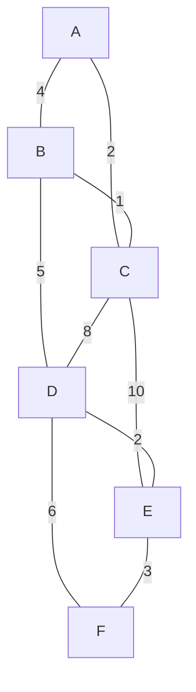
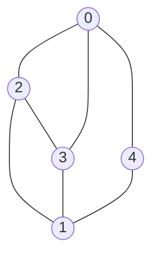

# algorithms/graph/bellman-ford | before References
Bellman-Ford on a small digraph with source S and the edges relaxed in this fixed order: A to C (2), B to A (-3), S to A (4), S to B (5), C to D (1). The table shows the best known distance to each vertex after every round, and which edges improved something.

```mermaid The example graph: the negative edge B to A makes the route through B cheaper than the direct edge S to A
flowchart TD
  S -->|4| A
  S -->|5| B
  B -->|-3| A
  A -->|2| C
  C -->|1| D
  class B focus
```

| Round | S | A | B | C | D | Edges that improved |
|---|---|---|---|---|---|---|
| start | 0 | inf | inf | inf | inf | - |
| round 1 | 0 | 4 | 5 | inf | inf | SA SB |
| round 2 | 0 | 2 | 5 | 6 | 7 | AC BA CD |
| round 3 | 0 | 2 | 5 | 4 | 5 | AC CD |
| round 4 | 0 | 2 | 5 | 4 | 5 | none, stop |

A reaches 2 via S, B, A instead of 4 directly. Round 4 changes nothing, so a version with an early exit can stop there, which is the best case in the complexity section. The lesson code has no such check and always runs |V| - 1 = 4 rounds.

# algorithms/graph/floyd-warshall | before Example
One cell of the update, using numbers from the tables below: in the pass for k = 2, the entry for 4 to 3 improves from infinity to 1 because going through vertex 2 costs -1 + 2. The 2 on the edge from 2 to 3 is the entry from the k = 1 table (it was 3 before that pass).

```mermaid Pass k = 2 for the pair 4 to 3: the direct entry is infinity, the route through vertex 2 costs 1
flowchart LR
  V4[Vertex 4] -->|direct: inf| V3[Vertex 3]
  V4 -->|-1| V2[Vertex 2]
  V2 -->|2| V3
  class V2 focus
  class V3 good
```

# algorithms/graph/kruskal | before Minimum Spanning Tree
A trace on a 6-vertex graph (edge weights invented for the example). The edges are taken in order of weight, and an edge is skipped when both ends are already connected.



| Step | Edge | Weight | Decision | Total so far |
|---|---|---|---|---|
| 1 | B-C | 1 | add | 1 |
| 2 | A-C | 2 | add | 3 |
| 3 | D-E | 2 | add | 5 |
| 4 | E-F | 3 | add | 8 |
| 5 | A-B | 4 | skip, would form a cycle | 8 |
| 6 | B-D | 5 | add | 13 |
| 7 | D-F | 6 | skip, would form a cycle | 13 |
| 8 | C-D | 8 | skip, would form a cycle | 13 |
| 9 | C-E | 10 | skip, would form a cycle | 13 |

The tree uses 5 edges (one fewer than the 6 vertices) and costs 13. The skipped edges A-B, D-F, C-D and C-E each join two vertices that earlier edges had already connected.

# algorithms/graph/prim | before Minimum Spanning Tree
Prim on the same 6-vertex graph as the Kruskal lesson (weights invented), starting at A. Each step lists the edges that leave the tree so far and takes the cheapest.


| Step | Edges leaving the tree (name:weight) | Cheapest taken | New vertex | Total so far |
|---|---|---|---|---|
| 1 | AC:2 AB:4 | A-C | C | 2 |
| 2 | BC:1 AB:4 CD:8 CE:10 | B-C | B | 3 |
| 3 | BD:5 CD:8 CE:10 | B-D | D | 8 |
| 4 | DE:2 DF:6 CE:10 | D-E | E | 10 |
| 5 | EF:3 DF:6 | E-F | F | 13 |

Prim and Kruskal both end at 13. They build the same tree here by different routes, one growing from A, the other joining the cheapest edges anywhere.

# algorithms/graph/strongly-connected-components | before Code
The lesson code runs two depth-first passes (Kosaraju). A trace on a 6-vertex digraph with edges A to B, B to C, C to A, B to D, D to E, E to F, F to D.

```mermaid Example digraph: A, B, C loop among themselves, D, E, F loop among themselves, and B points into D
flowchart TD
  subgraph S1[Component 1]
    A --> B
    B --> C
    C --> A
  end
  subgraph S2[Component 2]
    D --> E
    E --> F
    F --> D
  end
  B --> D
```

| Pass | What happens | Result |
|---|---|---|
| 1: DFS on the original graph from A | record each vertex when it finishes | finish order C, F, E, D, B, A |
| Reverse every edge | the edge B to D now points D to B | the loops stay, the link between them flips |
| 2: DFS on the reversed graph, taking vertices from the latest finisher | start at A | everything reached is one component: {A, C, B} then {D, F, E} |

The edge between the two loops now points the wrong way in the reversed graph, so the second pass cannot escape the component it started in. That is why starting from the latest finisher works.

# algorithms/graph/articulation-points | before Code
Two triangles joined by the vertices C and D. The goal is to find which single vertices split the graph when removed.

```mermaid Triangles A B C and D E F, joined by the edge C to D: removing C or D disconnects the graph
flowchart LR
  A --- B
  B --- C
  C --- A
  C --- D
  D --- E
  E --- F
  F --- D
  class C bad
  class D bad
```

Depth-first search from A gives each vertex a discovery time (disc) and a low value, the earliest discovery time reachable from its subtree using at most one back edge. Neighbors are visited in alphabetical order.

| Vertex | disc | low | DFS parent |
|---|---|---|---|
| A | 1 | 1 | none (root) |
| B | 2 | 1 | A |
| C | 3 | 1 | B |
| D | 4 | 4 | C |
| E | 5 | 4 | D |
| F | 6 | 4 | E |

The rule from the code: a non-root vertex u is an articulation point when some child c has disc[u] <= low[c], meaning c's subtree cannot reach above u. Here C qualifies (child D has low 4 and C has disc 3), and D qualifies (child E has low 4 and D has disc 4). The root A has one DFS child, so it is not one. A root counts only with two or more children.

# algorithms/graph/bridges | before Code
A square A, B, C, D with a tail D to E to F. Edges that sit on a cycle are never bridges, so only the tail should be flagged.

```mermaid Square A B C D with a tail D to E to F: the two tail edges are bridges
flowchart LR
  A --- B
  B --- C
  C --- D
  D --- A
  D --- E
  E --- F
  class E bad
  class F bad
```

Depth-first search from A records a discovery time (disc) per vertex and a low value, the earliest discovery time reachable from its subtree. A tree edge from u to v is a bridge when low[v] is greater than disc[u], so nothing below v can climb back past u.

| Tree edge | disc of upper end | low of lower end | Verdict |
|---|---|---|---|
| E-F | 5 | 6 | bridge |
| D-E | 4 | 5 | bridge |
| C-D | 3 | 1 | on a cycle |
| B-C | 2 | 1 | on a cycle |
| A-B | 1 | 1 | on a cycle |

Neighbors are visited alphabetically. The square collapses to one low value because it forms a cycle, and the two tail edges have no way back up.

# algorithms/graph/eulerian-path | before Code
The whole test is counting vertices with an odd number of edges.

```mermaid Deciding whether an Eulerian path or circuit can exist, once the graph is connected
flowchart TD
  A[Count odd-degree vertices] --> B{How many?}
  B -->|0| C[Circuit exists]
  B -->|2| D[Trail from an odd vertex]
  B -->|any other number| E[Neither exists]
  class C good
  class D good
  class E bad
```

The Konigsberg bridges, from the second image above, have seven bridges. The land masses have these degrees:

| Land mass | Bridges touching it | Odd or even |
|---|---|---|
| Central island | 5 | odd |
| North bank | 3 | odd |
| South bank | 3 | odd |
| East land | 3 | odd |

Four odd vertices is more than two, so no walk can cross every bridge exactly once.

# algorithms/graph/hamiltonian-cycle | before References
The backtracking method on 5 vertices with edges 0-2, 0-3, 0-4, 1-2, 1-3, 1-4, 2-3. Vertex 0 is placed first, then the next free neighbor is tried at each position.



| Step | Path array | Action |
|---|---|---|
| 1 | 0 2 | extend |
| 2 | 0 2 1 | extend |
| 3 | 0 2 1 3 | extend |
| 4 | 0 2 1 | undo 3 |
| 5 | 0 2 1 4 | extend |
| 6 | 0 2 1 | undo 4 |
| 7 | 0 2 | undo 1 |
| 8 | 0 2 3 | extend |
| 9 | 0 2 3 1 | extend |
| 10 | 0 2 3 1 4 | extend |
| 11 | 0 2 3 1 4 | last vertex touches vertex 0: cycle found |

The method abandons a dead end as soon as no unused neighbor is left, instead of building all orderings (5! = 120, or 24 with vertex 0 fixed first). The lesson code does not stop at step 11: it undoes the step and keeps going, so it lists 4 cycles in all, which are 2 different loops each read in both directions.

# algorithms/graph/travelling-salesman | before References
The code in this lesson is brute force: it tries every route. With a fixed start city there are (n - 1)! orders, and a tour read backwards is the same loop, so about (n - 1)! / 2 different loops. That count is why it stops being usable so quickly.

| Cities n | Different loops (n - 1)! / 2 |
|---|---|
| 4 | 3 |
| 6 | 60 |
| 8 | 2,520 |
| 10 | 181,440 |
| 12 | 19,958,400 |
| 15 | 43,589,145,600 |

Four cities, as in the K4 picture, give 3 loops. Twelve cities already give about 20 million, and 15 cities give more than 43 billion.
