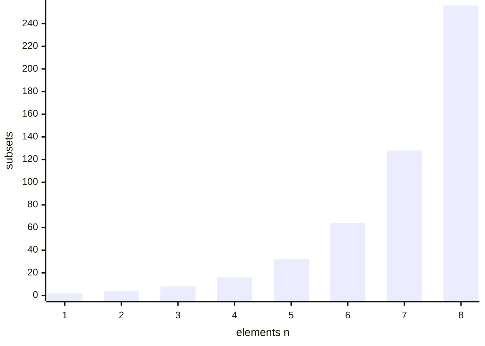

# algorithms/math/factorial | after Overview
```mermaid Factorial against doubling: n! passes 2^n at n = 4 and is more than 150 times larger by n = 8
xychart-beta
  x-axis "n" [1, 2, 3, 4, 5, 6, 7, 8]
  y-axis "value" 0 --> 40320
  line "n!" [1, 2, 6, 24, 120, 720, 5040, 40320]
  line "2^n" [2, 4, 8, 16, 32, 64, 128, 256]
```

# algorithms/math/factorial | before Code
The recursive version waits on a chain of calls, then multiplies on the way back. Trace of `factorialRecursive(4)`:

| Step | Call | What happens |
| --- | --- | --- |
| 1 | factorialRecursive(4) | 4 > 1, so it must compute 4 * factorialRecursive(3) and waits |
| 2 | factorialRecursive(3) | 3 > 1, so it must compute 3 * factorialRecursive(2) and waits |
| 3 | factorialRecursive(2) | 2 > 1, so it must compute 2 * factorialRecursive(1) and waits |
| 4 | factorialRecursive(1) | n is not above 1, so it returns 1 (base case) |
| 5 | factorialRecursive(2) | gets 1 back and returns 2 * 1 = 2 |
| 6 | factorialRecursive(3) | gets 2 back and returns 3 * 2 = 6 |
| 7 | factorialRecursive(4) | gets 6 back and returns 4 * 6 = 24 |

# algorithms/uncategorized/recursive-staircase | after The Problem
The last step is either a 1-step or a 2-step, so the ways to reach stair n are the ways to reach n - 1 plus the ways to reach n - 2.

| Stairs n | Ways | How it is built |
| --- | --- | --- |
| 1 | 1 | base case |
| 2 | 2 | base case |
| 3 | 3 | 2 + 1 |
| 4 | 5 | 3 + 2 |
| 5 | 8 | 5 + 3 |
| 6 | 13 | 8 + 5 |

# algorithms/uncategorized/recursive-staircase | after The Solution
```mermaid Brute force for 5 stairs makes 9 calls, and the marked boxes repeat questions already asked (3 appears twice, 2 appears three times)
flowchart TD
  a5[5] --> a4[4]
  a5 --> a3[3]
  a4 --> b3[3]
  a4 --> b2[2]
  b3 --> c2[2]
  b3 --> c1[1]
  a3 --> d2[2]
  a3 --> d1[1]
  class a3 warn
  class b3 warn
  class b2 bad
  class c2 bad
  class d2 bad
```

```mermaid Calls made: brute force multiplies its calls by about 1.6 per extra stair, while memoization adds 2 calls per stair
xychart-beta
  x-axis "stairs n" [5, 10, 15, 20]
  y-axis "calls" 0 --> 22000
  line "brute force" [9, 109, 1219, 13529]
  line "with memo" [7, 17, 27, 37]
```

# algorithms/uncategorized/hanoi-tower | before Code
Pole A holds discs 3 (largest), 2 and 1 (smallest). The big disc moves only once the two smaller ones are parked on pole B. Discs on each pole are listed bottom to top.

| Move | Disc | Route | Pole A | Pole B | Pole C |
| --- | --- | --- | --- | --- | --- |
| 1 | disc 1 | A to C | 3 2 | - | 1 |
| 2 | disc 2 | A to B | 3 | 2 | 1 |
| 3 | disc 1 | C to B | 3 | 2 1 | - |
| 4 | disc 3 | A to C | - | 2 1 | 3 |
| 5 | disc 1 | B to A | 1 | 2 | 3 |
| 6 | disc 2 | B to C | 1 | - | 3 2 |
| 7 | disc 1 | A to C | - | - | 3 2 1 |

Moves needed as discs are added, from the 2^n - 1 rule:

| Discs n | Moves 2^n - 1 |
| --- | --- |
| 1 | 1 |
| 2 | 3 |
| 3 | 7 |
| 5 | 31 |
| 10 | 1,023 |
| 20 | 1,048,575 |

# algorithms/sets/power-set | before Code
```mermaid Backtracking power set of {1, 2, 3}: every box is one recorded subset, and each edge is one element added
flowchart TD
  n0[empty] -->|1| n1[1]
  n0 -->|2| n2[2]
  n0 -->|3| n3[3]
  n1 -->|2| n12[1 2]
  n1 -->|3| n13[1 3]
  n12 -->|3| n123[1 2 3]
  n2 -->|3| n23[2 3]
```

Only larger elements are tried after the current one (`startAt` in the code), so each subset appears once. Trace of `btPowerSet([1, 2, 3])`:

| Step | Action | Current subset | Note |
| --- | --- | --- | --- |
| 0 | start | {} | record the empty set |
| 1 | add 1 | {1} | record it |
| 2 | add 2 | {1, 2} | record it |
| 3 | add 3 | {1, 2, 3} | record it |
| 4 | undo 3 | {1, 2} | back up one level |
| 5 | undo 2 | {1} | back up one level |
| 6 | add 3 | {1, 3} | record it |
| 7 | undo 3 | {1} | back up one level |
| 8 | undo 1 | {} | back up one level |
| 9 | add 2 | {2} | record it |
| 10 | add 3 | {2, 3} | record it |
| 11 | undo 3 | {2} | back up one level |
| 12 | undo 2 | {} | back up one level |
| 13 | add 3 | {3} | record it |
| 14 | undo 3 | {} | back up one level |



# algorithms/sets/combinations | before Cheatsheet
Choosing 2 of 4 letters A, B, C, D. Each combination is one group, but it can be ordered 2 different ways, so there are 6 combinations and 12 permutations (4 * 3). Dividing by the orderings, 12 / 2 = 6, is the `n! / (r! (n - r)!)` formula at work.

| Combination (order ignored) | Orderings it hides (permutations) |
| --- | --- |
| {A, B} | AB, BA |
| {A, C} | AC, CA |
| {A, D} | AD, DA |
| {B, C} | BC, CB |
| {B, D} | BD, DB |
| {C, D} | CD, DC |

Ice-cream check with repetition allowed: 5 flavours, 3 scoops. The count is (n + r - 1)! / (r! (n - 1)!) = 7! / (3! * 4!) = 35 different cones, against 5 * 4 * 3 = 60 ordered picks without repetition or 5^3 = 125 ordered picks with it.

# algorithms/sets/permutations | before Cheatsheet
```mermaid Filling 3 slots from A, B, C: the choices shrink at each slot, giving 3 * 2 * 1 = 6 permutations
flowchart TD
  s1[Slot 1: 3 letters left] --> s2[Slot 2: 2 letters left]
  s2 --> s3[Slot 3: 1 letter left]
  s3 --> r[3 * 2 * 1 = 6 orders]
  class r focus
```

Arranging all n items (r = n) without repetition gives n!. With repetition every slot has all n options, so n^n. Computed values:

| n | Without repetition (n!) | With repetition (n^n) |
| --- | --- | --- |
| 1 | 1 | 1 |
| 2 | 2 | 4 |
| 3 | 6 | 27 |
| 4 | 24 | 256 |
| 5 | 120 | 3,125 |
| 6 | 720 | 46,656 |

A 3-digit lock with digits 0 to 9 (r = 3, n = 10) has 10 * 9 * 8 = 720 orders when digits cannot repeat and 10^3 = 1,000 when they can.

# algorithms/sets/combination-sum | before Code
Trace for `candidates = [2, 3, 5]`, `target = 8`: each row is a call that ends right away, in the order the code reaches them. Calls that still have a positive remainder keep adding candidates, so they are not listed. The same call order gives all 3 answers shown in the Examples section.

| Path so far | Remaining | Outcome |
| --- | --- | --- |
| [2, 2, 2, 2] | 0 | save as answer |
| [2, 2, 2, 3] | -1 | too far, undo last |
| [2, 2, 2, 5] | -3 | too far, undo last |
| [2, 2, 3, 3] | -2 | too far, undo last |
| [2, 2, 3, 5] | -4 | too far, undo last |
| [2, 2, 5] | -1 | too far, undo last |
| [2, 3, 3] | 0 | save as answer |
| [2, 3, 5] | -2 | too far, undo last |
| [2, 5, 5] | -4 | too far, undo last |
| [3, 3, 3] | -1 | too far, undo last |
| [3, 3, 5] | -3 | too far, undo last |
| [3, 5] | 0 | save as answer |
| [5, 5] | -2 | too far, undo last |

# algorithms/uncategorized/n-queens | after Backtracking Algorithm
Rows are numbered from 0 at the top. The trace shows the row of the queen in each column so far, searching a 4 by 4 board column by column until the first solution is found. Dead ends ("backtrack") remove the latest queen and retry.

| Step | What happens | Rows of queens in columns 0, 1, ... afterwards |
| --- | --- | --- |
| 1 | column 0 row 0 is safe, place | 0 |
| 2 | column 1 row 2 is safe, place | 0, 2 |
| 3 | column 2 has no safe row, backtrack and remove the queen in column 1 | 0 |
| 4 | column 1 row 3 is safe, place | 0, 3 |
| 5 | column 2 row 1 is safe, place | 0, 3, 1 |
| 6 | column 3 has no safe row, backtrack and remove the queen in column 2 | 0, 3 |
| 7 | column 2 has no other safe row, backtrack and remove the queen in column 1 | 0 |
| 8 | column 1 has no other safe row, backtrack and remove the queen in column 0 | none |
| 9 | column 0 row 1 is safe, place | 1 |
| 10 | column 1 row 3 is safe, place | 1, 3 |
| 11 | column 2 row 0 is safe, place | 1, 3, 0 |
| 12 | column 3 row 2 is safe, place, all 4 queens placed | 1, 3, 0, 2 |

# algorithms/uncategorized/n-queens | after Naive Algorithm
Searching every board (naive) against backtracking, which stops extending a board the moment two queens clash. "Safe placements" counts the partial boards the backtracking search builds while finding all solutions. Computed by running both searches.

| n | Boards of n queens on n x n squares | Safe placements tried by backtracking | Solutions |
| --- | --- | --- | --- |
| 4 | 1,820 | 16 | 2 |
| 5 | 53,130 | 53 | 10 |
| 6 | 1,947,792 | 152 | 4 |
| 7 | 85,900,584 | 551 | 40 |
| 8 | 4,426,165,368 | 2,056 | 92 |

