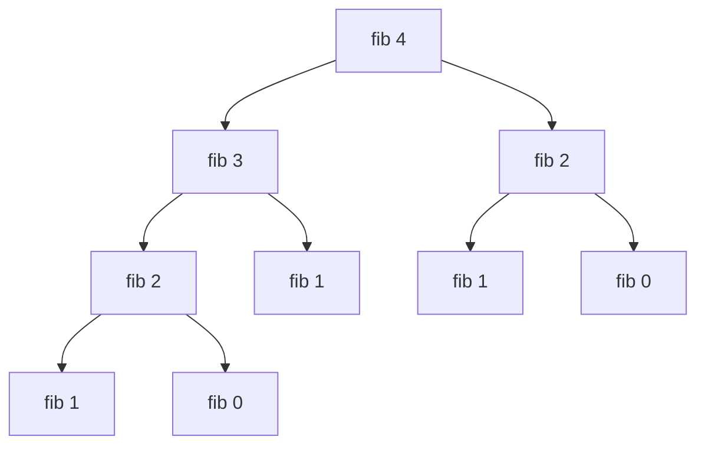

# foundations/big-o | after Common growth rates
The chart shows steps for small n. Exponential growth does not fit on it: at n = 30, 2ⁿ is already 1,073,741,824 steps while n squared is 900.

```mermaid Steps for n items (rounded to whole steps): log n barely moves, n squared climbs fast
xychart-beta
  x-axis "n" [10, 20, 30, 40, 50]
  y-axis "steps" 0 --> 2500
  line "log2 n" [3, 4, 5, 5, 6]
  line "n" [10, 20, 30, 40, 50]
  line "n log2 n" [33, 86, 147, 213, 282]
  line "n squared" [100, 400, 900, 1600, 2500]
```

# foundations/big-o | after How to calculate it
A worked count for a function that loops over `a` (n = 1000 items), then runs a loop over `a` with a loop over `b` (m = 50 items) inside it, then does one constant step. Dropping constants and keeping the dominant term leaves O(n × m).

| Part of the function | Steps | Kept? |
| --- | --- | --- |
| Loop over a | 1000 | No, smaller than the nested part |
| Loop over a with a loop over b inside | 1000 × 50 = 50,000 | Yes, dominant term |
| One constant step | 1 | No, constants drop |
| Total | 51,001 | O(n × m) |

# foundations/array | before JavaScript specifics
This trace pushes nine items into the `DynamicArray` from the code tab, which starts with capacity 2. Only 3 of the 9 pushes trigger a copy, and the copies add up to 14, about 1.6 per push. With doubling that average stays under 2 however many pushes follow.

| Push number | Capacity before | Block full, so grow? | Capacity after | Total items copied |
| --- | --- | --- | --- | --- |
| 1 | 2 | No | 2 | 0 |
| 2 | 2 | No | 2 | 0 |
| 3 | 2 | Yes, copy 2 | 4 | 2 |
| 4 | 4 | No | 4 | 2 |
| 5 | 4 | Yes, copy 4 | 8 | 6 |
| 6 | 8 | No | 8 | 6 |
| 7 | 8 | No | 8 | 6 |
| 8 | 8 | No | 8 | 6 |
| 9 | 8 | Yes, copy 8 | 16 | 14 |

Inserting in the middle is the costly case. Inserting `X` at index 1 of `A B C D` moves every later item one slot right, one move per row below, and a longer array means more moves. The trace assumes the block has spare room; a full block grows first, as in the push trace.

| Step | Slots 0 to 4 |
| --- | --- |
| Start | `A B C D _` |
| Move index 3 to 4 | `A B C D D` |
| Move index 2 to 3 | `A B C C D` |
| Move index 1 to 2 | `A B B C D` |
| Write X at index 1 | `A X B C D` |

# foundations/string | after Characters as numbers
This trace runs `isAnagram("listen", "silent")` from the code tab. Each step adds one for a letter of the first word and subtracts one for the letter of the second word at the same index. Only letters with a non-zero count are listed. The words are anagrams because every count ends at zero.

| i | Letter of first word (+1) | Letter of second word (-1) | Non-zero counts after this step |
| --- | --- | --- | --- |
| 0 | `l` | `s` | `l:1 s:-1` |
| 1 | `i` | `i` | `l:1 s:-1` |
| 2 | `s` | `l` | all zero |
| 3 | `t` | `e` | `t:1 e:-1` |
| 4 | `e` | `n` | `t:1 n:-1` |
| 5 | `n` | `t` | all zero |

# foundations/string | after Building strings
The chart counts characters copied while building a string of n one-character pieces. It uses the lesson's cost model, where every `+=` makes a fresh string. Real engines can optimise `+=`, so measured times are often lower, but the `join` version never depends on that.

```mermaid Characters copied for n pieces: repeated += copies n(n+1)/2 characters, join copies n
xychart-beta
  x-axis "n pieces" [1000, 2000, 3000, 4000, 5000]
  y-axis "characters copied" 0 --> 13000000
  line "+= in a loop" [500500, 2001000, 4501500, 8002000, 12502500]
  line "push then join" [1000, 2000, 3000, 4000, 5000]
```

# foundations/matrix-2d | after Handy facts
A 3 by 4 grid shown three ways. Left to right in each table is the column and top to bottom is the row. In the flat index table the number is `r * cols + c`. In the second table every cell holds `r - c` and in the third `r + c`, so equal numbers sit on the same diagonal or anti-diagonal.

Flat index `r * 4 + c`:

|  | col 0 | col 1 | col 2 | col 3 |
| --- | --- | --- | --- | --- |
| **row 0** | 0 | 1 | 2 | 3 |
| **row 1** | 4 | 5 | 6 | 7 |
| **row 2** | 8 | 9 | 10 | 11 |

Diagonal id `r - c`:

|  | col 0 | col 1 | col 2 | col 3 |
| --- | --- | --- | --- | --- |
| **row 0** | 0 | -1 | -2 | -3 |
| **row 1** | 1 | 0 | -1 | -2 |
| **row 2** | 2 | 1 | 0 | -1 |

Anti-diagonal id `r + c`:

|  | col 0 | col 1 | col 2 | col 3 |
| --- | --- | --- | --- | --- |
| **row 0** | 0 | 1 | 2 | 3 |
| **row 1** | 1 | 2 | 3 | 4 |
| **row 2** | 2 | 3 | 4 | 5 |

# foundations/matrix-2d | after Moving around
Checking the four neighbours of the cell at row 0, column 2 in the 3 by 4 grid. The top row has no cell above it, so that direction is skipped.

| Direction | Neighbour (row, col) | Inside the grid? |
| --- | --- | --- |
| `[1, 0]` | (1, 2) | Yes, use it |
| `[-1, 0]` | (-1, 2) | No, skipped (row is less than 0) |
| `[0, 1]` | (0, 3) | Yes, use it |
| `[0, -1]` | (0, 1) | Yes, use it |

# foundations/matrix-2d | before Common patterns
A trace of the `spiral` function from the code tab on the grid with values 1 to 12 (3 rows, 4 columns). After each side the matching boundary moves inward, and the loop stops once the boundaries cross. On the second lap the right column and left column have nothing left to walk and the bottom row is skipped by its guard, so those steps are not listed, but the right and left boundaries still move, which the last row shows.

| Step | top / bottom / left / right after | Output so far |
| --- | --- | --- |
| Walk the top row left to right | 1 / 2 / 0 / 3 | `1 2 3 4` |
| Walk the right column down | 1 / 2 / 0 / 2 | `1 2 3 4 8 12` |
| Walk the bottom row right to left | 1 / 1 / 0 / 2 | `1 2 3 4 8 12 11 10 9` |
| Walk the left column up | 1 / 1 / 1 / 2 | `1 2 3 4 8 12 11 10 9 5` |
| Walk the top row left to right | 2 / 1 / 1 / 2 | `1 2 3 4 8 12 11 10 9 5 6 7` |
| Loop check | 2 / 1 / 2 / 1 | top is past bottom, so the loop ends |

# foundations/map-set | after Patterns it unlocks
Two Sum from the code tab on `[11, 2, 15, 7]` with target 9. The map stores value to index, so each step asks one O(1) question: has the number I need already been seen? The map is shown as value:index.

| i | Number | Need (9 minus number) | In map? | Map after, or result |
| --- | --- | --- | --- | --- |
| 0 | 11 | -2 | No | {11:0} |
| 1 | 2 | 7 | No | {11:0, 2:1} |
| 2 | 15 | -6 | No | {11:0, 2:1, 15:2} |
| 3 | 7 | 2 | Yes, at index 1 | Return [1, 3] |

Group anagrams uses the sorted letters of each word as the key, so all anagrams land on the same key.

| Word | Key (sorted letters) | Groups after this word |
| --- | --- | --- |
| eat | `aet` | aet: eat |
| tea | `aet` | aet: eat tea |
| tan | `ant` | aet: eat tea; ant: tan |
| ate | `aet` | aet: eat tea ate; ant: tan |
| nat | `ant` | aet: eat tea ate; ant: tan nat |
| bat | `abt` | aet: eat tea ate; ant: tan nat; abt: bat |

# foundations/recursion | after The call stack
The same `factorial(3)` run as a sequence. The calls go down until the base case answers, then each waiting call finishes on the way back up and returns its result to the one above.

```mermaid factorial(3): three calls stack up, then return 1, 2 and 6 in turn
sequenceDiagram
  participant A as factorial(3)
  participant B as factorial(2)
  participant C as factorial(1)
  A->>B: call with 2
  B->>C: call with 1
  C-->>B: base case returns 1
  B-->>A: returns 2 times 1 = 2
  Note over A: returns 3 times 2 = 6
```

# foundations/recursion | after Common shapes
Overlapping calls are easy to see in the call tree of `fibSlow(4)`. The two highlighted boxes are the same subproblem solved twice, and the gap grows quickly as n rises.



Number of calls, counted by running `fibSlow` against a version that stores each result in a Map (every call counted, including the ones answered from the Map):

| n | Calls without caching | Calls with a cache |
| --- | --- | --- |
| 5 | 15 | 9 |
| 10 | 177 | 19 |
| 20 | 21,891 | 39 |
| 30 | 2,692,537 | 59 |
