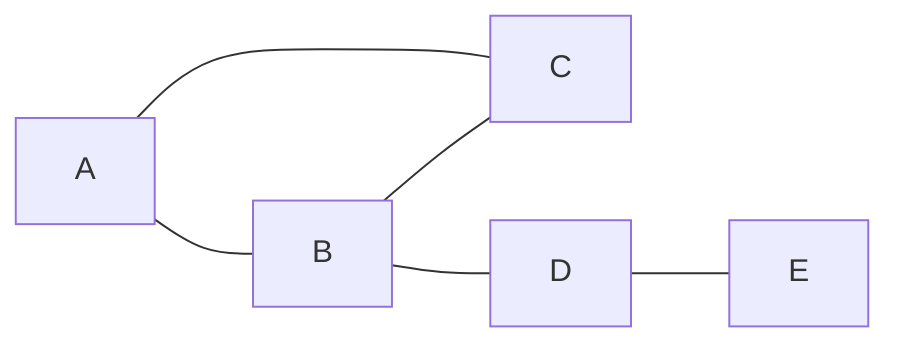

# data-structures/graph | top
A graph is a set of things (vertices, also called nodes) and the links between them (edges). Think of cities and roads, or people and friendships. In an undirected graph a link works both ways, like a friendship. In a directed graph each link has a direction, like following someone on a social site: A can follow B without B following A.

# data-structures/graph | before Code


The same graph stored two ways. The adjacency list keeps, for each vertex, only its neighbours:

| Vertex | Neighbours |
| --- | --- |
| A | B, C |
| B | A, C, D |
| C | A, B |
| D | B, E |
| E | D |

The adjacency matrix keeps a 1 where an edge exists, so it has one cell for every pair of vertices:

|  | A | B | C | D | E |
| --- | --- | --- | --- | --- | --- |
| **A** | 0 | 1 | 1 | 0 | 0 |
| **B** | 1 | 0 | 1 | 1 | 0 |
| **C** | 1 | 1 | 0 | 0 | 0 |
| **D** | 0 | 1 | 0 | 0 | 1 |
| **E** | 0 | 0 | 0 | 1 | 0 |

| Question | Adjacency list | Adjacency matrix |
| --- | --- | --- |
| Memory | one entry per vertex plus two per edge (V + 2E) | V * V cells |
| Is there an edge between u and v? | scan the neighbours of u | read one cell |
| List the neighbours of u | read u's list | scan a whole row |

With V = 1,000 vertices and E = 5,000 edges (invented numbers), the list holds about 11,000 entries while the matrix holds 1,000,000 cells. Dense graphs, where E is a large fraction of V * V, close that gap.

# data-structures/graph | after Code
Note: `getAdjacencyMatrix()` in the code above is a weighted matrix, not the 0/1 table shown earlier. A missing edge is `Infinity` and an edge holds its weight. Edges made without a weight get weight 0, so in an unweighted graph an edge shows as 0 and a missing edge as Infinity. Shortest-path code uses this form because "no route" must be larger than any real cost.

# algorithms/graph/breadth-first-search | after Overview
```mermaid Breadth-first from A: each box shows its distance in edges from A, so vertices are reached in order of distance
flowchart LR
  A[A dist 0] --- B[B dist 1]
  A --- C[C dist 1]
  B --- D[D dist 2]
  C --- D
  C --- E[E dist 2]
  D --- F[F dist 3]
  E --- F
  class A focus
```

# algorithms/graph/breadth-first-search | before Code
Trace on the graph above, visiting neighbours in alphabetical order. A vertex is marked when it joins the queue, so D is added once even though both B and C touch it. The page's default `allowTraversal` never marks the start vertex, so on an undirected graph the code run as is enters A a second time; mark the start first, or pass your own `allowTraversal`, to get exactly this trace.

To get the trace above, pass a callback that remembers the start:

```js
const seen = new Set(['A']);
breadthFirstSearch(graph, startVertex, {
  allowTraversal: ({ nextVertex }) => !seen.has(nextVertex.getKey()) && !!seen.add(nextVertex.getKey()),
});
```

| Visit | Vertex taken from queue | Its distance | New vertices queued | Queue afterwards |
| --- | --- | --- | --- | --- |
| 1 | A | 0 | B, C | B, C |
| 2 | B | 1 | D | C, D |
| 3 | C | 1 | E | D, E |
| 4 | D | 2 | F | E, F |
| 5 | E | 2 | none new | F |
| 6 | F | 3 | none new | empty |

Visit order: A, B, C, D, E, F. Distances never decrease along that order, which is why BFS finds the fewest-edge route in an unweighted graph.

# algorithms/graph/depth-first-search | top
```mermaid The graph used in the trace below: A connects to B and C; B to D; C to D and E; D to F; E to F
flowchart LR
  A --- B
  A --- C
  B --- D
  C --- D
  C --- E
  D --- F
  E --- F
```

# algorithms/graph/depth-first-search | before Code
Trace on the graph used in the breadth-first lesson (edges A-B, A-C, B-D, C-D, C-E, D-F, E-F), taking neighbours in alphabetical order. The path column is the chain of calls still open. A vertex already seen is skipped. The page's default `allowTraversal` never marks the start vertex, so on an undirected graph the code run as is enters A a second time; mark the start first, or pass your own `allowTraversal`, to get exactly this trace.

```js
const seen = new Set(['A']);
depthFirstSearch(graph, startVertex, {
  allowTraversal: ({ nextVertex }) => !seen.has(nextVertex.getKey()) && !!seen.add(nextVertex.getKey()),
});
```

| Step | Action | Open path |
| --- | --- | --- |
| 1 | enter A | A |
| 2 | enter B | A > B |
| 3 | enter D | A > B > D |
| 4 | enter C | A > B > D > C |
| 5 | enter E | A > B > D > C > E |
| 6 | enter F | A > B > D > C > E > F |
| 7 | back out of F | A > B > D > C > E |
| 8 | back out of E | A > B > D > C |
| 9 | back out of C | A > B > D |
| 10 | back out of D | A > B |
| 11 | back out of B | A |
| 12 | back out of A | empty |

Same graph, same start, different order:

| Search | Order vertices are reached |
| --- | --- |
| Breadth-first | A, B, C, D, E, F |
| Depth-first | A, B, D, C, E, F |

Depth-first runs down one chain as far as it goes (A, B, D, C, E, F), then backs out. Breadth-first finishes everything one edge away from A before anything two away.

# algorithms/graph/breadth-first-search | after Code
BFS touches each vertex and each edge a constant number of times, so it takes O(V + E) time, and the queue can hold up to V vertices. Use it when you want the fewest edges between two vertices.

The first two links under References are about binary trees, not graphs: "Tree Traversals" covers depth-first orders and "BFS vs DFS" compares the two on trees. For BFS on a graph, the Wikipedia article and the visualization are the closest fit.

# algorithms/graph/depth-first-search | after Code
The open path in the trace is the call stack: each recursive call is one step down the path, and returning is backing out. A very long chain (a graph of 100,000 vertices in a line) can overflow the stack; then use an explicit stack instead. Time is O(V + E).

# algorithms/graph/detect-cycle | top
A cycle is a route that follows edges and ends where it started, without reusing a vertex or edge on the way. The formal terms below only matter when you read graph-theory texts.

In an undirected graph, 1-2-3-1 is a cycle: you can leave 1 and come back without using an edge twice. Just 1-2 is not a cycle: going 1 to 2 and back reuses the same edge.

```mermaid In an undirected graph, 1-2-3-1 is a cycle (the triangle); 3-4 is a plain edge hanging off it
flowchart LR
  1 --- 2
  2 --- 3
  3 --- 1
  3 --- 4
```

# algorithms/graph/detect-cycle | before Code
In an undirected graph every edge can be walked both ways, so after going A to B the search sees A again as B's neighbour. That is not a cycle, it is the same edge. The DFS version of the code therefore ignores the edge back to the parent; any other visited vertex it meets means a cycle.

```mermaid A directed graph: B, C and D lead back to B, so they form a cycle, while E is only a dead end
flowchart LR
  A --> B
  B --> C
  C --> D
  D --> B
  A --> E
  class B bad
  class C bad
  class D bad
```

Directed graph: a depth-first search keeps the chain of vertices it is currently inside (the open path). Meeting a vertex that is already open means the walk has come back to itself. Trace on the graph above:

| Step | Action | Open path | Note |
| --- | --- | --- | --- |
| 1 | enter A | A |  |
| 2 | enter B | A > B |  |
| 3 | enter C | A > B > C |  |
| 4 | enter D | A > B > C > D |  |
| 5 | edge D to B | A > B > C > D | B is still open on the path, so this is a cycle |

Undirected graph: a different test works. Start with every vertex in its own group and merge the two ends of each edge. An edge whose ends are already in one group closes a cycle. Square with edges 1-2, 2-3, 3-4, 4-1:

| Edge | What happens | Groups afterwards | Cycle? |
| --- | --- | --- | --- |
| 1-2 | different groups, merge them | {1, 2} {3} {4} | no |
| 2-3 | different groups, merge them | {1, 2, 3} {4} | no |
| 3-4 | different groups, merge them | {1, 2, 3, 4} | no |
| 4-1 | 4 and 1 are already in the same group | {1, 2, 3, 4} | cycle |

# algorithms/graph/detect-cycle | after Code
Limit: `detectUndirectedCycle` searches only the part of the graph reachable from the first vertex. If the graph may be disconnected, a cycle in another part is missed. For example, with edges A-B, C-D, D-E, E-C the triangle C-D-E is a cycle, but starting from A the function returns `null`. Wrap the call in a loop that starts a new search from every vertex not yet visited (as `detectDirectedCycle` does with its white set), or use the disjoint-set version, which looks at every edge.

Note: the comments in `detectDirectedCycle` say BFS ("Describe BFS callbacks", "Pick fist vertex to start BFS from"), but the code runs depth-first search.

# algorithms/graph/topological-sorting | after Example
The arrows of the picture are 5 to 11, 7 to 11, 7 to 8, 3 to 8, 3 to 10, 11 to 2, 11 to 9, 11 to 10 and 8 to 9.

One way to build a valid order: repeatedly take a vertex with no unfinished prerequisites. Count of unfinished prerequisites at the start (vertex:count): 2:1 3:0 5:0 7:0 8:2 9:2 10:2 11:2. Always taking the smallest ready vertex:

| Step | Take | Its arrows go to | Now ready (count hit 0) | Ready list afterwards |
| --- | --- | --- | --- | --- |
| 1 | 3 | 8, 10 | none | 5, 7 |
| 2 | 5 | 11 | none | 7 |
| 3 | 7 | 11, 8 | 11, 8 | 8, 11 |
| 4 | 8 | 9 | none | 11 |
| 5 | 11 | 2, 9, 10 | 2, 9, 10 | 2, 9, 10 |
| 6 | 2 | none | none | 9, 10 |
| 7 | 9 | none | none | 10 |
| 8 | 10 | none | none | empty |

Result: 3, 5, 7, 8, 11, 2, 9, 10. This is the second order listed above ("smallest-numbered available vertex first"). If the ready list ever empties before every vertex is placed, a cycle blocks the rest (this is true of the counting method only, see the note before Code).

Only the second order is derived above. For the others the useful check is simple: for each of the nine arrows, the tail appears earlier in the list than the head. Try it on `7, 5, 11, 3, 10, 8, 9, 2`.

# algorithms/graph/topological-sorting | after Application
Direction matters. If package `app` needs package `lib`, `lib` must be installed first, so the edge runs from `lib` to `app`. The sorted order then lists `lib` before `app`.

# algorithms/graph/topological-sorting | before Code
The table above counts prerequisites. The code below does the same job a different way: it runs a depth-first search and, each time a vertex is completely explored (everything it points to is already done), puts it on a stack. The stack read from the top is a valid order. Both methods give a valid order, not always the same one. Unlike the counting method, this code does not notice a cycle: on a graph with a cycle it still returns a list, and that list is not a real ordering. Check for cycles first (see the Detect Cycle lesson).

Linear time here means the work grows with (vertices + edges): each vertex and each arrow is handled once.

# data-structures/disjoint-set | top
A disjoint set answers one question fast: are these two items in the same group? Typical uses: finding connected parts of a graph, spotting a cycle while adding edges, and Kruskal's algorithm (it picks the cheapest edges that do not close a cycle, and this structure does the cycle check). A singleton is a group with one item. The inverse Ackermann function grows so slowly that it is at most 4 for any input you will ever have, so treat it as constant. The "Applications section" mentioned below does not exist on this page; the uses are the ones listed here.

# data-structures/disjoint-set | before Code
The speed promise at the top belongs to the compact version, `DisjointSetAdhoc.js`, which flattens paths as it searches (path compression). `DisjointSet.js` is written for clarity: it has no path compression and its rank is recomputed by counting every item under a root, so `union` slows down as sets grow. Use the compact one when you need speed (and in interviews).

Note: the comment on `getRank` in `DisjointSetItem` says "ancestors", but the code counts descendants, the items below a node. That is really union by size. The compact version uses height, which is the textbook union by rank.

# data-structures/disjoint-set | before Implementation
Trace of the `DisjointSet` below on 6 items, written as the parent of each item (an item that is its own parent is a root). Rank here is the number of items below a root, as in `getRank`.

| Operation | Parent of items 0 to 5 | What happened |
| --- | --- | --- |
| start | 0 1 2 3 4 5 | six separate sets |
| union(0, 1) | 0 0 2 3 4 5 | root 1 goes under root 0 |
| union(2, 3) | 0 0 2 2 4 5 | root 3 goes under root 2 |
| union(0, 2) | 0 0 0 2 4 5 | root 2 goes under root 0 |
| union(4, 5) | 0 0 0 2 4 4 | root 5 goes under root 4 |
| union(5, 3) | 0 0 0 2 0 4 | root 4 has the smaller tree, so it goes under 0 |

Now find(5) walks 5 to 4 to 0 and ends at root 0, so 2 steps. Items 0 and 5 are in the same set because they share root 0.

Why the rank rule matters: joining 0 and 1, then 1 and 2, up to 6 and 7 (8 items). Always hanging the first root under the second builds one long chain. The rank rule keeps the tree wide.

| Rule | Steps for find(0) | Steps for find(7) |
| --- | --- | --- |
| Always hang first root under second | 7 | 0 |
| Smaller tree goes under larger (rank) | 0 | 1 |

# algorithms/graph/dijkstra | top
The graph used below has six nodes and these edges (they work in both directions): A-B 7, A-C 9, A-F 14, B-C 10, B-D 15, C-D 11, C-F 2, D-E 6, E-F 9. We start at A.

Words used here: to "look at" a neighbor means to try to improve its distance. A vertex is "visited" only when all its neighbors have been looked at; after that its distance never changes.

# algorithms/graph/dijkstra | after Step-by-step Dijkstra's algorithm example
The 16 pictures above condensed to one row per vertex. Edges: A-B 7, A-C 9, A-F 14, B-C 10, B-D 15, C-D 11, C-F 2, D-E 6, E-F 9. Distances are listed for A, B, C, D, E, F in that order, and "-" means not reached yet.

| Round | Closest unfinished vertex (distance) | Distances it improves | A B C D E F |
| --- | --- | --- | --- |
| 1 | A (0) | B gets 7; C gets 9; F gets 14 | 0 7 9 - - 14 |
| 2 | B (7) | D gets 22 | 0 7 9 22 - 14 |
| 3 | C (9) | D improves from 22 to 20; F improves from 14 to 11 | 0 7 9 20 - 11 |
| 4 | F (11) | E gets 20 | 0 7 9 20 20 11 |
| 5 | D (20) | no improvement | 0 7 9 20 20 11 |
| 6 | E (20) | no improvement | 0 7 9 20 20 11 |

```mermaid The shortest-path tree from A: each arrow is the last edge of the best route, and the label is its weight (arrows only show which edge gave each vertex its best distance; the real edges go both ways)
flowchart LR
  A -->|7| B
  A -->|9| C
  C -->|2| F
  C -->|11| D
  F -->|9| E
  class A focus
```

Best distances: A 0, B 7, C 9, D 20, E 20, F 11. The route to E is A to C to F to E, which costs 20.

Limit: every edge weight must be 0 or more. The algorithm treats the closest unfinished vertex as final, which is only safe when no later edge can make a route shorter. With a negative edge, use Bellman-Ford instead. Cost: with a priority queue the work is about (edges) x log(vertices).

