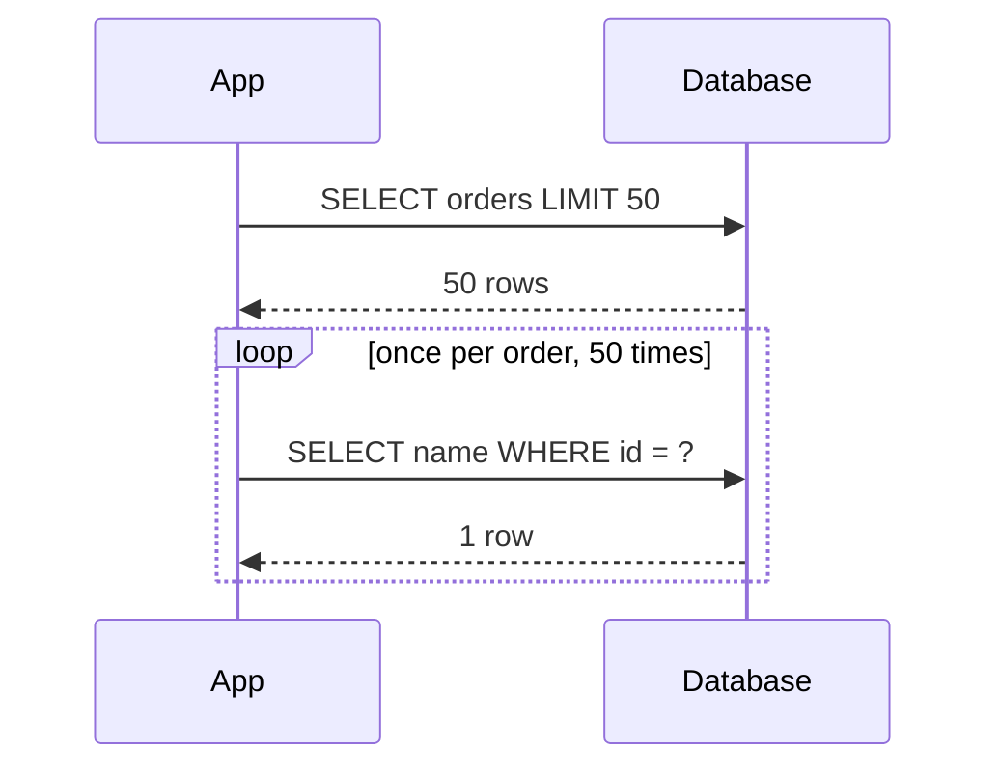
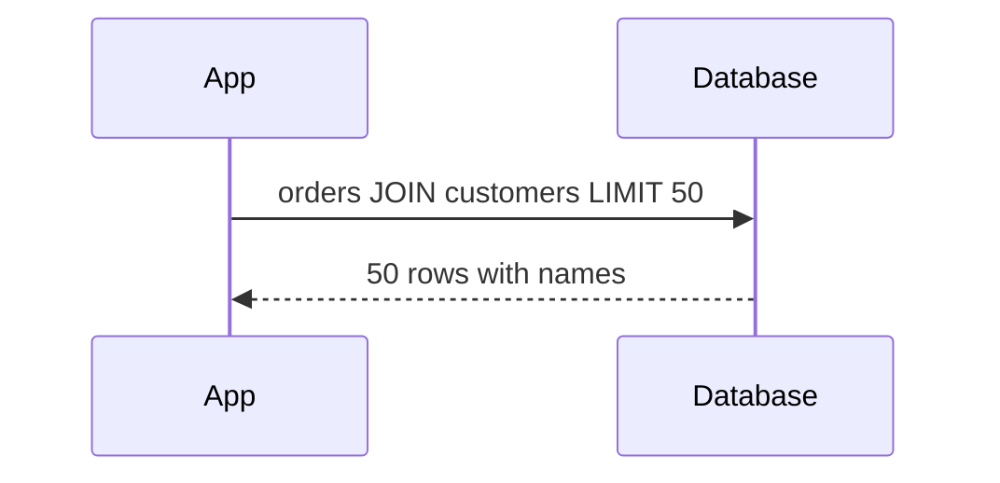

# busy-database-and-frontend | Busy Database and Busy Front End | 2 | 12
Two antipatterns put heavy work on the wrong machine. The Busy Database makes the data store run code instead of serving data, and the Busy Front End makes the web tier crunch numbers instead of answering users.

## What an antipattern is
An antipattern is a common fix that looks sensible and makes things worse under load. This chapter covers ten of them, taken from Microsoft's performance antipattern catalog. Each one passes a small test and fails in production, because production has many users at once and the test had few. For every antipattern we look at four things: what it looks like, why it hurts, how to detect it, and how to fix it.

## Busy Database
```card Busy Database
Symptoms | Database CPU is high while the data moved out of it is small, and every endpoint that touches it slows down.
Why it hurts | The database is shared and hard to scale out, so CPU spent on formatting and business rules is taken from finding rows.
Detect | Compare database CPU with network out of the database, then read the slowest queries and ask whether the time goes to finding rows or computing.
Fix | Keep filtering, joining and aggregating in the database and move formatting and business rules to the stateless app tier.
```

What it looks like: the database is treated as a compute service. Stored procedures format dates and money, build XML or JSON, glue name fields together and run business rules. The query result is ready to show on screen. It often starts as a cure for Extraneous Fetching (push the computation to the data), or as a belief that business rules are easier to maintain in stored procedures.

```python tab="Before"
# Pseudocode: db stands in for any database client
# The database does the formatting
rows = db.query("""
  SELECT UPPER(TRIM(first_name || ' ' || last_name)) AS name,
         TO_CHAR(total, 'FM$999,999.00') AS total
  FROM orders ORDER BY total DESC LIMIT 20""")
```

```python tab="After"
# Fetch plain values, format in the app tier
rows = db.query("SELECT first_name, last_name, total FROM orders ORDER BY total DESC LIMIT 20")
orders = [{"name": f"{r.first_name} {r.last_name}".strip().upper(),
           "total": f"${r.total:,.2f}"} for r in rows]
```

```mermaid Busy Database does formatting inside the one shared database, the fix moves it to app servers that are cheap to clone
flowchart LR
  subgraph Before
    A1[App server] --> D1[(Database: find rows, format, apply rules)]
  end
  subgraph After
    A2[App servers: format, apply rules] --> D2[(Database: find rows)]
  end
  class D1 bad
  class D2 good
```

Why it hurts: a database is a shared resource, and it is hard to scale out (see [replication](/sd/docs/data/replication) and [sharding](/sd/docs/data/sharding)). Every CPU millisecond spent formatting is a millisecond not spent finding rows. A stateless app server, by contrast, is cheap to clone behind a [load balancer](/sd/docs/scaling/load-balancing). On a metered managed database you also pay for that CPU.

How to detect it: throughput falls and latency rises on every endpoint that touches the database, while the amount of data moved stays small. That mix is the clue. Database CPU is high, network traffic out of the database is low. Look at the slowest queries in the database's own statistics view and ask whether the time goes to finding rows or to computing. If the queries turn out to be plain data access with no heavy computing, the real problem is more likely Extraneous Fetching.

How to fix it: keep the database to what it does best, such as filtering, joining, sorting and aggregating. Move formatting, string work and business rules into the app tier. Do not overcorrect, because moving an aggregation out of the database means shipping every row over the network. That is the Extraneous Fetching trap in the [next lesson](/sd/docs/antipatterns/chatty-io-and-extraneous-fetching).

## Busy Front End
```card Busy Front End
Symptoms | Light endpoints get slow exactly when a heavy endpoint is called, and web-tier CPU sits near its limit.
Why it hurts | The background work shares CPU, memory and threads with the code that answers users, so cheap requests wait behind expensive ones.
Detect | Plot latency per route against the request rate of the heavy route. If the light route slows when the heavy one rises, the web tier is busy.
Fix | Put a small message on a queue and let a separate worker pool do the heavy work, as in Queue-Based Load Leveling.
```

What it looks like: a web server takes a request, then does something expensive in the background of the same process (a thread, or a callback on the event loop), such as building a report, resizing images or encoding video. The handler returns "accepted" quickly, so it looks fine. (Awaiting a network call is fine. The trouble is CPU-heavy work that competes with user requests.)

```javascript tab="Before"
app.post('/reports', function (req, res) {
  // CPU work on the web process's own event loop: every other request waits for it
  setImmediate(function () { buildHugeReport(req.body); });
  res.status(202).end();
});
```

```javascript tab="After"
app.post('/reports', async function (req, res) {
  // queue is any message queue client; a separate worker process builds the report
  await queue.send('build-report', req.body);
  res.status(202).end();
});
```

```mermaid With a queue the web server replies at once and a worker takes the heavy CPU work, so the profile lookup stays fast
sequenceDiagram
  participant U as User
  participant W as Web server
  participant Q as Queue
  participant K as Worker
  U->>W: POST /reports
  W->>Q: report job
  W-->>U: 202 accepted
  Q->>K: deliver job
  Note over K: heavy CPU work stays here
  U->>W: GET /profile
  W-->>U: answers in about 5 ms
```

Why it hurts: the background work shares the CPU, memory and network of the box that serves user requests. A server also has a limit on threads, so a flood of heavy requests can end in errors when it cannot start another. Ten reports at once can leave no CPU for a cheap profile lookup. The response time of unrelated, light endpoints climbs. Adding more front-end servers only buys more machines that do the same thing.

How to detect it: light endpoints get slow at the same time that heavy ones are called. CPU on the web tier sits near its limit. Plot latency per route against the rate of the heavy route. If the profile lookup slows exactly when report requests rise, that confirms it.

How to fix it: use Queue-Based Load Leveling. The front end puts a small message on a [queue](/sd/docs/async/message-queues) and replies at once. A separate pool of workers pulls messages and does the heavy work at its own pace. The queue absorbs bursts, and you scale the workers by queue length. See [background jobs](/sd/docs/async/background-jobs). Do not just add front-end servers, and make sure the back end can keep up with the throughput you need. Moved tasks may also take longer to finish. The cost is extra moving parts and the need to handle lost or repeated messages safely.

## A worked example: two bad endpoints (invented numbers)
A database server has 8 cores. Each order-list request spends 40 ms of database CPU because the SQL formats everything. The database can finish at most 8 cores / 0.040 s = 200 requests per second. After the move to plain rows, each request costs 4 ms in the database: 8 / 0.004 = 2,000 requests per second. The formatting costs 1 ms of app CPU per request. Ten app servers with 4 cores each supply 40 / 0.001 = 40,000 requests per second of formatting, so the database is the limit again, 10 times later than before.

```mermaid Most requests per second the 8 core database can finish, before and after the formatting moves out
xychart-beta
  x-axis [SQL formats everything, Plain rows]
  y-axis "requests per second" 0 --> 2000
  bar [200, 2000]
```

Now the Busy Front End. A web server has 4 cores. A report job burns 8 CPU-seconds. Ten reports at once need 80 CPU-seconds, which is 20 seconds of every core. For those 20 seconds a 5 ms profile lookup waits for a turn on the CPU.

## Spot it in production: a slow checkout and a quiet database
Symptom: at 10:00 each day the checkout page takes 6 seconds instead of 300 ms. The team adds web servers and nothing improves. Database CPU is at 95 percent, but network out of the database is tiny. The slow-query list shows one stored procedure that formats an invoice, called thousands of times. Confirm by running that procedure with the formatting removed on a copy of the database. If the CPU per call drops by roughly 10 times, the Busy Database is proven. The fix is to move the formatting out. Adding web servers did not help, because every new server called the same procedure on the same database.

## When moving work out is the wrong tool
Do not move work out of the database when it is data-heavy. Summing 5 million rows in SQL returns 8 bytes. Summing them in the app moves gigabytes. The same goes for joins and filters that the database can do with an [index](/sd/docs/data/indexes). For the front end, a quick task of a few milliseconds does not need a queue. A queue adds delay and failure modes. Use it for work that is heavy, bursty or slow.

## Common mistake
Fixing a slow database by adding more app servers, or fixing a slow web tier by adding more threads, without first checking which resource is actually the bottleneck.

```resources
article | Busy Database antipattern | https://learn.microsoft.com/en-us/azure/architecture/antipatterns/busy-database/ | Microsoft Azure Architecture Center | The source for the database half of this lesson, with a stored-procedure example and a load-test diagnosis.
article | Busy Front End antipattern | https://learn.microsoft.com/en-us/azure/architecture/antipatterns/busy-front-end/ | Microsoft Azure Architecture Center | Shows background threads in a web process starving other requests, and the queue-based fix.
article | Performance testing and antipatterns for cloud applications | https://learn.microsoft.com/en-us/azure/architecture/antipatterns/ | Microsoft Azure Architecture Center | The catalog page, which explains why these problems often pass testing and only appear in production.
```

```quiz
A database has high CPU but very little network traffic out. What does that point to? | The database is busy computing ; The network card is the bottleneck ; The cache hit ratio is too high | 0 | Busy CPU with little data moved means the database is running code such as formatting.
Why does adding web servers not fix a Busy Front End? | Load balancers cannot spread the traffic ; Web servers cannot use more than one core ; Each copy still runs the heavy task | 2 | More servers still run the heavy task next to user requests.
In the worked example the database cost drops from 40 ms to 4 ms per request. What is the new maximum rate on 8 cores? | 200 requests per second ; 2,000 requests per second ; 20,000 requests per second | 1 | 8 cores divided by 0.004 seconds gives 2,000 requests per second.
```

```story
Maya's team has a report button. The handler starts a thread to build the report and returns "started" in 20 ms, so the demo looks great. On the first Monday of the month 300 customers click it, and the login page on the same servers takes 15 seconds. Nobody touched the login code.
```

```adapted
Azure Architecture Center (Microsoft) | https://learn.microsoft.com/en-us/azure/architecture/patterns/ | CC BY 4.0
```

# chatty-io-and-extraneous-fetching | Chatty I/O and Extraneous Fetching | 2 | 12
Chatty I/O sends many tiny requests where one would do. Extraneous Fetching does the opposite and drags back far more data than the caller needs. They are two sides of one balancing act, and fixing one often causes the other.

## Chatty I/O
```card Chatty I/O
Symptoms | A page makes dozens or hundreds of tiny calls, and time grows with the size of the list.
Why it hurts | Every call pays a fixed round trip and queueing cost however small the payload, so total time is the number of calls times the delay.
Detect | Count queries or calls per request in a trace or query log. If the count scales with result size, or repeats differ only by an id, it is chatty.
Fix | Batch with joins, IN lists, eager loading and bulk writes, and keep each batch bounded.
```

What it looks like: every network call, disk write or database query has a fixed cost, no matter how small the payload. A chatty program pays that cost again and again. There are three common shapes: one query per record, one HTTP call per field, and one file open per small write.

The classic case is the N+1 query problem. You load a list with 1 query, then loop over the N results and run 1 more query for each. An ORM (object-relational mapper, a library that turns rows into objects) can hide it, because touching `order.customer` quietly fires a query.

```python tab="Before"
# Pseudocode: db stands in for any database client
orders = db.query("SELECT id, customer_id FROM orders LIMIT 50")      # 1 query
for o in orders:
    o.customer = db.query_one("SELECT name FROM customers WHERE id = %s", o.customer_id)  # 50 more
```

```python tab="After"
# One join (or one IN query) returns the same data in a single round trip
rows = db.query("""SELECT o.id, c.name FROM orders o
                   JOIN customers c ON c.id = o.customer_id LIMIT 50""")
```

Why it hurts: each round trip costs the network latency plus queueing in the server, even when the query itself takes microseconds. N+1 turns one list page into N+1 trips. The total time grows with the list size, so the page passes testing with 5 rows and fails in production with 500. Most ORMs offer eager loading for this. In Django, `select_related` follows foreign keys in a single, more complex query, and `prefetch_related` handles many-to-many relations with one extra query per relation.

The same disease appears over HTTP. An API with `/users/1/name`, `/users/1/gender` and `/users/1/birthday` forces a client to make three calls for one profile. Offer a coarser endpoint that returns the whole profile, or let the client pick fields (see [API design](/sd/docs/foundations/api-design)).

How to detect it: a trace of one request shows a comb of near-identical short spans. The count of queries per request is the number to watch. If it scales with the size of the result, you have N+1. Turn on query logging in a test and read the log for repeats that differ only by an id.

How to fix it: batch. Use joins, `IN` lists, eager loading, bulk inserts, and buffered file writes. Keep the batch bounded, so one call cannot return a million rows. For file writes, buffer in memory and write once, but a buffer is lost if the process crashes, so use a durable queue when the data matters.

## Extraneous Fetching
```card Extraneous Fetching
Symptoms | Responses and memory spikes are large, and a query returns 100,000 rows to an endpoint that shows 20.
Why it hurts | You pay to read, send and parse bytes that are thrown away, and the extra data crowds out the cache and the app's memory.
Detect | Compare the bytes or rows the store returns with the bytes or rows the endpoint sends. A big gap is the giveaway.
Fix | Select only the columns you need, filter and aggregate in the database, and paginate every list.
```

What it looks like: the code fetches whole rows to use one column, loads a whole table to filter it in memory, or computes a total by reading every order into the app.

```python tab="Before"
# Pseudocode: db stands in for any database client
all_rows = db.query("SELECT * FROM products")                    # 200,000 rows, every column
names = [r.name for r in all_rows if r.price > 100]              # filtering in the app
```

```python tab="After"
names = db.query("SELECT name FROM products WHERE price > 100")  # let the database filter
```

It often starts as an overcorrection to Chatty I/O ("fetch everything once so we never go back"). It also hides inside ORMs. In .NET, a filter that cannot be translated to SQL silently runs in memory after loading the whole table, and Microsoft's page shows that case. Check how your own ORM translates filters, since a function it cannot turn into SQL may be a sign of the same trap.

Why it hurts: you pay to read, send and parse bytes that you throw away. The extra data crowds out the cache and eats network bandwidth and memory in the app. How to detect it: large response sizes, high network out of the database, and an app whose memory spikes on one endpoint. A query that returns 100,000 rows to an endpoint that shows 20 is the giveaway, so compare the bytes the store returns with the bytes the endpoint sends. The symptoms look much like Monolithic Persistence, covered later in this chapter. Fix: select only the columns you need, filter and aggregate in the database, and paginate any list.

The two diagrams show the same page. The chatty version sends 51 requests one after the other, each paying the full round trip. The batched version sends one.





## A worked example: 50 orders across a region (invented numbers)
A page lists 50 orders with customer names. The database is in the same data center: a round trip costs 2 ms. N+1 makes 51 queries, so 51 x 2 = 102 ms of waiting. One join takes 1 trip plus a slightly heavier query, say 6 ms in all. That is 17 times faster.

Now suppose the database is in another region and each round trip costs 40 ms. N+1 becomes 51 x 40 = 2,040 ms, a two-second page. The join stays near 46 ms. Same code, same data, and the distance multiplied the antipattern.

```mermaid Time to build the page of 50 orders, in milliseconds, by query shape and round trip time (invented numbers)
xychart-beta
  x-axis [N+1 same site, Join same site, N+1 other region, Join other region]
  y-axis "milliseconds" 0 --> 2100
  bar [102, 6, 2040, 46]
```

Extraneous Fetching on the same data: a table has 1,000,000 products at about 1 KB each, so 1 GB. Loading it to count the expensive ones moves 1 GB. `SELECT COUNT(*) WHERE price > 100` returns a few bytes.

## Spot it in production: the cure causes the disease
A team sees 300 queries per request and "fixes" it by loading all products and all prices at the start of each request. Queries per request fall to 2, and the trace looks clean. But response time doubles, memory use jumps and the garbage collector starts to pause. The team swapped Chatty I/O for Extraneous Fetching. Confirm by checking rows returned versus rows shown. If 200,000 rows are fetched to show 20, the fix overshot. The right shape is a join or batched `IN` query for exactly the 20 ids, plus pagination.

## When batching is the wrong tool
Do not batch when each item must succeed or fail on its own, or when waiting to fill a batch delays something users watch. A write that needs to be durable now should not sit in a buffer for 5 seconds. Do not widen a query when a [cache](/sd/docs/caching/caching-basics) already holds the small pieces. For one-off scripts, a few extra round trips are fine. Measure first.

## Common mistake
Declaring victory after a demo on a tiny dataset. The cost appears only at production volume, so test against a realistic table and compare timings before sign-off.

```resources
article | Chatty I/O antipattern | https://learn.microsoft.com/en-us/azure/architecture/antipatterns/chatty-io/ | Microsoft Azure Architecture Center | Covers per-record queries, field-by-field HTTP calls and small file writes, and the batching fix.
article | Extraneous Fetching antipattern | https://learn.microsoft.com/en-us/azure/architecture/antipatterns/extraneous-fetching/ | Microsoft Azure Architecture Center | Shows fetching whole rows, aggregating in app memory and filters that silently run client side.
docs | Django QuerySet: select_related | https://docs.djangoproject.com/en/stable/ref/models/querysets/ | Django documentation | Explains how select_related follows foreign keys in one query so later access needs no extra queries, and how prefetch_related handles many-to-many relations.
repo | The System Design Primer: Database | https://github.com/donnemartin/system-design-primer#database | Donne Martin | Background on indexes, joins and denormalization that decide how many trips a read needs.
```

```quiz
A list page runs 1 query for 50 orders and 1 more per order. How many queries is that? | 2 ; 51 ; 100 | 1 | One list query plus 50 per-order queries gives 51.
Why does N+1 hurt more when the database is far away? | The query text grows with distance ; Distant databases cannot run joins ; Each extra trip pays the full delay | 2 | Every query waits for a round trip, so 51 trips at 40 ms is about 2 seconds.
A fix drops queries from 300 to 2 but loads 200,000 rows to show 20. What happened? | The ORM cache is now disabled ; Chatty I/O became over-fetching ; The index was dropped from the table | 1 | Fewer trips came at the price of fetching far more data than needed.
```

```story
Dev ships a product page that works in 80 ms on his laptop with 6 test products. Launch day the category has 400 products, each with a price-history lookup. The page now runs 401 queries, and the database is two time zones away.
```

```adapted
Azure Architecture Center (Microsoft) | https://learn.microsoft.com/en-us/azure/architecture/patterns/ | CC BY 4.0
```

# synchronous-io-and-instantiation | Synchronous I/O and Improper Instantiation | 2 | 12
Synchronous I/O ties up a worker thread while it waits for the network or disk. Improper Instantiation builds a fresh client, with fresh connections, for every request. Both waste capacity that the machine has but the code does not use.

## Synchronous I/O
```card Synchronous I/O
Symptoms | CPU is low and latency is high, the thread pool is at its maximum, and a slow dependency stalls unrelated endpoints.
Why it hurts | A blocked thread does no work and cannot serve anyone else, so capacity is threads divided by wait time, not CPU.
Detect | Take thread dumps and look for most threads parked in socket or file reads, and watch the queue of waiting requests grow when a dependency slows.
Fix | Use the async API (await, promises, non-blocking drivers), put a timeout on every call, and use a separate worker pool only as a stopgap.
```

What it looks like: a thread calls the database, a web service or a file and sits blocked until the answer arrives. While blocked, it does no work and cannot serve anyone else. A single blocking call deep in a library can stall the whole chain above it.

In a server with a fixed pool of threads, the limit is easy to compute. This is Little's law from [latency and throughput](/sd/docs/foundations/latency-and-throughput): the work in flight equals the arrival rate times the time each request takes. Run it backwards. With 200 threads and requests that wait 100 ms, throughput tops out at 200 / 0.1 = 2,000 requests per second. If the downstream service slows to 1 second, the same server can only finish 200 per second, even though its CPU is nearly idle.

```python tab="Before"
# A blocking call inside an async handler freezes the whole event loop
async def profile(user_id):
    r = requests.get(f"https://users.internal/{user_id}")   # blocks every other request
    return r.json()
```

```python tab="After"
# Sketch: http is an async client (for example httpx.AsyncClient)
# A non-blocking client and await let the loop serve others while waiting
async def profile(user_id):
    r = await http.get(f"https://users.internal/{user_id}")  # http is an async client
    return r.json()
```

Why it hurts: threads are limited and each one costs memory. Waiting threads are capacity that does nothing, and under a traffic spike or a slow dependency the pool fills and new requests queue or fail. In event-loop runtimes such as Node or Python's asyncio, one blocking call stops everything on that loop.

How to detect it: CPU is low but latency is high and the thread pool is at its maximum. Thread dumps show most threads parked in socket or file reads. The queue of waiting requests grows when a dependency slows down. Fix: use the async version of the API (`await`, promises, non-blocking drivers) so a thread can serve other requests while waiting. If a library has no async version, running it in a separate worker pool is a stopgap. It costs extra threads, so it is a patch, not a cure. Set a [timeout](/sd/docs/reliability/timeouts-and-retries) on every call either way.

## Improper Instantiation
```card Improper Instantiation
Symptoms | Errors about exhausted sockets, ports, file handles or database connections, with low CPU.
Why it hurts | Each new client pays TCP and TLS handshakes, and closed connections linger and use up local ports.
Detect | Count connections in TIME_WAIT (ss -s shows them) and compare new connections per second with your request rate.
Fix | Create one shared, thread-safe client at startup or use a pool, and set per-request options per call.
```

What it looks like: some classes are brokers to an outside resource: an HTTP client, a database client, a message queue client, a Redis client. They manage connections inside and are built to be created once and shared. The mistake is making a new one per request, then throwing it away.

```python tab="Before"
# Sketch: requests is the Python Requests library
def get_product(pid):
    r = requests.get(f"https://catalog.internal/{pid}")   # new TCP and TLS connection each time
```

```python tab="After"
session = requests.Session()                               # created once at startup
def get_product(pid):
    return session.get(f"https://catalog.internal/{pid}")  # reuses pooled connections
```

The Requests docs say a Session uses connection pooling, so several requests to one host reuse the same TCP connection. Why it hurts: opening a connection costs a TCP handshake, and HTTPS adds a TLS handshake. That is 2 to 3 extra round trips before any data moves: one for TCP, plus two for a full TLS 1.2 handshake or one for TLS 1.3. Closed connections also linger. On Linux, a closed TCP connection stays in a state called TIME_WAIT for 60 seconds, and each one holds a local port. With roughly 28,000 ephemeral ports (the Linux default range of 32768 to 60999 is 28,232 ports, and it can be changed), about 28,000 / 60 = 470 new connections per second to one destination address and port can use them all. New requests then fail with "cannot assign requested address" or socket errors.

How to detect it: errors about exhausted sockets, ports, file handles or database connections. Counts of connections in TIME_WAIT climb (`ss -s` shows them). Memory use and garbage collection rise, and new-connection counts in the downstream service track your request rate. Fix: create one shared instance at startup, or use a pool. Check that the class is thread-safe first. Set per-request settings, such as headers, per call and not on the shared object, or you invite races.

Database connections are the exception to "hold on to it". They are scarce, so you borrow one from a pool for a short time and return it.

The diagram shows the worked example below: once the pricing API slows, every thread ends up waiting and the pool has nothing left for other work.

```mermaid A slow upstream fills the thread pool, so even endpoints that never call pricing time out
flowchart LR
  C[Clients] --> P[Thread pool, 100 threads]
  P -->|500 ms per call| U[Pricing API]
  P --> O[Other endpoints]
  class U bad
  class P warn
```

## A worked example: the slow upstream (invented numbers)
A service has 100 worker threads and calls a pricing API that normally answers in 50 ms. Capacity is 100 / 0.05 = 2,000 requests per second. Traffic is 1,200 per second, so all is well. Then the pricing API slows to 500 ms. Capacity falls to 100 / 0.5 = 200 requests per second, a tenth of before, with no change in the service's own load. Requests pile up, threads fill, and even endpoints that never call pricing start to time out.

```mermaid Capacity of a 100 thread service falls in proportion as the pricing API slows down
xychart-beta
  x-axis "pricing API latency in ms" [50, 100, 200, 500]
  y-axis "requests per second" 0 --> 2000
  line [2000, 1000, 500, 200]
```

Now add Improper Instantiation. Each request opens a new connection: 3 round trips of 10 ms for TCP and TLS 1.2, so 30 ms of setup before a call that takes 20 ms once connected. A shared pooled client skips the setup, so the call takes 20 ms instead of 50 ms.

```mermaid A new client pays three setup round trips before the call, a pooled client skips them
sequenceDiagram
  participant C as Caller
  participant S as Remote service
  Note over C,S: New client per request, 50 ms in total
  C->>S: TCP handshake, 10 ms
  C->>S: TLS handshake, 2 round trips, 20 ms
  C->>S: the call itself, 20 ms
  Note over C,S: Shared pooled client, 20 ms in total
  C->>S: the call itself on a warm connection, 20 ms
```

## Spot it in production: "works until Black Friday"
Symptom: at about 600 requests per second the service logs `Cannot assign requested address`, though the CPU is at 20 percent. Confirm by counting sockets in TIME_WAIT on the server: tens of thousands pointing at one IP. At 470 new connections per second the port range is gone. The code builds a client inside the request handler. The same mistake can also cost time without errors, when a class is merely slow to build. Moving the client to startup removes the errors without a single new server. Be careful when proving it: reproduce with a load test and check that the count of new connections falls to the pool size after the fix.

## When async or sharing is the wrong tool
Synchronous code is fine for scripts, batch jobs, and low-traffic services where simple code matters more than throughput, and for tiny local reads such as a small file on an SSD, where handing off to another thread costs more than it saves. Unblocking threads can also shift the bottleneck, because more concurrent calls reach the database or API and may get throttled. Async brings its own risk, such as a forgotten `await`, and CPU-heavy work still blocks an event loop. For CPU-bound work, use separate processes or a queue (see [Busy Front End](/sd/docs/antipatterns/busy-database-and-frontend)). Sharing is wrong for objects that are not thread-safe, and for resources that are scarce and should be returned quickly.

## Common mistake
Wrapping a blocking call in a thread and calling the code asynchronous. It frees the caller but burns a thread and still waits.

```resources
article | Synchronous I/O antipattern | https://learn.microsoft.com/en-us/azure/architecture/antipatterns/synchronous-io/ | Microsoft Azure Architecture Center | Describes blocked threads waiting on I/O and replacing the calls with async versions.
article | Improper Instantiation antipattern | https://learn.microsoft.com/en-us/azure/architecture/antipatterns/improper-instantiation/ | Microsoft Azure Architecture Center | Explains why client classes should be created once and shared, and how new-per-request exhausts sockets.
docs | Requests: Session Objects | https://requests.readthedocs.io/en/latest/user/advanced/ | Requests documentation | States that a Session reuses the underlying TCP connection through connection pooling.
docs | Python asyncio: Coroutines and Tasks | https://docs.python.org/3/library/asyncio-task.html | Python documentation | The official guide to await, tasks and running work concurrently without blocking the loop.
```

```quiz
A service has 200 threads and each request waits 100 ms on I/O. What is its maximum throughput? | 20 requests per second ; 2,000 requests per second ; 200,000 requests per second | 1 | 200 threads divided by 0.1 seconds is 2,000 requests per second.
Why create an HTTP client once instead of per request? | Clients stop working after one call ; Servers refuse repeated clients ; Setup repeats and ports can run out | 2 | A new client pays handshakes each time and leaves closed sockets waiting.
A downstream API slows from 50 ms to 500 ms with 100 threads. What happens to capacity? | It drops to a tenth ; It stays about the same ; It doubles | 0 | 100 threads at 0.5 seconds gives 200 per second instead of 2,000.
```

```story
A checkout service calls a tax API from 100 threads. One afternoon the tax API gets slow, not down. Within a minute every thread is waiting, the health check times out, and the load balancer removes the server. The next server takes the traffic and falls over the same way.
```

```adapted
Azure Architecture Center (Microsoft) | https://learn.microsoft.com/en-us/azure/architecture/patterns/ | CC BY 4.0
```

# noisy-neighbor-and-monolithic-persistence | Noisy Neighbor and Monolithic Persistence | 2 | 12
A Noisy Neighbor is one tenant that eats shared capacity and hurts the others. Monolithic Persistence is the same thing inside your own system: very different data crammed into one store until the parts fight each other.

## Noisy Neighbor
```card Noisy Neighbor
Symptoms | The same request succeeds at some times and fails or crawls at others, and resource use is dominated by one tenant ID.
Why it hurts | Shared capacity is fixed and usually first come first served, so one heavy tenant slows or fails the others.
Detect | Break CPU, queries and bandwidth down per tenant. Failures for a tenant that itself uses little are the clue.
Fix | Measure per tenant, apply quotas, isolate big tenants with bulkheads or dedicated stamps, and move heavy work off-peak.
```

What it looks like: a multitenant system serves many customers (tenants) from the same pool of CPU, database, queue or network. Pooling is cheaper than giving everyone their own stack. The risk is that one tenant uses far more than a fair share, and the rest see failed or slow requests. The tenant is usually not malicious. It may run a big import or a bad query. It can also be many tenants peaking together, each small on its own. Occasionally it is an attack on a shared component, so treat it as a resource governance problem whatever the cause.

Why it hurts: shared resources have a fixed capacity, and usually whoever arrives first wins. When total demand passes capacity, everyone slows down, or the unlucky tenants fail. The victim sees random errors on a request that works at other times, with nothing in its own code to blame.

How to detect it: the client sees the same request succeed at some times and fail or crawl at others. The provider sees resource use that is dominated by one tenant ID. Failures for a tenant that is itself using little are the other clue. This is why per-tenant metrics matter: a graph of total CPU hides the culprit, but CPU by tenant names it. See [observability](/sd/docs/reliability/observability).

```mermaid Without a quota tenant A starves B and C, a quota keeps the pool shared
flowchart LR
  A[Tenant A, bulk job] --> Q{Quota check}
  B[Tenant B] --> Q
  C[Tenant C] --> Q
  Q --> R[(Shared pool)]
  Q -.->|over quota, 429| A
  class A bad
```

How to fix it, as the provider:
1. Measure usage per tenant and alert on spikes.
2. Apply quotas with [rate limiting](/sd/docs/reliability/rate-limiting) so one tenant cannot take the whole pool, and return a clear throttled response with a Retry-After header.
3. Isolate with bulkheads (see [circuit breakers and load shedding](/sd/docs/reliability/circuit-breakers)): separate pools or queues for big tenants, or dedicated stamps (full copies of the stack) and [shards](/sd/docs/data/sharding) for them.
4. Move non-urgent heavy work, such as exports, to off-peak [background jobs](/sd/docs/async/background-jobs).
5. Cap what a tenant can do in one call, such as a maximum record count or query time, and rebalance tenants across stamps so their peaks do not line up.
6. Offer reserved capacity or a dedicated tier to tenants who need guarantees.

As a client, handle throttling and retry sensibly, and consider a tier with stronger isolation.

## Monolithic Persistence
```card Monolithic Persistence
Symptoms | Slow responses and connection failures rise together across unrelated features, often at fixed times.
Why it hurts | Data types with different access patterns compete for the same connections, disk and locks, and no single store suits every shape of data.
Detect | Instrument each operation and see which tables or stores are busy during bad periods. Logs, sessions or blobs busy while orders suffer means contention.
Fix | Split data by use: logs to a log store, files to object storage, short-lived data to a cache, jobs to a queue, orders in the relational database.
```

What it looks like: one database holds everything: business records, session data, logs, uploaded files, cached results and queued jobs. It began as the simple choice and no one split it.

```python tab="Before"
db.insert("purchase_orders", order)          # business data
db.insert("app_logs", {"msg": "order saved"})  # logs land in the same database
```

```python tab="After"
# Pseudocode: log_store and db are separate clients for separate stores
db.insert("purchase_orders", order)          # business data stays in the relational database
log_store.append({"msg": "order saved"})     # logs go to a store built for them
```

Why it hurts, for two reasons. First, the data types compete. Logs are written constantly and read rarely. Orders need random reads, transactions and joins. A flood of log writes eats connections, disk and locks that orders need. A monitoring tool scanning the log table slows checkout. Second, no single store fits every shape of data. Files bloat a relational database, and a relational database makes a poor job queue.

How to detect it: slow responses and connection failures rise together across unrelated features. Instrument each operation and see which tables or stores are touched during the bad periods. If the busy tables are logs, sessions or blobs and the victims are orders, the stores are in contention.

How to fix it: split data by how it is used. Put logs in a log or search store, files in object storage, short-lived data in a cache such as Redis, jobs in a queue, and keep orders in the relational database. See [relational vs NoSQL](/sd/docs/data/sql-vs-nosql) for choosing stores.

## A worked example: quotas and a log table (invented numbers)
A shared API has capacity of 1,000 requests per second. Tenants A, B and C normally send 100 each. A starts a bulk job and sends 900. Demand is 900 + 100 + 100 = 1,100, over capacity by 100. With no quota, the first requests in win, and B and C lose some. Give each tenant a quota of 400 per second. A is held to 400, and B and C send 100 each. Total is 600, leaving 400 spare. A's extra requests get a throttled response.

| Tenant | Sends | Served with a 400 per second quota |
| --- | --- | --- |
| A (bulk job) | 900 | 400, the other 500 get a throttled response |
| B | 100 | 100 |
| C | 100 | 100 |
| Total | 1,100, which is over the 1,000 capacity | 600, with 400 to spare |

For Monolithic Persistence: an order service handles 500 orders per second and writes 6 log rows per order. That is 500 order rows plus 3,000 log rows each second, so 3,500 writes, and 86 percent of them are logs (3,000 / 3,500). Moving logs out frees most of the write load for orders.

```mermaid Writes per second hitting the one database: logs are 3,000 of the 3,500
xychart-beta
  x-axis [Order rows, Log rows]
  y-axis "writes per second" 0 --> 3500
  bar [500, 3000]
```

## Spot it in production: checkout dies at 2 a.m.
Symptom: every night at 2 a.m. checkout slows and some requests fail with "too many connections". No traffic spike. Confirm with the database's process list at that moment: a nightly report is scanning the log table with a long query that holds connections, and the application pool is exhausted. The cause is shared storage, not slow checkout code. Move the logs to a separate store and give reports a read replica, so the report cannot touch order traffic.

## When splitting is the wrong tool
A small system with one modest database is fine. Each new store brings cost: more to run, back up, secure and learn. Data in two stores cannot share a transaction, so keeping them consistent is your job. For Noisy Neighbor, strict isolation for every tenant is also wasteful. Dedicated stacks cost far more, so reserve them for tenants who pay for it. Quotas and monitoring cover most cases.

## Common mistake
Watching only total resource use. A system at 70 percent overall can still be at 100 percent for one tenant or one table.

```resources
article | Noisy Neighbor antipattern | https://learn.microsoft.com/en-us/azure/architecture/antipatterns/noisy-neighbor/noisy-neighbor | Microsoft Azure Architecture Center | Explains tenants competing for shared resources and lists client and provider mitigations such as quotas, isolation and monitoring per tenant.
article | Monolithic Persistence antipattern | https://learn.microsoft.com/en-us/azure/architecture/antipatterns/monolithic-persistence/ | Microsoft Azure Architecture Center | Shows logs stored in the business database causing contention and the fix of separating data by use.
repo | The System Design Primer: SQL or NoSQL | https://github.com/donnemartin/system-design-primer#sql-or-nosql | Donne Martin | A starting point for matching data shapes to store types.
```

```quiz
Three tenants have a 400 per second quota each on a 1,000 per second system. Tenant A sends 900. How many of A's requests are served? | 100 ; 400 ; 900 | 1 | The quota caps A at 400, and the rest are throttled.
Why does a total CPU graph fail to find a noisy neighbor? | It hides which tenant is heavy ; It only records overnight data ; It counts idle time twice | 0 | Per-tenant metrics are needed to see who is taking the capacity.
In the example, what share of the 3,500 writes per second are logs? | 14 percent ; 50 percent ; 86 percent | 2 | 3,000 log writes out of 3,500 total is about 86 percent.
```

```story
A SaaS company hosts 400 customers on one database. A customer starts a nightly export of three years of data. At 2 a.m. the other 399 customers get timeouts, and nobody can say why because the dashboards show only the total.
```

```adapted
Azure Architecture Center (Microsoft) | https://learn.microsoft.com/en-us/azure/architecture/patterns/ | CC BY 4.0
```

# retry-storm-and-no-caching | Retry Storm and No Caching | 2 | 10
A Retry Storm is clients retrying a struggling service so hard that it cannot recover. No Caching is fetching the same data again and again. Both add load that was avoidable, and together they turn a small problem into an outage.

## Retry Storm
```card Retry Storm
Symptoms | Clients show repeated attempts, the retry rate climbs while success falls, and the service stays down after the original fault is fixed.
Why it hurts | Failures often mean overload, so immediate retries from every client multiply the load on a service that is already behind.
Detect | Look for many requests from one client in a short time and a retry rate that rises with errors. Graphs of retries per layer help.
Fix | Limit attempts and total time, use exponential backoff with jitter, retry at one layer, keep a retry budget and honor Retry-After.
```

What it looks like: a call fails, and the client tries again straight away, many times or forever.

```python tab="Before"
# Pseudocode: call_service stands in for any remote call
while True:
    r = call_service()
    if r.ok:
        break                     # no limit, no pause, no check of the error type
```

```python tab="After"
import random, time
for attempt in range(3):          # limited attempts
    r = call_service()
    if r.ok or r.status == 400:   # do not retry errors that cannot succeed
        break
    time.sleep(random.uniform(0, 0.2 * 2 ** attempt))   # backoff with jitter
```

```mermaid Instant retries pile on the failing service, backoff with jitter spreads them out
sequenceDiagram
  participant C as Clients
  participant S as Service
  Note over S: Blip: requests fail
  C->>S: 800 requests per second
  S-->>C: errors
  C->>S: retry at once, up to 3 times
  Note over S: Offered load reaches 3,200 per second
  S-->>C: more errors and late answers
  Note over C,S: With backoff and jitter the retries arrive spread over seconds
```

Why it hurts: failures often mean overload. Retrying at once adds more load to a service that is already behind. Every client does it together, so the load multiplies. Suppose a service has capacity of 1,000 requests per second and normal traffic of 800. A 5-second blip makes requests fail. If each client retries 3 times at once, the offered load becomes up to 800 x 4 = 3,200 per second, 3.2 times capacity. Even after the cause is fixed, the service stays buried and cannot get back to normal. This synchronized pile-up is sometimes called a thundering herd. The Google SRE book describes this loop in its chapter on cascading failures: overloaded servers answer late, clients retry, and the extra work adds overload. The same chapter shows that retries at each layer of a call chain multiply: three layers that each retry 3 times can turn one user action into 64 attempts against the database.

```mermaid Offered load with immediate retries for a service that normally gets 800 per second and can take 1,000
xychart-beta
  x-axis "immediate retries per failed request" [0, 1, 2, 3]
  y-axis "requests per second offered" 0 --> 3200
  line "offered load" [800, 1600, 2400, 3200]
  line "capacity" [1000, 1000, 1000, 1000]
```

Retries stack across layers too. Each layer that retries 3 times multiplies the attempts that reach the bottom:

| Layers that each retry 3 times | Attempts at the database per user action |
| --- | --- |
| 1 | 4 |
| 2 | 16 |
| 3 | 64 |

How to detect it: very long response times on the client with telemetry showing repeated attempts, a retry rate that climbs while success falls, many requests from one client in a short time, and a service that stays down after the original fault is fixed. The SRE book notes that in an emergency it may not be obvious that bad retry behavior is the cause, and that graphs of retry rates can help.

How to fix it: the mechanics are in [timeouts, retries and backoff](/sd/docs/reliability/timeouts-and-retries): limit attempts and total time (most callers need to retry for seconds or minutes, not forever), use exponential backoff with jitter, retry at one layer, and keep a retry budget. Three more points. Give up and return an error when the caller cannot wait. Do not retry errors that cannot succeed, such as a 400 Bad Request. And honor the Retry-After header. On the service side, throttle at a gateway, use [circuit breakers and load shedding](/sd/docs/reliability/circuit-breakers), and send a clear overload signal so clients back off.

## No Caching
```card No Caching
Symptoms | The same query text appears thousands of times with the same parameters, and database load grows in step with traffic.
Why it hurts | The store carries load that grows with traffic, read latency has a floor set by the store, and a metered service costs money or rejects calls.
Detect | A top-queries report plus a count of repeated keys shows it, and so does a hit ratio of zero because no cache exists.
Fix | Use cache-aside with a TTL that matches how stale the data may be, add Cache-Control and ETags for clients and CDNs, and count hits and misses.
```

What it looks like: every request goes to the database or remote service, even when thousands ask for the same thing.

```python tab="Before"
# Pseudocode: db and cache stand in for a database client and a cache client
def get_person(pid):
    return db.query_one("SELECT * FROM people WHERE id = %s", pid)   # every call hits the database
```

```python tab="After"
def get_person(pid):                                                  # cache-aside version
    key = f"person:{pid}"
    hit = cache.get(key)
    if hit is not None:
        return hit
    row = db.query_one("SELECT * FROM people WHERE id = %s", pid)
    cache.set(key, row, ttl=300)
    return row
```

It happens because skipping the cache is simpler, works at low load, and freshness worries are real. Why it hurts: the data store carries load that grows with traffic, response times go up, and a metered or throttled service costs money or rejects calls. The mechanism is the hit ratio, covered in [why caches work](/sd/docs/caching/caching-basics).

How to detect it: the same query text appears thousands of times with the same parameters, database load grows in step with traffic, and read latency has a floor set by the store. A top-queries report plus a count of repeated keys proves it.

How to fix it: use cache-aside (see [cache patterns](/sd/docs/caching/cache-patterns)): read the cache, on a miss read the store and fill the cache, and on a write update the store and delete the old entry. Set a TTL that matches how stale the data may be. Web APIs can also use `Cache-Control` and ETags so clients and CDNs cache. Count cache hits and misses so you can tune what you cache and for how long. If the cache fails, falling back to the database is right, but it can swamp the database, so plan for [stampedes](/sd/docs/caching/cache-invalidation) and protect the store with a circuit breaker.

## A worked example: two ways to double the load (invented numbers)
A product service gets 5,000 reads per second. The database can handle 1,500. With no cache, 3,500 reads per second cannot be served, so requests time out. A cache with a 90 percent hit ratio sends only 5,000 x 0.10 = 500 reads per second to the database, a third of its capacity.

```mermaid Attempts per second reaching a database that can handle 1,500, in four situations from the example
xychart-beta
  x-axis [Warm cache, No cache, Cold cache, Cold cache plus retries]
  y-axis "attempts per second" 0 --> 16000
  bar [500, 5000, 5000, 15500]
```

Now the two antipatterns together. The cache restarts, so hit ratio drops to 0. All 5,000 reads reach the database, which fails 70 percent of them. Each failed read is retried 3 times. The database sees 5,000 first attempts plus 3,500 x 3 = 10,500 retries, which is 15,500 attempts per second, more than 10 times capacity. Warm caches and capped retries each prevent that.

## Spot it in production: the outage that outlives the cause
Symptom: a 30-second database failover finished at 14:02, but errors continue until 14:40. Confirm in the logs: the request rate to the database after 14:02 is 4 times normal and most of it is repeats from the same clients, with the cache empty. The failover was the trigger. The retry loop and the cold cache were the reason it kept going. Recovery needs fewer requests, not more patience: shed load, shrink retries, and warm the cache before sending full traffic.

## When retrying and caching are the wrong tool
Do not retry a request that is not safe to repeat, such as a payment, unless it carries an idempotency key (see [delivery guarantees](/sd/docs/async/delivery-guarantees)). Do not retry permanent failures. Do not cache data that must be exact at every moment, such as an account balance used to authorize a payment, or data read so rarely that nearly every read is a miss. A cache with a 5 percent hit ratio adds cost and staleness for little gain.

## Common mistake
Setting a retry limit but no pause, so three instant retries from a thousand clients still arrive as one spike.

```resources
article | Retry Storm antipattern | https://learn.microsoft.com/en-us/azure/architecture/antipatterns/retry-storm/ | Microsoft Azure Architecture Center | Lists client and service practices that prevent retry storms, including limits, backoff and honoring Retry-After.
article | No Caching antipattern | https://learn.microsoft.com/en-us/azure/architecture/antipatterns/no-caching/ | Microsoft Azure Architecture Center | Explains repeated fetching of the same data, the cache-aside fix and what to do when the cache is unavailable.
article | Addressing Cascading Failures | https://sre.google/sre-book/addressing-cascading-failures/ | Google SRE book | Describes how retries and overload feed each other, and advises randomized exponential backoff, limited retries and retry budgets.
article | Timeouts, retries and backoff with jitter | https://aws.amazon.com/builders-library/timeouts-retries-and-backoff-with-jitter/ | Amazon Builders' Library | Explains backoff, jitter and retrying at a single point in the stack so retries do not multiply.
```

```quiz
A service handles 800 requests per second and each failed request is retried 3 times at once. What is the peak offered load? | 1,600 per second ; 2,400 per second ; 3,200 per second | 2 | Each request becomes up to 4 attempts, so 800 x 4 is 3,200.
Which error should a client not retry? | A 503 Service Unavailable ; A 400 Bad Request ; A connection timeout | 1 | A malformed request will fail the same way every time.
A cache with a 90 percent hit ratio fronts 5,000 reads per second. How many reach the database? | 500 per second ; 4,500 per second ; 5,000 per second | 0 | Ten percent miss, so 5,000 x 0.10 is 500.
```

```story
The database fails over in 30 seconds on a Tuesday afternoon. Every app server was set to retry forever with no pause, and the cache had just been flushed. Forty minutes later the database is still at 100 percent, and the fault itself was fixed on minute one.
```

```adapted
Azure Architecture Center (Microsoft) | https://learn.microsoft.com/en-us/azure/architecture/patterns/ | CC BY 4.0
```
