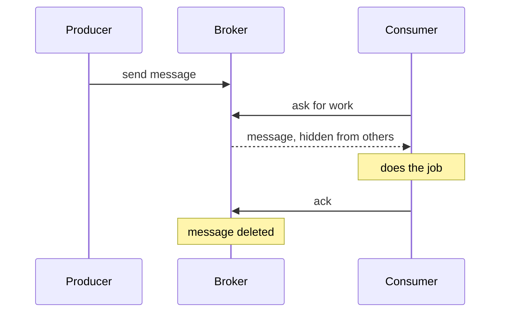
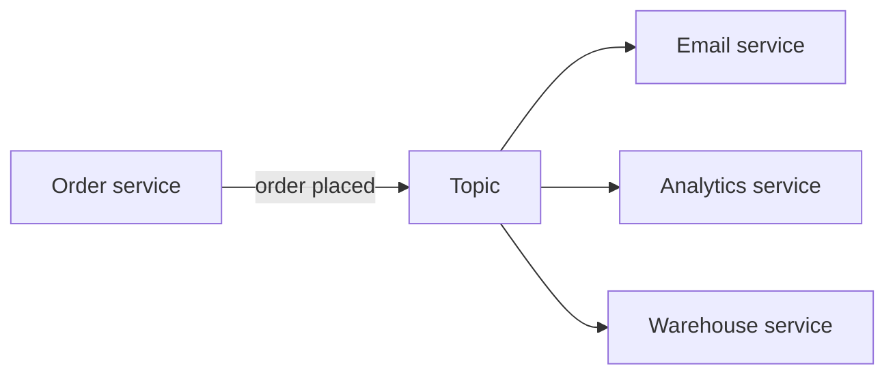
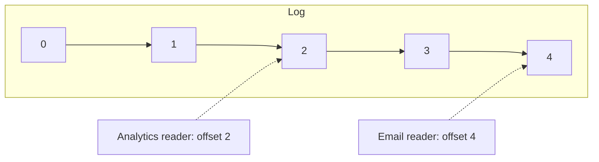
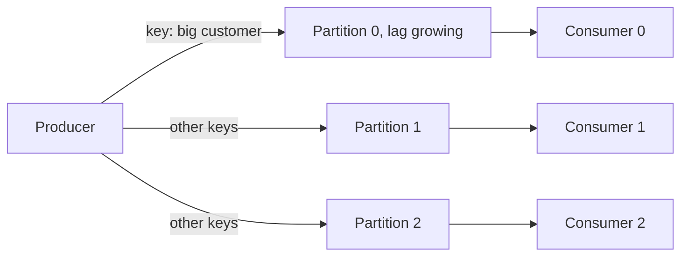
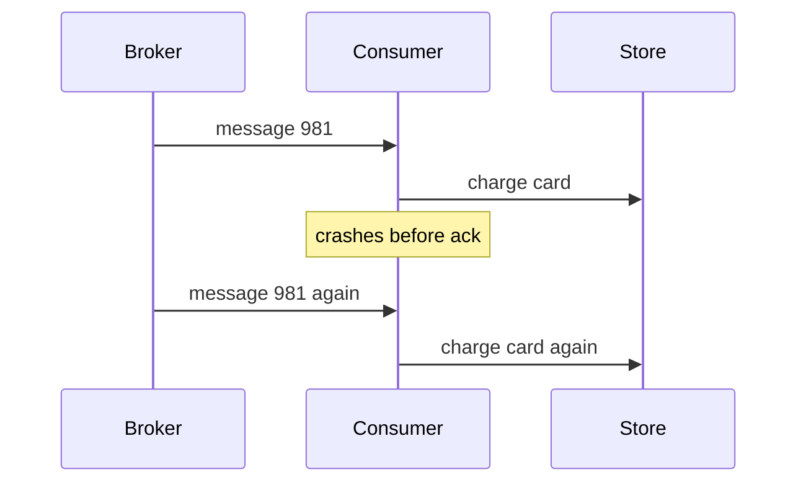

# message-queues | Message Queues and Task Queues | 2 | 10
A message queue holds work between the part of a system that creates it and the part that does it. The user gets a fast reply, and the slow work happens in the background at a pace the workers can sustain.

## The idea
Some work is too slow to do while a user waits: resizing a photo, sending an email, building a report. Instead of doing it inside the web request, the web server writes a small description of the job to a queue and replies right away, "we got it". Separate programs called workers take jobs off the queue and do them.

The program that adds messages is the producer. The program that takes them is the consumer. They never talk to each other directly. They only know the queue. The Primer's example is posting a tweet: it appears on your own timeline at once, while delivery to all your followers can take longer in the background. This is the asynchronism section of the [System Design Primer](https://github.com/donnemartin/system-design-primer#asynchronism), and it is one of the cheapest ways to make a slow system feel fast.

A message queue receives, holds and delivers messages. A task queue is the same idea with job features on top: each message names a function to run with its arguments, and the system can schedule jobs, retry them and return results. Celery for Python is a well-known task queue. It still needs a message broker underneath to hold the messages.

## What happens to one message


1. The producer sends the message. The broker (the server that runs the queue) stores it.
2. A consumer asks for work and receives the message. It stays in the queue but is hidden from other consumers.
3. The consumer does the job.
4. The consumer sends an acknowledgement, or ack, which tells the broker the job is done. The broker deletes the message.

Step 2 matters. If the consumer crashes before step 4, no ack ever arrives, so the message must not be lost. In Amazon SQS the hiding time is called the visibility timeout. It defaults to 30 seconds. If the message is not deleted before it runs out, the message becomes visible again and another consumer gets it. RabbitMQ gets the same effect differently: it requeues a message when the consumer's connection closes without an ack. Either way, the queue prefers to deliver a job twice over losing it. That choice has consequences, covered in [delivery guarantees](/sd/docs/async/delivery-guarantees).

Many consumers can read one queue at once, which is how you add capacity. The [Competing Consumers and Queue-Based Load Leveling](/sd/docs/cloud-messaging/competing-consumers) lesson shows how workers share a queue, and how a queue evens out bursts in front of a slow service.

## Which broker
Redis can act as a simple broker, but the Primer warns that messages can be lost. RabbitMQ is popular and speaks the AMQP protocol, but you run the nodes yourself. Amazon SQS is hosted, so you run nothing, and it delivers at least once, so duplicates can happen. For a first project, use whatever your platform already has. A full design that leans on queues is in [scale to millions](/sd/docs/practice/scale-to-millions).

## A worked example: a burst of uploads
All numbers here are invented. Photos arrive at a steady 300 per minute. Each takes a worker 3 seconds to process, so one worker finishes 20 per minute. With 20 workers the capacity is 20 x 20 = 400 per minute, a comfortable margin.

Then a marketing email lands and uploads jump to 5,000 per minute for 2 minutes. Capacity stays at 400, so the backlog grows by 5,000 - 400 = 4,600 per minute. After 2 minutes the queue holds 9,200 photos.

Arrivals fall back to 300 per minute. The queue now drains at 400 - 300 = 100 per minute. Emptying 9,200 photos takes 9,200 / 100 = 92 minutes. The last uploader waits over an hour and a half.

Now add workers. With 60 workers capacity is 1,200 per minute, the net drain is 900 per minute, and the backlog clears in about 10 minutes. Without a queue, a web tier that could only process 400 per minute would have rejected or timed out about 4,600 uploads every minute of the burst. The queue turned a failure into a delay, and extra workers shorten the delay without touching the web servers.

## What goes wrong: the job that runs twice
A report job takes 90 seconds, but the visibility timeout is 30 seconds. At second 30 the message reappears and a second worker starts the same report. At second 60 a third does. The symptom is customers receiving three copies of an email, or load that triples at random. Confirm it by comparing job durations with the timeout, and by looking for the same message id appearing in several workers' logs. The fix is a timeout longer than the slowest normal job, or a heartbeat that extends the timeout while the worker is still busy. SQS supports this with ChangeMessageVisibility. Make the job safe to repeat as well.

## When a queue is the wrong tool
If the user needs the result right now, such as a login check or a price quote, a queue only adds delay and moving parts. The Primer notes that cheap calculations and real-time flows are often better done synchronously. A queue also does not fix a database that is too slow. It moves the waiting somewhere you cannot see it, until the backlog grows.

## Common mistake
Assuming a queue makes work happen exactly once. It makes work survive crashes, and it does that by allowing repeats.

```resources
article | System Design Primer: Asynchronism | https://github.com/donnemartin/system-design-primer#asynchronism | Donne Martin | The short treatment of message queues, task queues and back pressure this lesson builds on.
docs | Amazon SQS visibility timeout | https://docs.aws.amazon.com/AWSSimpleQueueService/latest/SQSDeveloperGuide/sqs-visibility-timeout.html | AWS | Explains the 30 second default, redelivery after expiry, heartbeats and dead-letter queues.
docs | RabbitMQ consumer acknowledgements and publisher confirms | https://www.rabbitmq.com/docs/confirms | RabbitMQ | Shows how acks tell the broker a delivery was processed, and how unacked messages are requeued.
article | Avoiding insurmountable queue backlogs | https://aws.amazon.com/builders-library/avoiding-insurmountable-queue-backlogs/ | Amazon Builders Library | Describes how a backlog builds up and why recovering from it takes extra capacity for as long as the outage lasted.
```

```quiz
What does a worker do after finishing a job so the broker can delete the message? | Sends an acknowledgement ; Restarts the visibility timeout ; Publishes a new message | 0 | The ack tells the broker the delivery was processed, so it can remove the message.
Capacity is 400 jobs per minute and 300 arrive per minute after a burst leaves 9,200 queued. About how long to drain? | About 23 minutes ; About 92 minutes ; About 31 minutes | 1 | The queue drains at 400 minus 300, which is 100 per minute, and 9,200 divided by 100 is 92.
Why is a task that takes 90 seconds with a 30 second visibility timeout a problem? | The broker deletes it after 30 seconds ; The queue refuses messages that are too slow ; Another worker may pick it up while it runs | 2 | The message becomes visible again at 30 seconds, so a second worker can start the same job.
```

```story
A photo app runs thumbnail creation inside the upload request. On a quiet day it is fine. When a newsletter sends ten times the usual traffic, every upload waits behind the resizing, requests time out and users retry, which makes it worse. A queue would have let the app reply instantly and clear the pile at its own speed.
```

```adapted
The System Design Primer | https://github.com/donnemartin/system-design-primer | CC BY 4.0
```

# event-streams | Pub/Sub and Event Streams | 2 | 12
A queue gives each job to one worker and then forgets it. Pub/sub and event streams let many independent readers each see every event, and a log like Kafka also keeps the events so they can be read again.

## Queue versus pub/sub
In a work queue, each message goes to exactly one consumer. Ten workers share the load, and once a message is acked it is gone. That is right for jobs.

```card Publisher-Subscriber
Problem | One service must tell many others about an event, but it should not know who they are or wait for them.
Solution | The publisher sends the event to a topic. A messaging layer gives every subscriber its own copy, and subscribers come and go without changing the publisher.
Use when | Several independent consumers need the same events, or you want to add new consumers later without touching the sender.
Avoid when | A single consumer needs each job done exactly once, which is a work queue, or the sender needs an immediate reply.
```

Pub/sub (publish and subscribe) is different. A publisher sends an event to a topic, and every subscriber gets its own copy. When an order is placed, the email service, the analytics service and the warehouse service might each need to hear about it. The order service publishes one "order placed" event and does not know or care who listens. This is called fan-out. New subscribers can be added without changing the publisher.



## The log
Apache Kafka takes a third approach, based on a very simple idea. Jay Kreps, who helped build Kafka at LinkedIn, describes a log as an append-only, totally ordered sequence of records. New records go at the end, and each gets a sequence number. Readers start at some position and move forward.



A reader's position is its offset, the number of the next record it will read. The reader, not the log, remembers where it is. That one design choice explains most of Kafka. Reading does not remove anything, so many readers can read the same data at different speeds. The Kafka documentation says events are not deleted after consumption. They are kept for a time you set, called retention.

## Partitions, offsets and consumer groups
One log on one machine cannot grow forever. Kafka splits a topic into partitions, each its own log, spread over different servers. A producer picks a partition for each event, usually by hashing a key such as the customer id. Events with the same key land in the same partition, and Kafka guarantees a reader sees one partition's events in the order they were written. There is no ordering guarantee between partitions. Kreps names this lack of global order as a limitation.

A consumer group is a set of consumers that share a topic. Each partition is read by one consumer in the group, so more consumers means more parallelism, up to the number of partitions. A second group, say analytics, reads the same topic independently with its own offsets. So a consumer group acts like a work queue inside, and separate groups act like pub/sub.

Replay follows from all this. If a bug corrupts a downstream table, fix the code, reset the group's offset to an earlier point, and read the events again. A queue that deletes on ack cannot do that.

The [Event Sourcing and CQRS](/sd/docs/cloud-messaging/event-sourcing-and-cqrs) lesson goes further: it stores the log of events as the main record of what happened, and builds read models from it.

## A worked example: sizing partitions
Invented numbers. A topic receives 6,000 events per second. One consumer handles 1,000 per second. You need at least 6 consumers, so you need at least 6 partitions, because a partition feeds only one consumer in a group. You choose 12 for headroom. Events are keyed by customer id, so every event of customer 42 goes to one partition and is processed in order.

Then 12 consumers can run, double the minimum. Now the analytics group, with slower consumers at 500 per second each, needs 12 consumers too, and it can use the same 12 partitions. Adding a 13th consumer to either group would sit idle, since only 12 partitions exist. Retention is 7 days at 6,000 events per second of 1 KB each, which is 6,000 x 86,400 x 7 x 1 KB, about 3.6 TB before replication. Retention costs real disk, so choose it on purpose.

## What goes wrong: one hot key


Suppose one customer produces 40 percent of all events. Their key hashes to a single partition, so one consumer gets 40 percent of the traffic while the others idle. The symptom is one partition with a growing lag (how far the consumer's offset is behind the end of the log) while the rest sit near zero. Confirm it by listing lag per partition. Fixes include adding a random suffix to the key for that customer, which gives up ordering for them, or splitting the topic.

## When a log is the wrong tool
For plain background jobs with retries and per-job delays, a task queue is simpler to run. A log forces you to think about partitions, offsets and rebalancing. Kafka also adds an extra system for a small team to operate. If you have one producer, one consumer and modest volume, a managed queue is likely enough. Choose a log when several consumers need the same events, when order per key matters, or when replay is valuable.

## Common mistake
Expecting ordering across a whole topic. Order exists only inside one partition, so put events that must stay ordered under the same key.

```resources
paper | The Log: What every software engineer should know about real-time data's unifying abstraction | https://web.archive.org/web/2023/https://engineering.linkedin.com/distributed-systems/log-what-every-software-engineer-should-know-about-real-time-datas-unifying | Jay Kreps | Defines the log, its ordering by position, and the lack of global order across partitions.
docs | Apache Kafka introduction | https://kafka.apache.org/intro/ | Apache Kafka | Defines events, topics, partitions, key-based ordering, retention and why events are not deleted after reading.
article | System Design 101: The ultimate Kafka 101 | https://bytebytego.com/guides/the-ultimate-kafka-101-you-cannot-miss | ByteByteGo | A short picture-led overview of Kafka messages, topics and partitions.
```

```quiz
Why can a Kafka topic with 12 partitions not use 13 consumers in one group? | Each partition goes to one consumer in a group ; Kafka caps every group at twelve members ; Consumers need an even partition count | 0 | A partition is read by one consumer per group, so a 13th consumer has nothing to read.
A topic gets 9,000 events per second and a consumer handles 1,500. What is the minimum partition count? | Three partitions ; Nine partitions ; Six partitions | 2 | 9,000 divided by 1,500 is 6 consumers, and each needs its own partition.
Where does Kafka guarantee the order of events? | Across the whole topic ; Within one partition ; Across all consumer groups | 1 | Order holds only inside a partition, which is why related events share a key.
```

```story
An online shop publishes "order placed" to a stream. Email, analytics and fraud checks each read it at their own speed. Later the analytics team finds a bug in their revenue table. They fix the code, rewind their offset to last Monday and rebuild the table, and nobody else is affected.
```

# delivery-guarantees | Delivery Guarantees and Idempotency | 3 | 12
Networks lose messages and acknowledgements, so a system must choose between losing work and repeating it. Safe systems choose to repeat, and then make repeating harmless.

## The three guarantees
At-most-once means a message is delivered zero or one times. The sender fires it and never retries. Nothing is duplicated, but a lost message stays lost. This is fine for a metrics ping and bad for a payment.

At-least-once means the sender retries until it gets an acknowledgement. Nothing is lost, but duplicates happen. Many brokers work this way by default, and the SQS documentation says SQS has an at-least-once delivery model.

Exactly-once means each message has its effect once, with no loss and no repeats. A network cannot deliver a message exactly once. The sender cannot tell "the message never arrived" from "it arrived and the ack was lost". So the phrase really means effectively-once: the message may be delivered several times, but its effect happens once. Systems get there in two ways. Inside one system the broker can help. Kafka's idempotent producer (since version 0.11) stops a resend from writing a duplicate record, and its transactions let a program that reads from Kafka and writes back to Kafka commit its output and its consumer offset together, so readers set to read only committed data see each result once. Kafka's own documentation says this does not reach outside systems: exactly-once delivery to another destination needs that system's cooperation. Across systems, the consumer is made idempotent.

## Where duplicates come from


1. The consumer finishes the job but crashes or times out before the ack, so the broker redelivers.
2. The visibility timeout expires while a slow job is still running.
3. The producer sends, loses the broker's confirmation, and sends again.
4. A relay process publishes a message and crashes before recording that it did.

Stripe's engineering blog describes the same root problem for APIs: the call can succeed while the connection breaks before the server can tell the client. The client cannot know whether to retry.

## Idempotency
```card Idempotent Consumer
Problem | A message can arrive more than once, and handling it twice causes a double charge or a doubled record.
Solution | Give every message a unique id. The consumer records the id with its work in one transaction, and skips any message whose id is already recorded.
Use when | The broker delivers at least once and the work is not naturally safe to repeat.
Avoid when | The operation is naturally idempotent, such as setting a value, or an occasional duplicate does not matter.
```

An operation is idempotent if doing it many times has the same effect as doing it once. "Set the status to shipped" is idempotent. "Add 10 dollars to the balance" is not. For the second kind, attach an idempotency key: a unique id made by the producer for one logical operation. The consumer keeps a table of keys it has handled, with a unique constraint. It runs the work and records the key in the same database transaction. A repeat violates the constraint, so the work is skipped and the stored result is returned. Stripe's API works this way, with an Idempotency-Key header on mutating requests.

## The outbox pattern
A service often must update its database and also publish an event. Doing both is risky. Publish first and the database write may fail. Commit first and the service may crash before publishing. A distributed transaction across both is often unavailable or unwanted. The transactional outbox pattern, described by Chris Richardson, stores the event in an outbox table in the same transaction as the business change. A separate relay reads the table and publishes. The event is sent if and only if the transaction commits. The relay can crash after publishing, so it may publish twice, which is why consumers must be idempotent anyway.

## A worked example: charged twice
A payment consumer reads "charge order 981 for 40 dollars" from a queue. It calls the card processor, which charges the card. Then the consumer crashes, before it acks.

1. The visibility timeout expires and the message reappears.
2. Another consumer receives it and calls the processor again.
3. The customer is charged 80 dollars.

The fix has two layers. The consumer sends the order id "981-charge" as the processor's idempotency key. The second call returns the first result and charges nothing. The consumer also keeps its own table with a unique key on message id, so even a processor without keys is protected.

```python
def handle(msg):  # pseudocode
    try:
        with db.transaction():
            db.insert("processed", key=msg.id)   # unique constraint
            db.insert("payments", order=msg.order, amount=msg.amount)
    except UniqueViolation:
        pass                                      # duplicate, already done
    ack(msg)
```

Note the order: the work and the key commit together, and the ack comes last, also for a duplicate, so the broker stops redelivering it. A crash after commit but before the ack only causes a harmless repeat.

## What goes wrong: the check that races
A consumer first reads "have I seen this id?" and then does the work. Two copies of the message arrive at once, both read "no", both charge. The symptom is rare double charges that show up only under load or after an outage. Confirm it by querying for duplicate order ids in the payments table. A unique constraint fixes it, because the database lets only one insert win.

## When idempotency keys are the wrong tool
Idempotency keys cost a table and a cleanup job, so skip them for naturally idempotent writes such as "set the name to X". Skip dedupe for metrics, where an occasional duplicate or loss is invisible. If a key must be kept for a long time, the dedupe table can grow large, so expire keys after your longest retry window.

## Common mistake
Trusting a broker's "exactly-once" label for the whole flow. For Kafka it covers reading, processing and writing between Kafka topics. A call to an outside system, like a card processor, still needs its own idempotency key.

```resources
article | Designing robust and predictable APIs with idempotency | https://stripe.com/blog/idempotency | Brandur Leach, Stripe | Explains ambiguous failures, idempotency keys, and retries with backoff and jitter.
article | Pattern: Transactional outbox | https://microservices.io/patterns/data/transactional-outbox.html | Chris Richardson | Defines the outbox table and relay, and says the relay may publish twice so consumers must be idempotent.
docs | Amazon SQS visibility timeout | https://docs.aws.amazon.com/AWSSimpleQueueService/latest/SQSDeveloperGuide/sqs-visibility-timeout.html | AWS | States SQS uses at-least-once delivery and cannot promise a message is never delivered twice.
article | System Design 101: Top 6 cases to apply idempotency | https://bytebytego.com/guides/top-6-cases-to-apply-idempotency | ByteByteGo | A short list of places where retries make idempotency necessary, including payments and messaging.
```

```quiz
A consumer charges a card, then crashes before acking. What happens next with at-least-once delivery? | The message is redelivered and may charge again ; The broker detects the charge and skips it ; The message is dropped because it failed | 0 | Without an ack the broker redelivers, so the charge repeats unless the work is idempotent.
Which operation is naturally idempotent? | Add 10 dollars to a balance ; Send a welcome email ; Set an order status to shipped | 2 | Setting a value gives the same result however many times you repeat it.
Why store the processed key in the same transaction as the work? | It makes the broker deliver faster ; A crash cannot leave work done without its key ; It lets the consumer skip acknowledging | 1 | If both commit together, a repeat sees the key and a crash leaves neither.
```

```story
A subscription app retries failed charges. One night the card processor is slow, a timeout fires, and the retry goes through too. Four hundred customers are charged twice before anyone notices. A single idempotency key on each charge request would have turned every retry into a no-op.
```

# back-pressure | Back Pressure | 2 | 10
A queue that grows without limit only hides an overload until it becomes an outage. Back pressure means pushing the problem back toward the sender, so that waiting stays short and overload is visible.

## What back pressure is
If work arrives faster than workers finish it, the queue grows. The System Design Primer notes that once a queue outgrows memory, it causes cache misses and disk reads, and performance drops. Back pressure is the fix: you bound the queue, and when it is full, new requests are refused. A web service returns HTTP 503 (server busy) or 429 (too many requests), and clients retry later, ideally with exponential backoff (waiting longer after each failure).

The alternative is buffering forever. That feels kind, since nothing is rejected, but it means users wait hours for work that may no longer matter. Amazon's Builders' Library article on queue backlogs says many of its systems start rejecting work in the producer when a backlog gets unreasonable. It also says some systems, like order processing, prefer to keep accepting orders and prioritize behind the scenes. Both are valid. Decide which per workload.

```mermaid A bounded queue refuses new work at the limit, so the wait for accepted work stays flat
flowchart LR
  P[Producers] -->|accepted| Q[Bounded queue]
  P -.->|queue full: 429| X[Rejected]
  Q --> W[Workers]
  class X bad
  class Q warn
```

## Sizing with Little's law
How many workers do you need, and how long will a job wait? [Little's law](/sd/docs/foundations/latency-and-throughput) answers both, and that lesson has the full explanation. Applied here, the number of jobs in progress equals the arrival rate times the time one job takes. If 80 jobs arrive per second and each takes 0.5 seconds, 40 are in progress at any moment, so you need at least 40 workers, and more for bursts.

The same relation gives the wait. A queue of $Q$ jobs served at $\mu$ jobs per second makes a new job wait about $Q / \mu$ seconds. This is why a bound on queue length is also a bound on latency.

## Your options when arrivals exceed service
When the arrival rate stays above the service rate, only a few things can happen. Pick on purpose.

1. Reject at the edge. Bound the queue and return 429 or 503. Latency for accepted work stays flat.
2. Shed the least useful work. Drop old, low-priority or duplicate items first, and keep the rest.
3. Add capacity. More workers raise the service rate. This helps only if the bottleneck is the workers, not a shared database behind them.
4. Slow the producer. Let consumers pull work at their own pace, or make producers wait for a free slot. Streams and pull-based queues do this naturally.

## A worked example: when arrivals exceed service
Invented numbers. 50 workers each finish a job in 0.5 seconds, so the system serves 100 jobs per second. Arrivals rise to 120 per second. Try these numbers in the demo above.

The queue grows by 120 - 100 = 20 jobs per second. After 10 minutes (600 seconds) that is 12,000 jobs. A job arriving then waits 12,000 / 100 = 120 seconds before it starts, and the wait keeps growing. Nothing has crashed, yet users already see the system as down.

Now bound the queue at 1,000 jobs. A new job waits at most 1,000 / 100 = 10 seconds. The 20 jobs per second that do not fit are rejected with 429, and clients retry later. Latency for accepted work stays flat. The cost is that 1 in 6 requests is refused, which is visible but honest.

```mermaid The same overload, unbounded versus bounded: only the bounded queue keeps waits short
sequenceDiagram
  participant C as Client
  participant Q as Queue
  participant W as Workers
  C->>Q: job, queue holds 12,000
  Note over Q,W: wait is 120 s and growing
  C->>Q: job, queue holds 1,000
  Q-->>C: 429 too many requests
  Note over C: waits, retries with backoff
  Q->>W: accepted job, wait at most 10 s
```

## What goes wrong: the backlog nobody saw
A downstream API is slow for an hour. Workers time out and retry, and the queue fills. The dashboard shows workers busy and no errors, so no one is paged. By morning the queue holds a day of work. The symptom is complaints about stale results while every health check is green. Confirm it by checking queue depth and the age of the oldest message. Age is the better alarm, because depth alone cannot say whether a backlog is 10,000 small jobs or one hour old. Amazon's article also notes that a one-hour outage needs double capacity for another hour to recover, so recovery is slow.

## When back pressure is the wrong tool
If dropping work is unacceptable and the queue is durable, such as orders, bound by priority instead of refusing everything. If the load is a short, known burst, a deeper queue and extra workers can be cheaper than rejecting users. Back pressure also needs well-behaved clients. A client that retries instantly with no backoff turns your 429 into more load.

## Common mistake
Alarming on queue depth only. Alarm on the age of the oldest message too, since age is what users feel.

```resources
article | System Design Primer: Back pressure | https://github.com/donnemartin/system-design-primer#back-pressure | Donne Martin | Explains bounding queue size and returning 503 so clients retry later with backoff.
article | Applying back pressure when overloaded | https://mechanical-sympathy.blogspot.com/2012/05/apply-back-pressure-when-overloaded.html | Martin Thompson | Argues unbounded queues grow until latency is unacceptable and memory runs out, so reject overflow instead (the Primer's own source).
article | Avoiding insurmountable queue backlogs | https://aws.amazon.com/builders-library/avoiding-insurmountable-queue-backlogs/ | Amazon Builders Library | Covers backlog recovery time, sending back pressure upstream, and alarming on dead-letter queues.
docs | Little's law | https://en.wikipedia.org/wiki/Little%27s_law | Wikipedia | States L equals arrival rate times average time in the system, for a stationary system, whatever the arrival distribution.
```

```quiz
Jobs arrive at 60 per second and each takes 0.5 seconds. How many are in progress on average? | 120 jobs ; 30 jobs ; 60 jobs | 1 | Little's law gives 60 times 0.5, which is 30 jobs in progress.
Arrivals are 120 per second and service is 100 per second. How fast does the queue grow? | 20 jobs per second ; 100 jobs per second ; 120 jobs per second | 0 | The queue grows by arrivals minus service, which is 20 per second.
A queue is bounded at 1,000 jobs and served at 100 per second. What is the longest wait for an accepted job? | About 10 seconds ; About 100 seconds ; About 1 second | 0 | The wait is queue length divided by service rate, 1,000 divided by 100, which is 10 seconds.
```

```story
A nightly import queue is fine until a partner API slows down. Workers keep retrying, nothing errors, and the dashboard stays green. Two days later sales asks why last week's leads never showed up. An alarm on the age of the oldest message would have fired in the first hour.
```

```adapted
The System Design Primer | https://github.com/donnemartin/system-design-primer | CC BY 4.0
```

# background-jobs | Background Jobs | 2 | 10
A background job runs outside the request that asked for it, so the user does not wait. You decide what starts it, how failures are retried, how to make repeats harmless, and how the caller learns the result.

## What starts a job
Something has to start a job, and the Azure Architecture Center groups the options into two kinds.

Event-driven triggers start a job because something happened. The web app puts a message on a queue and a worker reads it. Or a row changes in storage and a watcher notices. Or a call to an HTTP endpoint hands the job its input. This suits image resizing, sending email, calling remote services and provisioning a new user. If requests come in bursts, the queue also smooths them, which is [Queue-Based Load Leveling](/sd/docs/cloud-messaging/competing-consumers).

Schedule-driven triggers start a job because a timer fired. Examples are a nightly report, an index rebuild, data retention cleanup and consistency checks. A timer can live inside the app, in the operating system (cron), or in a separate scheduler service that calls an endpoint.

```mermaid Two ways to start the same worker: an event on a queue, or a timer
flowchart LR
  A[Web app] -->|message| Q[Queue]
  T[Scheduler] -->|tick| J[Job runner]
  Q --> J
  J --> S[(Storage)]
```

Two traps follow for timers. If you run the scheduler on every server, each one starts its own copy. And if a run takes longer than the gap between ticks, the next run starts while the last is still going. Run the schedule in one place, or take a lock so only one copy runs.

## Failures: retries and dead letters
Jobs fail for temporary reasons, such as a flaky network, and permanent ones, such as bad input. Retry the first kind with exponential backoff plus jitter, so a thousand failed jobs do not all return at the same second. [Timeouts, retries and backoff](/sd/docs/reliability/timeouts-and-retries) covers the delay formula and the retry code. Cap the number of attempts, because a retry loop with no end is a load generator.

After the last attempt, a message goes to a dead-letter queue (DLQ), a separate queue holding jobs that could not be processed. A job that always fails would otherwise cycle forever and waste capacity. A person or a repair job can look at the DLQ later and replay the fixed messages. Amazon's Builders' Library says it is a good idea to alarm on DLQ volumes, though not to rely on that alone, since it can detect a problem too late.

```mermaid A job is retried a few times, then parked in the dead-letter queue
sequenceDiagram
  participant Q as Queue
  participant W as Worker
  participant D as Dead-letter queue
  Q->>W: job, attempt 1
  W-->>Q: failed
  Q->>W: job, attempt 2 after backoff
  W-->>Q: failed
  Q->>W: job, attempt 3 after backoff
  W-->>Q: failed
  Q->>D: move job, limit reached
```

## Jobs must be safe to repeat
Queues deliver at least once, and schedulers and retries add repeats of their own. So a job should give the same result when run twice. Write "set the status to shipped" instead of "add one to the counter", or record an idempotency key with the work in one transaction. The full treatment is in [delivery guarantees and idempotency](/sd/docs/async/delivery-guarantees). A job that can also be stopped halfway and restarted cleanly, for example by writing progress checkpoints, survives crashes and redeploys.

## Returning results
Ideally a job is fire and forget. If the caller does need the outcome, you have three options. First, a status record: the caller gets a job ID, polls a status URL, and later fetches the result. Second, a callback: the caller gives a webhook URL and the job calls it when done. Third, a reply queue: the job posts a message the caller listens for. Polling is simple and a callback is prompt but fails if the receiver is down, so keep the status record as the source of truth. The details of the first option are in [Asynchronous Request-Reply](/sd/docs/cloud-messaging/claim-check-and-async-reply).

## A worked example: the poison job
Invented numbers. A queue gets 10,000 jobs an hour, and 2 percent have bad input that always fails. That is 200 poison jobs. Each failure wastes 5 seconds of a worker, and there are 20 workers.

With no attempt limit, every poison job comes back again and again. One pass over them costs 200 x 5 = 1,000 worker-seconds. The 20 workers supply 20 worker-seconds each second, so one pass takes 1,000 / 20 = 50 seconds, and a new pass starts straight away. The workers spend all their time on jobs that cannot succeed, and healthy jobs starve.

Now allow 4 attempts, then move the job to the DLQ. Total waste is 200 x 4 x 5 = 4,000 worker-seconds, which is 4,000 / 20 = 200 seconds of the whole pool, once. After that the 200 messages sit in the DLQ, the queue is clean, and an alarm tells a person.

## What goes wrong: the job that ran three times
A nightly cleanup is configured with cron on each of three web servers. At 02:00 all three start it. The symptom is a database CPU spike at 02:00 each night, doubled emails, or deletes that fail on rows another copy already removed. Confirm it by looking for three start lines in the logs at the same minute, one per host. The fix is to run the schedule from one place, or take a lock at the start of the job so a copy that cannot get the lock exits quietly.

## When a background job is the wrong tool
If the user needs the answer in the same response, such as a login check, a job only adds delay. If a task has many steps that depend on each other and need compensation when one fails, a single job with retries is too weak, and a [saga](/sd/docs/cloud-messaging/compensating-transactions) or a workflow engine fits better. Tiny work that takes a few milliseconds is cheaper to do inline than to queue.

## Common mistake
Retrying every failure the same way. Temporary errors deserve a few retries with backoff, and permanent ones should go to the DLQ at once.

```resources
article | Best practices for background jobs | https://learn.microsoft.com/en-us/azure/architecture/best-practices/background-jobs | Microsoft Azure Architecture Center | Covers event-driven and schedule-driven triggers, overlapping scheduler runs, and ways to return results such as status endpoints, reply queues and webhooks.
docs | Amazon SQS dead-letter queues | https://docs.aws.amazon.com/AWSSimpleQueueService/latest/SQSDeveloperGuide/sqs-dead-letter-queues.html | AWS | Describes DLQs as the place source queues send messages that could not be processed, for later inspection.
article | Timeouts, retries and backoff with jitter | https://aws.amazon.com/builders-library/timeouts-retries-and-backoff-with-jitter/ | Amazon Builders Library | Says retries are selfish and that jitter spreads retry bursts over time.
article | Asynchronous Request-Reply pattern | https://learn.microsoft.com/en-us/azure/architecture/patterns/asynchronous-request-reply | Microsoft Azure Architecture Center | Shows the 202 Accepted, status endpoint and 303 redirect flow for returning a job's result.
```

```quiz
A queue has 200 poison jobs, 5 seconds wasted per attempt and 20 workers. With 4 attempts each, how long do the workers spend on them? | About 50 seconds ; About 200 seconds ; About 800 seconds | 1 | 200 jobs x 4 attempts x 5 seconds is 4,000 worker-seconds, and 20 workers clear that in 200 seconds.
A nightly job is scheduled on each of three servers. What is the most likely result? | Three copies start at once ; The first server blocks the others ; The job runs once at random | 0 | Each server's timer fires on its own, so without a lock all three run.
What does a service return when it accepts a long job and the caller must poll? | 200 with the full result ; 202 with a status location ; 204 with an empty body | 1 | HTTP 202 Accepted with a Location header points the caller at a status endpoint.
```

```story
A shop sends a receipt email from a background job. One customer typed an address with a stray space, and the job fails every time. With no attempt limit it cycles all day, and by afternoon receipts for everyone else are an hour late. A cap of four attempts and a dead-letter queue would have parked that one job and paged someone.
```

```adapted
Azure Architecture Center (Microsoft) | https://learn.microsoft.com/en-us/azure/architecture/patterns/ | CC BY 4.0
```
