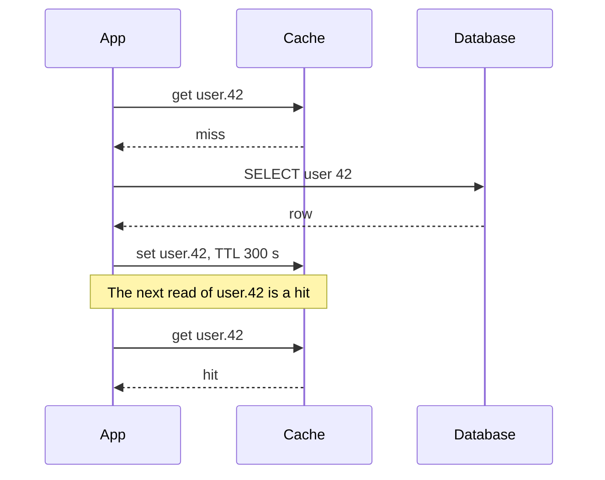

# caching-basics | Why Caches Work | 1 | 10
A cache keeps a copy of data in a faster place so most requests never reach the slow source. It works because a small set of items gets most of the reads, and one number, the hit ratio, tells you how much it helps.

## How it works
Caching improves page load times and can reduce the load on your servers and databases. The idea is simple. Before doing the expensive work (a database query, a page render, a network trip), look in a small, fast store. If the answer is there, that is a hit and you return it. If not, that is a miss: you do the work, save the result, and return it.

Caches pay off because of locality. Recently read data tends to be read again soon, and access is skewed: a few popular items (a celebrity profile, a front page, a trending video) get most of the reads while a long tail is rarely touched. A cache holding the popular few percent of items can answer most requests. Databases also like an even spread of reads across partitions, and popular items break that. A cache in front absorbs uneven load and traffic spikes. See [sharding](/sd/docs/data/sharding) for why hot keys hurt.

```mermaid The read path: a hit stops at the cache, only a miss reaches the database
flowchart TD
  C[Client] --> A[App]
  A -->|1 lookup| K[Cache]
  K -->|hit: answer| A
  K -.->|miss| D[(Database)]
  D -.->|row, then fill cache| K
```

## Where caches live
Caches stack in layers, from the user outward to the data:

1. Client: the browser or the operating system keeps copies of pages, images and DNS answers.
2. CDN: servers near the user hold static (and sometimes dynamic) content. See the [CDN lesson](/sd/docs/scaling/cdn-and-edge).
3. Web server or reverse proxy: tools such as Varnish can serve content directly without touching the application servers. See [reverse proxies](/sd/docs/scaling/reverse-proxies-and-gateways).
4. Application memory: a map inside one process. Fastest, but every server has its own copy.
5. Distributed cache: Redis or Memcached, a key-value store held in RAM and shared by all servers. RAM is much faster than disk-based databases but smaller, so it keeps only hot data.
6. Database: most databases cache disk pages in a buffer pool by default. Tuning those settings for your access pattern can help further.

Avoid file-based caches on app servers. They make cloning servers and autoscaling harder, because each new server starts empty. An AWS article on caching (Jas Chhabra, 2019) makes the matching point: a new server with an empty local cache can send a burst of requests to the dependency while it refills, and an external cache avoids that because it stays populated.

## The math
Average latency is the hit-weighted blend of the two paths, where $h$ is the hit ratio (the fraction of requests found in the cache):

$$\text{average} = h \times \text{cache} + (1 - h) \times \text{db}$$

The demo above lets you drag $h$ and watch both the average latency and the database load. The hit ratio matters more than it looks, because the database sees only the misses.

## A worked example: 90 percent versus 99 percent
Invented numbers: a cache read takes 1 ms, a database read takes 20 ms, and the site serves 10,000 reads per second.

At a 90 percent hit ratio, the average is 0.9 × 1 + 0.1 × 20 = 0.9 + 2.0 = 2.9 ms. The database serves the 10 percent of misses: 1,000 queries per second.

At 99 percent, the average is 0.99 × 1 + 0.01 × 20 = 0.99 + 0.2 = 1.19 ms. The database now serves 100 queries per second.

Average latency improved only about 2.4 times (2.9 down to 1.19 ms), but database load fell 10 times. That second number is usually the real prize. A database sized for 1,000 queries per second can now handle ten times the traffic before it hurts. The flip side is a warning: at 99 percent, losing the cache sends all 10,000 reads per second to a database built for 100.

```mermaid Losing a warm cache at 99 percent hits sends the full load to a database sized for 1 percent
flowchart TD
  U[10,000 reads per second] --> K[Cache node]
  K -.->|node dies| X[Empty cache]
  X -->|all reads miss| D[(Database built for 100 per second)]
  class X bad
  class D bad
```

## Eviction: what to throw out when full
RAM is limited, so a full cache must drop something to admit something new.

| Policy | Drops | Good for | Weak spot |
| --- | --- | --- | --- |
| LRU (least recently used) | the item untouched the longest | most workloads with locality | one big scan pushes out hot items |
| LFU (least frequently used) | the item with the fewest reads | stable popularity | old favorites linger after they go cold |
| TTL (time to live) | anything older than a set age | data that goes stale | not a size limit on its own |

LRU is a sensible default. Many caches combine a size policy with a TTL.

A trace of an LRU cache that holds 3 items, with the most recently used item first.

| Read | Result | Cache after the read |
| --- | --- | --- |
| A | miss | A |
| B | miss | B A |
| C | miss | C B A |
| A | hit | A C B |
| D | miss, evicts B | D A C |
| B | miss, evicts C | B D A |
| A | hit | A B D |
| E | miss, evicts D | E A B |
| C | miss, evicts B | C E A |

Two hits in nine reads. A is read often, so it stays. B is evicted, comes back as a miss, and is evicted again a few reads later.

## What goes wrong: a cache that never hits
You add a cache and the database load barely moves. Typical causes: the key includes something unique per request (a timestamp, a session id), the TTL is shorter than the gap between repeat reads, or the set of items people actually read is far larger than the cache, so LRU keeps evicting items before they are reused. Confirm by reading the cache's own counters (in Redis, `INFO stats` reports `keyspace_hits`, `keyspace_misses` and `evicted_keys`, the number of keys evicted because of the `maxmemory` limit) and computing $h$ as hits divided by hits plus misses. If $h$ is low, say under about 50 percent for a read-heavy workload, the cache adds a network hop and a failure point for little gain.

## When a cache is the wrong tool
If every request asks for something different (a unique search, a one-time report), there is nothing to reuse. If the data must always be exactly current, such as an account balance during a transfer, a copy that may be stale is dangerous. If the database is slow because of a missing [index](/sd/docs/data/indexes), fix the index first: a cache hides that problem and adds invalidation work. Caching also means maintaining consistency between the cache and the source of truth, which is the hard part covered in [invalidation](/sd/docs/caching/cache-invalidation).

The opposite mistake has its own name too. The No Caching antipattern is a system that repeats the same expensive fetches on every request. [Retry Storm and No Caching](/sd/docs/antipatterns/retry-storm-and-no-caching) shows how to spot it in production and fix it.

## Common mistake
Judging a cache by average latency alone and ignoring the database load and the cold-start case (a cache that starts empty, or is lost, so every read goes to the database until it refills).

```resources
article | System Design Primer: Cache | https://github.com/donnemartin/system-design-primer#cache | Donne Martin | The layers of caching, what to cache, and the update strategies this chapter builds on.
article | Introduction to Architecting Systems for Scale | http://lethain.com/introduction-to-architecting-systems-for-scale/ | Will Larson | Covers application versus database caching, says LRU is almost always an appropriate strategy, and warns about caches drifting from the source of truth.
article | Caching challenges and strategies | https://builder.aws.com/content/3K9TeXp6strMiJ4vhakpRD7BQWO/caching-challenges-and-strategies | AWS Builder Center | Compares local and external caches and explains cold starts from empty caches.
article | Caching, Karan Pratap Singh | https://github.com/karanpratapsingh/system-design#caching | Karan Pratap Singh | A short chapter on hits, misses and locality of reference (read for comparison, linked here as a second explainer).
```

```quiz
A site at a 99 percent hit ratio loses its only cache node. What happens to the database? | It gets every read, 100 times its usual load ; Nothing, since it already serves most reads ; Its load rises by about one percent | 0 | At 99 percent the database normally sees 1 percent of reads. With no cache it sees all of them, which is 100 times more.
Moving the hit ratio from 90 to 99 percent changes database load by about how much? | It falls by about ten percent ; It falls to a tenth of what it was ; It falls to half of what it was | 1 | Misses drop from 10 percent to 1 percent of requests, a 10 times drop.
A full cache must make room for a new item. What does LRU remove? | The item that was added first ; The item with the fewest total reads ; The item that was used longest ago | 2 | LRU tracks recency of use, not count or insertion order.
```

```story
A shop's product page needs three database queries and takes 60 ms. On sale day, 10,000 people open the same ten products. Without a cache the database melts, because it repeats the same work 10,000 times a second. With one, it computes each product once and the rest of the traffic never reaches it.
```

```adapted
The System Design Primer | https://github.com/donnemartin/system-design-primer | CC BY 4.0
```

# cache-patterns | Cache-Aside, Write-Through and Write-Behind | 2 | 12
Four patterns decide how the cache is filled and kept in step with the database. Three are about writes and one, refresh-ahead, is about reads. Each trades speed, freshness and complexity differently, and each has its own way of failing.

## The four strategies
A cache holds a copy, and the database can change underneath it. So you must decide who loads the cache, and what happens to the copy when data is written. The Primer describes four common answers.

```card Cache-Aside
Problem | Reading the database on every request is slow, but a cache that loads itself needs a database connection and rules it cannot know.
Solution | The application checks the cache first. On a miss it reads the database, stores the result in the cache and returns it. On a write it updates the database and deletes the cached copy.
Use when | Reads far outnumber writes, and a briefly stale value is acceptable.
Avoid when | Every read must see the latest write, or the data set is small and static enough to load into memory once.
```

Cache-aside (also called lazy loading): the application reads and writes storage itself, and the cache never talks to the database. On a read:




1. Look for the entry in the cache and find nothing (a miss).
2. Load the entry from the database.
3. Add the entry to the cache.
4. Return the entry.

```python
def get_user(user_id):
    key = f"user.{user_id}"
    user = cache.get(key)
    if user is None:                      # miss
        user = db.query_user(user_id)     # load from the source of truth
        if user is not None:
            cache.set(key, json.dumps(user), ttl=300)
    return user
```

Memcached is generally used this way. Only requested data gets cached, so the cache is not filled with things nobody reads. Facebook's memcache paper describes the same shape as a "demand-filled look-aside cache": on a write, the web server updates the database and then deletes the cache key.

Write-through: the application treats the cache as the main store. It writes to the cache, and the cache synchronously writes to the database before returning. Writes are slower overall, but reads of just-written data are fast, and the cached copy is fresh as long as every write goes through the cache. Users are generally more tolerant of latency on updates than on reads.

Write-behind (write-back): the application writes to the cache, and the cache writes to the database later, asynchronously. Writes are fast and can be batched.

```mermaid Write-behind: the write is acknowledged before the database has it
sequenceDiagram
  participant App
  participant Cache
  participant DB as Database
  App->>Cache: write user.42
  Cache-->>App: ack at once
  Note over Cache: held in pending writes
  App->>Cache: write user.43
  Cache-->>App: ack at once
  Cache->>DB: batch of 2 writes, later
  DB-->>Cache: stored
  Note over Cache,DB: A crash before the batch loses both writes
```

Refresh-ahead: the cache refreshes recently used entries before they expire. It lowers read latency when it predicts well which items will be needed.

## Comparing them
| Strategy | Write path | Read after write | Failure mode |
| --- | --- | --- | --- |
| Cache-aside | write DB, then delete key | miss, then reload | stale data until TTL or delete; empty cache is slow |
| Write-through | cache and DB, synchronous | hit, fresh if all writes go through the cache | slow writes; cache fills with data never read |
| Write-behind | cache now, DB later | hit, fresh | data loss if the cache dies first |
| Refresh-ahead | n/a, a read-side idea | hit | wrong guesses waste work and can be slower than no refresh |

Each miss in cache-aside costs three trips: a cache read, a database read, and a cache write. That can cause a noticeable delay. When a cache node fails and is replaced by an empty one, latency rises until it refills. Write-through has the matching gap: a new node has nothing for entries until they are next written, so cache-aside is often used together with it.

## A worked example: what write-behind buys and risks
Invented numbers: a database write takes 10 ms and a cache write takes 1 ms. A counter service receives 5,000 writes per second, many to the same keys.

Write-through pays 10 ms per write, so one connection handles 100 writes per second. Write-behind answers in 1 ms and can merge repeated updates. If the 5,000 writes touch 500 distinct keys per second, flushing once per second sends 500 database writes instead of 5,000, a 10 times saving.

Now the cost. If the cache node dies with a one-second buffer, up to 5,000 acknowledged writes vanish. The user was told "saved" and it was not. For page-view counters that may be fine. For payments it never is.

## What goes wrong: stale reads and silent loss
With cache-aside, a user edits their profile and refreshes: the old name appears. The cause is a write path that updated the database but did not delete the key, so the old value lives until the TTL runs out. Confirm by reading the key directly in the cache and comparing it with the database row. If the values differ, the write path is missing its invalidation step. Lethain's article warns the same thing: errors creep in easily when multiple code paths write to the database and the cache.

With write-behind, the symptom is missing rows after a cache restart. Confirm by comparing the number of writes the cache acknowledged with the number of rows that reached the database. If the cache has a pending-writes queue, check its length too: after a restart it starts empty, so the gap between the two counts is what was lost. See [invalidation](/sd/docs/caching/cache-invalidation) for the races that make cache-aside stale even when you do delete.

## When these patterns are the wrong tool
Write-behind is wrong for data you cannot afford to lose, such as money or inventory counts. Write-through is wrong when most written data is never read, because you pay slow writes and fill the cache with dead entries. Refresh-ahead is wrong when access is unpredictable. Cache-aside is wrong when you need every reader to see the latest write immediately, since a reader can fetch the old value between your database write and your delete. In those cases read from the primary database, or use [transactions](/sd/docs/data/transactions-and-isolation). For caching a search engine's results with a similar design, see the [query cache design](/sd/docs/practice/query-cache).

## Common mistake
Choosing write-behind for speed without writing down what happens to the buffered writes when the cache node crashes.

```resources
article | System Design Primer: When to update the cache | https://github.com/donnemartin/system-design-primer#when-to-update-the-cache | Donne Martin | Defines cache-aside, write-through, write-behind and refresh-ahead with each one's disadvantages.
paper | Scaling Memcache at Facebook | https://www.usenix.org/system/files/conference/nsdi13/nsdi13-final170_update.pdf | Nishtala et al. (NSDI 2013) | Describes a demand-filled look-aside cache where writes update the database and then delete the cached key.
article | Introduction to Architecting Systems for Scale | http://lethain.com/introduction-to-architecting-systems-for-scale/ | Will Larson | Prefers write-through to reduce backend stampedes and warns about multiple code paths writing to both stores.
article | Top caching strategies | https://bytebytego.com/guides/top-5-caching-strategies | ByteByteGo | A visual overview of the common strategies. It also uses the names read-through, write-around and write back; write back is the same idea as write-behind here.
```

```quiz
Which strategy loses acknowledged writes if the cache node crashes before flushing? | Write-through ; Write-behind ; Cache-aside | 1 | Write-behind returns before the database has the data.
A cache-aside miss costs how many trips? | Two: a cache read and a cache write ; One: only the database read ; Three: cache read, database read, cache write | 2 | The app checks the cache, loads from the database, then fills the cache.
A user edits their profile in a cache-aside system and then sees the old name. The write path updated the database. What is the most likely missing step? | Deleting the cached key after the write ; Reading the database twice per request ; Making the TTL much longer | 0 | Cache-aside never updates the cache on its own. Without a delete, the old copy stays until the TTL expires.
```

```story
A game saves each player's score into a cache so the leaderboard feels instant, and flushes to the database every few seconds. A cache restart during a tournament wipes the last few seconds of scores. Players see their points vanish. The speed was real, and so was the risk nobody wrote down.
```

```adapted
The System Design Primer | https://github.com/donnemartin/system-design-primer | CC BY 4.0
```

# cache-invalidation | Invalidation, TTLs and Stampedes | 2 | 12
Keeping a cache in step with its database is hard because reads and writes race. A popular key expiring at the wrong moment can also send a crowd of requests to the database at once.

## Why invalidation is hard
The cache is a copy, so any write to the source can leave the copy wrong. You have two tools. A TTL (time to live) lets the entry expire on its own after a set time. It is simple and always eventually correct, but the data can be stale until then. An explicit delete removes the key when the data changes, so the next read reloads fresh data. It is faster to converge, but every code path that writes must remember to do it.

Caching query results makes it worse. If you hash the query as the key, one changed table cell means finding every cached query that might contain it. The Primer therefore prefers caching at the object level (a user, a product) and removing the object when its data changes. Facebook's memcache paper chooses to delete cached data instead of updating it because deletes are idempotent: doing one twice is the same as once.

## The delete race
Even the delete approach has a gap, which the Facebook paper calls a stale set. A timeline, with the database holding name = "Ann":

1. Reader A misses the cache and reads "Ann" from the database.
2. Writer B updates the database to "Anna".
3. Writer B deletes the cache key.
4. Reader A, slow, now writes "Ann" into the cache.

The cache now holds the old value, and no delete is queued to fix it. It stays wrong until the next write to that row deletes the key, or the TTL ends, whichever comes first. The diagram shows the order of events.

```mermaid The stale set: reader A's late write puts the old name back after B's delete
sequenceDiagram
  participant A as Reader A
  participant C as Cache
  participant DB as Database
  participant B as Writer B
  A->>C: get name
  C-->>A: miss
  A->>DB: read name
  DB-->>A: Ann
  B->>DB: update name to Anna
  B->>C: delete name
  A->>C: set name = Ann
  Note over A,C: The cache now holds Ann and no delete is pending
```

The paper's fix is a lease: on a miss, the cache gives the reader a 64-bit token bound to that key. The reader must present the token when setting the value. A delete by writer B invalidates the token, so reader A's set is rejected. It works like a conditional write: the set only succeeds if nothing invalidated the token since it was issued. The paper says stale sets can occur when concurrent updates to memcache get reordered. Updating the cache instead of deleting has the same risk: two writers' cache updates can land in the opposite order to their database updates.

## Stampedes
A cache stampede (thundering herd) happens when a popular key expires and many requests miss at once, all recomputing the same value. The Facebook paper uses the term for a key with heavy reads and writes, where each write keeps invalidating the cached value, so many reads fall through to the database. Fixes:

1. Request coalescing: only one pending request goes to the source for an uncached key, and the others wait for its answer (Jas Chhabra's AWS article describes this, and says tools like Nginx and Varnish support it).
2. Locks: the first requester takes a lock and recomputes. Others wait or serve a slightly stale value.
3. Jittered TTLs: add a random amount to each expiry so keys loaded together do not expire together.
4. Probabilistic early expiration: each request may refresh the item before it expires, with a chance that grows as expiry nears. Vattani, Chierichetti and Lowenstein call this XFetch. Each entry stores how long it took to compute (delta). On a read, the request draws a random gap equal to delta times a tuning factor beta (the paper's default is 1) times the negative log of a random number between 0 and 1. If the current time plus that gap is at or past the expiry, this request recomputes the value now. Entries that are slow to compute get refreshed earlier, and the chance of an early refresh rises as expiry nears. Example: delta is 0.2 s and beta is 1. The random gap is 0.2 s or more about 37 times in 100, so a read 0.2 s before expiry refreshes with a 37 percent chance, and a read 1 s before expiry only about 0.7 percent.
5. Leases with rate limits: in the Facebook paper a memcached server returns a token only once every 10 seconds per key by default, and requests in that window are told to wait a short time and retry.

```mermaid A stampede: one expired hot key sends every waiting request to the database, coalescing sends one
flowchart TD
  R[2,000 requests per second] --> K{Key expired?}
  K -->|no| H[Cache hit]
  K -->|yes, no coalescing| M[400 identical queries]
  K -->|yes, coalescing| O[1 query, 399 wait]
  M --> D[(Database)]
  O --> D
  class M bad
  class O good
```

```mermaid XFetch refresh chance for one read, by time left before expiry, for an entry that takes 0.2 s to rebuild (beta 1)
xychart-beta
  x-axis "seconds before expiry" [2, 1, 0.5, 0.2, 0.1, 0]
  y-axis "percent chance this read refreshes" 0 --> 100
  bar [0, 0.67, 8.21, 36.79, 60.65, 100]
```

## Negative caching
If a key exists nowhere, every request for it misses the cache and hits the database. If the same missing id is asked for again and again (a deleted product, a bad link), negative caching helps: store the absence (a null marker) with a short TTL, so repeats are answered from the cache. If an attacker asks for a different random id every time, no id repeats and negative caching does nothing. A bloom filter (a compact structure that can say "definitely not present") in front of the database stops those, at the price of one more component to run.

The AWS article uses "negative cache" for something related: caching an error response from a failing dependency, with its own TTL, so a struggling service is not asked again on every request. It reports that not doing this led to higher failure rates.

## A worked example: a hot key and a mass expiry
Invented numbers. One product page gets 2,000 requests per second. Rebuilding it takes 200 ms. When its TTL expires, requests during those 200 ms all miss: 2,000 × 0.2 = 400 identical database queries at once, instead of 1. With coalescing, it is 1 query and 399 waiters.

Now the mass case. A deploy warms 100,000 keys with a TTL of 3,600 seconds. They all expire in the same second, so 100,000 rebuilds hit together. With a random extra TTL of up to 720 seconds (20 percent), expiries spread over 12 minutes, about 100,000 / 720, roughly 139 rebuilds per second. The database sees a steady trickle, not a spike.

## What goes wrong: the database falls over on the hour
Symptom: database CPU and latency spike at a regular interval, such as exactly every hour, and the cache hit ratio dips in the same minute. Confirm by plotting misses per key over time. If many different keys miss within the same second, they share an expiry time. If one key accounts for the burst, it is a single hot-key stampede. The first points to jitter, the second to coalescing or locks. If the stale value is acceptable, serving it while one request refreshes is the cheapest fix. The Facebook paper reports that for a set of keys particularly prone to thundering herds, tracked over one week, the peak database query rate was 17K per second without leases and 1.3K per second with them. That figure is theirs, for their workload.

## When these fixes are the wrong tool
Jitter does nothing for a single hot key, and locks add a failure point: if the lock holder dies, waiters stall until the lock times out. Probabilistic early refresh needs you to know roughly how long a recompute takes. For data where staleness is never acceptable, such as permissions after a user is removed, use short TTLs, or skip the cache and read the primary. See [replication](/sd/docs/data/replication) for why even a database replica can lag.

## Common mistake
Giving every key the same TTL and then loading many of them at once (a deploy warm-up, a cache restart), so they all expire in the same second. Add jitter to the TTL when you fill keys in bulk.

```resources
article | System Design Primer: Cache | https://github.com/donnemartin/system-design-primer#cache | Donne Martin | Query-level versus object-level caching, and why invalidation is the hard part.
paper | Scaling Memcache at Facebook | https://www.usenix.org/system/files/conference/nsdi13/nsdi13-final170_update.pdf | Nishtala et al. (NSDI 2013) | Section 3.2.1 explains stale sets and thundering herds and how leases fix them.
paper | Optimal Probabilistic Cache Stampede Prevention | https://www.vldb.org/pvldb/vol8/p886-vattani.pdf | Vattani, Chierichetti, Lowenstein (VLDB 2015) | Defines stampedes and gives the XFetch early-expiration algorithm, with a recompute test of the form time minus delta times beta times log of a random number, at or past expiry.
article | Caching challenges and strategies | https://builder.aws.com/content/3K9TeXp6strMiJ4vhakpRD7BQWO/caching-challenges-and-strategies | Jas Chhabra (AWS) | Covers request coalescing and negative caching.
article | How can cache systems go wrong | https://bytebytego.com/guides/how-can-cache-systems-go-wrong | ByteByteGo | A short visual list of cache failures (read for comparison, linked as an extra explainer).
```

```quiz
In the stale-set timeline, why does the cache end up wrong? | The writer updates the cache before the database ; The reader's read from the database was cached for too long ; A slow reader writes an old value after the delete | 2 | The reader's late set puts back the value it read before the update.
A deploy loads 100,000 keys with the same 3,600 second TTL and no jitter. Roughly how many rebuilds hit the database in the same second? | About 100,000 ; About 139 ; Just one rebuild | 0 | All keys expire together. Jitter of up to 720 seconds would spread them to about 139 per second.
Many requests ask for ids that exist nowhere, and the same missing ids are requested over and over. Which fix stops them reaching the database? | Add a longer TTL to successful entries ; Cache the absence with a short TTL ; Add more cache servers | 1 | A cached null answers repeat misses without a query.
```

```story
At midnight a news site's front page key expires. Four hundred readers arrive in the same 200 milliseconds, and each one rebuilds the page from the database. The database spikes, the page slows, more readers pile in, and the site is down by 00:01. One reader rebuilding while the rest wait would have prevented it.
```

```adapted
The System Design Primer | https://github.com/donnemartin/system-design-primer | CC BY 4.0
```
