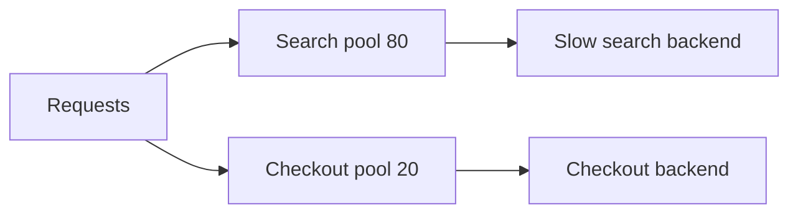

# gateways-and-bff | Gateway Routing, Gateway Offloading, Gateway Aggregation and Backends for Frontends | 2 | 12
Four patterns put a thin layer in front of your services so clients see one simple door. Routing picks the service, offloading takes shared chores, aggregation merges many calls into one, and Backends for Frontends gives each kind of client its own door.

## Gateway Routing
```card Gateway Routing
Problem | Clients that call many services must know every address, and break when a service is added, split or moved.
Solution | One gateway endpoint reads the path, header or version and forwards each call to the right service or service version.
Use when | Clients should not know your internal layout, or you want canary and blue-green releases.
Avoid when | You have one backend, where plain routing in the web server is enough.
```

The problem: a client that talks to many services must know every address, and it must change whenever a service is added, split or moved. A shop might have search, reviews, cart and checkout services, each with its own API.

Gateway Routing puts one endpoint in front of all of them. The client sends every request to the gateway, for example `api.shop.com`. The gateway reads the path, a header or the version and forwards the call.

1. `GET /search?q=shoes` goes to the search service.
2. `GET /reviews/42` goes to the reviews service.
3. 5 percent of `/cart` calls go to version 2 of the cart service, and the rest go to version 1.

```mermaid Routing: the gateway picks the service, and splits cart traffic between two versions
flowchart LR
  C[Client] --> G[Gateway]
  G -->|search path| S[Search service]
  G -->|reviews path| R[Reviews service]
  G -->|95 percent| V1[Cart v1]
  G -->|5 percent| V2[Cart v2]
```

The third rule is how teams run canary releases and blue-green deployments without telling the client. If you split the reviews service in two next month, only the gateway rules change. Use it when clients should not know your internal layout. The basics of the proxy itself are in [reverse proxies and gateways](/sd/docs/scaling/reverse-proxies-and-gateways).

## Gateway Offloading
```card Gateway Offloading
Problem | Every service repeats the same chores (TLS, token checks, rate limits, logging), in several languages, and the copies drift apart.
Solution | The gateway does these shared chores once, and services receive clean, already-checked requests.
Use when | A feature is needed by every request and does not depend on business data.
Avoid when | The chore needs business rules, which would make the gateway a release bottleneck.
```

The problem: every service needs the same chores. TLS, token checks, rate limits, logging and compression all appear in each service, in several languages, and they drift apart.

Gateway Offloading moves these shared chores into the gateway. Services receive clean, already-checked requests. A fix to the token check ships once. Typical offloaded jobs are TLS termination, authentication, [rate limiting](/sd/docs/reliability/rate-limiting), request logging, and response compression. Use it for features that every request needs and that do not depend on business data. Keep business rules out of it.

```mermaid Offloading: the chores happen once at the gateway, so the service sees a clean request
sequenceDiagram
  participant C as Client
  participant G as Gateway
  participant S as Service
  C->>G: request with token
  Note over G: TLS, token check, rate limit, log
  G->>S: clean request
  S-->>G: response
  G-->>C: compressed response
```

## Gateway Aggregation
```card Gateway Aggregation
Problem | One screen needs data from many services, and a phone that makes five calls pays the slow network round trip five times.
Solution | The client makes one call. The gateway fans out over the fast internal network and returns one combined response.
Use when | A client makes many chatty calls to separate services, especially over slow links.
Avoid when | The services are slow or flaky enough that the gateway would wait on the worst of them with no partial answer.
```

The problem: one screen needs data from many services. A phone that makes five separate calls over a slow mobile network pays the network round trip five times.

Gateway Aggregation lets the client make one call. The gateway fans out to the services over the fast internal network, waits for the replies and returns one combined response. Where calls do not depend on each other, the gateway runs them in parallel. Use it when a client makes many chatty calls to separate services.

```mermaid Aggregation: one call from the phone, and the list calls run in parallel inside
sequenceDiagram
  participant P as Phone
  participant G as Gateway
  participant U as Profile service
  participant O as Orders service
  participant F as Offers service
  P->>G: one call for the home screen
  G->>U: get profile
  U-->>G: profile id
  G->>O: get orders
  G->>F: get offers
  O-->>G: orders
  F-->>G: offers
  G-->>P: one combined response
```

## Backends for Frontends
```card Backends for Frontends
Problem | One general-purpose API must serve phone, web and partner clients that need different data, and every team's change lands in the same deployable.
Solution | Run one backend per user experience, owned by the team that owns that UI. Each may call the same downstream services.
Use when | Clients differ a lot in the data, calls or release speed they need.
Avoid when | One client type is enough, or an API gateway or GraphQL layer already serves all clients well.
```

The problem: a general-purpose API serves a phone app, a web app and a partner at once. Sam Newman, who wrote the pattern up (he credits Phil Calcado, an ex-SoundCloud engineer, with the name), points out that a phone experience often differs sharply from a desktop one: less screen space, so less data to show. He also notes that one general-purpose backend can become a bottleneck for releases, because the changes of many teams land in the same deployable.

Backends for Frontends (BFF) answers with one backend per user experience. The mobile app gets a mobile BFF, the web app a web BFF. Each is owned by the same team as its UI, so the API changes at the pace of the UI. The BFF may call the same downstream services, and it may aggregate. Use it when the clients differ a lot in the data, calls or release speed they need.

```mermaid BFF: each client type gets its own backend over the same services
flowchart LR
  M[Mobile app] --> MB[Mobile BFF]
  W[Web app] --> WB[Web BFF]
  MB --> O[Orders service]
  MB --> P[Profile service]
  WB --> O
  WB --> P
```

| Pattern | Question it answers | Who owns it |
| --- | --- | --- |
| Routing | Which service handles this? | Platform team |
| Offloading | Who does the shared chores? | Platform team |
| Aggregation | How do I save round trips? | Platform or UI team |
| BFF | Do all clients want the same API? | The UI team |

## A worked example: the home screen
Invented numbers. A phone is 100 ms round trip from the data center. The home screen needs the user profile first (20 ms server time), then four lists that depend on the profile id: orders, offers, messages and recommendations. The four lists take 20 ms each. Inside the data center a hop costs about 2 ms.

Without a gateway the phone makes five calls in sequence: 5 x (100 + 20) = 600 ms. With aggregation the phone makes one call. The gateway spends 2 + 20 on the profile, then 2 + 20 on the four lists in parallel, so 44 ms inside. Total: 100 + 44 = 144 ms. That is about four times faster, and the phone made one request instead of five.

## What goes wrong: the slowest upstream sets your speed
An aggregating gateway is only as fast as its slowest call. Suppose each of four services answers within 100 ms for 99 percent of calls. The chance that all four are fast is about $0.99^4 = 0.96$, so about 4 percent of home screens are slow, though no single service looks broken. Worse, if the gateway waits forever for one stuck service, threads pile up and the whole gateway stalls (see [circuit breakers](/sd/docs/reliability/circuit-breakers)).

The symptom is a p99 at the gateway that is higher than every service's p99. Confirm it with a trace that shows one span per upstream call. The fix is a short timeout per upstream call and a partial answer: return the screen without recommendations rather than no screen.

## When a gateway layer is the wrong tool
A single web app with one backend does not need four layers. Plain routing in your web server is enough. Do not offload business logic: the moment pricing rules live in the gateway, every team depends on its release train. Do not build a BFF per feature either, because many BFFs that copy the same logic must all be fixed when it changes. If two BFFs keep sharing code, pull that code into a service they both call.

A gateway is also one more hop, so it adds some latency. It can become a single point of failure and a bottleneck: run several instances, load test it, and size it for peak traffic, not average. Offloaded checks protect nothing if clients can reach a backend directly, so let the backends accept traffic only from the gateway. For BFFs, Microsoft's page adds that if you already use GraphQL with client-specific resolvers, or an API gateway that is enough for your clients, a BFF may add little.

## Common mistake
Using the gateway as a place for logic that "every client needs", until it is a bottleneck owned by nobody.

```resources
docs | Gateway Routing pattern | https://learn.microsoft.com/en-us/azure/architecture/patterns/gateway-routing | Azure Architecture Center | Describes routing requests to several services or instances through one endpoint, including version splits.
docs | Backends for Frontends pattern | https://learn.microsoft.com/en-us/azure/architecture/patterns/backends-for-frontends | Azure Architecture Center | Explains separate backends per client type and the costs of running several.
article | Pattern: Backends For Frontends | https://samnewman.io/patterns/architectural/bff/ | Sam Newman | Explains why one general-purpose API struggles with mobile and web, and proposes one backend per user experience owned by the UI team.
repo | Backend For Frontend (BFF) pattern | https://github.com/karanpratapsingh/system-design#backend-for-frontend-bff-pattern | Karan Pratap Singh | Short section crediting Sam Newman and saying GraphQL works well as a BFF.
```

```quiz
A phone makes 5 sequential calls at 100 ms round trip plus 20 ms server time each. How long do the calls take? | About 1,200 ms ; About 600 ms ; About 120 ms | 1 | Each call costs 100 + 20 = 120 ms, and 5 x 120 = 600 ms.
Which pattern fits "the mobile and web clients need different data and ship on different schedules"? | Gateway Aggregation of the calls ; Gateway Offloading of the chores ; A BFF per client | 2 | A backend per client type, owned by the UI team, lets each change at its own pace.
An aggregating gateway has a p99 higher than any service behind it. What is the likely reason? | It waits on the slowest of many calls ; The upstream services are cached too heavily ; Each client sends every request twice | 0 | The chance that all parallel calls are fast is lower than for any one, so tail latency grows.
```

```story
A retail app draws its home screen with seven calls to seven services, and shoppers on weak signal stare at a spinner. The team adds a mobile gateway that makes one call and does the fan-out inside the data center. The spinner time drops from seconds to under one. Then the web team asks for a different shape of data, and the shared gateway starts to creak.
```

```adapted
Azure Architecture Center (Microsoft) | https://learn.microsoft.com/en-us/azure/architecture/patterns/ | CC BY 4.0
```

# sidecar-and-ambassador | Sidecar and Ambassador | 2 | 10
A sidecar is a helper process that runs next to your application and shares its life, so common chores live outside the app code. An ambassador is a helper with one job, sending the application's network calls for it, and it is often deployed as a sidecar.

## The Sidecar pattern
```card Sidecar
Problem | Apps need logging, monitoring and networking help. Building it into each app means one version per language, and a shared remote service adds a network call.
Solution | Run a helper process or container next to each app instance, sharing its life cycle and talking over localhost or shared files.
Use when | Many services or languages need the same cross-cutting chore.
Avoid when | You have a few services in one language (a library is simpler), or every millisecond counts.
```

The problem: apps need logging, monitoring, configuration and networking help. If you build these into each app, you need a version for every language, and a bug in one library can crash the app. If you build them as one shared remote service, every call crosses the network.

The Sidecar pattern puts the helper in its own process or container on the same host, one helper per application instance. Like a motorcycle sidecar, it is attached to the main app and is created and retired with it. The app and sidecar talk over localhost or shared files, so the delay is tiny, and a Python app and a Go app can use the same sidecar.

1. The platform starts the app and its sidecar together, in one pod or on one host.
2. The app writes logs to a local file or port, and the sidecar ships them to the logging system.
3. If the sidecar crashes, the platform restarts it, and the app's code is unaffected.
4. To upgrade the log shipper, you roll out a new sidecar image and leave the app alone.

```mermaid Sidecar: the app and its helper share one host and one life cycle
flowchart LR
  subgraph Host
    A[App] -->|localhost or files| S[Sidecar]
  end
  S --> L[Logging system]
```

Use it for cross-cutting chores that every service needs and that work the same in any language.

## The Ambassador pattern
```card Ambassador
Problem | Apps must call remote services with retries, timeouts, TLS and routing, and legacy apps may be impossible to change.
Solution | Place an out-of-process proxy next to the client. The app calls localhost, and the ambassador adds the networking behaviour.
Use when | You need to bolt resilience and security onto code you cannot or will not change.
Avoid when | The calls are not safe to repeat and you cannot turn retries off, or the extra hop costs too much.
```

The problem: apps must call remote services safely. That means retries, timeouts, [circuit breaking](/sd/docs/reliability/circuit-breakers), TLS and routing. Legacy apps may be hard or impossible to change.

An ambassador is an out-of-process proxy placed next to the client. The app calls `localhost:9000`. The ambassador adds TLS, retries, metrics and routing, and forwards the request to the real service. You can add resilience to an app without editing it. Use it to bolt modern networking onto code you cannot or will not change.

```mermaid Ambassador: the app calls localhost and the proxy handles the remote call
flowchart TD
  subgraph Host
    A[App] -->|localhost 9000| B[Ambassador]
  end
  B -->|TLS and retries| R[Remote service]
```

Its first cost is extra latency from one more hop. The second is risk: an ambassador that retries blindly can repeat a payment, so retries are safe only for idempotent calls (calls that give the same result when repeated). Let the app pass a header that turns retries off.

## Service mesh in one paragraph
A service mesh is the sidecar idea applied to every service at once. A small proxy sits next to each service instance, and all traffic in and out goes through it. A central control plane pushes rules to those proxies: who may call whom, how to retry, how to split traffic. Istio's architecture page describes exactly this split: a data plane of Envoy proxies deployed as sidecars, and a control plane that configures them. Istio also offers an ambient mode that does not put a proxy in every pod, so a mesh does not always mean sidecars. The mesh gives you encryption between services, retries and traffic metrics without changing code. It also gives you one more system to run, upgrade and debug.

## A worked example: 40 services, 3 languages
Invented numbers. A company has 40 services in Java, Go and Python. Each needs mutual TLS, retries and request metrics. With client libraries, that is 3 libraries to build and 40 services to redeploy for every fix. Say the retry bug fix takes 2 hours of work per service: 40 x 2 = 80 hours.

With sidecars, there is one proxy image. The fix is one image rollout. The cost is memory: if each proxy uses 50 MB and there are 400 running instances, that is 400 x 50 MB = 20 GB of RAM across the fleet, plus a small added delay on each call. The sidecar wins when many services and languages share the chore. For three services in one language, a library costs less.

## What goes wrong: the sidecar that starves its app
The sidecar shares the host's CPU and memory. A log shipper that buffers too much, or a proxy under a traffic spike, can take the resources the app needs. The symptom is an app that slows or gets killed for memory while its own code looks fine. Confirm it by comparing resource use per container, not per pod, and by checking restart reasons. Set explicit CPU and memory limits for the sidecar. Also watch startup order: if the app starts before its proxy is ready, its first calls fail. Recent Kubernetes versions have native sidecar containers that start before the main container and stop after it, which removes this race.

## When sidecars are the wrong tool
A tiny system with a few services does not need a mesh or per-instance helpers. A shared library is simpler, has no extra hop and integrates more deeply with the language. A sidecar also suits poorly where every millisecond counts and the extra process hop matters, or where a helper needs to be shared by many apps and needs its own scaling. In that case a separate service is the better shape.

## Common mistake
Putting heavy business logic into a sidecar, so a "helper" becomes a hidden second application that nobody owns.

```resources
docs | Sidecar pattern | https://learn.microsoft.com/en-us/azure/architecture/patterns/sidecar | Azure Architecture Center | Defines a helper deployed with the main app in a separate process, sharing its life cycle, with language independence as a main benefit.
docs | Ambassador pattern | https://learn.microsoft.com/en-us/azure/architecture/patterns/ambassador | Azure Architecture Center | Describes a proxy next to the client that handles retries, routing and TLS, and warns that retries are safe only for idempotent operations.
docs | Istio architecture | https://istio.io/latest/docs/ops/deployment/architecture/ | Istio | Explains the data plane of Envoy sidecar proxies and the control plane that configures them.
repo | Service mesh | https://github.com/karanpratapsingh/system-design#service-mesh | Karan Pratap Singh | Short overview of why a mesh helps as services multiply.
```

```quiz
What does a sidecar share with its main application? | Its programming language and runtime ; Its own private database copy ; Its life cycle | 2 | It is created and retired with the app, on the same host.
40 services each need a retry fix at 2 hours of work per service. A shared sidecar needs one rollout. About how many hours of per-service work does the sidecar avoid? | About 80 hours ; About 40 hours in total ; About 2 hours in all | 0 | 40 services x 2 hours = 80 hours of separate work.
Why is it risky for an ambassador to retry every failed request? | Retries always use too much memory ; Some calls are unsafe to repeat ; The app cannot see the local proxy | 1 | A non-idempotent call such as a payment can be applied twice.
```

```story
A platform team must add encrypted service-to-service calls to forty services written in three languages, and the security audit is due in a month. Rewriting each service is impossible. They run a small proxy beside every instance, and traffic is encrypted without touching one line of application code. Then one proxy eats its pod's memory and the app next to it gets killed.
```

```adapted
Azure Architecture Center (Microsoft) | https://learn.microsoft.com/en-us/azure/architecture/patterns/ | CC BY 4.0
```

# strangler-fig | Strangler Fig, Anti-Corruption Layer and Messaging Bridge | 2 | 14
The Strangler Fig pattern replaces an old system a slice at a time instead of all at once. The Anti-Corruption Layer keeps the old design from leaking into the new one, and the Messaging Bridge joins old and new messaging systems while both run.

## Strangler Fig
```card Strangler Fig
Problem | A big old system is risky to rewrite in one go, and patching it forever is worse.
Solution | Put a facade in front of the old system and move one slice of behaviour at a time to the new system by changing facade rules. Switch the old system off when it gets no traffic.
Use when | You can intercept requests, and the system is large enough that a one-night cutover is too risky.
Avoid when | The system is small, or you cannot intercept or change the legacy system at all.
```

Martin Fowler named the idea after the strangler figs he saw in the rain forests of Queensland on a holiday in 2001. His first post, a couple of years later, was titled Strangler Application. He later renamed it Strangler Fig Application, because the word strangler has connotations of violence, and the new title stresses the botanical origin of the metaphor. The vine grows on a host tree, slowly takes over, and in the end the tree may die and leave the fig in its shape. He compares it with how he and his colleagues modernize legacy software: gradually, with small additions built on top of the old system. The plan to rebuild everything, he says, goes down in flames most of the time, since replacing a serious system takes long, users cannot wait for new features, and it is hard to work out the details of what the old system really does.

The problem: a big old system is risky to rewrite, but patching it forever is worse.

1. Put a facade, such as a proxy or gateway, in front of the legacy system. All clients now go through it. At first it forwards everything to the old system.
2. Pick one small piece of behavior, for example "order history", and build it in the new system.
3. Change a facade rule so that order-history requests go to the new system. The rest still go to the old one.
4. Repeat, slice by slice. Roll back any slice by flipping its rule.
5. When the old system receives no traffic, switch it off. Then remove the facade, or keep it as an adapter for old clients.

```mermaid Strangler Fig: the facade sends one slice to the new system and the rest to the old one
flowchart LR
  C[Clients] --> F[Facade]
  F -->|order history| N[New system]
  F -->|everything else| L[Legacy system]
  class N good
```

The facade is the same routing idea as [gateway routing](/sd/docs/cloud-architecture/gateways-and-bff). The difference is that its rules change over months as ownership moves. The facade must keep up with the migration, and like any gateway it must not become a single point of failure or a bottleneck.

## Data is the hard part
Moving code is easy compared with moving data. During the migration, both systems may need the same records. Choose one owner for each slice of data. Common ways to keep the other side current are to read through the owner's API, to copy changes with events, or to run a one-time copy before the cutover. Both systems writing the same table at once is the path to subtle corruption. Pick slices along seams in the business, such as "invoices" or "search", so that each takes its data with it.

## Anti-Corruption Layer
```card Anti-Corruption Layer
Problem | The new system must call an old or foreign one with a confusing model, and the new design slowly picks up the same problems.
Solution | A translation layer maps each call into the legacy form and each reply back, so the new code only ever speaks its own model.
Use when | You integrate with a legacy system, vendor API or partner that you do not control or that may change.
Avoid when | Both sides already share the same meaning of things, so the layer is just extra latency and upkeep.
```

The problem: the new system must call the old one, and the old one has a confusing schema and odd rules. If your new code speaks the old language, its design slowly picks up the same problems.

An Anti-Corruption Layer (ACL) is a translation layer between two subsystems that do not share the same meaning of things. The new system always speaks its own model. The ACL turns each call into the legacy form, and turns each reply back. Eric Evans first described the idea in domain-driven design. For example, the old system returns `CUST_STAT = 'X'`, and the ACL maps it to `status: "closed"` before the new code sees it.

```mermaid Anti-Corruption Layer: translation happens in one place between the two models
flowchart TD
  N[New service] -->|own model| T[Translation layer]
  T -->|legacy form| L[Legacy system]
  L -->|CUST_STAT X| T
  T -->|status closed| N
```

Use an ACL when you integrate with a system you do not control or do not trust to stay stable: a legacy system, a vendor's API, a partner. The layer adds a service to run and some latency, and it needs its own tests, since a translation bug looks like a data bug everywhere else.

## Messaging Bridge
```card Messaging Bridge
Problem | Systems that talk through different messaging products (say RabbitMQ and Amazon SQS) cannot exchange messages, and rewriting them to use HTTP means changing and retesting both sides.
Solution | A bridge component connects to both messaging systems, pulls messages from one and pushes them to the other without changing the payload.
Use when | You must join legacy and new systems with little change, or migrate endpoints between messaging products one at a time.
Avoid when | The call is synchronous and needs an immediate reply, or one side relies on a feature the other lacks.
```

This is the messaging side of living with two systems during a migration. After a merger or a move to the cloud, a company often runs two messaging products. The old estate might use RabbitMQ and the new one Amazon SQS. Making each app call the other over HTTP means editing and retesting both, hosting secure endpoints, and writing retry code for flaky networks.

A Messaging Bridge avoids that. It is a small component that connects to both systems at once.

1. The old app keeps sending to a designated queue on its own messaging system.
2. The bridge reads each message and writes it, payload unchanged, to a queue on the other system.
3. The new app reads from its own queue as usual. Neither app knows the other, or the bridge, exists.

```mermaid Messaging Bridge: messages cross between two messaging systems and the apps never change
flowchart TD
  A[Old app] --> Q1[Queue on RabbitMQ]
  Q1 --> B[Bridge]
  B --> Q2[Queue on SQS]
  Q2 --> C[New app]
```

Because each app keeps its own transport, you can move endpoints one at a time, on your own schedule. The price is that the bridged route gets only the features both systems share, and it must respect the tighter limit of the two. Microsoft's page gives an example of a 4 MB message limit on one system and 64 KB on another. If one side depends on distributed transactions for correctness, the bridge needs a de-duplication step, since delivery is at-least-once (see [delivery guarantees](/sd/docs/async/delivery-guarantees)). The bridge is also one more thing that must stay up, so scale it out with [Competing Consumers](/sd/docs/cloud-messaging/competing-consumers) where the load needs it.

Mind the in-flight messages. Messages already waiting on the old system, including those in an error queue waiting for a retry, must still reach their endpoint after it moves. Keep the bridge until those are delivered, and not only until the last endpoint has moved.

## A worked example: 10 slices, 20 months
Invented numbers. A billing monolith has 10 features. The team estimates 2 months to move each. A full rewrite would show nothing for 20 months and then switch over in one night. With a strangler approach, slice 1 (invoice PDFs) goes live in month 2 for 5 percent of traffic, then 100 percent.

Say a bug appears in slice 4, found when 10 percent of its traffic is on the new code. One rule change sends it back to the old system within minutes, and only 10 percent of one feature saw the bug. In the rewrite plan, the same bug would hit 100 percent of all features on the night of the switch. The strangler plan takes the same 20 months in total, but each month ships value and carries a small slice of the risk.

## What goes wrong: the migration that never ends
The common failure is stopping at 70 percent. The easy slices move, the hard, tangled ones wait, and the team now runs two systems plus a facade forever. Costs rise because everything must be maintained twice. The symptom is that the legacy traffic share stops falling for several months. Confirm it by graphing the share of requests handled by each system. Set a date for switching the old system off, and tackle one hard slice early so risk is known.

## When Strangler Fig is the wrong tool
If the system is small, a clean rewrite may be faster than building a facade and sync paths. If requests cannot be intercepted, or you cannot change the legacy system at all (no source code and no other integration point such as its database), you cannot redirect or disable migrated features, and a different approach is needed. If the old system is being switched off for good because the business is ending, nothing needs migrating at all.

## Common mistake
Letting the new system adopt the old data model "for now", so the legacy design is copied into the replacement. The same goes for messages: a bridge that passes the old payload shape through unchanged makes the new consumers learn the old format.

```resources
article | Strangler Fig | https://martinfowler.com/bliki/StranglerFigApplication.html | Martin Fowler | Tells the origin of the name and argues for gradual modernization over a one-shot replacement.
docs | Strangler Fig pattern | https://learn.microsoft.com/en-us/azure/architecture/patterns/strangler-fig | Azure Architecture Center | Walks through the facade, the gradual shift of requests and the final removal of the legacy system.
docs | Anti-Corruption Layer pattern | https://learn.microsoft.com/en-us/azure/architecture/patterns/anti-corruption-layer | Azure Architecture Center | Describes a translation layer between subsystems with different semantics and its latency and upkeep costs.
docs | Messaging Bridge pattern | https://learn.microsoft.com/en-us/azure/architecture/patterns/messaging-bridge | Azure Architecture Center | Describes a component that relays messages between two messaging systems without changing the payload, and warns about lost features, size limits and in-flight messages.
```

```quiz
A bridge joins a queue with a 4 MB message limit to one with a 64 KB limit. What is the safe maximum size on the bridged route? | 4 MB, the larger of the two ; 64 KB, the smaller of the two ; Any size, since the bridge splits messages | 1 | A message must fit both systems, so the tighter limit applies.
A rewrite takes 20 months and the team ships nothing until then. What does the strangler approach change? | Ships slices as they finish ; Skips testing the data ; Shortens the total to 10 months | 0 | Total effort is similar, but value and risk arrive slice by slice.
What is the job of an Anti-Corruption Layer? | Encrypting traffic between subsystems ; Spreading load across old servers ; Translating between two different models | 2 | It keeps the legacy model from leaking into the new design.
```

```story
A bank's 15-year-old core system cannot be switched off, but each change takes months. The team puts a proxy in front, builds the statement page as a new service, and sends 5 percent of customers to it. When complaints stay flat, they send 100 percent. Four years later most of the old system is silent.
```

```adapted
Azure Architecture Center (Microsoft) | https://learn.microsoft.com/en-us/azure/architecture/patterns/ | CC BY 4.0
```

# bulkhead-throttling-health | Bulkhead, Throttling and Health Endpoint Monitoring | 2 | 12
Three habits keep one problem from taking down everything. Bulkheads wall off resources, throttling limits how much any one caller can use, and health endpoints tell the platform when an instance is sick or not ready.

## Bulkhead
```card Bulkhead
Problem | Services share threads, connections and memory, so one slow dependency or noisy consumer drains the shared pool and unrelated work fails.
Solution | Split resources into isolated pools, queues or instance groups with hard caps, one per dependency, tenant or priority class.
Use when | A critical flow such as checkout must survive trouble in a less critical one, or one big tenant must not starve the rest.
Avoid when | A small app has one dependency, since a half-empty pool cannot lend capacity to a busy one.
```

The problem: services share threads, connections and memory. One slow dependency or one noisy consumer drains the shared pool, and unrelated work fails.

The Bulkhead pattern splits resources into isolated pools, like the sealed sections of a ship, so a leak floods one section only. [Circuit breakers](/sd/docs/reliability/circuit-breakers) introduced the idea with thread pools per dependency. The same idea works at larger scales.

1. Pick the units that can fail separately: a dependency, a tenant, a priority class.
2. Give each unit its own pool, queue or instance group with a hard cap.
3. When a pool is full, requests to that unit wait briefly or fail fast. Others are unaffected.



Use bulkheads to protect critical flows (checkout) from less critical ones (recommendations), and to keep one big tenant from starving the rest. The price is unused capacity: a pool that sits half empty cannot lend its threads to a busy one.

## Throttling
```card Throttling
Problem | Demand spikes can exceed what you can serve, and one client can use more than its fair share.
Solution | Limit how much of a resource a user, tenant or the whole app may consume, and decide what happens at the limit: reject, delay, degrade or add capacity.
Use when | You must stay up under load and protect shared capacity from one heavy caller.
Avoid when | Clients cannot handle a rejection, since an instant retry turns a limit into a flood.
```

The problem: demand spikes can exceed what you can serve, and a single client can use more than its share.

The Throttling pattern controls how much of a resource a user, tenant or the whole app may consume, so the system stays up under load. When a limit is reached, you choose how to react:

1. Reject excess requests with a clear error such as HTTP 429.
2. Slow or delay low-priority work, for example by queueing it (see [Queue-Based Load Leveling](/sd/docs/cloud-messaging/competing-consumers)).
3. Degrade: serve a cheaper answer.
4. Add capacity with autoscaling, which takes time and costs money, so throttling covers the gap while new capacity arrives.

```mermaid Throttling: the limit is checked first, then you choose how to react
flowchart TD
  R[Request] --> D{Over the limit}
  D -->|no| S[Serve it]
  D -->|yes| X{Choose a reaction}
  X --> A[Reject with 429]
  X --> B[Queue for later]
  X --> C[Serve a cheaper answer]
  class A warn
```

The mechanics of limits, such as the token bucket, are in [rate limiting](/sd/docs/reliability/rate-limiting). Throttling is the policy: who is limited, by how much, and what happens at the limit. Pairing it with bulkheads means each tenant hits its own cap before it can reach the shared one. Decide on throttling early, since retrofitting it is costly, and set the limit on whatever saturates first (concurrent requests, queue depth, CPU or a downstream limit), which is often not requests per second.

## Health Endpoint Monitoring
```card Health Endpoint Monitoring
Problem | A process can be running and still broken, and a platform that only checks that it is alive keeps sending it traffic.
Solution | Expose an endpoint such as /health that an outside tool calls on a schedule. A failing liveness check restarts the instance, and a failing readiness check only stops traffic.
Use when | A load balancer or orchestrator must pull sick or not-ready instances out of rotation.
Avoid when | The probe would run a deep test of the whole system every few seconds, which becomes a load of its own.
```

The problem: a process can be running and still broken. A load balancer or orchestrator that only checks "is the process alive" keeps sending traffic to it.

The Health Endpoint Monitoring pattern exposes an endpoint, such as `/health`, that an outside tool calls on a schedule. It returns a status code, and sometimes details. Kubernetes names three kinds of probe. A startup probe holds off the other two until a slow application has started. The two that matter most afterwards are liveness and readiness.

```mermaid Health probes: not ready means no traffic, and the instance keeps running
sequenceDiagram
  participant P as Platform
  participant I as Instance
  participant L as Load balancer
  P->>I: liveness probe
  I-->>P: ok
  P->>I: readiness probe
  I-->>P: not ready
  P->>L: remove from rotation
  Note over I: Stays running, no restart
```

| Check | Question | If it fails |
| --- | --- | --- |
| Liveness | Is this process stuck beyond recovery? | The platform kills the container and restarts it (if the restart policy allows) |
| Readiness | Can it serve traffic right now? | The platform stops sending it traffic and leaves it running |

The Kubernetes documentation says a failing readiness probe removes the pod from the endpoints of its Services, and that readiness probes run for the container's whole life. That suits an app that is loading data or waiting on a dependency, where a restart would not help. The same documentation warns that badly designed liveness probes can cause cascading failures. Keep liveness checks shallow, such as "can the event loop respond", so a down database does not make every instance restart at once. Readiness may check dependencies, but should be cheap, cached for some seconds, and protected from outside callers.

## A worked example: pools and probes
Invented numbers. A service has 100 worker threads. Search takes 70 threads at peak, and checkout needs 10 at most. Without bulkheads, a slow search backend can take all 100. With a pool of 80 for search and 20 for checkout, search can fail, and checkout still has 20 threads for its 10 needed.

Now health. Readiness is checked every 5 seconds, and an instance is removed after 3 failures in a row, so 15 seconds. After an instance breaks, up to 15 seconds of traffic still reaches it. If your 10 instances receive 1,000 requests per second, one broken instance gets about 100 per second, or 1,500 requests in that window. Shorter intervals reduce that and raise probe load. That tradeoff is yours to set.

## What goes wrong: the probe that kills the fleet
A team makes the liveness check call the database. The database slows for a minute. Every liveness probe times out, the platform restarts all instances together, and the restart load (cold caches, new connections) keeps the database down longer. The symptom is a restart count that jumps across all instances at the same moment. Confirm it from orchestrator events and by checking what the probe code touches. The fix is a shallow liveness check and a readiness check that reports not ready, without a restart.

## When these patterns are the wrong tool
Bulkheads cost capacity, so a small app with one dependency gains little. Throttling needs a client that can handle a rejection, and a client that retries instantly turns a limit into a flood. Health endpoints that run a full test of the system every few seconds become a load of their own. Use real traffic metrics and [observability](/sd/docs/reliability/observability) for deep checks, and keep probes cheap.

## Common mistake
Making the liveness probe check dependencies, so a downstream outage restarts healthy processes.

```resources
docs | Bulkhead pattern | https://learn.microsoft.com/en-us/azure/architecture/patterns/bulkhead | Azure Architecture Center | Explains isolating resources into pools so a failure in one does not cascade.
docs | Throttling pattern | https://learn.microsoft.com/en-us/azure/architecture/patterns/throttling | Azure Architecture Center | Describes limiting resource use by users or the app, with rejecting, delaying and degrading as responses.
docs | Health Endpoint Monitoring pattern | https://learn.microsoft.com/en-us/azure/architecture/patterns/health-endpoint-monitoring | Azure Architecture Center | Covers exposing health endpoints that external tools check on a schedule.
docs | Configure liveness, readiness and startup probes | https://kubernetes.io/docs/tasks/configure-pod-container/configure-liveness-readiness-startup-probes/ | Kubernetes | States that a not-ready pod gets no Service traffic and that liveness failures lead to a restart.
```

```quiz
What should happen when a readiness check fails? | The whole process restarts at once ; The database is marked as unhealthy ; Traffic stops but it stays up | 2 | Not ready means keep it alive and stop routing requests to it.
Pools: 80 threads for search and 20 for checkout. Search hangs. How many threads can checkout still use? | 20 threads ; 100 threads ; 80 threads | 0 | The bulkhead caps the damage at search's own 80 threads.
Why can a liveness probe that queries the database be harmful? | It makes probes run too rarely ; A slow database may restart every instance ; It hides the status code from the platform | 1 | One shared failure then triggers a fleet-wide restart that adds more load.
```

```story
A store's recommendation service starts to hang on a Friday evening. Without walls, its calls drain every worker thread and checkout stops too. With a separate pool for recommendations, the box on the page goes blank, and customers keep paying. The load balancer also quietly pulls two unready instances out of rotation.
```

```adapted
Azure Architecture Center (Microsoft) | https://learn.microsoft.com/en-us/azure/architecture/patterns/ | CC BY 4.0
```

# stamps-and-geodes | Deployment Stamps and Geodes | 3 | 12
Deployment Stamps copy a whole self-contained copy of your system for a group of customers. Geodes spread identical copies around the world so any one can serve any user. Both limit the blast radius, which is how much breaks when something fails.

## Deployment Stamps
```card Deployment Stamps
Problem | One big deployment hits service limits, and one bad release or noisy customer affects everybody.
Solution | Deploy several independent copies of the full application and its data, each serving a fixed set of tenants. Add stamps to grow, and map tenants to stamps with a thin global layer.
Use when | You hit scale limits, need tenant isolation, or want to roll out releases to a small slice first.
Avoid when | You are below the scale where one deployment hits a limit, or you cannot create a stamp with one command.
```

The problem: one big deployment hits limits. A service may cap connections or hostnames, one database stops scaling smoothly, and one bad release or one noisy customer affects everybody. Large customers may want isolation or a particular region.

The Deployment Stamps pattern deploys several independent copies of the full application, including its data stores. Each copy is a stamp (also called a scale unit, service unit or cell). Each stamp serves a fixed set of tenants. To grow, you add stamps instead of making one bigger.

1. Define a stamp as a template: web tier, workers, database, queues, all of it.
2. A thin global layer, often DNS or a routing service, maps each tenant to its stamp.
3. New tenants go into a stamp that has room. When it is nearly full, deploy another stamp from the same template.
4. Roll out releases stamp by stamp, starting with a small one.

```mermaid Deployment Stamps: a global router maps each tenant to one self-contained stamp
flowchart TD
  U[Users] --> G[Global router]
  G -->|tenants 1 to 500| S1[Stamp 1]
  G -->|tenants 501 to 1000| S2[Stamp 2]
  G --> S3[Stamp 3]
  S1 --> D1[(Database 1)]
  S2 --> D2[(Database 2)]
  S3 --> D3[(Database 3)]
```

A stamp should not call into another stamp's data. The shared global piece stays small, since it is the one thing that can still hurt everyone. Microsoft's page lists "cell" as another name for a stamp, so cell-based designs are the same idea.

## Blast radius and shuffle sharding
With $N$ equal stamps and one failure confined to a stamp, about $1/N$ of customers are affected. Amazon's Builders' Library describes the same logic for ordinary sharding: splitting a fleet into four shards of workers limits the impact of a bad customer to one quarter. It then describes shuffle sharding, where each customer gets a small virtual shard, such as two of eight workers. A problem affecting one customer hits only that pair of workers. With 8 workers there are 28 possible pairs, and most other customers share at most one worker with the affected pair, so they still have a healthy worker. This is useful when you cannot afford one stamp per customer.

## Geodes
```card Geode
Problem | Users are spread across the world, distance adds latency, and one region can be overwhelmed or fail.
Solution | Deploy identical, self-contained copies to many regions. Each geode can serve any request, behind a global entry point and a data replication layer.
Use when | You need low latency worldwide and want regions to survive each other's failure.
Avoid when | Your users are in one country and a primary with a standby meets your recovery goals.
```

The problem: users are spread around the world. Distance adds latency, and a single region can be overwhelmed or fail.

The Geodes pattern, whose name comes from geographical nodes, deploys the service to many regions. Each geode can serve any request from any client, which makes the design active-active (all regions take live traffic, with no idle standby). Geodes have three traits.

1. Each is self-contained and depends on nothing outside itself to run.
2. They are tied together by a global entry point that routes users to a nearby healthy geode, and by a replication layer for data.
3. There are always several of them. The pattern's page says a geode never exists alone.

```mermaid Geodes: any region can serve any user, and data replicates between them
flowchart TD
  U[Users] --> E[Global entry point]
  E --> G1[Geode Europe]
  E --> G2[Geode US]
  E --> G3[Geode Asia]
  G1 -.->|replicate| G2
  G2 -.->|replicate| G3
  G3 -.->|replicate| G1
```

The hard part is data. For any user to be served anywhere, writes in one region must reach the others. That means a [replicated](/sd/docs/data/replication) store that accepts writes in many places, with the conflict and [consistency](/sd/docs/distributed/consistency-models) questions that come with it, as in [CAP and PACELC](/sd/docs/distributed/cap-and-pacelc).

| | Stamps | Geodes |
| --- | --- | --- |
| Each copy serves | A fixed group of tenants | Any user, in any region |
| Main goal | Scale limits, isolation | Latency and regional survival |
| Data | Stays inside the stamp | Replicated across geodes |
| Failure of one | Its tenants are hit | Traffic shifts to the others |

## A worked example: 20 stamps and a bad release
Invented numbers. A SaaS product has 10,000 customers in 20 stamps of 500. A release has a bug that corrupts invoices.

With one big deployment, all 10,000 customers get the bug at once. With stamps, the team deploys to stamp 1 (500 customers, 5 percent). Alerts fire in 20 minutes. They halt the rollout: 500 customers affected, 9,500 untouched. The blast radius is 1/20, or 5 percent.

For geodes, take 3 geodes with 100 ms of latency from far-away users reduced to about 20 ms by routing to a near one. If one geode fails, the other two must carry 50 percent more load each (3 units of load over 2 geodes, 1.5x), so each must have enough spare capacity to take on half again its normal load. Running 3 geodes at 60 percent utilization is a safe design for one failure, since 60 x 1.5 = 90 percent. At 80 percent, losing one geode would ask the others for 120 percent of their capacity, and the overload could take them down too.

## What goes wrong: the shared piece that was not shared-nothing
A team deploys 6 stamps but keeps one global configuration database and one shared message queue. A bad config push, or a queue outage, takes all six stamps down together. The symptom is simultaneous failures across stamps that were meant to be independent. Confirm it by listing every dependency that crosses a stamp boundary and checking which have a single instance. Anything shared must be tiny, well tested and highly available, or must be copied per stamp.

## When stamps and geodes are the wrong tool
Below the scale where a single deployment hits a limit, stamps multiply your work: each needs deploys, monitoring and upgrades. Your tooling must make creating a stamp one command. Geodes with multi-region writes are costly and need conflict handling. If your users are in one country and a standby in a second region meets your recovery goals, a simple primary and standby is cheaper and easier (see [availability and redundancy](/sd/docs/reliability/availability-and-redundancy)).

## Common mistake
Building many stamps while sharing one database or queue between them, so the blast radius is still everything.

```resources
docs | Deployment Stamps pattern | https://learn.microsoft.com/en-us/azure/architecture/patterns/deployment-stamp | Azure Architecture Center | Describes independent copies of the application and data, called stamps, scale units or cells, each serving a set of tenants.
docs | Geode pattern | https://learn.microsoft.com/en-us/azure/architecture/patterns/geodes | Azure Architecture Center | Describes active-active regional deployments where each geode can serve any request and there is always more than one.
article | Workload isolation using shuffle sharding | https://aws.amazon.com/builders-library/workload-isolation-using-shuffle-sharding/ | Amazon Builders' Library | Explains how sharding and then shuffle sharding limit the number of customers hit by a bad request or attack.
article | Static stability using Availability Zones | https://aws.amazon.com/builders-library/static-stability-using-availability-zones/ | Amazon Builders' Library | Defines static stability, where a system keeps working when a dependency is impaired, and applies it to Availability Zones.
```

```quiz
20 equal stamps hold the customers, and a bug is caught in the first stamp. What share of customers is affected? | About 5 percent ; About 20 percent ; About 50 percent | 0 | One stamp of 20 is 1/20, or 5 percent.
3 geodes share load equally and one fails. How much more load does each remaining geode carry? | Exactly double the old load ; Half as much again ; No change in load at all | 1 | Three units spread over two is 1.5 times, so 50 percent more.
What is the key difference between a stamp and a geode? | Geodes keep all of their data in a single place ; Stamps must always sit together in one region ; A stamp owns tenants, a geode serves anyone | 2 | A geode is one of many equal copies that each can serve any user, and a stamp serves its own set of tenants.
```

```story
A SaaS company grows to ten thousand customers on one database, and each release is a coin toss that could hurt everyone. They split into twenty stamps of five hundred customers and roll out one stamp at a time. A bad invoice bug reaches 500 customers instead of ten thousand. Later, the largest customers ask for a copy in their own continent, and a new stamp is cut from the same template.
```

```adapted
Azure Architecture Center (Microsoft) | https://learn.microsoft.com/en-us/azure/architecture/patterns/ | CC BY 4.0
```

# config-and-consolidation | External Configuration Store and Compute Resource Consolidation | 2 | 10
An External Configuration Store moves settings out of the deployed package into one shared place you can change without redeploying. Compute Resource Consolidation does the opposite for hosting: it packs several small tasks into one unit so you stop paying for idle machines.

## External Configuration Store
```card External Configuration Store
Problem | Settings ship inside the app, so a change needs a redeploy, shared values live in many places, and instances can run with different settings.
Solution | Keep settings in a central store that apps read at startup, cache locally and refresh on a timer or on change events.
Use when | Many instances share settings or feature flags that should change without a redeploy.
Avoid when | A value never changes or is needed before the store is reachable, or you would read it on every request.
```

The problem: configuration files ship with the application. Changing a setting needs a redeploy, which can mean downtime. Each app has its own copy, so shared values such as a queue address or a feature flag live in many places. During a rolling update, instances can run with different settings, and config schemas change with the code.

The External Configuration Store keeps settings in a central store with an interface to read and update them. The store can be a database, a key-value service such as etcd or Consul, a cloud config service, or even files in object storage. Consul and etcd are mentioned in [microservices](/sd/docs/scaling/microservices) as service registries that include a key-value store.

1. At startup, an app reads its settings from the store and caches them in memory.
2. Optionally it checks the store on a timer, or listens for change events, to pick up new values.
3. An operator changes a value once. All instances see it, either at their next refresh or after a restart.

```mermaid External Configuration Store: apps read and cache values, and pick up changes by polling
sequenceDiagram
  participant O as Operator
  participant S as Config store
  participant A as App instance
  A->>S: read settings at start
  S-->>A: values
  Note over A: cache in memory
  O->>S: change one value
  A->>S: poll on a timer
  S-->>A: new value
```

Design points: the store must be highly available and backed up, since apps may fail to start without it. Cache values locally and keep a last known good copy so a store outage does not stop running apps. Control who may write, because a changed value is a production change. Keep secrets in a secrets manager rather than plain config, with audit logs. Version values so you can roll back a bad change.

## Compute Resource Consolidation
```card Compute Resource Consolidation
Problem | Many small components each run on their own server or plan, and each costs money while idle.
Solution | Group several tasks with similar scaling, lifetime and load shape into one computational unit.
Use when | Units sit mostly idle, tasks talk to each other a lot, or management overhead is the main cost.
Avoid when | Tasks need different security boundaries, scaling or release timing, or one is critical and another experimental.
```

The problem: a system is built from many small components, each deployed on its own server, container group or app plan. Each costs money when idle. A job that runs 5 minutes an hour still holds a whole machine.

The pattern groups several tasks into one computational unit. Good candidates have similar scaling needs, lifetime and load shape. Bad candidates differ: one task polls an almost empty queue, and another handles large bursts of traffic. Scaling them together wastes resources, since the quiet task would scale too. There are also hidden risks, since tasks in one unit share CPU, memory and failures.

```mermaid Compute Resource Consolidation: several quiet tasks share one unit instead of one each
flowchart LR
  subgraph Before
    T1[Task 1] --> M1[Instance 1]
    T2[Task 2] --> M2[Instance 2]
    T3[Task 3] --> M3[Instance 3]
  end
  subgraph After
    U1[Task 1] --> H[One shared unit]
    U2[Task 2] --> H
    U3[Task 3] --> H
  end
```

Use it when units sit mostly idle, when tasks talk to each other a lot, or when management overhead is the main cost. It is the opposite pull from splitting everything into [microservices](/sd/docs/scaling/microservices). Both are tools, and the right amount of splitting depends on load and team size.

## A worked example: five tasks, one box
Invented numbers. Five background tasks each run on their own small instance at $40 per month, which is $200 per month. Each uses about 10 percent CPU on average. They peak at different hours, so the combined peak is about 60 percent of one small instance. Moving all five to two medium instances at $70 each costs $140 per month and also gives failover. The saving is $60 per month, 30 percent. The price is lost isolation and some coordination in releases.

For configuration, say 50 instances read one feature flag. Polling the store every 30 seconds is 50 / 30, about 1.7 reads per second. That is trivial. Change events or a longer interval would be wasted effort, but at 5,000 instances the same polling is about 167 per second, and a cache layer or push model starts to make sense.

## What goes wrong: a config change that hits everyone at once
An operator edits `max_connections` from 50 to 5 in the shared store, meaning to test it on one service. All 200 instances of 12 apps pick up the value within 30 seconds and start to fail. The symptom is errors that begin on every app at the same moment, right after a config write. Confirm it by comparing the store's audit log with the error graph. Prevent it by scoping values per environment and per app, rolling changes out to a few instances first, keeping version history, and allowing a fast revert.

A consolidation failure looks different. One memory leak in a task takes down the other four, and the symptom is unrelated tasks failing together. Check per-task resource use and give each task its own limits.

## When these patterns are the wrong tool
Do not use a remote store for values that never change or that must exist before the store is reachable, such as the store's own address and credentials. Do not read configuration on every request, because that makes the store a hot path. Do not consolidate tasks that need different security boundaries, different scaling or independent release timing. Do not consolidate when one task is critical and another is experimental, since a crash in the second hurts the first.

## Common mistake
Making the config store a hard dependency with no local cache, so a store outage prevents apps from starting.

```resources
docs | External Configuration Store pattern | https://learn.microsoft.com/en-us/azure/architecture/patterns/external-configuration-store | Azure Architecture Center | Describes moving settings out of the deployment package into central storage, with caching and access control considerations.
docs | Compute Resource Consolidation pattern | https://learn.microsoft.com/en-us/azure/architecture/patterns/compute-resource-consolidation | Azure Architecture Center | Explains grouping tasks into one computational unit and which tasks should not be grouped.
```

```quiz
Five tasks cost $40 each per month on separate instances. Two shared instances at $70 host them all. What is the monthly saving? | $60 ; $130 ; $200 | 0 | Separate cost is $200, shared cost is $140, so the saving is $60.
Why keep a local cached copy of config values? | To skip the access checks ; So apps start when the store is down ; To never have to change a setting again | 1 | A last known good copy keeps apps running through a store outage.
Which pair of tasks suits being placed together? | A queue poller with a bursty web handler ; A critical service with an experiment ; Two quiet jobs with similar load | 2 | Similar scaling and lifetime make sharing safe and efficient.
```

```story
A team of six runs eleven small background jobs, each on its own server that sits idle most of the day. They move the quiet ones onto two shared hosts and cut the monthly bill by a third. The same week, they move shared settings to a central store, so changing a feature flag takes seconds, not a deploy. Then someone edits the wrong key.
```

```adapted
Azure Architecture Center (Microsoft) | https://learn.microsoft.com/en-us/azure/architecture/patterns/ | CC BY 4.0
```

# security-patterns | Federated Identity, Gatekeeper, Valet Key and Quarantine | 2 | 13
Four patterns reduce what an attacker can reach. Federated Identity hands sign-in to a trusted provider, the Gatekeeper puts a hardened checkpoint before your real service, the Valet Key gives a client narrow, short-lived access to one resource, and Quarantine checks outside software before you use it.

## Federated Identity
```card Federated Identity
Problem | If every app keeps its own passwords, users juggle many logins, admins must disable accounts in each system, and each app must store credentials safely.
Solution | Delegate sign-in to a trusted identity provider. The app receives a signed token with claims and never sees the password.
Use when | Several apps share users, or you want single sign-on and central account control.
Avoid when | You must work offline, or users have no account with any provider you can trust.
```

The problem: if every app keeps its own passwords, users juggle many logins, admins must disable an account in every system when someone leaves, and each app must store credentials safely.

Federated Identity delegates sign-in to an external identity provider (IdP), such as a company directory or a social login. Your app trusts the IdP and never sees the password. The flow in plain words:

1. The user opens your app. It sends them to the IdP's sign-in page.
2. The user proves who they are to the IdP, maybe with a second factor.
3. The IdP sends back a signed token with claims, which are facts about the user such as an id and an email.
4. Your app checks the signature, reads the claims and decides what the user may do.

```mermaid Federated Identity: the app trusts a signed token from the identity provider
sequenceDiagram
  participant U as User
  participant A as App
  participant P as Identity provider
  U->>A: open the app
  A-->>U: redirect to sign-in
  U->>P: prove who you are
  P-->>U: signed token with claims
  U->>A: present the token
  Note over A: Check signature, read claims
```

Two standards cover most cases. OpenID Connect (OIDC) is, in its own spec's words, a simple identity layer on top of OAuth 2.0. It adds an ID Token, a signed JSON Web Token (JWT) with claims about who signed in. SAML is an older, XML-based standard common in company single sign-on. Both let one login unlock many apps, which is single sign-on (SSO). Authentication means proving who you are. Authorization means deciding what you may do, and your app still owns that part. See [security basics](/sd/docs/reliability/security-basics) for the wider picture.

## Gatekeeper
```card Gatekeeper
Problem | The code that handles internet requests is the most exposed, and if it also holds credentials, one attack hands over everything.
Solution | A small front component validates and sanitizes requests and holds no secrets. Only it may call the trusted service, over a locked-down channel.
Use when | The attack surface is large or the data is sensitive.
Avoid when | The service is internal and already sits behind your own gateway, or you cannot afford one more hop.
```

The problem: the code that handles internet requests is the most exposed. If one service validates input, checks identity and also holds database credentials and storage keys, one successful attack hands over everything.

The Gatekeeper is a dedicated front component that validates and sanitizes requests, then passes clean ones to the trusted service. The two are separate, so the front holds no secrets and has limited rights. If an attacker breaks the gatekeeper, they find no keys, and the trusted side only accepts calls from the gatekeeper over a locked-down channel.

```mermaid Gatekeeper: the exposed front holds no keys, and the trusted side accepts only its calls
flowchart TD
  I[Internet] --> G[Gatekeeper]
  G -->|clean requests only| T[Trusted service]
  T --> D[(Database)]
  class G warn
```

It looks like an API gateway, but the emphasis is security isolation. A gateway may do many jobs. A gatekeeper is small on purpose, easy to review, and has low privilege. Use it where the attack surface is large or the data is sensitive. It adds a hop and a component that must be highly available.

## Valet Key
```card Valet Key
Problem | Streaming every upload and download through the app burns bandwidth, memory and CPU, but handing clients your storage credentials gives away everything.
Solution | After checking the user, mint a token for one object, one action and a short time. The client then talks to storage directly.
Use when | Large files move between clients and storage and the app need not inspect the bytes.
Avoid when | You must inspect or transform data before it is stored, or it must never touch the client.
```

The problem: users upload and download large files. If the app streams every byte, it burns bandwidth, memory and CPU. The storage service could handle the transfer directly, but giving the client your storage credentials would give away everything.

A valet key is a token that grants limited access to one resource. Like a car key that opens the car but not the trunk, and works only for the valet. The app checks that the user may do this, then issues a token for one object, one action and a short time. The client then talks to storage directly.

```mermaid Valet Key: the app issues a small signed URL and the bytes go straight to storage
sequenceDiagram
  participant C as Client
  participant A as App
  participant S as Storage
  C->>A: I want to upload a video
  Note over A: check the user, sign a URL for one object
  A-->>C: presigned URL
  C->>S: PUT file using the URL
  S-->>C: ok
```

The common form is a presigned URL. Amazon's S3 docs describe it: it carries an HTTP method (GET to download, PUT to upload), the object, and an expiry time, and it is signed with the credentials of whoever created it. Anyone holding the URL can use it until it expires, so keep the time short. It also cannot outlive the credentials that signed it: with temporary credentials such as a role session, the URL stops working when they expire. The maximum expiry is 7 days with SDKs or the CLI and an IAM user, or 12 hours from the S3 console. S3 checks expiry when the request starts, so a download already running is not cut off.

## Quarantine
```card Quarantine
Problem | Software you did not write, such as open-source packages and public container images, may be untrusted, vulnerable or unsuitable, and it flows straight into your build.
Solution | A separate process fetches each artifact into a quarantine store, runs checks, and only then publishes it to a trusted store. Consumers are blocked until it passes.
Use when | Your workload uses artifacts from outside the team, and the risk of a bad one is worth the cost of the checks.
Avoid when | You built the artifact yourself or it comes from a trusted partner team, or checking costs more than the risk.
```

The problem: every outside artifact is untrusted by default. The source may be unreliable, or the artifact may carry a vulnerability. The Quarantine pattern puts a gate between the outside world and your pipeline.

1. A consumer asks to use an artifact and is blocked from using it until the process finishes.
2. The quarantine process checks who asked, then fetches the artifact into a separate, untrusted store.
3. It runs checks suited to the type, such as vulnerability scans and malware detection.
4. If every check passes, the artifact is published to the trusted store, often with a report of the checks. If not, it stays unavailable.
5. An event tells consumers the result, and they may now use it.

```mermaid Quarantine: an artifact reaches the trusted store only after the checks pass
flowchart TD
  E[External artifact] --> Q[Quarantine store]
  Q --> V{Checks pass}
  V -->|yes| T[Trusted store]
  V -->|no| X[Stays unavailable]
  T --> C[Consumers]
  class X bad
  class T good
```

Keep the trusted and untrusted stores apart with identity and network controls, and automate the whole path, since checks can take time. Passing quarantine is only a first check. Keep scanning later, because an artifact that was clean today may have a vulnerability found next month. Microsoft's page also says you can outsource the work to a specialist and should compare that cost with building your own.

## A worked example: uploads through the app or direct
Invented numbers. Users upload 50 MB videos, 200 per minute. Through the app that is $200 \times 50 = 10{,}000$ MB per minute, about 167 MB per second, passing through your servers twice if you also forward it on. If one server handles 20 MB per second of uploads, you need 167 / 20, about 9 servers just to move bytes.

With a valet key, the app handles 200 small requests per minute to issue URLs. The 10,000 MB per minute goes straight to storage, which is built for that. You need one or two app servers. The new risks are that anyone with a URL can upload within its life, and that you do not control content until it arrives. Check what your store lets you restrict: a plain signed PUT URL generally does not cap the upload size, while some stores offer signed upload policies with size conditions. Scan the file after upload.

## What goes wrong: the URL that lived too long
A team issues presigned download URLs valid for 7 days (the SDK maximum) and puts them in emails. A user forwards the email, and the link ends up on a public forum. For a week, anyone can download the private file, and logs show valid signatures, so nothing looks wrong. The symptom is traffic from unknown addresses on files that should be private. Confirm it from storage access logs, grouped by IP and object. Issue URLs for minutes, not days, tie each to one object, and generate a fresh one on each click instead of storing it.

## When these patterns are the wrong tool
Federated login is a poor fit when you must work offline or when users have no account with any provider you can trust. A gatekeeper adds little to an internal service that sits behind your own network and already has a gateway. A valet key is wrong when you must inspect or transform data before it is stored, or when the data must never touch the client. Choose proxying through the app in those cases.

## Common mistake
Treating a signed URL as secret forever, when it works for anyone who has it until it expires.

```resources
docs | Federated Identity pattern | https://learn.microsoft.com/en-us/azure/architecture/patterns/federated-identity | Azure Architecture Center | Explains delegating authentication to a trusted identity provider that returns tokens with claims, and single sign-on.
docs | Gatekeeper pattern | https://learn.microsoft.com/en-us/azure/architecture/patterns/gatekeeper | Azure Architecture Center | Describes a dedicated broker that validates and sanitizes requests to limit the attack surface.
docs | Valet Key pattern | https://learn.microsoft.com/en-us/azure/architecture/patterns/valet-key | Azure Architecture Center | Describes giving clients restricted direct access to a resource to offload data transfer from the application.
docs | Sharing objects with presigned URLs | https://docs.aws.amazon.com/AmazonS3/latest/userguide/using-presigned-url.html | AWS | States what a presigned URL contains and that it works for anyone holding it until it expires.
docs | Quarantine pattern | https://learn.microsoft.com/en-us/azure/architecture/patterns/quarantine | Azure Architecture Center | Describes verifying third-party artifacts in a separate store before marking them trusted, and keeping up checks after they pass.
```

```quiz
An image passes quarantine and moves to the trusted store. What should happen next? | It is trusted for good and never rescanned ; It keeps getting scanned for new issues ; It is deleted from the trusted store after a day | 1 | Passing is a first check, and new vulnerabilities can be found later.
200 uploads of 50 MB arrive each minute. How much data per minute would pass through your app without a valet key? | About 10,000 MB ; About 250 MB total ; About 1,000 MB total | 0 | 200 x 50 MB is 10,000 MB per minute.
Why should a presigned URL expire quickly? | Short links are faster to sign ; The file gets smaller to send ; Whoever holds it can use it | 2 | A leaked URL works for whoever has it, so a short life limits the damage.
```

```story
A video app lets users upload 50 MB clips, and its servers melt at every launch event because each byte flows through them. The team switches to short-lived upload links that go straight to storage, and the servers only hand out the links. Then a download link ends up in a public chat, and the team learns why links should last minutes, not weeks.
```

```adapted
Azure Architecture Center (Microsoft) | https://learn.microsoft.com/en-us/azure/architecture/patterns/ | CC BY 4.0
```
