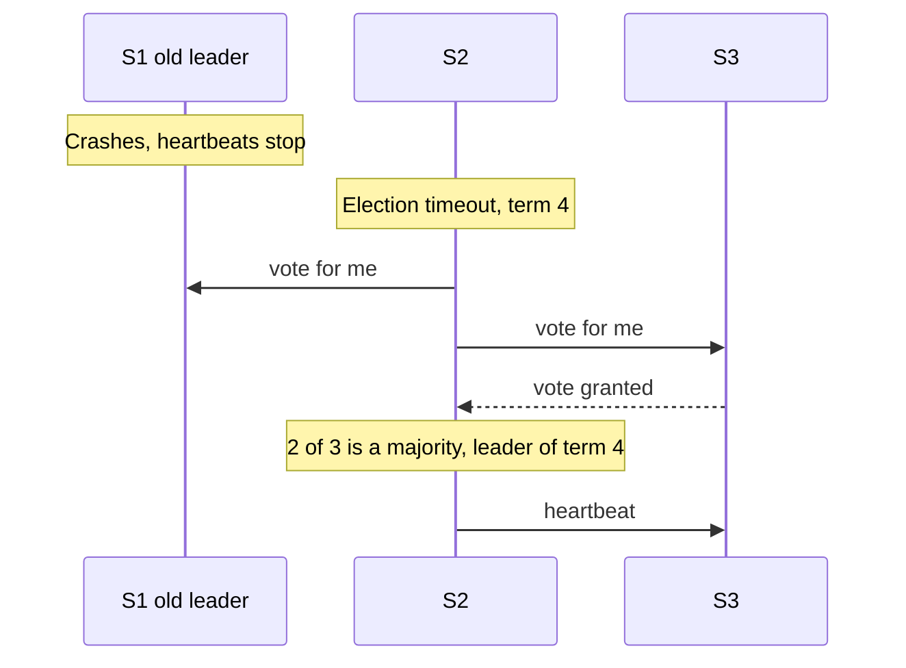

# cap-and-pacelc | CAP and PACELC | 2 | 12
CAP says that when a network partition splits your replicas, you must choose between answering every request and giving linearizable answers. PACELC adds the part CAP leaves out: even with a healthy network, replication forces a trade between consistency and speed.

## What CAP says
Three words need exact meanings, because most confusion comes from loose ones.

Seth Gilbert and Nancy Lynch turned Eric Brewer's idea into a proof in 2002, so their definitions are the ones that count. Consistency in CAP means linearizability. Every read returns the latest completed write, as if there were one copy of the data. It is not the C in ACID, which is about keeping data rules true.

Availability in CAP means that every request sent to a working node gets a non-error answer. The answer may be stale. A system where some node answers, but another node returns errors, does not meet this definition.

Partition tolerance means the network may delay or drop messages between nodes. You do not get to opt out of this. Cables fail, switches reboot and a cloud region can lose contact with another one.

The System Design Primer opens with "you can only support two of the following guarantees" and then adds that networks are not reliable, so you must pick between consistency and availability. That second sentence is the useful one. The first is misleading, and Brewer himself wrote in 2012 that the "2 of 3" formulation was always misleading. A partition is an event, not a feature you buy. When there is no partition, a system can be both consistent and available. CAP only describes what you give up while the partition lasts.

## Choosing during a partition
Take two data centers, each holding a copy of the same data, and cut the link between them. A request arrives at one side. That node cannot ask the other side anything, so it has two choices.

```mermaid During a partition the node must refuse or answer from what it has
sequenceDiagram
  participant U as User
  participant N1 as Node 1
  participant N2 as Node 2
  Note over N1,N2: Link cut, a partition
  U->>N1: read or write
  N1--xN2: cannot reach
  alt CP choice
    N1-->>U: error or timeout
  else AP choice
    N1-->>U: answer from local copy
    Note over N1,N2: Copies may now differ, merge later
  end
```

A CP choice: refuse or delay the request until it can be sure its answer is the latest. Users on that side see errors or timeouts. Data stays correct.

An AP choice: answer from what it has. Users get a response, but it might be stale, and two sides may accept conflicting writes. When the link heals, the system must merge them.

The Primer puts it this way: CP suits needs for atomic reads and writes, AP suits needs that allow eventual consistency or must keep working through external errors.

## Why labels like "CP database" mislead
Martin Kleppmann argues in "Please stop calling databases CP or AP" that the labels fail for several reasons. CAP's model is a single read-write register. The only fault it considers is a partition, and it says nothing about latency, crashed nodes or multi-key transactions. One piece of software can have operations with different guarantees. And many real systems fit neither label. A single-leader database with asynchronous followers is not CAP-available, since a client cut off from the leader cannot write. It is also not CAP-consistent if followers serve stale reads. Dynamo-style stores (see [consistency models](/sd/docs/distributed/consistency-models)) are another example. Reading and writing one copy makes them CAP-available, but with quorums the minority side of a partition cannot reach a quorum, and features like sloppy quorums make linearizability unwise to rely on. ZooKeeper is often called CP, yet its default reads are not linearizable. Treat any "this database is CP" claim as a starting question, not an answer.

## PACELC: the other half
Daniel Abadi observed that CAP only matters while a partition lasts, and he calls partitions somewhat rare. Most of the time a replicated system faces a different trade. PACELC reads: if there is a Partition, trade Availability against Consistency. Else, trade Latency against Consistency.

The reason is replication. To stay available when a machine dies, you must keep copies. To give strong answers, a write must reach other copies, or a read must ask them, before returning. Each wait costs a network round trip. Between data centers that is tens or hundreds of milliseconds. Abadi notes this trade is present all the time, so it may shape a design more than CAP does. In his 2012 paper, Dynamo, Cassandra and Riak (default settings) are PA/EL, and VoltDB and HBase are PC/EC. Those labels describe original designs, so check current docs.

## A worked example: the last seat
An airline keeps one copy of its seat map in Frankfurt and one in Singapore. Seat 14C on flight 88 is free. All numbers here are invented.

1. The link between the two sites fails.
2. Ana, in Frankfurt, books 14C. Ben, in Singapore, books 14C a minute later.
3. AP design: each site answers "confirmed". Both customers have a ticket. When the link returns, the system sees two bookings for one seat. Someone must be moved or compensated.
4. CP design, where Frankfurt holds the primary copy for this flight: Singapore cannot reach it, so it refuses Ben's booking, or shows "try again". Ana's booking is safe. Ben is unhappy, but the plane never holds two people for one seat.
5. Now the link is healthy. A design that writes to both sites before confirming adds one round trip, say 180 ms. One that confirms locally and copies later answers in 5 ms, but readers elsewhere may briefly see 14C as free. That is the PACELC choice.


```mermaid The last seat: the AP design confirms both bookings, the CP design refuses one
sequenceDiagram
  participant Ana
  participant F as Frankfurt
  participant S as Singapore
  participant Ben
  Note over F,S: Link fails
  Ana->>F: book 14C
  F-->>Ana: confirmed
  Ben->>S: book 14C
  alt AP design
    S-->>Ben: confirmed, conflict found later
  else CP design
    S-->>Ben: refused, try again
  end
```

## What goes wrong: a split-brain write
A team runs two database copies and lets both accept writes during a partition to stay available. After the link is repaired, they find two different shipping addresses for one order. The symptom is a customer who got a parcel at the old address, with no error in any log. To confirm, compare the copies' write logs for the partition window and look for the same key written on both sides. Without a merge rule, one write is silently lost.

## When CAP thinking is the wrong tool
CAP says nothing about speed, durability or transactions across keys, and it cannot rank two products whose behavior depends on settings. For day-to-day design, ask which consistency model each operation needs and what latency users accept. The next lesson gives the vocabulary.

## Common mistake
Saying "we chose CP" or "we chose AP" for a whole product, and treating the choice as permanent. The choice is made per operation, and only matters during a partition.

```resources
article | System Design Primer: CAP theorem | https://github.com/donnemartin/system-design-primer#cap-theorem | Donne Martin | A short, plain statement of C, A, P with CP and AP examples, and the base this lesson adapts.
article | Please stop calling databases CP or AP | https://martin.kleppmann.com/2015/05/11/please-stop-calling-databases-cp-or-ap.html | Martin Kleppmann | Shows that CAP's model is a single register with one kind of fault, and why real systems resist the CP or AP label.
article | CAP Twelve Years Later: How the Rules Have Changed | https://www.infoq.com/articles/cap-twelve-years-later-how-the-rules-have-changed/ | Eric Brewer | CAP's author explains why "2 of 3" misleads, why the choice can differ per operation, and how to recover after a partition.
paper | Consistency Tradeoffs in Modern Distributed Database System Design | https://www.cs.umd.edu/~abadi/papers/abadi-pacelc.pdf | Daniel Abadi | Introduces PACELC and argues the latency versus consistency trade matters during normal operation.
repo | Distributed systems class notes | https://github.com/aphyr/distsys-class | Kyle Kingsbury | Course notes that put CAP in the wider context of availability and consistency models.
```

```quiz
In CAP, what does availability require? | A working node never answers with an error ; At least one node of the cluster stays up and responds quickly ; Every response carries the newest value written | 0 | CAP availability allows stale answers but not errors from a working node.
Singapore refuses Ben's booking during a partition so no seat is double sold. Which choice is that? | AP, it keeps answering every request it receives ; Neither, since the network is down anyway ; CP, it trades availability for safety | 2 | Refusing requests to protect correctness is the consistency-first choice.
A replicated store has a healthy network, yet strong reads are slower than weak ones. Which idea explains it? | The CAP rule that you can only pick two of three ; The latency versus consistency trade in PACELC ; The partition tolerance clause that CAP defines | 1 | PACELC covers the cost of coordinating replicas when no partition exists.
```

```story
Two sales agents, one in Frankfurt and one in Singapore, both sell the last seat on a flight while the line between offices is down. Each system said "confirmed" because that felt friendlier than an error. At the gate, the airline has one seat and two angry customers, and a rule about who gets bumped. CAP is the name for the choice that office software made without anyone noticing.
```

```adapted
The System Design Primer | https://github.com/donnemartin/system-design-primer | CC BY 4.0
```

# consistency-models | Consistency Models | 3 | 12
A consistency model is a promise about which values a read may return when data is copied across machines. Stronger promises are easier to program against and cost more latency and availability.

## The gentle start: weak, eventual, strong
The Primer groups consistency into three patterns. With weak consistency, a read after a write may or may not see it, and the system makes a best effort. The Primer cites memcached and real-time uses like voice calls. With eventual consistency, reads will see the write after a while, usually within milliseconds, because data is copied asynchronously. DNS and email are its examples. With strong consistency, a read after a write sees it, because data is copied synchronously. File systems and relational databases are its examples. These three words are a good first map. The sections below give names to the middle ground, using Jepsen's consistency pages as the reference.

## The models, one timeline each
Use one register named x, starting at 0. Alice writes x = 1. The write starts at time 10 and is acknowledged at time 12.

```mermaid The same write and read: linearizable forces 1, weaker models allow 0
sequenceDiagram
  participant A as Alice
  participant R as Replicas
  participant B as Bob
  A->>R: write x = 1, time 10
  R-->>A: ack, time 12
  B->>R: read x, time 13
  alt Linearizable
    R-->>B: 1
  else Eventual or sequential
    R-->>B: 0 or 1
  end
```

Linearizable: each operation appears to take effect at one instant between its start and its end, and that order respects real time. Bob reads x at time 13, after Alice's write finished. He must see 1. Reads that overlap the write may see 0 or 1, but once any read has returned 1, reads that start after it may not see 0.

Sequential: everyone sees the same total order of operations, and each person's own operations stay in their program order. The order need not match the clock. If Alice texts Bob "done", Bob's read at time 13 may still return 0, because the order can place his read before her write. Jepsen's page warns that sequential reads may be arbitrarily stale, and points to linearizability when you tell another process about an event through a side channel.

Causal: operations linked by cause and effect appear in that order everywhere. Unrelated operations may appear in different orders to different readers. Example: Alice posts a question, Bob reads it and posts an answer. No reader may see the answer without the question. Two unrelated posts by Carol and Dan may appear in either order.

Read your writes: after Alice writes x = 1, her own later reads show 1 or newer. Bob promises nothing.

Monotonic reads: once a process has seen x = 1, its later reads never go back to 0. Jepsen says this can be totally available, while read your writes needs the client to stick to one server.

Eventual: if writes stop, all copies converge to the same value. Until then, reads can return anything old. It does not say how long this takes.

## Quorums
Many replicated stores keep N copies, send each write to W of them and read from R of them. If

$$ R + W > N $$

then every read set overlaps every write set in at least one copy. A read can then find the newest acknowledged write by picking the highest version among its replies, as long as the write really went to that fixed set of N copies.

## A worked example: N=3, W=2, R=2
Copies are A, B and C. All hold x = 0 at version 1. Try these numbers in the demo above.

1. A client writes x = 1 (version 2). It sends the write to A, B and C and waits for two acknowledgments. A and B reply. C is slow and still holds version 1.
2. The write is acknowledged. Now R + W = 4, which is more than 3.
3. A reader asks any two copies. The pairs are AB, AC or BC. Each pair includes A or B, so each includes version 2.
4. The reader sees version 2 beside possibly version 1, and returns the higher one. A good store also repairs C in the background (read repair).

```mermaid N=3, W=2, R=2: the write reaches A and B, and any read of two copies includes one of them
sequenceDiagram
  participant Cl as Client
  participant A
  participant B
  participant C
  Cl->>A: write x = 1, version 2
  Cl->>B: write x = 1, version 2
  Cl--xC: write delayed
  A-->>Cl: ack
  B-->>Cl: ack
  Note over Cl: 2 acks, write done
  Cl->>A: read
  Cl->>C: read
  A-->>Cl: version 2
  C-->>Cl: version 1
  Note over Cl: Return the higher version
```

With W = 1 and R = 1 instead, the write would be acknowledged once A alone stored it. A read that asks only B or C would return 0, since 1 + 1 is less than 3.

## Why quorums alone are not always linearizable
Overlap guarantees that a read sees an acknowledged write. It does not order things while a write is still running. Suppose a write of x = 1 has reached only A so far. Reader 1 asks A and C, sees version 2 and returns 1. Then Reader 2 starts after Reader 1 finished, asks B and C, and sees only version 1. The value went backward in real time, which linearizability forbids.

Other gaps exist too. With a sloppy quorum, a write goes to stand-in nodes outside the usual N, so a later read quorum may not overlap it. Two concurrent writes can reach copies in different orders, and a store that picks the winner by timestamp may drop one (see [clocks and ordering](/sd/docs/distributed/clocks-and-ordering)). Read repair often runs after the read has returned, so it does not reliably close the window above. Kleppmann warns that sloppy quorums and read repair combine into tricky edge cases, even deleted data coming back. Abadi notes Dynamo-style systems cannot reach full CAP consistency even with R + W > N. One known fix makes the reader write the newest value back to a quorum before it returns, which costs another round trip.

## What goes wrong: a stale read after a save
A user changes their display name. The write goes to the leader, and the next page load is served by a lagging follower, so the old name appears. The symptom is that users repeat the action. To confirm, log the replica that served each read and its replication lag. Read your writes fixes it: for a short time after a write, send that user's reads to the leader.

## When strong consistency is the wrong tool
Page-view counters, feeds and recommendations tolerate stale reads, and strong guarantees would add round trips for no benefit. Money transfers and unique usernames need strong guarantees. Pick per operation.

## Common mistake
Assuming R + W > N gives linearizability. It gives overlap, which is weaker.

```resources
article | System Design Primer: Consistency patterns | https://github.com/donnemartin/system-design-primer#consistency-patterns | Donne Martin | Plain definitions of weak, eventual and strong consistency, which this lesson adapts.
docs | Jepsen: Consistency models | https://jepsen.io/consistency/models | Jepsen | A clickable map of how the models imply each other, colored by which can stay available during a partition.
docs | Jepsen: Sequential consistency | https://jepsen.io/consistency/models/sequential | Jepsen | Defines sequential consistency, notes reads may be arbitrarily stale, and says when to use linearizability instead.
article | Please stop calling databases CP or AP | https://martin.kleppmann.com/2015/05/11/please-stop-calling-databases-cp-or-ap.html | Martin Kleppmann | Explains why quorum stores are not cleanly CP or AP, and warns that sloppy quorums and read repair create tricky edge cases.
```

```quiz
Alice's write is acknowledged at time 12 and Bob reads at time 13. Which model forces Bob to see it? | Sequential consistency, which fixes one shared order ; Eventual consistency, which converges after a delay ; Linearizability | 2 | Only linearizability requires the order to respect real time.
With N=5 and W=3, what is the smallest R that guarantees overlap? | R = 1, since a single copy is enough for reads ; R = 3, since 3 + 3 = 6 is above 5 ; R = 2, since two copies make a pair | 1 | R + W must exceed N, so 3 + 3 = 6 works and 3 + 2 = 5 does not.
Reader 1 sees the new value, then Reader 2 starts later and sees the old one. What explains this? | A write still running had reached few replicas ; The quorum was too large for the read sets to overlap ; Monotonic reads had been switched on for both readers | 0 | A partly applied write can be seen by one read set and missed by another.
```

```story
A shopper edits their delivery address, hits save, and the page reloads showing the old one. They save again, and again, then email support. The database was fine. The reload was served by a replica that had not yet received the change, and nothing promised the user they would see their own write.
```

```adapted
The System Design Primer | https://github.com/donnemartin/system-design-primer | CC BY 4.0
```

# consensus | Consensus and Leader Election | 3 | 15
Consensus is how a group of machines agrees on one value or one ordered log, even when some of them crash. Raft is a widely used algorithm for it, and it powers tools like etcd and Consul.

## Why agreement is hard
Machines talk over a network that can delay or lose messages, and a silent machine might be dead or only slow. You cannot tell which. A classic result by Fischer, Lynch and Paterson (1985), called FLP, covers a fully asynchronous system: no bound on message delay, no clocks and no way to detect a crash. Even if the network never loses a message, no deterministic algorithm can guarantee it always reaches agreement when one machine may crash. Real algorithms live with this. They never break safety, meaning two machines never decide different values. They guarantee progress only when the network behaves well enough for a while.

## Raft in steps
Raft, by Diego Ongaro and John Ousterhout, was designed to be easier to understand than Paxos, the older standard. Its paper says it produces a result equivalent to Multi-Paxos and is as efficient. Every server is a follower, candidate or leader. Time is divided into terms, numbered upward, and each term has at most one leader.

1. Servers start as followers. The leader sends regular heartbeats.
2. A follower that hears nothing for the election timeout starts an election. It adds one to its term, votes for itself and asks the others for votes.
3. Each server votes for at most one candidate per term, so at most one candidate can collect a majority.
4. Timeouts are random inside a range, the paper suggests 150 to 300 ms. Usually one server times out first and wins before others start. If votes split, the term ends with no leader and a new random timeout starts another round.
5. A server will not vote for a candidate whose log is less up to date than its own. Logs compare by the term of their last entry, then by length. This keeps committed entries from being lost.
6. Clients send commands to the leader. It appends the command to its log and sends it to followers.
7. Once an entry from the leader's current term is on a majority of servers, it is committed, along with every entry before it. The leader applies it and replies to the client. Followers learn the commit point from later messages.



```mermaid Log replication: an entry is committed once a majority stores it
sequenceDiagram
  participant Cl as Client
  participant L as Leader
  participant F1 as Follower 1
  participant F2 as Follower 2
  Cl->>L: set a = 7
  L->>F1: append entry
  L->>F2: append entry
  F1-->>L: stored
  Note over L: Leader plus 1 follower is a majority, committed
  L-->>Cl: done
  F2-->>L: stored later
```

One subtle rule: a leader never commits an entry from an older term by counting copies. The paper's Figure 8 shows such an entry, stored on a majority, being overwritten by a later leader. The paper has each new leader commit a blank entry from its own term at the start, which also commits everything before it.

## The majority math
A majority of n servers is

$$ \lfloor n/2 \rfloor + 1 $$

The cluster survives as many failures as leave a majority:

$$ f = \lfloor (n - 1)/2 \rfloor $$

With 5 servers, a majority is 3, so 2 can fail. With 4 servers, a majority is 3 and only 1 can fail, so an even size adds cost and no tolerance. Consul's docs list this table and recommend 3 or 5 servers for production. Any two majorities share at least one server. A committed entry sits on a majority, a winner needs votes from a majority, and the voting rule in step 5 means the winner's log is at least as up to date as every voter's. That is why a new leader always holds every committed entry.

## A worked example: a leader dies after a commit
Five servers, S1 to S5. S1 is leader in term 3. Invented timings.

1. A client sends "set a=7". S1 appends it at log index 8 and sends it out. S2 and S3 store it. S4 and S5 are slow.
2. S1, S2 and S3 hold index 8, which is 3 of 5. It is committed and the client gets an answer.
3. S1 crashes. S4 times out first, becomes candidate in term 4 and asks for votes.
4. S2 and S3 refuse, because S4's log lacks index 8 and so is less up to date than theirs. S4 gets only S5 and itself, 2 of 5.
5. S2 times out, starts term 5 (it saw term 4 earlier), and wins with S3, S4 and S5, since their logs are no more up to date than its own.
6. S2 appends a blank entry for term 5 at index 9 and copies its log to the others, so S4 and S5 receive index 8 too. When index 9 is on a majority, S2 knows index 8 is committed as well. The value was never lost.

## Split brain and fencing tokens
Split brain means two nodes both believe they lead. Raft prevents two leaders in one term, but an old leader cut off in a minority may not know it was replaced. It cannot commit anything, since it cannot reach a majority, and a higher term number makes everyone reject it once it reconnects. It could still serve stale reads if it answered them alone, so the Raft paper has a leader exchange heartbeats with a majority before it answers a read. The danger comes from outside Raft. Say a client holds a lock with a lease, then pauses for a long garbage collection. The lease expires and another client takes the lock. When the first wakes up, it still believes it holds the lock.

Kleppmann's fix is a fencing token, a number that grows with each lock grant. Client 1 gets 33, client 2 gets 34. The storage service remembers the highest token it saw and rejects any write below it. The storage service must take part in the check. A lock service alone cannot stop the stale write.

## Leader Election
```card Leader Election
Problem | A group of identical nodes must agree on one that coordinates the work, and a crashed or cut-off leader must be replaced without two nodes both acting as leader.
Solution | Nodes vote, and the candidate that gets a majority becomes leader for a numbered term. Higher terms override older ones, so a stale leader is rejected. Consensus tools such as etcd, Consul and ZooKeeper offer this as locks and elections.
Use when | One node must make decisions that all others follow, such as who accepts writes or runs a scheduled job.
Avoid when | The work can be split safely among all nodes, or a single managed instance with a restart is enough. Do not write your own election code.
```

Raft's election in the steps above is the standard example. Applications usually do not run it themselves. They ask a store such as etcd for a lock or a lease and treat the holder as leader, adding a fencing token (next section) so a paused old leader cannot do harm.

## Where it is used
Etcd stores Kubernetes cluster state and says it uses Raft within one replication group. Consul uses Raft among its servers. ZooKeeper offers locks and elections, built on its own atomic broadcast protocol with majority quorums. All are small, strongly consistent stores for configuration, membership and locks, not for big data. Etcd's own docs say it lacks sharding.

## What goes wrong: losing the majority
A team runs 3 servers in one rack. A switch fails and 2 are cut off from the third. The pair keeps a majority and works. The lone server cannot commit, so writes to it hang. If 2 servers die, the cluster stops writing entirely. Symptoms are write timeouts and logs full of election attempts with rising terms. Confirm by checking each node's term and leader, and count reachable servers against the majority.

## When consensus is the wrong tool
Do not write your own. Raft's paper is readable, yet bugs hide in snapshots, membership changes and disk handling. Use etcd, Consul or ZooKeeper, or a database that has it built in. Also skip it for bulk data. Every write needs a majority round trip, so throughput is limited by one leader. For large data, shard and run a small consensus group per shard, or use [replication](/sd/docs/data/replication) with a failover tool.

## Common mistake
Choosing 4 servers for "more safety". It tolerates the same single failure as 3 and needs a bigger majority.

```resources
paper | In Search of an Understandable Consensus Algorithm | https://raft.github.io/raft.pdf | Diego Ongaro and John Ousterhout | The Raft paper, with terms, elections, log replication and the commit rules used here.
article | Raft consensus algorithm | https://raft.github.io/ | Raft authors | The home page, with RaftScope, an in-browser view of five servers and their logs, plus talks and implementations.
article | How to do distributed locking | https://martin.kleppmann.com/2016/02/08/how-to-do-distributed-locking.html | Martin Kleppmann | Walks through the paused-client failure and fencing tokens.
docs | Consul: Consensus protocol | https://developer.hashicorp.com/consul/docs/architecture/consensus | HashiCorp | States the quorum formula and a table of cluster sizes against failure tolerance.
docs | etcd: Why etcd | https://etcd.io/docs/v3.5/learning/why/ | etcd authors | Says etcd keeps all data in one replication group without sharding, for systems that would rather lose availability than allow split brain.
```

```quiz
A Raft cluster has 7 servers. How many can fail while it still commits writes? | Four, since four is a majority of seven ; Two, since five is a majority of seven ; Three, since four servers remain | 2 | A majority of 7 is 4, so 3 failures leave exactly 4.
Why does S4 lose the election in the worked example? | Its log lacked entry 8 ; Its term number was lower than S2's own term ; It had already voted for another server in that term | 0 | Servers refuse candidates with less up-to-date logs, which protects committed entries.
What does a fencing token let a storage service do? | Extend a lock lease without asking the service again ; Reject writes from a client that holds an old lock ; Pick the next leader without running a vote | 1 | Higher tokens win, so a paused client's old token is refused.
```

```story
A team guards a nightly payout job with a lock. One run pauses for 40 seconds during a garbage collection, the lock lapses and a second run starts. The first wakes up, still believing it owns the lock, and both pay the same invoices. A fencing token on the payout table would have rejected the stale run.
```

# clocks-and-ordering | Clocks and Ordering | 3 | 12
Machines cannot agree on what time it is, so wall clock timestamps are a weak way to say which event came first. Logical clocks order events by cause and effect instead, and a few systems buy better physical clocks.

## Two kinds of clock
A wall clock tells the date and time. Computers set it from NTP, a protocol that adjusts it using servers over the network. Two machines never agree exactly. Their clocks drift (run slightly fast or slow) and differ by some skew (the offset between them). NTP may also move a clock backward to correct it: by default it jumps the clock when the error is over 128 ms. Aphyr's course notes list hardware clocks that ran fast, hypervisors that lied about time and a leap second that made time go backward.

A monotonic clock only moves forward and counts elapsed time from some arbitrary start. Use it to measure durations and timeouts. It is useless across machines, since each has its own starting point. It has quirks too. On Linux, CLOCK_MONOTONIC stops counting while the machine is suspended (CLOCK_BOOTTIME keeps counting), and some platforms have had bugs where monotonic time went backward.

A real case: Cloudflare's DNS software measured how fast its upstream resolvers answered by subtracting two wall clock reads. At midnight UTC on 1 January 2017 a leap second made the clock step back, so some timings came out negative. A negative value reached Go's rand.Int63n function, which panics on a negative argument. At peak, about 0.2 percent of DNS queries to Cloudflare were affected, and the fix was out everywhere by 06:45 UTC.

## Last write wins loses data
Last write wins (LWW) resolves conflicting writes by keeping the one with the larger timestamp. With skewed clocks, "last" is wrong.

## A worked example: skewed timestamps
Server A's clock runs 5 seconds fast. Server B's is correct. Invented numbers.

1. At true time 12:00:00, Alice saves the title "Draft" on server A. A stamps it 12:00:05.
2. At true time 12:00:03, Bob reads it and saves "Final" on server B. B stamps it 12:00:03.
3. Both servers exchange writes. LWW compares 12:00:05 and 12:00:03 and keeps "Draft".
4. Bob's later edit is dropped. No error, no log line.

```mermaid A fast clock gives Alice's older write the larger stamp, so last write wins keeps it
sequenceDiagram
  participant A as Server A, 5 s fast
  participant B as Server B
  Note over A: True 12:00:00
  A->>B: title Draft, stamp 12:00:05
  Note over B: True 12:00:03
  B->>A: title Final, stamp 12:00:03
  Note over A,B: LWW compares stamps and keeps Draft
```

The fix is not a better clock alone. Compare versions with logical clocks and keep both writes when they are concurrent, or use a store where one node orders writes.

## Lamport clocks
Leslie Lamport's 1978 paper "Time, Clocks, and the Ordering of Events in a Distributed System" starts from the "happened before" relation: event a happened before b if they are on one process with a first, or a is a send and b is its receive, or through a chain of these. Events with no chain are concurrent. The relation is a partial order. Lamport's clock gives each event a number so that if a happened before b then the number for a is smaller. His rules: increment the counter between any two events, put the counter on each message, and on receive set the counter at least as high as its own value and higher than the message's. The usual way to write the receive rule is max(own, message) + 1.

Worked example, all counters start at 0.

1. P1 does event a. Counter 1.
2. P1 sends message m (event b). Counter 2, message carries 2.
3. P2 does local event c. Counter 1.
4. P2 receives m (event d). It sets max(1, 2) + 1 = 3.
5. P2 sends m2 (event e). Counter 4.
6. P3 receives m2 (event f). It had 0, so it sets max(0, 4) + 1 = 5.

```mermaid Lamport stamps: each receive jumps to max of own and message, plus one
sequenceDiagram
  participant P1
  participant P2
  participant P3
  Note over P1: a = 1
  P1->>P2: m stamped 2
  Note over P2: c = 1, then receive m = 3
  P2->>P3: m2 stamped 4
  Note over P3: receive m2 = 5
```

Now a happened before f, and 1 is less than 5. But c has 1 and b has 2 while the two are concurrent. The converse does not hold: a smaller number does not prove one event caused another. Ties break with a process id, giving a total order that all agree on, though it may not be intuitive.

## Vector clocks, briefly
A vector clock keeps one counter per process. Alice's replica writes with [1,0], Bob's with [0,1]. Neither is less than or equal to the other in every slot, so they are concurrent, and the store keeps both for the application to merge. If one vector is at least the other everywhere, that write is the newer. The cost is space that grows with the number of processes.

## Hybrid clocks and TrueTime
Hybrid logical clocks (Kulkarni and colleagues, 2014) pair a physical time with a small counter. The time part is the largest wall clock reading the node has seen, from itself or from messages. The counter breaks ties. If event e happened before f, e gets the smaller stamp, as with Lamport clocks, and the stamp stays close to the real clock, within the sync error. The paper notes it fits in a 64-bit NTP timestamp.

Google Spanner takes the hardware route. Its TrueTime API returns an interval that is guaranteed to contain the true time, built from GPS and atomic clocks in each data center. The paper reports an error bound that rises from about 1 to 7 ms between clock syncs, so about 4 ms most of the time. Before anyone can see a transaction's data, Spanner waits until its commit timestamp is surely in the past. This is commit wait. The paper puts the expected wait at no less than twice the error bound, about 8 ms at 4 ms, and it usually overlaps with the replication messages. Spanner pays that latency to keep timestamp order matching real time.

## What goes wrong: a timeout that never fires
A service computes a deadline from the wall clock. An NTP step moves the clock back 60 seconds, so a lock expires a minute late and a retry loop sleeps a minute longer than planned. A step back of an hour would stall it for an hour. The symptom is a job stuck for an odd amount of time that matches a clock correction. Confirm by comparing the system log of clock adjustments to the incident time. Use monotonic clocks for timeouts.

## When logical clocks are the wrong tool
For one node or for logs a human reads, wall clock time is fine. If a single leader orders all writes, as in [consensus](/sd/docs/distributed/consensus), a counter from that leader is simpler than vector clocks. And if you need real-time order across data centers, only bounded-error clocks like TrueTime or a coordinator give it.

## Common mistake
Using timestamps from different machines to decide which write is newer.

```resources
paper | Time, Clocks, and the Ordering of Events in a Distributed System | https://lamport.azurewebsites.net/pubs/time-clocks.pdf | Leslie Lamport | The 1978 paper that defines happened-before and the logical clock rules used here.
paper | Spanner: Google's Globally-Distributed Database | https://static.googleusercontent.com/media/research.google.com/en//archive/spanner-osdi2012.pdf | Google | Describes the TrueTime interval API, its GPS and atomic clock sources, and commit wait.
article | How and why the leap second affected Cloudflare DNS | https://blog.cloudflare.com/how-and-why-the-leap-second-affected-cloudflare-dns/ | Cloudflare | A real outage caused by treating a wall clock as if it never moves backward.
repo | Distributed systems class notes | https://github.com/aphyr/distsys-class | Kyle Kingsbury | Lists many ways wall clocks fail and covers Lamport and vector clocks in short form.
paper | Logical Physical Clocks and Consistent Snapshots in Globally Distributed Databases | https://cse.buffalo.edu/tech-reports/2014-04.pdf | Sandeep Kulkarni, Murat Demirbas and others | The 2014 paper that defines hybrid logical clocks and proves they keep causal order while staying close to physical time.
```

```quiz
P2 has counter 6 and receives a message stamped 9. What is its counter after the receive? | 7, its own counter plus one ; 10, larger value plus one ; 9, the number copied from the message | 1 | The rule is max(own, message) + 1, so max(6, 9) + 1 = 10.
Server A's clock is 5 s fast. Alice writes at true 12:00:00 and Bob writes at true 12:00:03 on a correct server. LWW keeps which? | Bob's, since he wrote later in real time ; Both, since LWW merges the two values ; Alice's, since her stamp is 12:00:05 | 2 | Alice's skewed stamp is larger, so Bob's later edit is dropped.
Lamport counter for event x is smaller than for event y. What can you conclude? | y cannot have happened before x ; x happened before y, with certainty ; x and y are concurrent for sure | 0 | A happened-before chain forces a smaller number, so a smaller number rules out y happening before x.
```

```story
Two teammates edit the same record. One laptop's clock is a few seconds ahead, so its older edit carries the newer timestamp, and the merge keeps it. The better edit disappears and nobody sees an error. The only trace is a teammate asking why their change vanished.
```
