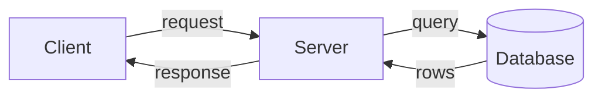

# what-is-system-design | What System Design Is | 1 | 8
System design is choosing the parts of a product and how they talk to each other, so it meets its needs for load, speed, cost and reliability. The skill is not knowing a magic architecture. It is weighing trade-offs with numbers.

## The job
Any product that real people use is a set of machines doing work together. A phone app asks a server for data. The server asks a database. Something has to decide how many servers, where the data lives, what happens when one machine dies and what all of it costs. That decision-making is system design.

Three words will carry you through this whole course. A **client** is whatever asks for something: a browser, a phone app, or another program. A **server** is a program that waits for requests and answers them. A **database** is where data is kept so it survives a restart. Almost every system you will meet is these three, repeated, split up and copied. The rest of the course is about what changes when one of each stops being enough.



## Two kinds of requirements
A **functional requirement** says what the system does: users can upload a photo, follow someone, search by tag. A **non-functional requirement** says how well it must do it: the feed loads in under 300 milliseconds, the service is up 99.9 percent of the time, one month of running costs under $5,000.

Beginners spend all their time on the functional list. Experienced designers spend it on the second list, because the non-functional numbers decide the architecture. Two products with the same features can need completely different designs if one has 1,000 users and the other has 100 million.

## Performance and scalability
These two get confused. If your system is slow for a single user, you have a performance problem. If it is fast for one user but slow when many arrive together, you have a scalability problem. A service is scalable if its performance rises in proportion to the resources added. Usually that means serving more units of work, but it can also mean handling larger units of work, such as a growing dataset. Fixing one does not fix the other. A faster algorithm helps the single user. More machines help the crowd, but only if the design lets work be split up.

## Trade-offs are the core skill
Every choice buys something and costs something. A cache makes reads fast and risks showing stale data. Copying data to three machines survives a crash and triples the storage bill. There is rarely a best answer, only an answer that fits your numbers. A good design explanation sounds like "I chose X because the load is Y, and the price is Z".

## The interview and the real job
System design interviews give you 45 minutes and a vague prompt, like "design a URL shortener". The real job gives you months, real traffic data, an existing system you cannot throw away, and a team that has to run it at 3 a.m. The habits carry over: ask about requirements, estimate numbers, draw boxes, name the trade-offs. What the interview skips is the long tail of operations and migration. This course teaches the habits, and flags where real work differs.

```mermaid Requirements become numbers, numbers pick the parts, and a missed number sends you back
flowchart TD
  R[Fuzzy goal] --> N[Numbers]
  N --> P[Choose parts]
  P --> K{Numbers met?}
  K -->|yes| D[Ship it]
  K -->|no| N
  class K warn
  class D good
```

## A worked example: turning "fast and reliable" into numbers
A founder says: "The photo feed must be fast and reliable." That is not a requirement yet. Turn it into numbers (all invented).

1. Fast: 95 percent of feed loads finish in under 300 ms, measured at the server.
2. Reliable: 99.9 percent availability. A 30-day month has 30 x 24 x 60 = 43,200 minutes. Allowed downtime is 0.1 percent of that, so 43.2 minutes per month.
3. Cost: a budget of $2,000 per month.

Now ask what each number forces. 43.2 minutes a month means you cannot have one server, because a single reboot or bad deploy eats the budget. Two servers at an invented $70 each is $140, well inside the cost target, so a second server is cheap insurance. The 300 ms target means the feed cannot be assembled from scratch on every request, which points toward caching, a topic for later. Vague words became three numbers, and the numbers pushed the design.

## What goes wrong: designing for a scale you do not have
A team of four builds a startup product on a dozen microservices, a message queue and a sharded database "so it scales". It has 200 users. The symptom is that simple features take weeks, deploys break across services, and the cloud bill is high for almost no traffic. You can confirm it by reading the real numbers: requests per second, database size, and CPU use. If one small server sits at 5 percent CPU, the complexity bought nothing yet.

## When heavy architecture is the wrong tool
If your product has a few hundred users and modest data, one server and one database is a fine design. Reach for the patterns in this course when a measured number says you need them: a latency target missed, a machine near its limit, an outage that cost real money. Until then, simple and boring wins, and it is easier to change later.

## Common mistake
Starting with technology names ("we will use Kafka and Cassandra") before writing down the requirements and the numbers.

```resources
repo | The System Design Primer: Performance vs scalability | https://github.com/donnemartin/system-design-primer#performance-vs-scalability | Donne Martin | The short statement of the difference between a performance problem and a scalability problem that this lesson adapts.
article | A Word on Scalability | https://www.allthingsdistributed.com/2006/03/a_word_on_scalability.html | Werner Vogels | Defines a scalable service as one whose performance rises in proportion to resources added, and argues "it doesn't scale" is often a sign of an architecture limiting growth.
docs | Google SRE Book: Service Level Objectives | https://sre.google/sre-book/service-level-objectives/ | Google | Shows how teams turn vague goals like "fast" into measurable targets (indicators and objectives).
```

```quiz
A founder says "the app must be reliable". What is the best next step? | Pick a database and a cloud provider ; Turn it into a number like 99.9 percent uptime ; Add a second server right away | 1 | A requirement has to be measurable before it can drive a design.
Your app answers in 80 ms for one user but takes 6 seconds when 5,000 users arrive. What do you have? | A scalability problem under heavy load ; A pure performance problem for one user ; A functional requirement that is missing | 0 | It is fast alone but slow under load, which is the Primer's definition of a scalability problem.
A 30-day month allows 99.9 percent availability. How much downtime is that? | About 4.3 minutes per month ; About 7 hours per month ; About 43 minutes per month | 2 | 43,200 minutes times 0.001 is 43.2 minutes.
```

```story
A two-person startup spends three months building a queue-based, multi-service backend for an app that launches with 150 users. The first real problem is not scale at all, it is that nobody can add a feature without touching five repos. A single server and one database would have shipped in three weeks and handled the first year of growth.
```

```adapted
The System Design Primer | https://github.com/donnemartin/system-design-primer | CC BY 4.0
```

# client-server-http | Clients, Servers and HTTP | 1 | 10
A client sends a request over the network and a server sends back a response. HTTP is the shared language for that conversation, and every extra network round trip costs time you can count.

## Request and response
HTTP (Hypertext Transfer Protocol) is a request and response protocol. The client sends one request, the server sends one response. The server never speaks first. A request has a **method** (what to do), a **path** (which resource), headers and sometimes a body. A response has a **status code**, headers and usually a body.

The common methods are these.

| Method | Meaning | Idempotent | Safe (read only) | Cacheable |
| --- | --- | --- | --- | --- |
| GET | Read a resource | Yes | Yes | Yes |
| POST | Create a resource or trigger processing | No | No | Only if the response says how fresh it is |
| PUT | Create or replace a resource | Yes | No | No |
| PATCH | Change part of a resource | No | No | Only if the response says how fresh it is |
| DELETE | Remove a resource | Yes | No | No |

Idempotent means doing it twice leaves the same result as doing it once. This matters a lot when a network fails and the client does not know whether its request arrived. The [API design lesson](/sd/docs/foundations/api-design) returns to it.

Status codes are grouped by their first digit. 2xx means success (200 OK, 201 Created). 3xx means look elsewhere (301 moved permanently, 304 not modified). 4xx means the client made a mistake (400 bad request, 401 not logged in, 404 not found, 429 too many requests). 5xx means the server failed (500 internal error, 503 unavailable). Sending the right class matters, because clients and retry logic key off it.

**Headers** are small key and value lines that carry extra information: the content type, a login token, how long a response may be cached, and so on.

## What carries HTTP
HTTP does not move bits itself. It rides on a lower layer. **TCP** (Transmission Control Protocol) opens a connection with a handshake, numbers every packet, adds a checksum to catch corruption, and waits for acknowledgements. Lost packets are resent, and after repeated timeouts the connection is dropped. It also slows the sender when the receiver or network is overloaded (flow and congestion control). That reliability costs time and memory. A busy server holding many open connections uses a lot of memory, and a connection pool to a database or cache helps. **UDP** (User Datagram Protocol) sends packets with no handshake, no ordering and no resend. It is faster and loses data silently. Web pages, databases, email, FTP and SSH use TCP. Live video, voice calls and games often use UDP, where a late packet is worthless and a lost one is tolerable.

**TLS** (Transport Layer Security) is what turns HTTP into HTTPS. After the TCP connection opens, client and server run a handshake to agree on keys, then encrypt everything. This stops others on the network from reading or changing traffic, and it proves the server is who it claims to be through a certificate.

## Connections cost round trips
A **round trip** is one message out and one reply back, and its length is the **round-trip time**, RTT. Opening a TCP connection takes one RTT. A TLS 1.3 handshake takes one more. A TLS 1.2 handshake takes two. Only then can the request go out.

Because setup is expensive, **keep-alive** lets the client reuse one connection for many requests. HTTP/1.1 made that the default, but one connection could handle only one request at a time. HTTP/2 allows many requests at once over a single connection, called multiplexing. HTTP/3 does the same over QUIC, a transport built on UDP, which avoids one slow lost packet stalling every request, and merges connection and encryption setup.

```mermaid A new HTTPS connection spends two round trips before the request even leaves
sequenceDiagram
  participant B as Browser
  participant S as Server
  B->>S: TCP SYN
  S-->>B: SYN ACK
  Note over B,S: 1 RTT for TCP
  B->>S: TLS hello
  S-->>B: TLS hello and keys
  Note over B,S: 1 RTT for TLS 1.3
  B->>S: GET /index.html
  S-->>B: 200 OK
  Note over B,S: 1 RTT for the request
```

## A worked example: counting round trips for a page load
Say the server is far away and one RTT is 50 ms (invented). A page needs one HTML file and six more files (CSS, scripts, images). We ignore server think time and DNS to keep the arithmetic clear.

HTML first:
1. TCP handshake: 1 RTT.
2. TLS 1.3 handshake: 1 RTT.
3. Request the HTML and get it back: 1 RTT.

That is 3 RTT, so 150 ms before the browser even sees the six other files.

HTTP/1.1 then opens up to six connections in parallel, one per file. Each new connection needs TCP, TLS and the request, so 3 more RTT, which is 150 ms. Total is 300 ms.

HTTP/2 reuses the existing connection and sends all six requests together. That takes 1 RTT, so 50 ms. Total is 200 ms. A third of the time disappeared with no faster hardware. The lesson is that distance times round trips is often the real cost of a page, and the way to win is fewer round trips or shorter distance (a [CDN](/sd/docs/scaling/cdn-and-edge) shortens it).

## What goes wrong: a new connection on every request
A service calls an internal API with a client library that opens a fresh HTTPS connection for each call. In testing it is fine. In production the average latency is double what the API itself reports, and CPU on both sides climbs. The cause is the repeated TCP and TLS handshakes. Confirm it by capturing connection counts: if new connections per second roughly equal requests per second, nothing is being reused. The fix is a connection pool with keep-alive.

```mermaid Opening a fresh connection for every call repeats the handshake, a reused one pays it once
sequenceDiagram
  participant C as Client
  participant A as API
  Note over C,A: Without reuse, every call pays a handshake
  C->>A: handshake, then call 1
  A-->>C: response 1
  C->>A: handshake again, then call 2
  A-->>C: response 2
  Note over C,A: With keep-alive, one handshake serves many calls
  C->>A: handshake, then call 3
  A-->>C: response 3
  C->>A: call 4 on the open connection
  A-->>C: response 4
```

## When plain request and response is the wrong tool
HTTP request and response is poor when the server needs to push data the moment it happens, like chat messages or live prices. Polling every second wastes requests. WebSockets or server-sent events keep one connection open for pushes. HTTP is also heavy for tiny, very frequent messages between machines, where a binary protocol over a long-lived connection is cheaper.

## Common mistake
Assuming a slow page is a slow server, when most of the time went to round trips before the server received the request.

```resources
repo | The System Design Primer: Communication | https://github.com/donnemartin/system-design-primer#communication | Donne Martin | Covers HTTP verbs, TCP and the trade-off against UDP, and is the base of this lesson.
docs | An overview of HTTP | https://developer.mozilla.org/en-US/docs/Web/HTTP/Overview | MDN | Describes HTTP as a client-server protocol where the client starts every request, and explains that HTTP is stateless but not sessionless.
docs | HTTP response status codes | https://developer.mozilla.org/en-US/docs/Web/HTTP/Status | MDN | Lists every status code grouped into informational, success, redirection, client error and server error classes.
docs | RFC 9114: HTTP/3 | https://www.rfc-editor.org/rfc/rfc9114 | IETF | The standard that maps HTTP onto QUIC, whose abstract names stream multiplexing, per-stream flow control and low-latency connection establishment.
article | HTTP/1 to HTTP/2 to HTTP/3 | https://bytebytego.com/guides/http1-http2-http3/ | ByteByteGo | A short guide noting HTTP/2 added multiplexing and header compression but still used TCP, while HTTP/3 moves to QUIC on UDP.
```

```quiz
Which status code class means the client made a mistake? | 4xx ; 5xx server errors ; 3xx redirects | 0 | 4xx codes such as 400, 404 and 429 report client errors.
RTT is 40 ms. A TLS 1.3 HTTPS request on a new connection needs TCP, TLS and one request. How long until the response arrives, ignoring server time? | 40 ms ; 80 ms ; 120 ms | 2 | That is three round trips, 3 x 40 = 120 ms.
Why do voice calls often use UDP instead of TCP? | A late packet is useless, so resending it wastes time ; UDP encrypts the audio and TCP does not ; UDP guarantees every packet arrives in order | 0 | TCP resends and orders packets, which adds delay that real-time audio cannot use.
```

```story
An engineer sees an API that answers in 20 ms on the server but takes 180 ms for users on another continent. Nothing is wrong with the code. Three round trips of 55 ms each are spent on handshakes before the first byte of the request is sent.
```

```adapted
The System Design Primer | https://github.com/donnemartin/system-design-primer | CC BY 4.0
```

# dns-and-the-request-path | DNS and the Life of a Request | 1 | 10
DNS turns a name like www.example.com into an IP address, using a chain of servers and lots of caching. It is the first step of nearly every request, and then the request travels through several more stops before an answer comes back.

## What DNS does
Computers reach each other by IP address, such as 93.184.216.34 (IPv4) or a longer IPv6 address. People remember names. The Domain Name System (DNS) is a worldwide, hierarchical phonebook that maps names to addresses. No single server holds it all. The work is split up by the structure of the name, read right to left: the root, then `com`, then `example`, then `www`.

## Resolving a name step by step
Your device does not ask the whole internet. It asks a **resolver**, a helper run by your internet provider or a public service. The resolver does the hunting.

1. The browser checks its own cache, then the operating system checks its cache. A hit ends the search.
2. The device asks its configured resolver. If the resolver has the answer cached, it replies at once.
3. Otherwise the resolver asks a **root server**. The root does not know the address, but it knows who runs `.com` and points to those servers.
4. The resolver asks a **TLD server** (top-level domain, here `.com`). It replies with the name servers that are in charge of `example.com`.
5. The resolver asks that **authoritative server**, the one that holds the real records for the domain. It returns the IP address.
6. The resolver gives the answer to your device and caches it, for as long as the record allows.

```mermaid The resolver does the hunting: root points to TLD, TLD points to the authoritative server
sequenceDiagram
  participant D as Device
  participant R as Resolver
  participant Root as Root server
  participant T as TLD server
  participant A as Authoritative
  D->>R: www.example.com?
  R->>Root: www.example.com?
  Root-->>R: ask the .com servers
  R->>T: www.example.com?
  T-->>R: ask example.com name servers
  R->>A: www.example.com?
  A-->>R: 93.184.216.34, TTL 3600
  R-->>D: 93.184.216.34
```

## Records and TTL
The authoritative server stores **records**. The common ones:

| Record | What it holds |
| --- | --- |
| A | A name pointing to an IPv4 address |
| AAAA | A name pointing to an IPv6 address |
| CNAME | A name that is an alias for another name |
| NS | Which servers are in charge of a domain |
| MX | Which servers accept email for the domain |

Every record carries a **TTL** (time to live), a number of seconds that caches may keep it. A long TTL means fewer lookups and faster pages, but changes spread slowly. A short TTL spreads changes fast but sends more traffic to the authoritative servers.

Some managed DNS services answer differently depending on who asks. Weighted routing returns one address 90 percent of the time and another 10 percent. Latency-based routing returns the data center closest to the resolver. Geolocation routing picks by country. This is a coarse load balancer, and it is where [load balancing](/sd/docs/scaling/load-balancing) starts.

## The whole path of a URL
Typing `https://www.example.com/photos` sets off a long chain.

1. DNS resolves the name to an IP address.
2. The browser opens a TCP connection, then a TLS handshake (see [HTTP](/sd/docs/foundations/client-server-http)).
3. The request goes to the edge: often a CDN or a load balancer that picks one server.
4. A web server or gateway receives it, and passes it to application code.
5. The application may ask a cache, then a database, and builds a response.
6. The response travels back, and the browser renders it, which can trigger more requests for images and scripts.

Each stop is a place where time is spent and where something can fail. Later chapters take them in turn, and the [scale to millions](/sd/docs/practice/scale-to-millions) practice design walks the whole path as a system grows.

```mermaid One URL passes through six stops, and each one adds time and a way to fail
flowchart TD
  U[URL typed] --> DNS[DNS lookup]
  DNS --> T[TCP and TLS]
  T --> E[CDN or load balancer]
  E --> W[Web server]
  W --> A[App code]
  A --> DB[(Cache and database)]
```

## A worked example: a DNS change that takes an hour
You move a site to a new server, and its IP changes. The A record has a TTL of 3,600 seconds (one hour, invented). At 12:00 you update the record. A resolver that cached the old answer at 11:59 will keep returning the old IP until 12:59. Users behind that resolver reach the old server for almost an hour, while users behind a fresh resolver reach the new one. Their browsers and operating systems may add their own caching on top.

The fix is planning. A day before the move, lower the TTL to 60 seconds. After the old TTL has expired everywhere (one hour), every cache now holds the short TTL. Move the site, and the change reaches nearly everyone within a minute. Afterwards, raise the TTL again to cut lookup load.

## What goes wrong: DNS as a single point of failure
A site uses one DNS provider. That provider has an outage, or is attacked with a flood of traffic. The site's servers are healthy, yet users get "server not found" errors, because nobody can learn its address. The primer notes that a DDoS attack on a DNS provider once kept users away from major sites. Symptoms: failures from many networks at once, while connecting directly to the IP address still works. Confirm it with a lookup against the authoritative servers. Mitigation is a second DNS provider and sensible TTLs, so cached answers survive a short outage.

## When DNS routing is the wrong tool
DNS routing cannot react quickly. Caches ignore your wishes until the TTL runs out, and the split is per resolver, not per user: a whole company behind one resolver goes to the same side of a 90/10 split. If you need to remove a failed server within seconds, or spread requests evenly, use a load balancer in front of the servers, and keep DNS for choosing a region or a front door.

## Common mistake
Changing a DNS record and testing it from your own laptop, which still has the old answer cached.

```resources
repo | The System Design Primer: Domain name system | https://github.com/donnemartin/system-design-primer#domain-name-system | Donne Martin | Concise description of the hierarchy, record types and routing policies, which this lesson adapts.
docs | RFC 1035: Domain names, implementation and specification | https://www.rfc-editor.org/rfc/rfc1035 | IETF | The original DNS specification, which describes resolvers hiding the distribution of data among name servers from the user.
article | How Does the Domain Name System (DNS) Lookup Work? | https://bytebytego.com/guides/how-does-the-domain-name-system-dns-lookup-work/ | ByteByteGo | Describes the root, TLD and authoritative levels and the caching layers, to compare with the steps above.
article | What Happens When You Type a URL Into Your Browser? | https://bytebytego.com/guides/what-happens-when-you-type-a-url-into-your-browser/ | ByteByteGo | Walks the same path from URL to page, including the DNS cache layers and the TCP connection, for comparison with the chain here.
```

```quiz
In a DNS lookup, who finally returns the IP address of example.com? | The root server ; The authoritative server ; The TLD server | 1 | The root and TLD servers only point onward, the authoritative server holds the records.
A record has TTL 600. You change it at 10:00. Latest time an old cached answer can still be served? | 10:10 ; 10:06 ; 11:00 | 0 | A cache can hold the old answer for 600 seconds, which is 10 minutes.
Which record type points a name at another name? | A ; MX mail record ; CNAME | 2 | A CNAME is an alias that points to a different name.
```

```story
A team moves its website to a new data center on a Saturday, and updates the DNS record at noon. Half the customers reach the new site, half still hit the old one, and support gets confusing tickets for an hour. Had they lowered the TTL a day earlier, the cutover would have been over in a minute.
```

```adapted
The System Design Primer | https://github.com/donnemartin/system-design-primer | CC BY 4.0
```

# api-design | Designing APIs: REST, RPC and GraphQL | 2 | 12
An API is the contract that lets a client and a server talk. REST, RPC and GraphQL are three common styles, each good at something, and details like pagination and idempotency keys decide whether the API behaves well when things go wrong.

## Three styles
An **API** (application programming interface) is the set of requests a server accepts and the responses it gives. The style you pick shapes how clients use it for years.

**REST** models the world as resources with names. A path like `/persons/1234/items` identifies things, and HTTP methods say what to do: GET reads, POST creates, PUT replaces, DELETE removes. The server stays stateless, so any request can go to any server, which suits caching and scaling. REST is the usual choice for public APIs. Its core qualities are using one URI per resource whatever the operation, changing resources through representations (verbs, headers, body), and using the standard status codes for errors instead of inventing new ones.

**RPC** (remote procedure call) models actions. The client calls a function on a remote machine as if it were local, such as `addItemToUsersItemsList`. Under the hood a client stub packs the procedure id and arguments into a message, the network carries it, and a server stub unpacks it and runs the matching function. Remote calls are slower and less reliable than local ones, so it helps that they look different in code. Its downsides are tight coupling between client and service, a new endpoint for every new action, and being harder to debug and cache. **gRPC** is a popular RPC system. It uses a compact binary format (Protocol Buffers) over HTTP/2, with a schema file that generates client code in many languages. It is fast and strictly typed, and is often used between internal services.

**GraphQL** gives the client one endpoint and a query language. The client lists exactly the fields it wants, even across related objects, and the server returns just those. It avoids both many round trips and large unused payloads.

| Operation | RPC style | REST style |
| --- | --- | --- |
| Read a person | GET /readPerson?personid=1234 | GET /persons/1234 |
| Add an item | POST /addItemToUsersItemsList | POST /persons/1234/items |
| Remove an item | POST /removeItem | DELETE /items/456 |

## Choosing between them
REST fits public APIs and data that is naturally a set of things. Tools, caches and browsers already understand it. RPC fits internal calls where speed and a typed contract matter, and where an action does not map to a noun. GraphQL fits clients with varied screens, such as mobile apps, where one view needs data from many places and bandwidth is tight. The cost of GraphQL is on the server: arbitrary queries can be expensive, so you need limits, and HTTP caching is harder because queries usually go to one URL as POST requests.

## Versioning
Clients you do not control will not upgrade when you do. Adding a new optional field is safe. Renaming or removing a field breaks people. Put a version in the URL (`/v2/persons`) or a header, keep the old one running for a stated period, and measure who still uses it before turning it off.

## Pagination
Never return a million rows. Return a page. **Offset pagination** says "skip 20, give me 10". It is simple, and lets users jump to page 7. **Cursor pagination** says "give me 10 items after this item". The cursor is a marker, often the last item's id or timestamp, encoded in a token.

## Idempotency keys
A POST is not safe to repeat. If a client sends "charge $50", the connection drops, and it cannot tell whether the charge happened, retrying risks charging twice. An **idempotency key** fixes this. The client generates a unique id per operation and sends it in a header. The server stores the key with the result. If the same key arrives again, the server returns the stored result instead of running the work again. Stripe documents this pattern for its payments API.

```mermaid The server remembers the key, so a retry gets the saved answer instead of a second charge
sequenceDiagram
  participant C as Client
  participant S as Server
  participant DB as Database
  C->>S: POST /charge, key K1
  S->>DB: save charge, key K1
  S-->>C: response lost in transit
  Note over C: Timeout, so retry
  C->>S: POST /charge, key K1
  S->>DB: key K1 seen before?
  DB-->>S: yes, saved result
  S-->>C: same result, no second charge
```

## A worked example: why offset breaks
A feed is sorted newest first. There are 10 posts, ids 10 down to 1, and the page size is 3 (invented).

1. The client loads page 1 with offset 0. It gets 10, 9, 8.
2. Two new posts arrive: ids 11 and 12. The list is now 12, 11, 10, 9, 8, 7, 6, and so on.
3. The client loads page 2 with offset 3. The server skips 12, 11, 10 and returns 9, 8, 7.

The user sees posts 9 and 8 twice. If posts had been deleted instead, some would be skipped and never seen. With a cursor, the client asks for "3 posts older than id 8". The answer is 7, 6, 5 no matter what was added at the top.

There is a cost problem too. With offset, the database still has to fetch and order the skipped rows before it can return the next ones, as Markus Winand explains in his keyset pagination article. So an offset of 1,000,000 means a million rows read and thrown away. A cursor condition like `WHERE id < 8` can use an index and jump straight to the spot.

```mermaid Offset paging shifts when new rows arrive, a cursor stays anchored to an item
sequenceDiagram
  participant C as Client
  participant S as Server
  C->>S: offset 0, limit 3
  S-->>C: 10, 9, 8
  Note over S: Posts 11 and 12 arrive
  C->>S: offset 3, limit 3
  S-->>C: 9, 8, 7 (repeats 9 and 8)
  C->>S: older than 8, limit 3
  S-->>C: 7, 6, 5 (cursor, no repeats)
```

## What goes wrong: a retried payment
A mobile app times out waiting for a "create order" call and retries. The first call had actually succeeded, so the customer has two orders. Symptoms are duplicate rows with identical contents and timestamps a few seconds apart, usually clustered around slow network periods. Confirm it by grouping orders by user and contents and looking for near-identical pairs. Fix it by requiring an idempotency key on POST /orders and storing it with a unique constraint.

## When each style is the wrong tool
REST is awkward for operations that are not nouns (the Primer's example is moving expired documents to an archive folder), for nested views that need several round trips, and for responses that grow bloated as fields are added. It is also awkward for queries such as "all records updated in the last hour that match these events", which do not fit a simple path. gRPC does not work directly from a browser without a proxy, so it is a poor public API. GraphQL is overkill for a small API with two clients that need the same shape. Offset pagination is wrong for feeds that change quickly or tables with millions of rows.

## Common mistake
Using offset pagination on a live feed and then chasing "duplicate item" bug reports.

```resources
repo | The System Design Primer: RPC and REST | https://github.com/donnemartin/system-design-primer#remote-procedure-call-rpc | Donne Martin | The comparison table and the trade-offs between RPC and REST, which this lesson adapts.
article | Do you really know why you prefer REST over RPC? | https://apihandyman.io/do-you-really-know-why-you-prefer-rest-over-rpc/ | Arnaud Lauret | The Primer's source for its verb table and RPC and REST request examples, comparing the two request styles point by point.
article | Designing robust and predictable APIs with idempotency | https://stripe.com/blog/idempotency | Stripe | Explains idempotency keys with the double-charge example, and recommends exponential backoff with random jitter when retrying.
docs | Introduction to gRPC | https://grpc.io/docs/what-is-grpc/introduction/ | gRPC | Describes gRPC as calling a remote method as if it were local, with protocol buffers as the interface language and message format.
article | We need tool support for keyset pagination | https://use-the-index-luke.com/no-offset | Markus Winand | Explains why offset pagination is slow (the database still fetches and orders the skipped rows) and that keyset pagination avoids drifting results.
```

```quiz
A client retries POST /charge after a timeout and the customer is billed twice. What prevents this? | Switching the request to GET ; Sending a unique idempotency key with each charge ; Making the timeout longer | 1 | The server returns the saved result when it sees the same key again.
A feed has page size 3. After page 1 shows ids 10, 9, 8, two new posts arrive. Offset 3 returns what? | 7, 6, 5 ; 8, 7, 6 ; 9, 8, 7 | 2 | The two new posts push everything down by two, so 9 and 8 repeat.
Which style suits a mobile screen that needs a few fields from many related objects in one call? | GraphQL ; gRPC ; Plain RPC | 0 | The client names exactly the fields it needs across related data.
```

```story
A food delivery app times out on a flaky train connection and the user taps "Pay" again. The server sees two separate requests and charges twice. One header with a random id, stored with the order, would have turned the second tap into a harmless repeat.
```

```adapted
The System Design Primer | https://github.com/donnemartin/system-design-primer | CC BY 4.0
```

# latency-and-throughput | Latency, Throughput and Percentiles | 2 | 10
Latency is how long one request takes, and throughput is how many requests finish per second. Averages hide the slow requests that users actually remember, so we measure with percentiles.

## Two measurements
**Latency** is the time to perform one action or produce one result, such as 120 ms to load a page. **Throughput** is how many of those finish per unit of time, such as 800 requests per second. They are related but separate. A highway with a 100 km/h limit and ten lanes has the same speed (latency) as a one-lane road, but moves far more cars per hour (throughput). Generally you want maximum throughput with acceptable latency, and pushing throughput to the limit tends to make latency climb.

## Why averages lie
Latency is not one number. It varies request to request. The **average** (mean) squashes that into one value, and a few very slow requests are hidden inside it. Users do not experience the average. They experience their own request.

So we look at **percentiles**. The p50 (median) is the value that half of requests beat. The p95 is the value that 95 percent of requests beat, so 1 in 20 is slower. The p99 means 1 in 100 is slower. The slow end is called the **tail**. The demo above lets you drag latencies around and watch the average stay calm while p99 jumps.

## Tail latency at fan-out
Modern requests often fan out: one user action calls many servers and waits for all of them. Then the slowest one decides the response time. Google's paper "The Tail at Scale" explains that short slow episodes that do not matter in a small system can dominate the performance of a large one.

Suppose each server is slow on 1 percent of its calls. A single call is slow with probability 0.01, so fast with probability 0.99. For a request that needs 100 servers, the chance that all 100 are fast is $0.99^{100} \approx 0.366$. So the chance that at least one is slow is $1 - 0.99^{100} \approx 0.634$, about 63 percent. A rare 1 percent event per server becomes the usual case for the user.

```mermaid The user waits for the slowest of the servers the request fans out to
flowchart LR
  U[User] --> F[Front end]
  F --> S1[Server 1 fast]
  F --> S2[Server 2 fast]
  F --> S3[Server 100 slow]
  S1 --> R[Response]
  S2 --> R
  S3 --> R
  class S3 bad
```

## Little's law
In any steady system, the average number of requests inside it equals the arrival rate times the average time each spends there:

$$L = \lambda W$$

Here $L$ is requests in flight, $\lambda$ is arrivals per second and $W$ is seconds per request. It tells you how many workers, threads or connections you need. [Back pressure](/sd/docs/async/back-pressure) uses the same law to size the workers that drain a queue.

## The numbers worth memorizing
These rough figures come from the Primer's appendix. That table is a community-extended version of the numbers Jeff Dean showed in talks around 2009 (the SSD rows were added later, they are not in Dean's list). Colin Scott's interactive page extrapolates Peter Norvig's 2002 numbers to any year, which shows how they drift. Treat them as orders of magnitude only, since exact values change with hardware. Two handy rates from the same list: an SSD reads sequentially at about 1 GB per second, and a 1 Gbit network at about 100 MB per second.

| Operation | About |
| --- | --- |
| Main memory reference | 100 ns |
| Read 4 KB randomly from SSD | 150 microseconds |
| Round trip within one data center | 500 microseconds |
| Read 1 MB sequentially from SSD | 1 ms |
| Disk seek (spinning disk) | 10 ms |
| Round trip between continents | 150 ms |

Memory is thousands of times faster than a network hop, and a network hop to another continent is hundreds of times slower than one inside a data center.

## A worked example: one slow request in a hundred
You measure 100 requests (invented). 98 take 50 ms and 2 take 3,000 ms.

1. Mean: (98 x 50 + 2 x 3000) / 100 = (4,900 + 6,000) / 100 = 109 ms.
2. p50: sort the values. The 50th is 50 ms.
3. p95: the 95th is still 50 ms.
4. p99: the 99th and 100th are 3,000 ms, so p99 is 3,000 ms.

A dashboard showing "average 109 ms" looks healthy. Yet 2 percent of users waited three seconds. Then do the Little's law check. Traffic is 200 requests per second, and the typical request takes 0.25 seconds, so $L = 200 \times 0.25 = 50$ requests in flight on average. A server with only 40 worker slots would queue, and queueing makes latency climb for everyone.

```mermaid Little law with the worked numbers: 200 arrivals per second at 0.25 seconds each keep 50 requests in flight
flowchart LR
  A[200 requests per second] --> Sys[System, 0.25 s each]
  Sys --> Out[200 per second finish]
  Sys -.-> L[50 in flight]
  class L focus
```

## What goes wrong: a healthy average with angry users
A team alerts on average latency under 200 ms. The graph is flat and green. Support still hears "the app hangs sometimes". The cause is a slow dependency that hits 3 percent of calls. The symptom is that complaints arrive while the dashboard stays green, and heavy users complain most, since they make more calls and meet the tail more often. To confirm, plot p95 and p99 per endpoint and compare slow requests' traces against fast ones. The fix starts with alerting on percentiles, as the Google SRE book recommends, and then fixing or isolating the slow path.

## When averages and single numbers are the wrong tool
Averages are fine for throughput over a long window, or for cost (total seconds of compute). They are wrong for anything a user waits on. Percentiles are also not additive: you cannot add the p99 of two services to get the p99 of the chain. Measure the whole request end to end. With very few requests, a p99 is just the maximum, so do not trust it until you have hundreds or thousands of samples.

## Common mistake
Reporting only the average latency, and calling a service fast when 1 in 50 requests takes three seconds.

```resources
repo | The System Design Primer: Latency vs throughput | https://github.com/donnemartin/system-design-primer#latency-vs-throughput | Donne Martin | The short definitions and the appendix table of numbers this lesson adapts.
paper | The Tail at Scale | https://research.google/pubs/the-tail-at-scale/ | Jeffrey Dean and Luiz Andre Barroso | The abstract says temporary slow episodes that do not matter in a moderate system can dominate performance at large scale.
docs | Google SRE Book: Service Level Objectives | https://sre.google/sre-book/service-level-objectives/ | Google | Says most metrics are better thought of as distributions, and that a simple average can obscure tail latencies.
tool | Numbers Every Programmer Should Know By Year | https://colin-scott.github.io/personal_website/research/interactive_latency.html | Colin Scott | An interactive page that extrapolates Peter Norvig's 2002 latency numbers to any year.
```

```quiz
99 requests take 10 ms and 1 takes 1,000 ms. What is the mean? | About 10 ms ; About 20 ms ; About 100 ms | 1 | (99 x 10 + 1000) / 100 = 19.9 ms, so the mean is near 20 ms while p99 is still 1,000 ms.
Each of 20 servers is slow 5 percent of the time. A request needs all of them. Roughly what share of requests is slow? | About 64 percent ; About 5 percent ; About 20 percent | 0 | 1 minus 0.95 to the power 20 is about 0.64.
A service gets 300 requests per second and each takes 0.2 seconds. How many are in flight on average? | 15 ; 1,500 ; 60 | 2 | Little's law gives 300 x 0.2 = 60.
```

```story
A search page calls 80 back-end shards for every query and shows results when all have replied. Each shard is fast 99.5 percent of the time, which sounds great. About one query in three still hits a slow shard, and users say the site is flaky while every dashboard shows a healthy average.
```

```adapted
The System Design Primer | https://github.com/donnemartin/system-design-primer | CC BY 4.0
```

# back-of-envelope | Back-of-the-Envelope Estimates | 2 | 12
A back-of-the-envelope estimate is a quick calculation with rounded numbers that tells you the size of the problem before you design anything. It decides whether you need one server or a hundred.

## Why estimate
You cannot choose between designs without a sense of scale. Is the database 10 GB or 10 TB? Is the traffic 50 requests per second or 50,000? Those answers lead to very different systems. An estimate does not need to be exact. Being right within a factor of two or three is enough, and being wildly wrong is easy to catch. Round hard, write down every assumption, and say they are guesses.

## Tools of the trade
**Powers of two** help with data sizes. A kilobyte is about a thousand bytes, a megabyte a million, a gigabyte a billion, a terabyte a trillion and a petabyte a quadrillion. Exactly, $2^{10} = 1{,}024$, $2^{20}$ is about a million, $2^{30}$ about a billion and $2^{40}$ about a trillion.

**Seconds in a day** is 24 x 60 x 60 = 86,400. Round it to 100,000, a little high. Dividing by it is easy: 10 million events per day is about 100 per second.

**QPS** (queries per second) is requests divided by seconds. The average hides busy times, so multiply by a **peak factor**, often 2 to 5, depending on how spiky traffic is. Servers must be sized for the peak.

**Storage** is items per day x size per item x 365 x number of copies. **Bandwidth** is requests per second x bytes per request.

## The method
1. Write down users and behavior as assumptions: daily active users, actions per user per day.
2. Convert to per-second rates and multiply by a peak factor.
3. Estimate the size of each item, and compute storage per day and per year.
4. Compute bandwidth in and out.
5. Divide by what one machine can do to get a rough machine count.
6. Sanity-check it. Does the answer feel plausible compared with something real?

```mermaid The estimate is a chain of small multiplications, and the end of the chain names the design
flowchart TD
  U[5 million daily users] --> V[200 million views a day]
  V --> Q[2,000 per second]
  Q --> P[6,000 per second at peak]
  P --> M[About 13 servers]
  U --> St[About 6 TB a day]
  St --> O[Object storage and a CDN]
```

## A worked example: an invented photo app
Assumptions, all invented: 5 million daily active users. Each user views 40 photos a day and uploads a photo on one day in two (0.5 per day). An uploaded photo is 2 MB, and we also store thumbnails of 0.3 MB in total.

Traffic:
1. Uploads per day: 5,000,000 x 0.5 = 2.5 million.
2. Upload rate: 2,500,000 / 100,000 = 25 per second on average. With a peak factor of 3, that is 75 per second.
3. Views per day: 5,000,000 x 40 = 200 million.
4. View rate: 200,000,000 / 100,000 = 2,000 per second, so 6,000 at peak.
5. Reads outnumber writes about 80 to 1, so reading must be the optimized path.

Storage:
1. Per photo: 2 + 0.3 = 2.3 MB.
2. Per day: 2,500,000 x 2.3 MB = 5,750,000 MB, about 6 TB.
3. Per year: 6 TB x 365 is about 2,200 TB, so about 2.2 PB.
4. With three copies for safety: about 6.6 PB per year.

Bandwidth:
1. Upload at peak: 75 x 2 MB = 150 MB per second, roughly 1.2 Gbit/s.
2. Downloads, at an average 200 KB per view: 2,000 x 0.2 MB = 400 MB per second on average, or about 3.2 Gbit/s. At peak, three times that, about 9.6 Gbit/s.

Machines: if one app server handles 500 requests per second, peak reads of 6,000 plus 75 uploads need about 13 servers. Add headroom and redundancy and say 20.

What the numbers tell us: the data is huge, so photos belong in object storage, not the main database. Outbound bandwidth is the pressure point, so a [CDN](/sd/docs/scaling/cdn-and-edge) is not optional. The write rate of 75 per second is small, so writes do not need exotic scaling. The estimate chose the architecture. The [sales rank](/sd/docs/practice/sales-rank) and [query cache](/sd/docs/practice/query-cache) practice designs use the same arithmetic.

## What goes wrong: forgetting the peak
A team sizes servers from average traffic, 2,000 requests per second, with a little headroom. The product gets featured and traffic at 7 p.m. is six times the daily average. Servers saturate, latency climbs, and the load balancer starts returning errors. The symptom is health on dashboards that average over a day, with failures at specific hours. Confirm it by plotting requests per second per minute, not per day, and comparing the busiest minute to the mean.

```mermaid Sizing for the daily average leaves no room for the evening peak
flowchart TD
  T[7 pm traffic, 6 times average] --> S[Servers sized for average]
  S --> Q[Queues grow]
  Q --> E[Load balancer returns errors]
  class S bad
  class E bad
```

## When estimating is the wrong tool
An estimate cannot replace measurement once a system exists. If you have real traffic logs, use them. Estimates are also bad at modeling one-off effects like a viral post or a sale, which need a separate plan. And do not polish the arithmetic: if a decision does not change between 10 and 30 servers, stop calculating and move on.

## Common mistake
Spending the time on exact arithmetic and skipping the assumptions, so nobody can see which guess drives the result.

```resources
repo | The System Design Primer: Back-of-the-envelope calculations | https://github.com/donnemartin/system-design-primer#back-of-the-envelope-calculations | Donne Martin | Points to the powers of two and latency tables in its appendix, which this lesson uses.
article | Google Pro Tip: Use Back-of-the-envelope-calculations to Choose the Best Design | https://highscalability.com/blog/2011/1/26/google-pro-tip-use-back-of-the-envelope-calculations-to-choo.html | High Scalability | Summarizes Jeff Dean's advice to compare designs with rough estimates, with a worked thumbnail-page example.
tool | Numbers Every Programmer Should Know By Year | https://colin-scott.github.io/personal_website/research/interactive_latency.html | Colin Scott | Shows how the standard latency numbers shift by year, a reminder to trust orders of magnitude only.
```

```quiz
10 million events happen per day. About how many per second on average? | About 1,000 ; About 100 ; About 10 | 1 | 10,000,000 divided by roughly 100,000 seconds is about 100.
Which approximation matches 2 to the power 30? | One million ; One trillion ; One billion | 2 | 2 to the 30 is 1,073,741,824, about a billion.
A feature gets 1 million writes of 5 KB per day, with 3 copies kept. About how much storage per year? | About 0.5 TB ; About 5 TB ; About 50 TB | 1 | 1,000,000 x 5 KB is 5 GB a day, x 365 is about 1.8 TB, x 3 copies is about 5.5 TB.
```

```story
A founder is told "we will need a big cluster for photos". A ten-minute estimate shows 75 uploads per second, which one modest server handles easily, but 3 Gbit/s of downloads, which one server cannot send. The money goes to a CDN instead of a bigger database, and the launch survives.
```

```adapted
The System Design Primer | https://github.com/donnemartin/system-design-primer | CC BY 4.0
```
