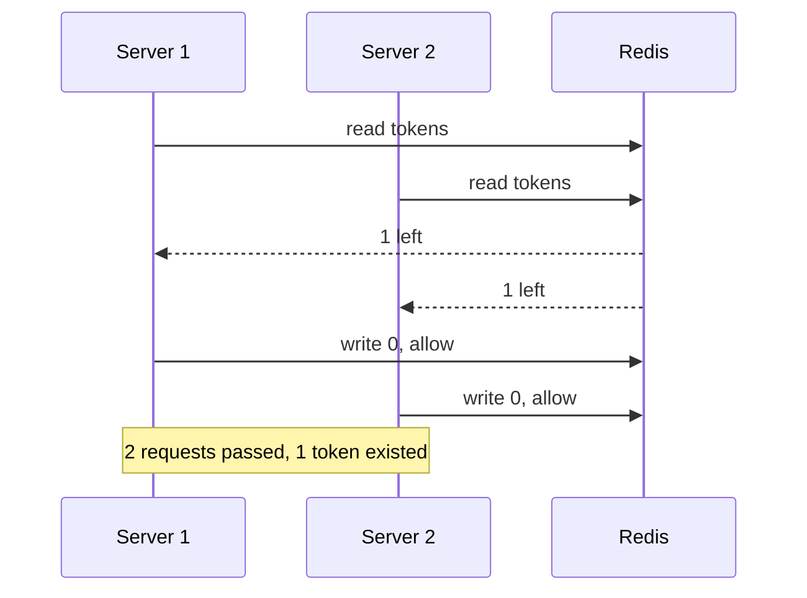
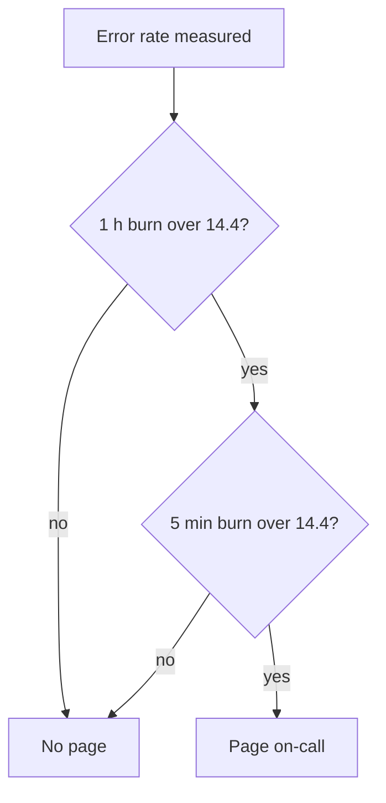

# availability-and-redundancy | Availability, Nines and Failover | 1 | 12
Availability is the share of time a service works, and it is counted in nines. You get more of it by removing single points of failure and by running spare copies that can take over.

## Availability in numbers
Availability is uptime as a percentage of total time. People count it in nines: a service with 99.99 percent availability has four nines.

$$ \text{availability} = \frac{\text{uptime}}{\text{uptime} + \text{downtime}} $$

Each extra nine cuts the allowed downtime by ten. This table shows what you may lose per year and per 30-day month.

| Availability | Downtime per year | Downtime per 30-day month |
| --- | --- | --- |
| 99 percent (two nines) | about 3.65 days | about 7.2 hours |
| 99.9 percent (three nines) | about 8 h 46 min | about 43 min |
| 99.99 percent (four nines) | about 52.6 min | about 4.3 min |
| 99.999 percent (five nines) | about 5.3 min | about 26 s |

Three nines allow about 1 minute 26 seconds of downtime per day. Four nines allow about 8.6 seconds. Google's SRE book makes a useful point here: past a certain level users cannot tell the difference, because their phone or network fails more often than your service does. Extra nines cost a lot, so choose the number your users need.

## Components in sequence and in parallel
A request usually passes through several parts, such as a load balancer, an app server and a database. If every part must work, the parts are in sequence, and the chances multiply.

$$ A_{\text{total}} = A_1 \times A_2 \times \dots \times A_n $$

Two parts at 99.9 percent each give $0.999 \times 0.999 = 0.998$, so 99.8 percent. A chain is always weaker than its weakest link.

```mermaid In sequence every part must work, so the total is the product of all three
flowchart LR
  A[Load balancer 99.99] --> B[App server 99.9]
  B --> C[(Database 99.9)]
  class B warn
  class C warn
```

If a request succeeds when any one of several copies works, the copies are in parallel. Now the chance that all of them fail is what counts.

$$ A_{\text{total}} = 1 - (1 - A_1)(1 - A_2) \dots (1 - A_n) $$

Two copies at 99.9 percent give $1 - 0.001 \times 0.001 = 0.999999$, which is 99.9999 percent. Redundancy is how you buy nines.

```mermaid In parallel the request fails only when both copies fail at once
flowchart TD
  LB[Load balancer] --> A1[App server 1]
  LB --> A2[App server 2]
  A1 --> DB[(Primary database)]
  A2 --> DB
  DB -.->|replicates| R[(Replica)]
  class LB bad
  class DB bad
```

Even here the load balancer and the primary database are each still one copy, which the red boxes mark.

## Failover patterns
A single point of failure (SPOF) is any part whose loss takes the whole service down. You find them by asking of each box in the diagram: what happens if this dies? The cure is a spare copy and a rule for switching to it, called fail-over. Two patterns are common.

With active-passive fail-over, only the active server handles traffic. The two servers exchange heartbeats, which are small "I am alive" messages. If the heartbeats stop, the passive server takes over the active one's IP address and carries on. Downtime depends on whether the spare is already running (hot standby) or has to boot first (cold standby). You may also see this called master-slave fail-over.

With active-active, both servers take traffic and share the load. If the servers are public, DNS must list both public IPs. If they are internal, the calling code must know about both. You may also see it called master-master. Fail-over adds hardware and complexity, and if the active system dies before its newest writes reach the passive one, those writes are lost. The data side of this is covered in [replication](/sd/docs/data/replication). The traffic side is covered in [load balancers](/sd/docs/scaling/load-balancing), and note that a single load balancer is itself a SPOF.

## Zones and regions
A server dies, a rack loses power, a whole data centre floods. Cloud providers group data centres into availability zones (one or more data centres with separate infrastructure, within one area) and regions (separate areas). Spreading copies across zones survives a building failure. Spreading across regions survives a regional outage, but costs more and makes data replication slower.

## A worked example: three nines or four
Invented numbers. A shop has one load balancer (99.99 percent), one app server (99.9 percent) and one database (99.9 percent), all in sequence.

1. Multiply: $0.9999 \times 0.999 \times 0.999 = 0.9979$, so 99.79 percent.
2. Downtime per year is $0.0021 \times 525{,}960$ minutes, about 1,100 minutes or 18 hours. That is not even three nines.
3. Add a second app server and a database replica. Each pair is in parallel: $1 - 0.001^2 = 0.999999$.
4. Now the chain is $0.9999 \times 0.999999 \times 0.999999 = 0.999898$, about 99.99 percent, or roughly 54 minutes a year.

The load balancer is now the weakest link, so it needs a spare next. Try these numbers in the demo above.

## What goes wrong: the standby that never worked
A team runs active-passive. The active database dies on a Friday night and the passive one takes over, but it crashes in minutes because nobody tested it under real load. Its disk is small and its config is a year old. The symptom is a failover that happens on paper and an outage in practice. You confirm it by checking the standby's history: when did it last serve real traffic? Fix it by running fail-over drills on purpose, or by going active-active so both sides always carry load. Also remember the parallel formula assumes independent failures. Two servers on the same power strip or sharing one bad config push fail together.

## When more redundancy is the wrong tool
Redundancy does not help against bugs that every copy shares, such as a bad deploy or a corrupt record replicated to all nodes. It also does not help a hobby project where an hour of downtime is fine. There, one box and good backups are cheaper and simpler. Spend on nines only where the cost of downtime is higher than the cost of the spare.

## Common mistake
Adding a second server and claiming the nines doubled, while the load balancer, the database or the DNS record in front of it is still a single copy.

```resources
article | System Design Primer: Availability patterns | https://github.com/donnemartin/system-design-primer#availability-patterns | Donne Martin | The fail-over, replication and nines material this lesson adapts, with tables for three and four nines.
article | Embracing Risk (Google SRE book) | https://sre.google/sre-book/embracing-risk/ | Google SRE | Explains why chasing extra reliability has a cost and why users stop noticing past a point.
article | Availability (karanpratapsingh system-design) | https://github.com/karanpratapsingh/system-design#availability | Karan Pratap Singh | A longer nines table, shown for comparison.
```

```quiz
A request passes through two services in sequence, each 99.9 percent available. What is the total? | About 99.8 percent ; About 99.9999 percent ; About 99.95 percent | 0 | In sequence the chances multiply: 0.999 times 0.999 is about 0.998.
Which change raises availability the most for a service with one database? | Buy a bigger single database server ; Add a replica that can take over ; Add more app servers in front of it | 1 | A second database copy in parallel removes the single point of failure, and the formula shows the gain.
Your chain is LB 99.99, app 99.9, DB 99.9. You add a second app server only. What is the new weakest link? | The app tier, still at 99.9 percent ; The load balancer at 99.99 percent ; The lone database at 99.9 percent | 2 | The app tier becomes 99.9999 percent, so the lone database at 99.9 percent is now the lowest.
```

```story
At 2 a.m. the only server in a small shop's data centre loses a disk. The owner has backups, but restoring takes six hours and the sale is on. A second, cheaper server running as a hot standby would have cut that to a minute. Availability is decided long before the outage, by what you built ahead of time.
```

```adapted
The System Design Primer | https://github.com/donnemartin/system-design-primer | CC BY 4.0
```

# timeouts-and-retries | Timeouts, Retries and Backoff | 2 | 12
Every call over a network can hang or fail, so each one needs a timeout and a careful retry plan. Done badly, retries turn a small problem into an outage.

## Why every remote call needs a timeout
A call to another service can take longer than expected, or never finish. While the caller waits, it holds a thread, a connection and memory. The AWS Builders' Library says a client should set a timeout on any remote call, covering both the time to connect and the time to get a response. Without it, a slow dependency slowly uses up every thread you have, and your service goes down with it.

Choosing the value is the hard part. AWS suggests starting from the downstream service's latency numbers. Pick a rate of false timeouts you can live with, such as 0.1 percent, and use the matching percentile, here p99.9 (the time that 99.9 percent of requests beat). See [latency and throughput](/sd/docs/foundations/latency-and-throughput) for percentiles. Too high and you waste resources while waiting. Too low and healthy calls time out, get retried, and add traffic. Pad the number when p99.9 sits close to the median, or when the client is far away across the internet.

## Retries
```card Retry
Problem | A call to another service fails for a moment because of a network blip, a restart or a short overload.
Solution | Send the same request again after a delay that grows with each try, with a cap on tries and a random jitter added to the wait.
Use when | The failure is transient, the call is idempotent and only one layer of the stack retries.
Avoid when | The error is permanent (a 400 or 404), the call has side effects without an idempotency key, or the server has signalled overload and the work is optional.
```

Many failures are partial (some requests fail) or transient (they fail for a moment). Sending the same request again often works. But the AWS article calls retries selfish: the client spends more of the server's time to raise its own chance of success. When the server is overloaded, that extra load can delay recovery long after the original fault is gone.

Retries across layers multiply. If the web tier, the API tier and the service tier each make up to 3 tries, one user click can reach the bottom with $3 \times 3 \times 3 = 27$ calls. AWS describes a five-deep stack with three tries per layer, which gives 243 times the load on the database. The usual advice is to retry at one place in the stack, and to let the other layers fail fast.

## Backoff and jitter
Backoff means waiting between tries, with the wait growing exponentially: 100 ms, 200 ms, 400 ms and so on, up to a cap. That alone is not enough. If 1,000 clients fail together, they all wait the same time and all come back together. The AWS Architecture Blog shows that jitter, a random delay, spreads those calls out. In its simulation of 100 contending clients, adding jitter cut the number of calls by more than half and finished sooner than plain backoff.

```python
import random, time

def call_with_retries(fn, tries=4, base=0.1, cap=5.0):
    for attempt in range(tries):
        try:
            return fn()
        except TransientError:
            if attempt == tries - 1:
                raise
            time.sleep(random.uniform(0, min(cap, base * 2 ** attempt)))
```

This is "full jitter": sleep a random time between zero and the capped exponential value.

```mermaid With jitter, two clients that failed together retry at different moments
sequenceDiagram
  participant A as Client A
  participant B as Client B
  participant S as Service
  A->>S: try 1 at 0 s
  B->>S: try 1 at 0 s
  S-->>A: error
  S-->>B: error
  Note over A,B: A picks 0.3 s, B picks 0.8 s
  A->>S: retry at 0.3 s
  S-->>A: ok
  B->>S: retry at 0.8 s
  S-->>B: ok
```

## Budgets and idempotency
A retry budget caps retries as a share of traffic, for example 10 percent, using a token bucket (see [rate limiting](/sd/docs/reliability/rate-limiting)). While tokens last, calls retry. When they run out, retries drop to a low fixed rate or stop. AWS says it added this kind of local limit to its SDK in 2016.

Retrying a call with side effects is only safe if it is idempotent, meaning doing it twice has the same effect as once. A timeout does not tell you whether the work happened. Payment APIs fix this with an idempotency key: the client sends a unique id, and the server returns the stored result for a repeated id. See [delivery guarantees](/sd/docs/async/delivery-guarantees).

## A worked example: 27 calls from one click
Invented numbers. A database can handle 1,000 queries per second and normally gets 400. A slow disk makes it reject half its queries.

1. Each of 3 layers tries up to 3 times, so one failing click causes up to 27 queries.
2. Under the fault, many clicks fail all the way down. If 100 clicks per second hit the failing path, the database sees up to 2,700 queries per second.
3. That is far above its 1,000 limit, so more queries fail and more retries happen.
4. With retries only in the top layer, the same 100 clicks cause at most 300 queries. The database can recover.

## What goes wrong: the retry storm
A dependency has a 30 second blip. Every client retries after exactly 1 second, then 2, then 4. The dependency recovers, but is hit by thousands of clients in the same instant, falls over again, and repeats. The symptom is request spikes at regular intervals, visible on a per-second graph. Confirm it by looking at call counts per second to the dependency, and check whether they sit at powers of two after the incident started. Fix it with jitter, one retry layer and a budget. The [Retry Storm antipattern](/sd/docs/antipatterns/retry-storm-and-no-caching) lesson shows the same collapse in code, with the measurements that expose it.

```mermaid Without jitter, every client retries at the same instant and the recovering service is hit again
sequenceDiagram
  participant A as Client A
  participant B as Client B
  participant S as Service
  A->>S: try 1 at 0 s
  B->>S: try 1 at 0 s
  S-->>A: error
  S-->>B: error
  Note over A,B: both wait exactly 1 s
  A->>S: retry at 1 s
  B->>S: retry at 1 s
  Note over S: spike hits a service that was just recovering
```

## When retries are the wrong tool
Do not retry client errors such as 400 or 404, because the same request will fail the same way. Do not retry non-idempotent calls without an idempotency key. Do not retry when the server says it is overloaded and the work is optional. For failures that last minutes, a [circuit breaker](/sd/docs/reliability/circuit-breakers) or a queue is better.

## Common mistake
Adding retries to every layer of the stack and a fixed sleep, without jitter, a cap or a budget.

```resources
article | Timeouts, retries, and backoff with jitter | https://aws.amazon.com/builders-library/timeouts-retries-and-backoff-with-jitter/ | Amazon Builders' Library | Covers timeouts picked from p99.9, retry multiplication across layers, token-bucket retry limits and idempotency.
article | Exponential Backoff And Jitter | https://aws.amazon.com/blogs/architecture/exponential-backoff-and-jitter/ | AWS Architecture Blog | Simulates full, equal and decorrelated jitter and shows jitter cuts client work sharply.
article | Retry Strategies for System Failures | https://bytebytego.com/guides/how-do-we-retry-on-failures | ByteByteGo | A short picture guide to linear and exponential backoff, with and without jitter.
```

```quiz
Three layers each try a call up to 3 times. How many calls can the bottom service see per user request? | 9 calls ; 27 calls ; 243 calls | 1 | Retries multiply across layers: 3 times 3 times 3 is 27.
Why add jitter to exponential backoff? | It makes every wait time shorter ; It lets the client skip the timeout ; It spreads retries out in time | 2 | Random delays spread the retries out so they do not arrive as one spike.
A payment call timed out. Which makes a retry safe? | An idempotency key on the request ; A longer timeout on the next try ; Retrying right away without any delay | 0 | The key lets the server spot a repeat and not charge twice.
```

```story
A checkout service has a bad minute, and every client retries on the same schedule. The database comes back up, then gets hit by ten times its normal traffic at once and dies again. The outage that should have lasted one minute lasts forty. A random delay and a retry limit are tiny changes that stop this loop.
```

# rate-limiting | Rate Limiting | 2 | 12
A rate limiter caps how many requests a client can make in a time window. It protects a service from abuse, from one noisy customer and from surprise cost.

## Why limit
Stripe's engineering post lists the cases. One user causes a traffic spike and you must stay up for everyone else. A script has a bug and floods you by accident. Someone attacks on purpose. Low-priority traffic should not crowd out critical traffic. Limits work when clients can spread their requests out, and Stripe says clients almost always can. Separately, limits cap cost, since autoscaling a service to absorb abuse turns into a bill. The [Throttling pattern](/sd/docs/cloud-architecture/bulkhead-throttling-health) applies the same idea from the server side, deciding what to slow or refuse when the service itself runs short of capacity.

## The algorithms
```card Rate Limiting
Problem | One client, a buggy script or an attacker can use so much capacity that everyone else is slowed or locked out.
Solution | Count requests per client in a time window or with a token bucket, and reject extra requests with HTTP 429 and a Retry-After header.
Use when | Clients can spread their requests out, and you need to protect shared capacity or cost.
Avoid when | The whole system is overloaded (shed load instead), traffic cannot be spread out, or the attack comes from many sources that each stay under the limit.
```

Five common designs, with different trade-offs. Names vary between sources.

| Algorithm | How it works | Strength | Weakness |
| --- | --- | --- | --- |
| Token bucket | A bucket holds up to N tokens and refills at a steady rate. Each request takes one. | Allows bursts, tiny state | Two knobs to tune |
| Leaky bucket | Requests fill a bucket that drains at a fixed rate. A full bucket rejects or delays new ones. | Smooth, steady output | Bursts wait or drop; queue memory |
| Fixed window | Count requests per clock window, such as per minute. | Simplest, cheap | Double traffic at window edges |
| Sliding window log | Store a timestamp per request and count those in the last window. | Exact | Memory grows with traffic |
| Sliding window counter | Weigh the previous window's count plus the current one. | Cheap and smooth | Approximate |

Stripe uses a token bucket for its rate limiters, backed by Redis, with one bucket per user. Each request takes a token, tokens drip back in, and an empty bucket means rejection. The demo above lets you step through one.

```mermaid A token bucket refills lazily, then takes one token per allowed request
flowchart TD
  R[Request arrives] --> T[Add tokens earned since last request]
  T --> C{Token left?}
  C -->|yes| A[Take one token and allow]
  C -->|no| X[Reject with 429]
  class A good
  class X bad
```

```python
import time

class TokenBucket:
    def __init__(self, capacity, refill_per_sec):
        self.capacity, self.rate = capacity, refill_per_sec
        self.tokens, self.last = capacity, time.monotonic()

    def allow(self):
        now = time.monotonic()
        self.tokens = min(self.capacity, self.tokens + (now - self.last) * self.rate)
        self.last = now
        if self.tokens >= 1:
            self.tokens -= 1
            return True
        return False
```

The bucket refills lazily, when a request arrives, so no timer is needed.

## Sharing the count and what to return
With many servers, each server counting alone lets a client exceed the global limit. So the counter lives in a shared store such as Redis. The trap is a race: two servers read "1 token left" at the same moment, both allow, and both write 0. Make the check and the decrement one atomic step, for example a single Redis script or an atomic increment.



Putting the limiter in the [gateway](/sd/docs/scaling/reverse-proxies-and-gateways) means the work happens once, before your code runs.

When you reject, send HTTP 429 (Too Many Requests) with a Retry-After header that says how many seconds to wait. Stripe's post also discusses 503 for load shedding. The message should say what to do next. Stripe also advises failing open: if the limiter or Redis breaks, let traffic through.

## A worked example: bucket of 5, refill 2 per second
Invented numbers. Capacity 5 tokens, refill 2 tokens per second, bucket starts full.

1. At 0 s, a burst of 6 requests arrives. The first 5 pass and the bucket is empty. The sixth gets a 429.
2. At 1 s, 2 tokens have returned. If three requests arrive then, two pass and the third gets a 429.
3. After 10 quiet seconds, the bucket refills to 5 (the cap), not 20.
4. Over any long period the client averages 2 requests per second, with bursts of up to 5.

Compare a fixed window of 100 per minute. A client sends 100 requests at 0:59 and 100 more at 1:00. Both windows allow it, yet the server saw 200 in two seconds. For a sliding window counter, Cloudflare's example with a limit of 50 per minute: 42 requests last minute, 18 so far this minute, 15 seconds in. Estimated rate is $42 \times 0.75 + 18 = 49.5$. One more request in the next second pushes the estimate to about 50 and the limiter starts rejecting.

## What goes wrong: the limiter takes the API down
A new limiter reads counters from Redis on every request. Redis slows down and each API call now waits on it, so the limiter becomes the outage. Another case: a bug sets limits too low and rejects paying customers. Symptoms are a spike in 429s or latency matching Redis latency. Stripe's advice maps to the fixes: catch errors so the limiter fails open, keep a kill switch, track how often each limiter triggers, and dark launch it first so you can see what it would block.

## When rate limiting is the wrong tool
A limiter treats each client by its own rate, so it cannot see overall health. If the whole system is overloaded, you need [load shedding](/sd/docs/reliability/circuit-breakers) that looks at server state. A limiter is also useless for traffic that cannot be spread out, such as a live flash-sale event, where you need capacity or a queue. And it is no defence against a large distributed attack, where each source stays under the limit.

## Common mistake
Limiting by IP address only, which blocks a whole office behind one shared address while a bot with thousands of addresses sails through.

```resources
article | Scaling your API with rate limiters | https://stripe.com/blog/rate-limiters | Stripe | Four limiter types, token bucket on Redis, and the rollout advice: fail open, kill switch, dark launch.
article | How we built rate limiting capable of scaling to millions of domains | https://blog.cloudflare.com/counting-things-a-lot-of-different-things/ | Cloudflare | Explains the sliding window counter with a worked estimate and an accuracy test on 400 million requests.
article | Rate Limiting (karanpratapsingh system-design) | https://github.com/karanpratapsingh/system-design#rate-limiting | Karan Pratap Singh | Compares the five algorithms and distributed problems, for a second view.
```

```quiz
A token bucket holds 5 tokens and refills 2 per second. It is full and 6 requests arrive at once. How many pass? | All six of them ; Two of them ; Five of them | 2 | The bucket holds 5 tokens, so five requests take one each and the sixth is rejected.
Which algorithm lets a client send double the limit around a window boundary? | Fixed window ; Token bucket ; Sliding window log | 0 | A fixed window resets its count at the edge, so full use at the end plus full use at the start doubles it.
Two servers read the shared counter at the same moment and both allow the last request. What fixes this? | Adding more Redis replicas ; One atomic check and update ; Sending a longer Retry-After value | 1 | An atomic operation stops two servers from both seeing the same remaining token.
```

```story
A customer's script has a bug and loops, sending 5,000 requests per second to a public API. Without a limit, it eats the capacity that every other customer shares, and the autoscaler quietly triples the cloud bill. With a limit of 100 per second the script gets a polite 429 and the bug is found in an hour.
```

# circuit-breakers | Circuit Breakers and Load Shedding | 3 | 12
When a dependency gets slow, callers pile up waiting and the failure spreads. Circuit breakers, bulkheads and load shedding stop that spread by failing fast.

## How a failure spreads
Google's SRE book defines a cascading failure as one that grows over time through positive feedback. One replica fails from overload, so the others take more load and fail too, like dominoes. Slow calls are the usual trigger. A caller waiting on a slow dependency holds a thread for the whole wait. By Little's law (threads in use equals request rate times time per request), 100 requests per second at 50 ms uses 5 threads. If the dependency hangs and calls wait 2 seconds, the same traffic needs 200 threads. The pool runs out, and the caller cannot serve even the requests that do not need that dependency.

The AWS Builders' Library adds the key idea: when latency passes the client timeout, a latency problem becomes an availability problem. It separates throughput (all requests arriving) from goodput (the part answered on time and usable). An overloaded server keeps working on requests whose clients already gave up. That wasted work, plus client retries, feeds the overload.

## The circuit breaker
```card Circuit Breaker
Problem | A dependency that is slow or down makes every caller wait, so threads pile up and the failure spreads to healthy features.
Solution | Wrap the call in a breaker that counts failures. After a threshold it opens and fails calls at once, then lets one trial call through after a wait.
Use when | A remote call can fail on its own, and you have a fallback such as a default value or a clear error.
Avoid when | The call is in-process, or it is a primary database with no fallback, where failing fast gains nothing.
```

Martin Fowler describes the pattern, popularised by Michael Nygard's book Release It. You wrap the remote call in a breaker object that watches for failures. It has three states.

1. Closed: calls pass through. Failures are counted. Normal state.
2. Open: after the failure count hits a threshold, the breaker trips. Calls fail at once, without touching the dependency. This saves the caller's threads and gives the dependency room to recover.
3. Half-open: after a wait, the breaker allows a trial call. If it works, the breaker closes. If it fails, it opens again and the wait restarts.

```mermaid The breaker moves between three states, and only a trial call can close it
stateDiagram-v2
  [*] --> Closed
  Closed --> Open: failures pass threshold
  Open --> HalfOpen: wait time over
  HalfOpen --> Closed: trial call works
  HalfOpen --> Open: trial call fails
  class Open bad
  class Closed good
```

Fowler notes that not every error should trip it, since some are normal business failures. Real breakers often trip on an error rate such as 50 percent rather than a raw count. Fowler says every change in breaker state should be logged, and a trip should raise an alert. AWS also warns that breakers add modal behaviour that is hard to test, and can slow recovery, which is why it prefers local retry limits.

## Bulkheads, shedding and degrading
A bulkhead splits resources so one failure cannot drain them all, like the sealed sections of a ship. Give each dependency its own thread pool or connection limit. If the payments pool of 20 threads is full, the other 80 threads still serve search.

```mermaid Each dependency gets its own pool, so a hung payments service cannot take the search threads
flowchart LR
  W[Web service] --> P1[Payments pool 20]
  W --> P2[Search pool 80]
  P1 --> PAY[Payments service]
  P2 --> SRCH[Search service]
  class PAY bad
  class P1 warn
```

The [Bulkhead pattern](/sd/docs/cloud-architecture/bulkhead-throttling-health) applies the same idea to tenants and whole instance groups, and that lesson also covers throttling and health probes.

Load shedding means a server rejects excess requests early and cheaply, so it can answer the rest in time. AWS says the goal is low latency for accepted requests, keeping goodput high while only the excess fails. Stripe describes shedders that reserve a share of the fleet for critical requests and drop test traffic first. It adds that shedding must start and stop gradually, or the system flaps between "fine" and "awful".

Graceful degradation does less work per request. Google's chapter gives the example of a search that looks at a cached subset of data when overloaded. Keep that code simple and test it, since a path you never use is often broken.

## A worked example: pool exhaustion
Invented numbers. A web service has 100 worker threads and receives 100 requests per second. Each calls a recommendations service.

1. Healthy: the call takes 50 ms. Threads busy are $100 \times 0.05 = 5$.
2. The recommendations service hangs. The call timeout is 2 s, so threads busy would be $100 \times 2 = 200$. Only 100 exist.
3. After about one second all threads are stuck, and the whole site returns errors, including pages that never use recommendations.
4. With a breaker (opens after 5 failures) and a bulkhead of 10 threads for that call, at most 10 threads are ever stuck. After the breaker opens, calls fail in microseconds and the page shows a default list.

## What goes wrong: the breaker that flaps
A breaker is set with a 1 second open period. The dependency needs 30 seconds to recover, so each half-open trial fails and the breaker reopens, while real users keep hitting errors. Or the threshold is so sensitive that two slow calls trip it for everyone. Symptoms are error rates that rise and fall in a regular rhythm. Confirm it by graphing breaker state changes next to dependency latency. Tune the thresholds, wait longer, or allow only a trickle of trial calls.

## When a breaker is the wrong tool
Breakers guard remote calls that can fail independently. Skip them for in-process code and for calls where failing fast has no better outcome, such as a primary database with no fallback. In those cases, rate limits, [back pressure](/sd/docs/async/back-pressure) and queues may fit better. Shedding also needs load tests: AWS says that if you have not tested far past the break point, assume it will fail in the worst way.

## Common mistake
Adding a breaker with no fallback and no alert, so the dependency is cut off silently and nobody notices for days.

```resources
article | Using load shedding to avoid overload | https://aws.amazon.com/builders-library/using-load-shedding-to-avoid-overload/ | Amazon Builders' Library | Explains goodput versus throughput, wasted work and how shedding keeps accepted requests fast.
article | Addressing Cascading Failures (Google SRE book) | https://sre.google/sre-book/addressing-cascading-failures/ | Google SRE | Describes how overload, retries and slow starts spiral and lists load shedding and degradation as defences.
article | CircuitBreaker | https://martinfowler.com/bliki/CircuitBreaker.html | Martin Fowler | A short walk through closed, open and half-open states with working code.
article | Scaling your API with rate limiters | https://stripe.com/blog/rate-limiters | Stripe | Shows fleet and worker load shedders that protect critical traffic first.
```

```quiz
A circuit breaker has tripped and its wait time is over. What does it do next? | Lets one trial call decide ; Closes at once and sends all traffic ; Stays open until someone resets it | 0 | Half-open lets a trial call through, closing on success and reopening on failure.
Why does a hung dependency exhaust a thread pool so fast? | Threads are lost whenever calls fail quickly ; Busy threads equal rate times wait ; The pool shrinks when a dependency is slow | 1 | By Little's law, 100 per second at 2 seconds needs 200 threads.
What is the point of a bulkhead? | Making every call retry much faster than before ; Encrypting calls between internal services ; Capping what one dependency can use | 2 | Separate limits per dependency confine the damage to one pool.
```

```story
An online store's recommendation box starts timing out at 2 seconds. Within a minute every page hangs, even the checkout, because all the worker threads are waiting on the box. A breaker that shows a default list instead would have kept the store selling while recommendations were fixed.
```

# observability | Logs, Metrics, Traces and SLOs | 2 | 12
Observability lets you ask why a system is misbehaving from the data it emits. Logs, metrics and traces each answer a different question, and SLOs turn that data into a goal you can alert on.

## The three signals
A log is a record of one event, such as "payment failed for order 812 with a timeout". Logs hold the detail and are usually the largest signal by volume. Write them as structured data, such as JSON, so you can search by field. A metric is a number measured over time, such as requests per second or the 99th percentile latency. Metrics are cheap to store and good for graphs and alerts, but they show that something is wrong, not which request. A trace follows one request through many services. Each step is a span with a start time, an end time and a link to its parent span.

Each answers a question. Metrics ask "is something wrong?". Traces ask "where in the path is the time going?". Logs ask "what exactly happened in this step?". You usually move from a metric alert, to a trace, to the logs of the slow span.

```mermaid An incident usually walks from the metric to the trace to the log line
flowchart TD
  M[Metric alert] --> T[Trace of a slow request]
  T --> S[Slow span]
  S --> L[Logs for that span]
```

## Golden signals
Google's SRE book gives four signals to measure for any user-facing service. Latency is how long requests take, and the book says to track failed requests separately, since a quick error looks good on an average. Traffic is demand, such as requests per second. Errors is the rate of failing requests, including wrong content and responses that break a promise like one-second replies. Saturation is how full the service is, focused on its tightest resource, and many systems slow down before they reach 100 percent.

The book also warns against watching only the average. With an average of 100 ms at 1,000 requests per second, 1 percent of requests may still take 5 seconds. Track percentiles or histograms ([latency and throughput](/sd/docs/foundations/latency-and-throughput)).

## SLIs, SLOs and error budgets
A service level indicator (SLI) is a measurement of how the service is doing, such as the share of requests that succeed in under 300 ms. A service level objective (SLO) is the target for it, such as 99.9 percent over 30 days. The gap is the error budget: the amount of failure you are allowed. While budget remains, you ship features. When it is spent, you slow down and fix reliability.

$$ \text{error budget} = (1 - \text{SLO}) \times \text{period} $$

For 99.9 percent over 30 days: $0.001 \times 43{,}200 \text{ minutes} = 43.2$ minutes, about 43.

## Alerting and tracing across services
The SRE book says to page a human only for something that matters, since noisy pages train people to ignore them. Alert on symptoms users feel, such as high error rate or slow responses, and use causes like CPU as dashboards for diagnosis.

For tracing, a request gets a trace ID at the edge. Every service passes it along in a header and puts it on each span and log line. The OpenTelemetry docs show that all spans in a trace share one trace_id, and a span with no parent is the root. Searching logs by trace ID gives the whole story of one request.

```mermaid One trace ID travels with the request, so the slow span can be found afterwards
sequenceDiagram
  participant U as User
  participant W as Web
  participant O as Orders
  participant P as Payments
  U->>W: checkout, trace abc123
  W->>O: create order, trace abc123
  O->>P: charge card, trace abc123
  P-->>O: timeout after 7 s
  O-->>W: error
  Note over W,P: every span and log line carries abc123
```

The [monitoring types and burn-rate alerts](/sd/docs/reliability/monitoring-and-alerts) lesson shows how to turn an SLO into pages that fire fast on real outages and stay quiet on blips.

## A worked example: spending the budget
Invented numbers. SLO: 99.9 percent of requests succeed over 30 days. Traffic is steady at 1,000 requests per minute, so 43.2 million requests a month.

1. Budget: 0.1 percent of 43.2 million is 43,200 failed requests.
2. A bad deploy fails 20 percent of requests for 15 minutes. That is $1{,}000 \times 0.20 \times 15 = 3{,}000$ failures.
3. That used about 7 percent of the monthly budget.
4. If instead 10 percent of requests fail steadily, that is 100 times the allowed rate of 0.1 percent. The whole month's budget (720 hours) would last about 7.2 hours. That is worth a page.

## What goes wrong: the dashboard that says all is well
The graph shows average latency of 120 ms and green status, while users complain. Behind it, 2 percent of requests take 8 seconds, from one slow database shard. The average hides them. You confirm it with a latency histogram split by shard, and by pulling a slow trace to see the wait. Fix it by alerting on p99 and on the SLO, not on the mean, and by adding the trace ID to error logs so complaints can be matched to requests.

## When heavy observability is the wrong tool
A small internal tool does not need distributed tracing and a 99.95 percent SLO. A few logs and an uptime check are enough, and every extra signal costs money and attention. Beware also of metrics with unbounded labels, such as a user ID on every series, which blow up storage. Add tracing when you have several services and cannot tell where requests slow down.

## Common mistake
Alerting on every cause, such as high CPU or one failed health check, instead of on what users feel, until the on-call person ignores pages.

```resources
article | Monitoring Distributed Systems (Google SRE book) | https://sre.google/sre-book/monitoring-distributed-systems/ | Google SRE | Defines the four golden signals, symptoms versus causes, and why to watch the tail and not the mean.
article | Embracing Risk (Google SRE book) | https://sre.google/sre-book/embracing-risk/ | Google SRE | Introduces error budgets as a way to balance reliability against shipping speed.
docs | OpenTelemetry Traces | https://opentelemetry.io/docs/concepts/signals/traces/ | OpenTelemetry | Shows spans, trace IDs and parent IDs with JSON examples.
article | Logging, Tracing and Metrics | https://bytebytego.com/guides/logging-tracing-metrics | ByteByteGo | A short picture guide to the three pillars and typical tools.
```

```quiz
A 99.9 percent monthly SLO over 30 days allows about how much downtime? | 4.3 minutes ; 43 minutes ; 7.2 hours | 1 | 0.1 percent of 43,200 minutes is 43.2 minutes.
Average latency is 100 ms but users report slowness. What should you check first? | CPU usage on one server ; Whether the logs are in JSON format ; The p99 latency histogram | 2 | One percent of requests may take seconds while the average looks fine.
Failures run at 10 percent against an SLO that allows 0.1 percent. How fast is the budget burning? | At 100 times the allowed rate ; At about 10 times the allowed rate ; At about the same as the allowed rate | 0 | 10 divided by 0.1 is 100, so a 720 hour budget lasts about 7 hours.
```

```story
Support says checkout is slow for some people, yet every graph is green. An engineer finds one failed order, copies its trace ID, and sees a single span spending seven seconds on one database shard. Without that ID tying the request together across five services, finding it would have taken days.
```

# monitoring-and-alerts | Monitoring Types, Instrumentation and Alerts | 2 | 12
Monitoring means collecting the right data for each question: is it up, is it fast, is it safe, who uses it. This lesson sorts monitoring into five types, then covers what to build into your code and how to turn the data into alerts people trust.

## Five kinds of monitoring
The [observability lesson](/sd/docs/reliability/observability) explains the raw signals. This lesson asks what you point them at. The Azure Architecture Center's monitoring guide splits the job by purpose, and each purpose needs different data and a different reaction.

| Type | Question it answers | Typical data | Typical reaction |
| --- | --- | --- | --- |
| Health Monitoring | Is it working right now? | Health endpoints, synthetic users, exceptions | Alert within seconds |
| Availability Monitoring | How much of the time was it working? | Probe results, timeouts, failed connections | Uptime statistics, failover review |
| Performance Monitoring | Is it slowing down before it breaks? | Latency percentiles, queue length, CPU, memory | Scale up, tune, throttle |
| Security Monitoring | Is someone attacking or misusing it? | Sign-in attempts, access to forbidden resources | Block, investigate |
| Usage Monitoring | How do customers use it? | Requests per feature, per user | Capacity planning, billing, quotas |

## Health Monitoring and Availability Monitoring
Health Monitoring answers "is the system running?" quickly. For how to design the probe itself, see the Health Endpoint Monitoring pattern in [Bulkhead, Throttling and Health Endpoint Monitoring](/sd/docs/cloud-architecture/bulkhead-throttling-health). The sources are health endpoints that the application exposes, and synthetic users: scripts that log in, add to cart and check out, and record each step's result. A synthetic user finds a broken checkout at 3 a.m. when no real customer is trying it.

Availability Monitoring is the same raw data viewed over time. A scheduler pings each health endpoint and records success or failure with a timestamp, and the totals become uptime statistics using the formula from the [availability lesson](/sd/docs/reliability/availability-and-redundancy). Write down what counts as downtime, for example "a minute is down if every request in it failed". A feature is only as available as its parts, so track the order database and the payment service separately and combine them.

## Performance Monitoring
Performance often degrades before a component fails, so this is where you catch trouble early. A number is only good or bad against a baseline, so record the system under typical or test load.

Watch two levels. High-level numbers describe user experience: response time per request type, concurrent users and error rate. Low-level numbers describe the machines: memory, threads, CPU, disk and network I/O, and queue length. Plot one against the other: latency that climbs with concurrent users marks a capacity limit. Summarize with percentiles such as p95 and p99 ([latency and throughput](/sd/docs/foundations/latency-and-throughput)), and reduce the detail if monitoring itself slows the system.

## Security Monitoring
Record every sign-in attempt with its result, and what each user did. Then alert on patterns: one account failing to sign in many times in a short window (possible password guessing), one account repeatedly asking for resources it may not touch, or a wave of unauthenticated requests (possibly a denial-of-service attack).

Many organizations pool security data into a security information and event management (SIEM) system. Keep an untouched, timestamped copy in a protected store for investigators, apart from debug logs. See [security basics](/sd/docs/reliability/security-basics) for what to defend.

## Usage Monitoring
Usage Monitoring tracks how customers use features. It shows which parts are hot, which nobody touches, and how much work each customer causes, which feeds capacity planning. In multi-tenant systems (many customers sharing one deployment) it supports billing and quotas and finds noisy neighbors.

## Instrumentation
Instrumentation is the code you add so the system reports on itself, so you can diagnose problems without logging in to a production server. Key habits:

1. Give every request a unique activity ID at the edge and pass it to every service, so records from different machines can be joined.
2. Write timestamps in UTC, and do not rely on them alone to order events across machines, since clocks drift ([clocks and ordering](/sd/docs/distributed/clocks-and-ordering)).
3. Use a fixed schema for log lines, readable by people and parsers.
4. Split logs by purpose, and keep data with different security needs in separate logs.
5. Sample metrics at a sensible rate: too often loads the system, too rarely misses the fault.

OpenTelemetry describes two ways. Code-based instrumentation uses its APIs and SDKs inside your code, such as timers around database calls. Zero-code instrumentation attaches to libraries and the runtime without changing the application.

## Visualization and Alerts
Dashboards layer the data: a top screen with one tile per subsystem, and drill-down screens for details. An alert is a notification that a person must act, sent to an on-call group with a severity, or a trigger for machines such as autoscaling. The observability lesson covers why to alert on symptoms and not causes. What it leaves out is how to alert on an SLO without paging for every blip.

The burn rate is the observed error rate divided by the error rate the SLO allows. A burn rate of 1 spends the budget exactly over the SLO period. Google's SRE workbook chapter on alerting on SLOs recommends several burn rates, each checked over two time windows. The long window shows that enough budget is gone to matter. The short window, about one twelfth as long, shows the problem is still happening, so the alert clears soon after a fix. Its example for a 99.9 percent SLO over 30 days:

- Page at burn rate 14.4 over 1 hour and 5 minutes. That spends 2 percent of the budget.
- Page at burn rate 6 over 6 hours and 30 minutes. That spends 5 percent.
- Open a ticket at burn rate 1 over 3 days and 6 hours. That spends 10 percent.



An alert fires only when both windows exceed the rate. Fast burns page within minutes, and slow leaks become tickets (the workbook calls this multiwindow, multi-burn-rate alerting). Each alert should say what is wrong, who is affected and where to look first.

## A worked example: alerting on burn rate
Invented numbers. The SLO is 99.9 percent of requests succeed over 30 days (720 hours), so the allowed error rate is 0.1 percent.

1. Errors rise to 5 percent. Burn rate = 5 / 0.1 = 50, so the whole budget lasts 720 / 50 = 14.4 hours.
2. One hour at burn rate 14.4 uses 14.4 / 720 = 2 percent of the budget, so 14.4 is the first page line. At 50, the 5-minute average passes it at once and the 1-hour average passes it after about 17 minutes (14.4 / 50 x 60), so the page fires then.
3. A one-minute spike to 5 percent lifts the 5-minute average but barely moves the 1-hour one, so it does not page.
4. A steady 0.15 percent error rate is a burn rate of 1.5. It never pages, but it passes the ticket line, so someone looks at it that week.

## What goes wrong: alert fatigue
A team has 60 alerts and about 40 pages a week, mostly CPU and disk warnings that fix themselves. After a month people mute the channel, and a real database failover pages at 2 a.m. and sits unread for 40 minutes. The symptom is a rising share of pages with no action taken, and incidents that customers find first. Confirm it by counting pages per week and the share that needed a human. Fix it by deleting alerts nobody acted on, moving cause-based alerts to dashboards, and paging on burn.

## When more monitoring is the wrong tool
A prototype with ten users needs an uptime check and error logs, not five monitoring types and a SIEM. Monitoring cannot replace tests, since it finds a bug after users hit it. Without a baseline or SLO, define those first. An alert with no owner and no runbook is noise.

## Common mistake
Adding an alert after each incident until the pager never stops. Every new alert should replace a worse one or be tied to what users feel.

```resources
article | Best practices for monitoring and diagnostics | https://learn.microsoft.com/en-us/azure/architecture/best-practices/monitoring | Microsoft Azure Architecture Center | Describes health, availability, performance, security and usage monitoring, instrumentation, dashboards and alerting.
article | Alerting on SLOs (Google SRE workbook) | https://sre.google/workbook/alerting-on-slos/ | Google SRE | Defines burn rate and recommends multiwindow, multi-burn-rate alerts, with the page and ticket thresholds for a 99.9 percent SLO.
docs | OpenTelemetry instrumentation | https://opentelemetry.io/docs/concepts/instrumentation/ | OpenTelemetry | Explains code-based instrumentation with APIs and SDKs, and zero-code instrumentation that needs no application changes.
```

```quiz
Which monitoring type uses scripted users that run checkout steps on a schedule? | Usage Monitoring ; Health Monitoring ; Security Monitoring | 1 | Synthetic users replay fixed steps and record each result, which shows whether the system works now.
The SLO allows 0.1 percent errors and the service now fails 5 percent of requests. What is the burn rate? | 5 ; 50 ; 500 | 1 | Burn rate is 5 divided by 0.1, which is 50, so a 720 hour budget lasts 14.4 hours.
Why does a burn-rate alert check a short window as well as a long one? | To confirm the problem is still happening so the alert clears fast ; To make the alert fire later than a single window would ; To count only errors from one region | 0 | The long window shows enough budget is gone, and the short window shows the burn has not stopped.
```

```story
A shop's CPU alert fires every night during the batch run, so the on-call phone is on silent by week three. One Saturday the payment provider starts timing out and checkout fails for 30 percent of buyers. The only alert that would have helped was one on checkout errors, and nobody wrote it.
```

```adapted
Azure Architecture Center (Microsoft) | https://learn.microsoft.com/en-us/azure/architecture/patterns/ | CC BY 4.0
```

# security-basics | Security Basics for System Design | 2 | 10
Security is a broad field, but a few habits cover most system-level risk: encrypt data, never trust input, check who is asking and what they may do, and give every part only the access it needs.

## The basics
The System Design Primer keeps its security advice short. It still holds up. Encrypt in transit, so data between client and server, and between your services, cannot be read on the wire. Encrypt at rest, so a stolen disk or backup is useless. Sanitize all input, including anything the user can influence, to prevent cross-site scripting (XSS, where an attacker's script runs in another user's browser) and SQL injection (where input is treated as database commands). Use parameterized queries, which keep the SQL text and the values separate, so an input like `' OR '1'='1` is just a string. Follow the principle of least privilege: each user, service and key gets the minimum permission that its job needs.

## Who are you and what may you do
Authentication answers "who are you?" (password, a code, a login via another provider). Authorization answers "what are you allowed to do?" Mixing them up is a classic source of bugs: a logged-in user who can fetch any order by changing the ID in a URL is authenticated but not properly authorized.

There are two common ways to keep a user logged in. With a session, the server stores login state, and the browser holds an opaque ID in a cookie. Deleting a session ends it at once. The store must be shared across servers ([stateless services](/sd/docs/scaling/stateless-services)). With a token such as a JWT (JSON Web Token), the token itself carries the user's claims and a signature. Servers need no lookup, so it scales easily. But a stolen token works until it expires. Revoking one early needs extra machinery, like a blocklist. Keep tokens short-lived, and store passwords only as slow salted hashes such as bcrypt or argon2.

```mermaid The API checks a short-lived access token without a lookup, and a refresh token gets a new one
sequenceDiagram
  participant C as Client
  participant A as Auth server
  participant P as API
  C->>A: login with password
  A-->>C: access token 15 min, refresh token
  C->>P: GET /orders with access token
  Note over P: checks signature and expiry, no lookup
  P-->>C: 200 orders
  Note over C: access token expires
  C->>A: send refresh token
  A-->>C: new access token
```

When login is delegated to another provider, or a gateway checks identity for you, see [Federated Identity, Gatekeeper, Valet Key and Quarantine](/sd/docs/cloud-architecture/security-patterns).

## Secrets and TLS
Secrets are passwords, API keys and signing keys. Keep them out of source control, and load them from a secrets manager or environment at runtime. Give each service its own key and rotate keys on a schedule, so a leak has an end date.

TLS is the protocol behind HTTPS. As the Primer's load balancer section explains, the load balancer can terminate TLS, decrypting requests and encrypting responses, so backend servers skip that work and you manage certificates in one place. The catch is that traffic inside your network is then plain. For sensitive data, re-encrypt from the load balancer to the servers, or use mutual TLS between services, where both sides prove who they are.

## OWASP Top 10 as a checklist
OWASP (the Open Worldwide Application Security Project) publishes the Top 10, a consensus list of the most critical web risks. The 2025 list is: broken access control, security misconfiguration, software supply chain failures, cryptographic failures, injection, insecure design, authentication failures, software or data integrity failures, security logging and alerting failures, and mishandling of exceptional conditions. Use it as a review checklist. For each item, ask where your system could be exposed. Note that the list changes between editions.

## A worked example: a token that cannot be revoked
Invented numbers. An app issues JWTs valid for 24 hours. An employee is dismissed at 9:00 and their account is disabled.

1. Their laptop still holds a token issued at 8:30, valid until 8:30 the next morning.
2. Every server accepts it, because checking the signature needs no database call, so the account looks disabled only to the login page.
3. Exposure window: 23.5 hours.
4. Change tokens to a 15 minute lifetime with a refresh token the server can revoke. The window is now at most 15 minutes. With server sessions it would be zero, at the cost of one lookup per request.

## What goes wrong: the key in the repository
A developer commits a cloud access key to a repository, even a private one. It later leaks through a fork or a laptop. Automated scanners find exposed keys quickly. The symptom may be an unexpected bill or data you did not delete. You confirm it by searching history with a secret scanner and checking the cloud audit log for calls from unknown addresses. The fix is to revoke and rotate the key at once, since deleting the file does not remove it from history, then move secrets to a manager.

## When these basics are the wrong tool
These habits are the floor, not the whole job. For payments, health data or regulated systems you need audits and expert review. Rolling your own login, hashing or encryption is the wrong tool: use proven libraries and standards. And a design diagram alone cannot fix security, since most breaches come from misconfiguration and access control mistakes, not clever attacks.

## Common mistake
Checking that the user is logged in but never checking that the record they requested belongs to them.

```resources
article | System Design Primer: Security | https://github.com/donnemartin/system-design-primer#security | Donne Martin | The short checklist this lesson adapts: encrypt, sanitize, parameterize, least privilege.
docs | OWASP Top 10:2025 | https://owasp.org/Top10/2025/ | OWASP | The current list of ten critical web application risks, from broken access control to mishandled exceptions.
repo | API Security Checklist | https://github.com/shieldfy/API-Security-Checklist | Shieldfy | A checkbox list covering authentication, TLS, input validation and throttling for APIs.
repo | Security guide for developers | https://github.com/FallibleInc/security-guide-for-developers | FallibleInc | A practical guide to hashing, sessions, configuration mistakes and least privilege.
```

```quiz
What does a parameterized query protect against? | Slow queries on large tables ; Data loss when a disk fails ; SQL injection | 2 | It keeps input as values, so it can never be run as SQL commands.
A user changes /orders/812 to /orders/813 and sees someone else's order. What failed? | Authorization, no ownership check ; Authentication, since the login was bad ; Encryption at rest on the database | 0 | They were logged in, but the server did not check what they may access.
A 24-hour JWT is stolen. What is the best way to shorten the risk? | Use a stronger algorithm to hash passwords ; Short tokens plus a revocable refresh ; Move the token to a much longer expiry | 1 | A short lifetime limits how long a stolen token works.
```

```story
A start-up pushes a cloud access key to a private repository by accident. A week later its cloud bill shows thousands of dollars of servers mining coins. A secrets manager and a key limited to one bucket would have turned a disaster into a rotated key and a shrug.
```

```adapted
The System Design Primer | https://github.com/donnemartin/system-design-primer | CC BY 4.0
```
